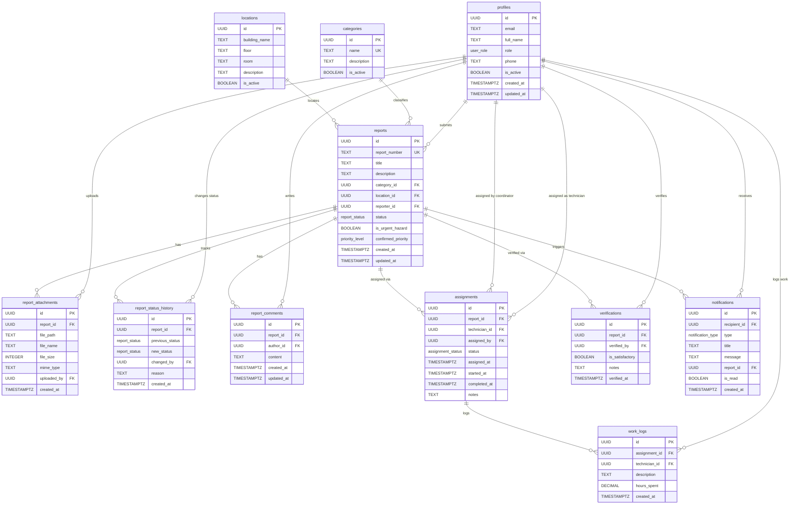

# CMIRS — Proposed Database Schema

> **Status:** This document describes the **proposed** database schema for CMIRS. No tables, enums, triggers, functions, or Row Level Security policies have been created yet. Do not execute any SQL from this document without explicit authorization. This schema will be implemented in a later phase through Supabase migrations.

## Table of Contents

- [Overview](#overview)
- [Proposed Enums](#proposed-enums)
- [Proposed Tables](#proposed-tables)
  - [profiles](#profiles)
  - [categories](#categories)
  - [locations](#locations)
  - [reports](#reports)
  - [report_attachments](#report_attachments)
  - [report_status_history](#report_status_history)
  - [report_comments](#report_comments)
  - [assignments](#assignments)
  - [work_logs](#work_logs)
  - [verifications](#verifications)
  - [notifications](#notifications)
- [Report Number Generation](#report-number-generation)
- [Proposed Triggers](#proposed-triggers)
- [Timestamp Conventions](#timestamp-conventions)
- [Database Integrity Requirements](#database-integrity-requirements)
- [Schema Relationship Diagram](#schema-relationship-diagram)
- [Pending Decisions](#pending-decisions)

## Overview

The CMIRS database is designed for **Supabase (PostgreSQL)**. The schema supports:

- Role-based user profiles linked to Supabase Auth (D1).
- A complete maintenance report lifecycle with auditable status transitions.
- Two-layer priority: reporter urgent-hazard flag and coordinator-confirmed priority (D3).
- Optional photo attachments stored in Supabase Storage (D4).
- Repair verification by a designated coordinator (D2).
- In-app notifications only for the MVP (D7).

### Design Principles

- **Referential integrity:** All relationships enforced through foreign keys.
- **Audit trail:** Status changes, assignments, and verifications are recorded in dedicated history tables, never overwritten.
- **Soft references:** Records are never hard-deleted; `is_active` flags are used where applicable.
- **Separation of concerns:** Reporter urgency flags and coordinator-confirmed priorities are stored as distinct fields.
- **PostgreSQL conventions:** `TIMESTAMPTZ` for all timestamps, `UUID` for all primary keys, `snake_case` for all identifiers.

## Proposed Enums

### `user_role`

Defines the roles available in the system. See [ROLES.md](ROLES.md) for detailed role definitions.

| Value | Description |
|---|---|
| `student_personnel` | Student / School Personnel (default role) |
| `coordinator` | Maintenance Coordinator |
| `technician` | Maintenance Technician |
| `administrator` | School Administrator |
| `management` | School Management |

### `report_status`

Defines the lifecycle states for a maintenance report. See [WORKFLOW.md](WORKFLOW.md) for transition rules.

| Value | Description | Terminal |
|---|---|---|
| `submitted` | Newly created, awaiting coordinator review | No |
| `under_review` | Coordinator is reviewing and assessing priority | No |
| `assigned` | Assigned to a technician, awaiting work | No |
| `in_progress` | Technician is actively working on the repair | No |
| `on_hold` | Work temporarily paused | No |
| `completed` | Repair finished, awaiting coordinator verification | No |
| `verified` | Coordinator verified the repair is satisfactory | **Yes** |
| `reopened` | Verification failed, returned for additional work | No |
| `cancelled` | Report cancelled | **Yes** |

### `priority_level`

The coordinator-confirmed priority classification.

| Value | Description |
|---|---|
| `low` | Minor cosmetic or non-urgent issue |
| `medium` | Functional issue affecting usability |
| `high` | Significant issue affecting safety or operations |
| `critical` | Immediate safety hazard requiring urgent response |

### `assignment_status`

Tracks the state of a technician assignment.

| Value | Description |
|---|---|
| `assigned` | Technician has been assigned to the report |
| `in_progress` | Technician has started work |
| `completed` | Technician has finished the assigned work |
| `reassigned` | Assignment transferred to a different technician |
| `cancelled` | Assignment cancelled (e.g., report was cancelled) |

> **Note:** Values such as `accepted` and `declined` are not included because technician assignment acceptance is a **pending decision** (PD-R2 in [ROLES.md](ROLES.md)). If that decision permits technicians to decline assignments, the enum should be extended accordingly.

### `notification_type`

Categorizes in-app notification events. See the notification event list in [WORKFLOW.md](WORKFLOW.md).

| Value | Description |
|---|---|
| `report_submitted` | A new report was submitted |
| `report_assigned` | A report was assigned to a technician |
| `status_changed` | A report's status was updated |
| `priority_changed` | A report's confirmed priority was changed |
| `comment_added` | A comment was added to a report |
| `verification_required` | A completed report is awaiting verification |
| `verification_complete` | A report's repair was verified as satisfactory |
| `verification_failed` | A verification failed and the report was reopened |
| `report_reassigned` | A report was reassigned to a different technician |
| `report_cancelled` | A report was cancelled |

## Proposed Tables

### profiles

Extends the Supabase Auth `auth.users` table with application-specific user data.

| Column | Type | Constraints | Description |
|---|---|---|---|
| `id` | `UUID` | `PK`, references `auth.users(id)` `ON DELETE CASCADE` | User ID from Supabase Auth |
| `email` | `TEXT` | `NOT NULL` | User's email address |
| `full_name` | `TEXT` | `NOT NULL` | User's display name |
| `role` | `user_role` | `NOT NULL DEFAULT 'student_personnel'` | Assigned role (D1) |
| `phone` | `TEXT` | | Optional phone number |
| `is_active` | `BOOLEAN` | `NOT NULL DEFAULT true` | Whether the account is active |
| `created_at` | `TIMESTAMPTZ` | `NOT NULL DEFAULT now()` | Account creation timestamp |
| `updated_at` | `TIMESTAMPTZ` | `NOT NULL DEFAULT now()` | Last profile update timestamp |

**Relationships:** Referenced by `reports.reporter_id`, `assignments.technician_id`, `assignments.assigned_by`, `report_comments.author_id`, `report_status_history.changed_by`, `report_attachments.uploaded_by`, `verifications.verified_by`, `notifications.recipient_id`, `work_logs.technician_id`.

**Indexes:**

- Primary key on `id`.
- Index on `role` (for role-based queries and RLS policies).
- Index on `email` (for user lookup).

**Notes:**

- The `id` column directly references `auth.users(id)`, tying each profile to a Supabase Auth account.
- The default role `student_personnel` ensures new users receive the least-privileged operational role (D1).
- A user cannot change their own `role` value — only a user with `administrator` role may do so. This is enforced via RLS policies (see [SECURITY.md](SECURITY.md)).

---

### categories

Predefined maintenance issue categories for report classification.

| Column | Type | Constraints | Description |
|---|---|---|---|
| `id` | `UUID` | `PK DEFAULT gen_random_uuid()` | Category identifier |
| `name` | `TEXT` | `NOT NULL UNIQUE` | Category name (e.g., "Plumbing", "Electrical") |
| `description` | `TEXT` | | Optional detailed description |
| `is_active` | `BOOLEAN` | `NOT NULL DEFAULT true` | Whether the category is available for new reports |

**Relationships:** Referenced by `reports.category_id`.

**Indexes:**

- Primary key on `id`.
- Unique index on `name`.

**Notes:**

- Categories are managed by administrators or seeded during setup.
- Deactivated categories (`is_active = false`) remain in the database for historical reference but are not shown in new report forms.

---

### locations

Campus locations where maintenance issues can occur.

| Column | Type | Constraints | Description |
|---|---|---|---|
| `id` | `UUID` | `PK DEFAULT gen_random_uuid()` | Location identifier |
| `building_name` | `TEXT` | `NOT NULL` | Name of the building |
| `floor` | `TEXT` | | Floor number or description |
| `room` | `TEXT` | | Room number or name |
| `description` | `TEXT` | | Additional location details |
| `is_active` | `BOOLEAN` | `NOT NULL DEFAULT true` | Whether the location is available for new reports |

**Relationships:** Referenced by `reports.location_id`.

**Indexes:**

- Primary key on `id`.
- Index on `building_name` (for location lookup and filtering).

**Notes:**

- Whether locations should be split into separate `buildings` and `rooms` tables is a **pending decision** (PD-D1). The current single-table design is simpler but may limit structured queries.
- Deactivated locations remain for historical reference.

---

### reports

The central table for maintenance and incident reports.

| Column | Type | Constraints | Description |
|---|---|---|---|
| `id` | `UUID` | `PK DEFAULT gen_random_uuid()` | Report identifier |
| `report_number` | `TEXT` | `NOT NULL UNIQUE` | Human-readable report number (generated) |
| `title` | `TEXT` | `NOT NULL` | Brief summary of the issue |
| `description` | `TEXT` | `NOT NULL` | Detailed description of the problem |
| `category_id` | `UUID` | `NOT NULL FK → categories(id)` | Type of maintenance issue |
| `location_id` | `UUID` | `NOT NULL FK → locations(id)` | Where the issue is located |
| `reporter_id` | `UUID` | `NOT NULL FK → profiles(id)` | User who submitted the report |
| `status` | `report_status` | `NOT NULL DEFAULT 'submitted'` | Current lifecycle status |
| `is_urgent_hazard` | `BOOLEAN` | `NOT NULL DEFAULT false` | Reporter's urgent-hazard flag (D3) |
| `confirmed_priority` | `priority_level` | | Coordinator-confirmed priority (NULL until reviewed) |
| `created_at` | `TIMESTAMPTZ` | `NOT NULL DEFAULT now()` | Report creation timestamp |
| `updated_at` | `TIMESTAMPTZ` | `NOT NULL DEFAULT now()` | Last modification timestamp |

**Relationships:**

- `category_id` → `categories(id)`
- `location_id` → `locations(id)`
- `reporter_id` → `profiles(id)`
- Referenced by: `report_attachments`, `report_status_history`, `report_comments`, `assignments`, `verifications`, `notifications`

**Indexes:**

- Primary key on `id`.
- Unique index on `report_number`.
- Index on `status` (for filtering by lifecycle state).
- Index on `reporter_id` (for user's own reports).
- Index on `confirmed_priority` (for priority-based work queues).
- Index on `created_at` (for chronological sorting).
- Composite index on `(status, confirmed_priority)` (for coordinator work queues).

**Notes:**

- `is_urgent_hazard` and `confirmed_priority` are **independent fields** (D3). A reporter's urgent flag does not automatically set the confirmed priority. The Coordinator sets `confirmed_priority` during review.
- `confirmed_priority` is nullable — it remains `NULL` until a Coordinator reviews the report.
- `status` values and transitions are defined in [WORKFLOW.md](WORKFLOW.md).
- A report is valid without any entries in `report_attachments` (D4).

---

### report_attachments

Optional photo attachments for reports, stored in Supabase Storage.

| Column | Type | Constraints | Description |
|---|---|---|---|
| `id` | `UUID` | `PK DEFAULT gen_random_uuid()` | Attachment identifier |
| `report_id` | `UUID` | `NOT NULL FK → reports(id) ON DELETE CASCADE` | Associated report |
| `file_path` | `TEXT` | `NOT NULL` | Path in Supabase Storage |
| `file_name` | `TEXT` | `NOT NULL` | Original filename |
| `file_size` | `INTEGER` | `NOT NULL` | File size in bytes |
| `mime_type` | `TEXT` | `NOT NULL` | MIME type (e.g., `image/jpeg`) |
| `uploaded_by` | `UUID` | `NOT NULL FK → profiles(id)` | User who uploaded the file |
| `created_at` | `TIMESTAMPTZ` | `NOT NULL DEFAULT now()` | Upload timestamp |

**Relationships:**

- `report_id` → `reports(id)` with `ON DELETE CASCADE`
- `uploaded_by` → `profiles(id)`

**Indexes:**

- Primary key on `id`.
- Index on `report_id` (for listing attachments per report).

**Notes:**

- Photos are optional (D4). A report with zero attachments is valid.
- Actual file content is stored in Supabase Storage (private bucket), not in the database. This table stores metadata and the storage path.
- File upload validation (MIME type, file size) is enforced at the application level. See [SECURITY.md](SECURITY.md).
- Whether attachments can be deleted or edited after upload is a **pending decision** (PD-D2).

---

### report_status_history

Audit trail of all status transitions for every report.

| Column | Type | Constraints | Description |
|---|---|---|---|
| `id` | `UUID` | `PK DEFAULT gen_random_uuid()` | History entry identifier |
| `report_id` | `UUID` | `NOT NULL FK → reports(id) ON DELETE CASCADE` | Associated report |
| `previous_status` | `report_status` | | Status before transition (`NULL` for initial submission) |
| `new_status` | `report_status` | `NOT NULL` | Status after transition |
| `changed_by` | `UUID` | `NOT NULL FK → profiles(id)` | User who performed the transition |
| `reason` | `TEXT` | | Reason for the transition (required for holds, cancellations, reopenings) |
| `created_at` | `TIMESTAMPTZ` | `NOT NULL DEFAULT now()` | Timestamp of the transition |

**Relationships:**

- `report_id` → `reports(id)` with `ON DELETE CASCADE`
- `changed_by` → `profiles(id)`

**Indexes:**

- Primary key on `id`.
- Index on `report_id` (for listing history per report).
- Index on `created_at` (for chronological ordering).
- Composite index on `(report_id, created_at)` (for efficient history retrieval).

**Notes:**

- This table is **append-only**. Existing records must never be updated or deleted.
- Every status transition recorded in the [Status Transition Table](WORKFLOW.md#status-transition-table) must produce a corresponding record here.
- The `reason` field is required for transitions to `on_hold`, `cancelled`, and `reopened` statuses. Application logic should enforce this requirement.
- A proposed database trigger can automate the creation of history records when `reports.status` changes (see [Proposed Triggers](#proposed-triggers)).

---

### report_comments

User comments and notes on reports.

| Column | Type | Constraints | Description |
|---|---|---|---|
| `id` | `UUID` | `PK DEFAULT gen_random_uuid()` | Comment identifier |
| `report_id` | `UUID` | `NOT NULL FK → reports(id) ON DELETE CASCADE` | Associated report |
| `author_id` | `UUID` | `NOT NULL FK → profiles(id)` | User who wrote the comment |
| `content` | `TEXT` | `NOT NULL` | Comment text |
| `created_at` | `TIMESTAMPTZ` | `NOT NULL DEFAULT now()` | Comment creation timestamp |
| `updated_at` | `TIMESTAMPTZ` | `NOT NULL DEFAULT now()` | Last edit timestamp |

**Relationships:**

- `report_id` → `reports(id)` with `ON DELETE CASCADE`
- `author_id` → `profiles(id)`

**Indexes:**

- Primary key on `id`.
- Index on `report_id` (for listing comments per report).
- Index on `created_at` (for chronological ordering).

**Notes:**

- Comment permissions are defined in the [Role-Permission Matrix](ROLES.md#role-permission-matrix): reporters on own reports, technicians on assigned reports, coordinators on any report.
- Whether comments can be edited or deleted after creation is a **pending decision** (PD-D3).

---

### assignments

Links reports to assigned maintenance technicians.

| Column | Type | Constraints | Description |
|---|---|---|---|
| `id` | `UUID` | `PK DEFAULT gen_random_uuid()` | Assignment identifier |
| `report_id` | `UUID` | `NOT NULL FK → reports(id) ON DELETE CASCADE` | Associated report |
| `technician_id` | `UUID` | `NOT NULL FK → profiles(id)` | Assigned technician |
| `assigned_by` | `UUID` | `NOT NULL FK → profiles(id)` | Coordinator who made the assignment |
| `status` | `assignment_status` | `NOT NULL DEFAULT 'assigned'` | Current assignment status |
| `assigned_at` | `TIMESTAMPTZ` | `NOT NULL DEFAULT now()` | When the assignment was made |
| `started_at` | `TIMESTAMPTZ` | | When the technician started work |
| `completed_at` | `TIMESTAMPTZ` | | When the technician marked work complete |
| `notes` | `TEXT` | | Assignment notes from the coordinator |

**Relationships:**

- `report_id` → `reports(id)` with `ON DELETE CASCADE`
- `technician_id` → `profiles(id)`
- `assigned_by` → `profiles(id)`
- Referenced by: `work_logs`

**Indexes:**

- Primary key on `id`.
- Index on `report_id` (for finding assignments per report).
- Index on `technician_id` (for technician work queues).
- Composite index on `(technician_id, status)` (for active assignment queries).

**Notes:**

- A report may have **multiple assignment records** over its lifetime (due to reassignment). Previous assignments are marked as `reassigned`, not deleted, preserving the audit trail.
- Only coordinators can create assignments. The `assigned_by` field records the coordinator who made the assignment.
- The `technician_id` must reference a profile with `role = 'technician'`. This constraint should be enforced at the application level and optionally via a database check constraint or trigger.

---

### work_logs

Records of work performed by technicians on their assignments.

| Column | Type | Constraints | Description |
|---|---|---|---|
| `id` | `UUID` | `PK DEFAULT gen_random_uuid()` | Work log entry identifier |
| `assignment_id` | `UUID` | `NOT NULL FK → assignments(id) ON DELETE CASCADE` | Associated assignment |
| `technician_id` | `UUID` | `NOT NULL FK → profiles(id)` | Technician who performed the work |
| `description` | `TEXT` | `NOT NULL` | Description of work performed |
| `hours_spent` | `DECIMAL(5,2)` | | Hours spent on this work session |
| `created_at` | `TIMESTAMPTZ` | `NOT NULL DEFAULT now()` | When the log was created |

**Relationships:**

- `assignment_id` → `assignments(id)` with `ON DELETE CASCADE`
- `technician_id` → `profiles(id)`

**Indexes:**

- Primary key on `id`.
- Index on `assignment_id` (for listing work logs per assignment).

**Notes:**

- Work logs are append-only records of effort. They support workload analysis and verification review.
- The `technician_id` should match `assignments.technician_id` for the referenced assignment. Application logic should enforce this.

---

### verifications

Records of coordinator verification decisions on completed repairs.

| Column | Type | Constraints | Description |
|---|---|---|---|
| `id` | `UUID` | `PK DEFAULT gen_random_uuid()` | Verification record identifier |
| `report_id` | `UUID` | `NOT NULL FK → reports(id) ON DELETE CASCADE` | Associated report |
| `verified_by` | `UUID` | `NOT NULL FK → profiles(id)` | Coordinator who performed verification |
| `is_satisfactory` | `BOOLEAN` | `NOT NULL` | Whether the repair passed verification |
| `notes` | `TEXT` | | Verification notes or rejection reason |
| `verified_at` | `TIMESTAMPTZ` | `NOT NULL DEFAULT now()` | When the verification was performed |

**Relationships:**

- `report_id` → `reports(id)` with `ON DELETE CASCADE`
- `verified_by` → `profiles(id)`

**Indexes:**

- Primary key on `id`.
- Index on `report_id` (for listing verifications per report).

**Notes:**

- A report may have **multiple verification records** if it is reopened and re-verified after additional work.
- `is_satisfactory = true` corresponds to the `completed` → `verified` transition. `is_satisfactory = false` corresponds to the `completed` → `reopened` transition.
- The `verified_by` user must have `role = 'coordinator'` and must **not** be the technician who performed the repair (D2). Application logic and RLS policies should enforce this.
- Whether `verified_by` can be the same user as `reports.reporter_id` is a **pending decision** (PD-R4 in [ROLES.md](ROLES.md)).

---

### notifications

In-app notification records for users.

| Column | Type | Constraints | Description |
|---|---|---|---|
| `id` | `UUID` | `PK DEFAULT gen_random_uuid()` | Notification identifier |
| `recipient_id` | `UUID` | `NOT NULL FK → profiles(id) ON DELETE CASCADE` | User receiving the notification |
| `type` | `notification_type` | `NOT NULL` | Category of notification event |
| `title` | `TEXT` | `NOT NULL` | Notification title |
| `message` | `TEXT` | `NOT NULL` | Notification body text |
| `report_id` | `UUID` | `FK → reports(id) ON DELETE SET NULL` | Associated report (nullable for non-report notifications) |
| `is_read` | `BOOLEAN` | `NOT NULL DEFAULT false` | Whether the user has read the notification |
| `created_at` | `TIMESTAMPTZ` | `NOT NULL DEFAULT now()` | When the notification was created |

**Relationships:**

- `recipient_id` → `profiles(id)` with `ON DELETE CASCADE`
- `report_id` → `reports(id)` with `ON DELETE SET NULL`

**Indexes:**

- Primary key on `id`.
- Composite index on `(recipient_id, is_read, created_at)` (for unread notification queries).
- Index on `report_id` (for listing notifications per report).

**Notes:**

- In-app notifications are the only notification channel in the MVP (D7). Email, SMS, and push notifications are out of scope.
- Notification creation can be automated via database triggers when relevant events occur (see [Proposed Triggers](#proposed-triggers)).
- The `report_id` foreign key uses `ON DELETE SET NULL` rather than `CASCADE` so that notification history is preserved even if a report record is removed.

## Report Number Generation

Each report requires a unique, human-readable `report_number` for easy reference (e.g., in verbal communication or printed documents).

**Proposed approach:**

- Use a database sequence to generate monotonically increasing numbers.
- Format the report number with a prefix and zero-padded sequence (e.g., `RPT-000001`).
- The exact format is a **pending decision** (PD-D4).

**Implementation options:**

1. **Database sequence + trigger:** A `BEFORE INSERT` trigger on `reports` generates the number from a PostgreSQL sequence.
2. **Application-level generation:** The server generates the number before inserting the record, using a sequence or counter table.

Both approaches ensure uniqueness. The database trigger approach is preferred for atomicity.

## Proposed Triggers

The following database triggers are proposed to automate audit and notification tasks. These are **not yet implemented**.

### Status History Trigger

**Table:** `reports`
**Event:** `AFTER UPDATE` when `status` column changes
**Action:** Insert a new record into `report_status_history` with the previous status, new status, and the user who made the change.

**Notes:**

- The `changed_by` user ID must be passed to the trigger. In Supabase, this can be achieved via `auth.uid()` in the RLS context or via a custom function parameter.
- The `reason` field cannot be automatically populated by the trigger; it must be provided by the application when the transition requires one.

### Report Number Trigger

**Table:** `reports`
**Event:** `BEFORE INSERT`
**Action:** Generate and assign a unique `report_number` from a database sequence.

### Updated-At Trigger

**Tables:** `reports`, `profiles`, `report_comments`
**Event:** `BEFORE UPDATE`
**Action:** Set `updated_at = now()`.

### Notification Triggers

**Tables:** Various (triggered by events in `reports`, `assignments`, `verifications`, `report_comments`)
**Event:** `AFTER INSERT` or `AFTER UPDATE`
**Action:** Insert notification records into the `notifications` table for relevant recipients.

**Notes:**

- Notification triggers can become complex. An alternative approach is to handle notification creation in the application layer (server actions or API routes) rather than database triggers.
- The decision between database-level and application-level notification creation should be made during implementation.

## Timestamp Conventions

All timestamp columns use the following conventions:

| Convention | Details |
|---|---|
| Data type | `TIMESTAMPTZ` (timestamp with time zone) |
| Default value | `now()` for creation timestamps |
| Storage | UTC internally; displayed in the user's local timezone by the frontend |
| Precision | Microsecond (PostgreSQL default) |
| `created_at` | Set once at record creation; never modified |
| `updated_at` | Updated automatically via trigger on each modification |

## Database Integrity Requirements

### Referential Integrity

- All foreign keys must be enforced at the database level.
- Cascade behavior is defined per relationship:
  - `ON DELETE CASCADE` for child records that are meaningless without their parent (e.g., `report_attachments`, `report_status_history`).
  - `ON DELETE SET NULL` where the child record should be preserved (e.g., `notifications.report_id`).
  - No cascade for user references (`profiles.id`) to prevent accidental data loss when deactivating users.

### Status Transition Validation

- Status transitions should be validated against the permitted transitions defined in the [Status Transition Table](WORKFLOW.md#status-transition-table).
- Validation can be implemented via:
  - A database trigger or check constraint on `reports.status` changes.
  - Application-level validation before the database update.
  - Both (defense in depth) — recommended.

### Role Constraints

- Certain operations require the acting user to have a specific role. For example:
  - Only `coordinator` can set `confirmed_priority`.
  - Only `coordinator` can create `assignments`.
  - Only `technician` can create `work_logs`.
  - Only `coordinator` can create `verifications`.
  - Only `administrator` can change `profiles.role`.
- These constraints are enforced via RLS policies and application logic. See [SECURITY.md](SECURITY.md).

### Data Preservation

- Audit records (`report_status_history`, `verifications`, `work_logs`) are append-only. They must not be updated or deleted.
- Previous `assignments` records (on reassignment) are marked as `reassigned`, not deleted.
- Deactivated `categories` and `locations` remain in the database for historical foreign key integrity.

## Schema Relationship Diagram

## Pending Decisions

The following database design decisions have not been finalized. They are recorded here to ensure they are addressed before implementation. Recommendations are included but **must not be treated as approved requirements**.

| ID | Decision | Context | Recommendation |
|---|---|---|---|
| PD-D1 | Should `locations` remain a single table, or be split into separate `buildings` and `rooms` tables? | Affects query structure, location management, and data normalization | Recommend starting with a single `locations` table for simplicity. Split only if hierarchical location queries become necessary. |
| PD-D2 | Can attachments be deleted or edited after upload? | Affects `report_attachments` mutability and Supabase Storage cleanup | Recommend treating attachments as immutable for audit integrity. Allow only soft-delete if needed. |
| PD-D3 | Can comments be edited or deleted after creation? | Affects `report_comments` mutability and `updated_at` usage | Recommend allowing edits (tracked via `updated_at`) but not hard deletes. |
| PD-D4 | What is the report-number format? | Affects `report_number` generation and display | Recommend a prefix + zero-padded sequence (e.g., `RPT-000001`). |
| PD-D5 | What are the photo size and count limits per report? | Affects `report_attachments` validation and storage costs | Recommend a maximum of 5 photos per report, each up to 10 MB, accepting `image/jpeg`, `image/png`, and `image/webp`. |
| PD-D6 | Should notification triggers be implemented at the database level or the application level? | Affects architecture complexity and maintainability | Recommend starting with application-level notification creation for simplicity, with database triggers considered for critical audit events. |
| PD-D7 | Should `confirmed_priority` have a default value instead of being nullable? | Affects query complexity for unreviewed reports | Recommend keeping it nullable to clearly distinguish unreviewed reports from those with low priority. |

---

*This document is part of Phase 0 project documentation. See [README.md](../README.md) for project overview and links to other documents.*
