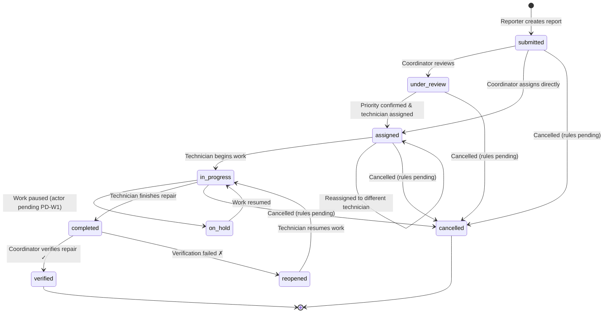

# CMIRS — Report Lifecycle and Workflow

> **Status:** This document describes the **proposed** report lifecycle and workflow for CMIRS. No workflow logic, status management, or business rules have been implemented yet.

## Table of Contents

- [Overview](#overview)
- [Report Statuses](#report-statuses)
- [Lifecycle Stages](#lifecycle-stages)
  - [1. Report Submission](#1-report-submission)
  - [2. Coordinator Review](#2-coordinator-review)
  - [3. Technician Assignment](#3-technician-assignment)
  - [4. Inspection and Repair](#4-inspection-and-repair)
  - [5. Work Holds](#5-work-holds)
  - [6. Completion](#6-completion)
  - [7. Verification](#7-verification)
  - [8. Resolution](#8-resolution)
  - [9. Cancellation](#9-cancellation)
  - [10. Reassignment](#10-reassignment)
- [Priority System](#priority-system)
- [Critical Incident Handling](#critical-incident-handling)
- [Status Transition Table](#status-transition-table)
- [Status Transition Diagram](#status-transition-diagram)
- [Audit and Status History](#audit-and-status-history)
- [Notifications](#notifications)
- [Pending Decisions](#pending-decisions)

## Overview

Each maintenance report in CMIRS follows a structured lifecycle from submission through resolution. The workflow ensures that:

- Every report is reviewed by a Maintenance Coordinator before work begins.
- Priority is confirmed by a Coordinator, not determined solely by the reporter (D3).
- Repairs are verified by a designated Coordinator before a report is closed (D2).
- All status transitions are recorded for accountability.
- Critical incidents receive expedited handling.

## Report Statuses

| Status | Description | Primary Actor |
|---|---|---|
| `submitted` | Report created by a user, awaiting coordinator review | Reporter |
| `under_review` | Coordinator is reviewing the report and assessing priority | Coordinator |
| `assigned` | Report assigned to a technician, awaiting work | Coordinator |
| `in_progress` | Technician is actively working on the repair | Technician |
| `on_hold` | Work temporarily paused (see [Work Holds](#5-work-holds)) | *Pending decision (PD-W1)* |
| `completed` | Technician has finished the repair, awaiting verification | Technician |
| `verified` | Coordinator has verified the repair is satisfactory — **terminal state** | Coordinator |
| `reopened` | Verification failed; report returned for additional work | Coordinator |
| `cancelled` | Report cancelled — **terminal state** (see [Cancellation](#9-cancellation)) | *Pending decision (PD-W2, PD-W3)* |

These statuses correspond to the `report_status` enum proposed in [DATABASE.md](DATABASE.md).

## Lifecycle Stages

### 1. Report Submission

**Actor:** Student / School Personnel (or any role with submission permission)

A reporter creates a new maintenance report by providing:

- **Title** — Brief summary of the issue.
- **Description** — Detailed explanation of the problem.
- **Category** — Type of maintenance issue (e.g., plumbing, electrical, structural).
- **Location** — Where the issue is located on campus.
- **Photos** — Optional photo attachments for visual evidence (D4).
- **Urgent-hazard flag** — The reporter may flag the issue as an urgent safety hazard (D3).

**Result:** The report is created with status `submitted` and default `confirmed_priority` of `NULL` (awaiting coordinator review). The reporter's `is_urgent_hazard` flag is stored as a separate field from the coordinator-confirmed priority. In-app notifications are sent to Maintenance Coordinators (D7).

### 2. Coordinator Review

**Actor:** Maintenance Coordinator

The Coordinator reviews the submitted report and:

1. Assesses the reported issue for validity and completeness.
2. Reviews the reporter's urgent-hazard flag, if set.
3. **Sets the confirmed priority level** (`low`, `medium`, `high`, or `critical`).
   - If the reporter flagged the issue as urgent, the Coordinator may confirm it as `critical` or assign a different appropriate priority.
   - The reporter's original flag is preserved in `is_urgent_hazard` but does **not** automatically become the confirmed priority (D3).
4. Transitions the report status from `submitted` to `under_review` during assessment, then to `assigned` when ready.

**Result:** The report has a coordinator-confirmed priority stored in `confirmed_priority`. The Coordinator proceeds to assignment or requests additional information via comments.

### 3. Technician Assignment

**Actor:** Maintenance Coordinator

The Coordinator assigns the report to a specific Maintenance Technician:

1. Selects an appropriate technician based on skills, availability, and workload.
2. Creates an assignment record in the `assignments` table linking the technician to the report.
3. Transitions the report status to `assigned`.

**Result:** The assigned technician receives an in-app notification (D7). The report appears in their work queue.

### 4. Inspection and Repair

**Actor:** Maintenance Technician

The assigned technician:

1. Reviews the report details, location, and any attached photos.
2. Transitions the report status to `in_progress` when beginning work.
3. Performs the inspection and/or repair.
4. Logs work performed in the `work_logs` table, including description and time spent.
5. Adds comments to the report as needed for documentation.

### 5. Work Holds

**Actor:** *Pending decision — see PD-W1 in [Pending Decisions](#pending-decisions)*

A report may be placed `on_hold` when work cannot continue temporarily. Possible reasons include:

- Parts or materials are on order.
- Access to the location is temporarily restricted.
- Additional approvals or resources are needed.
- External contractors are required.

**Requirements for a hold:**

- A reason must be provided and recorded in `report_status_history`.
- The hold should specify the expected condition for resumption, if known.
- When the hold is resolved, the report transitions back to `in_progress`.

> **Pending Decision (PD-W1):** Who can initiate a work hold? Options include technician only, coordinator only, or either party. See [Pending Decisions](#pending-decisions).

### 6. Completion

**Actor:** Maintenance Technician

When the repair is finished:

1. The technician logs final work details in `work_logs`.
2. The technician transitions the report status to `completed`.
3. An in-app notification is sent to Coordinators indicating the report is ready for verification (D7).

**Important:** Marking a report as `completed` does **not** close it. Verification by a Coordinator is required (D2).

### 7. Verification

**Actor:** Maintenance Coordinator (designated verifier per D2)

The Coordinator verifies the completed repair:

1. Reviews the work logs and any completion notes.
2. Optionally inspects the repair in person.
3. Records the verification result in the `verifications` table.

**If the repair passes verification:**

- The Coordinator transitions the report to `verified` (terminal state).
- The `verifications` record has `is_satisfactory = true`.
- The reporter receives a notification that their issue has been resolved (D7).

**If the repair fails verification:**

- The Coordinator transitions the report to `reopened` with a required reason explaining what is unsatisfactory.
- The `verifications` record has `is_satisfactory = false`.
- The reason is recorded in `report_status_history`.
- The assigned technician is notified (D7).
- The report re-enters the repair cycle: `reopened` → `in_progress`.

**Verification restrictions:**

- The technician who performed the repair **cannot** verify their own work (D2).
- Whether a Coordinator can verify a report they submitted is a **pending decision** (PD-R4 in [ROLES.md](ROLES.md)).

### 8. Resolution

A report reaches its final resolved state when it receives `verified` status. At this point:

- The report is considered closed and the issue resolved.
- All status history, work logs, comments, and verification records are preserved for the audit trail.
- The report remains accessible for reference but no further status transitions are expected.

### 9. Cancellation

**Actor:** *Pending decision — see PD-W2, PD-W3, PD-W4 in [Pending Decisions](#pending-decisions)*

A report may be cancelled when:

- The issue was reported in error or is a duplicate.
- The issue resolved itself (e.g., temporary condition).
- The issue is determined to be outside the system's scope.
- Work cannot proceed and no resolution is possible.

**Requirements for cancellation:**

- A reason must be provided and recorded in `report_status_history`.
- `cancelled` is a terminal state — no further transitions are permitted.

> **Pending Decisions:**
>
> - **PD-W2:** Can a reporter cancel their own report? If so, only before assignment, or at any stage?
> - **PD-W3:** Can a Coordinator cancel a report at any stage? What approvals or notifications are required?
> - **PD-W4:** What happens to an existing assignment when an assigned or in-progress report is cancelled?

### 10. Reassignment

**Actor:** Maintenance Coordinator

A Coordinator may reassign a report to a different technician when:

- The original technician is unavailable.
- The issue requires different expertise.
- The original technician requests reassignment (if permitted — pending decision PD-R2 in [ROLES.md](ROLES.md)).

**Reassignment process:**

1. The Coordinator creates a new assignment record for the new technician.
2. The previous assignment record is updated to `status = 'reassigned'` (not deleted) for audit purposes.
3. The new technician receives an in-app notification (D7).
4. The previous technician receives an in-app notification (D7).
5. If the report was `in_progress`, its status may revert to `assigned`.
6. The reassignment is recorded in `report_status_history`.

## Priority System

CMIRS uses a two-layer priority system to separate reporter perception from coordinator judgment (D3).

### Reporter Urgent-Hazard Flag

- A **boolean field** (`is_urgent_hazard`) set by the reporter at submission time.
- Indicates the reporter believes the issue is an urgent safety hazard.
- Preserved in the report record regardless of the coordinator's priority decision.
- Triggers an alert to Coordinators for expedited review.
- Does **not** automatically become the coordinator-confirmed priority.

### Coordinator-Confirmed Priority

- An **enum field** (`confirmed_priority`) set by the Coordinator during review.
- Represents the official priority classification used for work scheduling.
- Remains `NULL` until the Coordinator reviews and sets it.

| Priority | Description | Expected Response |
|---|---|---|
| `low` | Minor cosmetic or non-urgent issue | Scheduled maintenance window |
| `medium` | Functional issue affecting usability | Addressed within normal workflow |
| `high` | Significant issue affecting safety or operations | Prioritized for prompt attention |
| `critical` | Immediate safety hazard requiring urgent response | Expedited handling (see [Critical Incident Handling](#critical-incident-handling)) |

### Key Distinction

The reporter's urgent flag and the coordinator's confirmed priority are **independent fields** in the `reports` table:

- A reporter may flag an issue as urgent, but the Coordinator may determine it is `medium` priority after review.
- A Coordinator may elevate a non-flagged report to `critical` based on their assessment.
- Both values are stored in the database for audit and analysis purposes.

## Critical Incident Handling

When a reporter flags an issue as an urgent hazard or a Coordinator assigns `critical` priority:

1. **Immediate notification:** Coordinators receive a high-priority in-app notification (D7).
2. **Expedited review:** Critical reports should be reviewed before lower-priority items.
3. **Priority assignment:** The Coordinator sets `confirmed_priority = 'critical'` after confirming the hazard. The reporter's flag does **not** automatically become a critical classification (D3).
4. **Tracking:** Critical reports are visually distinguished in the coordinator's work queue.
5. **Escalation:** If a critical report is not reviewed within a defined timeframe, it may be escalated (specific escalation rules are a future consideration).

> **Note:** Email, SMS, and push notifications are outside the MVP scope (D7). Critical incident alerting is limited to in-app notifications in the current design.

## Status Transition Table

This table defines the permitted status transitions, the actor authorized to perform each transition, and any conditions or requirements.

| From | To | Actor | Condition / Requirement |
|---|---|---|---|
| `submitted` | `under_review` | Coordinator | Coordinator begins reviewing the report |
| `submitted` | `assigned` | Coordinator | Direct assignment with priority confirmation (combined review and assign) |
| `under_review` | `assigned` | Coordinator | Priority confirmed; technician selected |
| `assigned` | `in_progress` | Technician | Technician begins work on the assignment |
| `in_progress` | `on_hold` | *Pending (PD-W1)* | Reason required; recorded in `report_status_history` |
| `on_hold` | `in_progress` | *Pending (PD-W1)* | Hold condition resolved; reason recorded |
| `in_progress` | `completed` | Technician | Repair finished; work log entry recommended |
| `completed` | `verified` | Coordinator | Repair confirmed satisfactory; `verifications` record created |
| `completed` | `reopened` | Coordinator | Verification failed; reason required; `verifications` record created |
| `reopened` | `in_progress` | Technician | Technician resumes work on the issue |
| `submitted` | `cancelled` | *Pending (PD-W2, PD-W3)* | Reason required |
| `under_review` | `cancelled` | *Pending (PD-W3)* | Reason required |
| `assigned` | `cancelled` | *Pending (PD-W3, PD-W4)* | Reason required; assignment handling pending |
| `in_progress` | `cancelled` | *Pending (PD-W3)* | Reason required |
| `assigned` | `assigned` | Coordinator | Reassignment to different technician |

**Terminal states:** `verified`, `cancelled` — no further transitions are permitted from these states.

**Not permitted:** Any transition not listed above is denied by default. Transitions from `verified` or `cancelled` to any other state are explicitly prohibited.

## Status Transition Diagram

## Audit and Status History

Every status transition must be recorded in the `report_status_history` table (see [DATABASE.md](DATABASE.md)). Each record captures:

| Field | Description |
|---|---|
| `report_id` | The report whose status changed |
| `previous_status` | The status before the transition (`NULL` for initial creation) |
| `new_status` | The status after the transition |
| `changed_by` | The user who performed the transition |
| `reason` | Explanation for the transition (required for holds, cancellations, reopenings, and reassignments; optional for standard transitions) |
| `created_at` | Timestamp of the transition |

This history provides:

- Complete traceability of each report's lifecycle.
- Accountability for all decisions and actions.
- Data for response-time analysis and process improvement.
- Evidence for dispute resolution.

## Notifications

All notifications in the MVP are **in-app only** (D7). Email, SMS, and push notifications are outside the current scope.

The following events trigger notifications:

| Event | Recipients |
|---|---|
| New report submitted | Maintenance Coordinators |
| Report flagged as urgent hazard | Maintenance Coordinators (high priority) |
| Report assigned to technician | Assigned Technician |
| Report status changed | Reporter, assigned Technician |
| Report priority changed | Reporter, assigned Technician |
| Comment added to report | Reporter, assigned Technician, relevant Coordinator |
| Repair completed (awaiting verification) | Maintenance Coordinators |
| Repair verified | Reporter, assigned Technician |
| Repair verification failed (reopened) | Assigned Technician |
| Report reassigned | Previous Technician, new Technician |
| Report cancelled | Reporter, assigned Technician (if any) |

Notification records are stored in the `notifications` table (see [DATABASE.md](DATABASE.md)).

## Pending Decisions

The following workflow decisions have not been finalized. They are recorded here to ensure they are addressed before implementation. Recommendations are included but **must not be treated as approved requirements**.

| ID | Decision | Context | Recommendation |
|---|---|---|---|
| PD-W1 | Who can initiate a work hold? | Determines the `on_hold` transition actor and permissions | Recommend allowing both technicians and coordinators to initiate holds, each with a required reason. |
| PD-W2 | Can a reporter cancel their own report? At which stages? | Affects cancellation rules and the reporter's control over their submissions | Recommend allowing reporter cancellation only for `submitted` and `under_review` statuses (before assignment). |
| PD-W3 | Can a Coordinator cancel a report at any stage? | Affects cancellation authority and scope | Recommend allowing Coordinator cancellation at any non-terminal stage with a required reason. |
| PD-W4 | What happens to an assignment when an assigned or in-progress report is cancelled? | Affects assignment record handling and technician notifications | Recommend marking the assignment as `cancelled` and notifying the technician. |
| PD-W5 | Should there be a maximum number of reopenings before escalation? | Prevents infinite verification-failure loops | Recommend tracking reopening count and alerting after a configurable threshold. |
| PD-W6 | Is `under_review` always used, or can Coordinators assign directly from `submitted`? | Affects workflow complexity and flexibility | Both transitions are included in this proposal. The `submitted` → `assigned` path allows direct assignment when the situation is straightforward. |

---

*This document is part of Phase 0 project documentation. See [README.md](../README.md) for project overview and links to other documents.*
