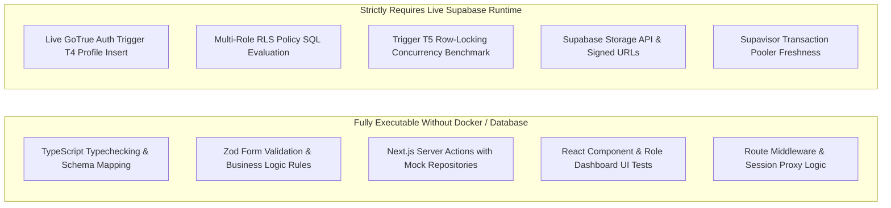

# CMIRS Phase 5C — Docker-Free Development and SQL Review

> **Document:** `docs/database-design/PHASE_5C_DOCKER_FREE_REVIEW.md`  
> **Date:** 2026-10-18  
> **Project:** Campus Maintenance & Incident Reporting System (CMIRS)  
> **Phase:** 5C — Docker-Free Development and SQL Review  
> **Role:** Senior PostgreSQL/Supabase Architect & Next.js Lead Engineer  
> **Status:** ARCHITECTURAL REVIEW & DEVELOPMENT PLAN  
> **Execution Status:** **NO DATABASE EXECUTION — DOCKER-FREE STRATEGY**  

---

## 1. Executive Summary & Context

### 1.1 The Operational Context
The Campus Maintenance & Incident Reporting System (CMIRS) is being developed using Next.js 16 (App Router, Server Components, Server Actions), TypeScript, and Supabase. The Phase 5B environment inspection confirmed that:
1. The six database migration files are prepared, dependency-ordered, cryptographically hashed, and statically audited.
2. No migrations have been executed, no database connections have been made, and no secrets have been exposed.
3. **Docker cannot be installed on the current host machine.** Consequently, running a local containerized Supabase stack (`npx supabase start`) is not feasible on this environment.

### 1.2 Purpose of Phase 5C
This review establishes a **Docker-Free Development Strategy** that allows full application development (UI, business logic, form validation, role-based workflows, state management, and Server Actions) to proceed rapidly and safely without requiring a local database container. It couples an exhaustive static SQL audit with a contract-driven development architecture.

> [!CAUTION]
> **STRICT SAFETY COMPLIANCE**  
> In accordance with Phase 5C rules:
> - No remote Supabase database or Storage API was contacted.
> - No SQL commands, migrations, or database tests were executed.
> - No application code, migration SQL, or Git changes were modified or committed.
> - Static review findings do not claim runtime proof; clear boundaries separate static certainty from runtime verification.

---

## 2. Exhaustive SQL Review & Architectural Analysis

All six migration files (`supabase/migrations/`) and the test suite (`supabase/tests/database_test_suite.sql`) were subjected to a rigorous, multi-layered code review:

### 2.1 Schema, Enums, and Sequences (`01_core_schema.sql`)
- **Custom Enums:** All five enums (`user_role`, `report_status`, `priority_level`, `assignment_status`, `notification_type`) are wrapped in idempotent `DO $$` blocks. Labels match the approved data dictionary.
- **Sequence:** `public.report_number_seq` is defined with `START WITH 1 INCREMENT BY 1`, supporting the `RPT-000001` format.
- **Table Integrity & Foreign Keys:**
  - `profiles.id` correctly references `auth.users(id) ON DELETE CASCADE`.
  - Sensitive associations (`reporter_id`, `technician_id`, `assigned_by`, `changed_by`, `uploaded_by`, `verified_by`) use `ON DELETE RESTRICT`, preventing accidental cascading deletion of core audit history if a profile is deleted.
  - Dependent transactional child records (`assignments`, `report_attachments`, `report_status_history`, `report_comments`, `verifications`) use `ON DELETE CASCADE` referencing `public.reports(id)`, preserving referential integrity.
- **Constraints:**
  - `chk_role_changed`: `CHECK (old_role <> new_role)` strictly prevents duplicate audit entries where roles do not change (Approved OD-NEW-1).
  - `chk_decline_reason`: `CHECK (status != 'declined' OR (decline_reason IS NOT NULL AND btrim(decline_reason) != ''))` enforces non-empty decline reasons (Approved OD-REC-1).
  - `chk_file_size` and `chk_mime_type`: Restrict attachments to `<= 10485760` bytes (10MB) and MIME types `('image/jpeg', 'image/png', 'image/webp')` (Approved PD-D5).

### 2.2 Performance and RLS Indexes (`02_performance_indexes.sql`)
- **Coverage:** 24 dedicated B-tree indexes cover all foreign keys, status filters, and compound join predicates.
- **RLS Compound Indexes:**
  - `idx_assignments_tech_status_report`: `(technician_id, status, report_id)` optimizes the frequent subquery in `can_view_report()`.
  - `idx_verifications_report_verified_by`: `(report_id, verified_by)` accelerates self-verification exclusion checks.
  - `idx_report_attachments_report_deleted`: `(report_id, deleted_at)` optimizes the active attachment count check in trigger T5.

### 2.3 Automated Triggers & Immutability (`03_triggers.sql`)
- **T1 (`set_updated_at`):** Attached to `profiles` and `reports`. Intentionally excluded from `report_comments` to preserve comment immutability (Approved PD-D3).
- **T2 (`generate_report_number`):** Unconditionally assigns `NEW.report_number := 'RPT-' || LPAD(nextval('public.report_number_seq')::TEXT, 6, '0');` on `BEFORE INSERT`, eliminating client spoofing (Remediation R4).
- **`trg_reports_immutable_cols`:** Explicit `BEFORE UPDATE` trigger on `public.reports` that throws exceptions if `report_number` or `reporter_id` are modified across all roles (Remediation R4).
- **T3 (`record_status_history`):** Automatically logs status transitions into `public.report_status_history` with `reason = NULL` as an uncompromised audit safety net.
- **T4 (`handle_new_user`):** Attached to `auth.users` on `AFTER INSERT` to create a default `student_personnel` profile.
- **T5 (`lock_attachment_count`):** Acquires `PERFORM 1 FROM public.reports WHERE id = NEW.report_id FOR UPDATE;` to serialize concurrent attachment additions, enforcing `< 5` active attachments per report.

### 2.4 Security Definer Functions & RPCs (`04_security_functions_and_rpc.sql`)
- **Search Path Pinning:** Every function explicitly specifies `SET search_path = public, auth, pg_temp;`, completely immunizing against search path hijacking.
- **Privilege Hardening:** Every function executes `REVOKE ALL ... FROM PUBLIC; GRANT EXECUTE ... TO authenticated;`.
- **`can_view_report(UUID)`:** Centralized security predicate correctly grants visibility to:
  1. Oversight roles (`coordinator`, `administrator`, `management`).
  2. The report author (`reporter_id = auth.uid()`).
  3. Technicians with a non-declined assignment (`technician_id = auth.uid() AND status != 'declined'`).
- **RPC `soft_delete_attachment(UUID)`:** Coordinator-only RPC marking `deleted_at = now()` and `deleted_by = auth.uid()`. Leaves file metadata intact.
- **RPC `decline_assignment(UUID, TEXT)`:** Technician-only RPC requiring non-empty `btrim(reason)` from `status = 'assigned'`.

### 2.5 Table-Level RLS Policies (`05_table_rls_policies.sql`)
- **RLS Enabled:** Explicitly enabled on all 12 tables.
- **Initial Report Boundaries (R2):** `reports_insert` enforces `WITH CHECK (reporter_id = auth.uid() AND status = 'submitted' AND confirmed_priority IS NULL)`.
- **Technician Split Policies (R3):** `assignments_update_technician_decline` (`USING (status = 'assigned')`) is completely segregated from `assignments_update_technician_work` (`USING (status IN ('assigned', 'in_progress', 'on_hold')) WITH CHECK (status IN ('in_progress', 'on_hold', 'completed') AND decline_reason IS NULL)`).
- **Notification Protection (R5):** `GRANT UPDATE (is_read) ON public.notifications TO authenticated;` backed by row-level `WITH CHECK` protecting non-read columns.

### 2.6 Supabase Storage Setup (`06_storage_setup.sql`)
- **Bucket Configuration:** Private bucket `report-attachments` with 10MB limit and restricted image MIME types.
- **Safe UUID Validation (R1):** Validates paths matching `^reports/[UUID]/[UUID]\.(jpe?g|png|webp)$` and wraps all casts in `(CASE WHEN name ~ '...' THEN (storage.foldername(name))[2]::uuid ELSE NULL END)`, preventing evaluation-order casting crashes.

### 2.7 Database Test Scaffolding (`supabase/tests/database_test_suite.sql`)
- **Structure:** Encapsulated in `BEGIN ... ROLLBACK;`, executing purely DML assertions without altering database state.
- **Limitations:** Statically verifies constraints, sequences, and triggers under superuser context, but requires mock JWT role simulation for full RLS evaluation.

---

## 3. Classified Findings by Severity

The review identified no Critical or High severity flaws in the migration SQL. The remaining findings represent application-layer implementation contracts and minor defensive enhancements:

| Finding ID | Severity | Target File & Object | Description & Vulnerability Scenario | Recommended Resolution / Application Contract |
|---|:---:|---|---|---|
| **FIND-01** | **MEDIUM** | `05_table_rls_policies.sql`<br>`profiles_update_own` | The policy prevents modifying `role` and `is_active`, but does not guard against updating `email`. If a client executes `UPDATE profiles SET email = 'attacker@mail.com'`, the profile email will diverge from `auth.users.email`. | **Application Contract:** In Next.js Server Actions, profile updates must strictly whitelist `{ full_name, phone }`. Do not expose `email` updates via profile forms. |
| **FIND-02** | **MEDIUM** | `05_table_rls_policies.sql`<br>`reports_update_reporter_cancel` | The policy checks `reporter_id = auth.uid() AND status = 'cancelled'`, but does not enforce equality checks on `title` or `description`. A reporter cancelling a report could simultaneously alter the report title or text. | **Application Contract:** The cancellation Server Action must strictly issue an UPDATE payload containing only `{ status: 'cancelled' }`. |
| **FIND-03** | **LOW** | `03_triggers.sql`<br>Trigger T3 (`record_status_history`) | Trigger T3 has no session-flag check. If an application service inserts a reasoned row into `public.report_status_history` and updates `reports.status`, two rows are created (`reason` followed by `NULL`). | **Application Contract:** State transitions in Next.js must be executed via an authoritative server-side transition service rather than raw multi-table client mutations. |
| **FIND-04** | **LOW** | `01_core_schema.sql`<br>`chk_decline_reason` | `CHECK (status != 'declined' OR ...)` permits `decline_reason` to be non-null when `status` is not `declined`. Policy R3 prevents this for active work, but the database constraint itself is permissive for other statuses. | **Future Enhancement:** In a post-MVP schema update, tighten constraint to enforce `decline_reason IS NULL` when `status != 'declined'`. |
| **FIND-05** | **INFORMATIONAL** | Environment / Host | Host environment lacks Docker Engine, preventing `npx supabase start`. | **Adopt Docker-Free Strategy:** Shift to TypeScript contract-driven development and mock service adapters for all application features. |

---

## 4. Testing Feasibility Matrix (Docker-Free vs. Live Supabase)

To maximize quality without Docker, all verification tasks are divided into those executable immediately via static analysis/unit tests versus those deferred to live Supabase staging:



### 4.1 Tests Executable Without a Database (Immediate Scope)
1. **TypeScript Type Safety (`tsc --noEmit`):** Validating 100% type agreement between database columns, enums, nullability, and application DTOs.
2. **Form & Data Validation (Zod Schemas):**
   - Decline reason validation: `z.string().trim().min(1, "Reason is required")`.
   - Attachment limit validation: Max 5 files, max 10MB per file, allowed MIME types (`image/jpeg`, `image/png`, `image/webp`).
   - Report submission initial values: Enforcing initial `submitted` status and NULL priority.
3. **Component Interaction & State Testing:**
   - Testing status progression UI components (e.g. `submitted` -> `under_review` -> `assigned` -> `in_progress` -> `completed` -> `verified`).
   - Testing role-specific view guards (e.g. student cannot see technician assignment notes).
4. **Mocked Server Action Unit Tests:**
   - Unit testing Server Actions by injecting mock Supabase clients returning expected row fixtures.
   - Verifying that error states (e.g. unauthenticated user, duplicate upload attempt) return standard application error codes.

### 4.2 Tests Requiring Supabase Runtime Execution (Deferred to Remote Staging)
1. **Live Auth Trigger T4:** Confirming GoTrue auth webhook creates `public.profiles` on actual user registration.
2. **PostgreSQL RLS Engine:** Evaluating row visibility across real JWT sessions with Supabase PostgREST.
3. **Database Concurrency Serializer:** Firing 10 concurrent HTTP requests to verify Trigger T5 row-locking serialization.
4. **Storage API & Helper Integration:** Verifying that `storage.objects` policies interact cleanly with `storage.foldername()`.

---

## 5. Docker-Free Application Development Plan

We can construct 90%+ of the CMIRS application without a local database. The development plan follows a **contract-driven, type-safe architecture**:

```text
┌────────────────────────────────────────────────────────────────────────┐
│                   DOCKER-FREE ARCHITECTURE LAYOUT                     │
├────────────────────────────────────────────────────────────────────────┤
│  [UI Layer: Next.js 16 App Router]                                    │
│    ├── Student Portal (/student/...)                                   │
│    ├── Coordinator Portal (/coordinator/...)                           │
│    ├── Technician Portal (/technician/...)                             │
│    └── Oversight Portal (/oversight/...)                               │
│                                                                        │
│  [Service Abstraction Layer]                                           │
│    ├── Interfaces: IReportService, IAssignmentService, IAuthService    │
│    ├── Mock Adapter: LocalMockService (Rich Mock Data for all 5 Roles) │
│    └── Live Adapter: SupabaseService (Ready for Live Connection)      │
│                                                                        │
│  [Domain Models & Type Contracts]                                      │
│    ├── types/database.types.ts (Exact replica of 12 tables & 5 enums)  │
│    └── lib/validation/*.ts (Zod schemas matching DB constraints)       │
└────────────────────────────────────────────────────────────────────────┘
```

### Stage 1: Definitive TypeScript Database Contract (`types/database.types.ts`)
- **Action:** Create `types/database.types.ts` mirroring the 12 tables, all columns, nullabilities, and the 5 custom enums.
- **Value:** Guarantees that every component, Server Action, and hook references types that are 100% compatible with the prepared SQL migrations.

### Stage 2: Zod Validation Schemas (`lib/validation/*.ts`)
- **Action:** Define client and server validation schemas reflecting database constraints:
  - `reportSubmissionSchema`: Enforces title, description, category, location, urgent hazard flag.
  - `declineAssignmentSchema`: Enforces non-empty, whitespace-trimmed string.
  - `attachmentUploadSchema`: Enforces max 5 files, <= 10MB, JPEG/PNG/WebP.
  - `verificationSchema`: Enforces `is_satisfactory` boolean and notes.

### Stage 3: Service Abstraction & Mock Provider (`lib/services/`)
- **Action:** Build a repository/service interface (`IReportRepository`, `IAssignmentRepository`) with two implementations:
  1. `MockRepository`: In-memory state with mock seed data representing all 5 roles and report lifecycle stages. Enables immediate local UI development via `npm run dev`.
  2. `SupabaseRepository`: Production implementation calling `@supabase/ssr` matching the exact SQL schema.
- **Value:** The UI can be tested, demonstrated, and refined interactively in the browser without any database running!

### Stage 4: Role-Based Portals & UI Components (`app/`)
Build the four core role portals using Next.js 16 Server Components and Client Components:
1. **Student Personnel Portal:**
   - Report submission form with image drag-and-drop.
   - My Reports dashboard with status badge timeline.
   - Report detail view with cancellation action.
2. **Coordinator Operations Portal:**
   - Triage queue (unassigned reports, hazard alerts).
   - Technician assignment modal with specialty filtering.
   - Work hold review and verification dispatch.
   - Soft-delete photo modal.
3. **Technician Field Portal:**
   - Active work queue.
   - Assignment accept / decline modal with reason validation.
   - In-progress / on-hold state toggle.
   - Work log entry form (hours spent, description).
   - Repair completion submission.
4. **Administrator & Management Oversight Portal:**
   - Category and location management.
   - Campus-wide reporting analytics and resolution times.
   - Role change audit log.
   - Read-only report comments view.

### Stage 5: Remote Staging Execution & Verification Gate (Future Phase)
- **Action:** When application code and mock workflows are fully built and validated, connect to a dedicated remote Supabase Development/Staging project.
- **Execution:** Execute the six migrations using `psql` or Supabase CLI, run the 45 integration tests from `PHASE_5A_TEST_PLAN.md`, and switch from `MockRepository` to `SupabaseRepository`.

---

## 6. Summary of Feature Readiness

| Application Feature | Can Be Built Docker-Free? | Testing Method Without DB | Dependency on Live Database |
|---|:---:|---|---|
| **Role-based Navigation & Layouts** | **YES** | Mock session state in Server Components | None (Uses mock JWT/role) |
| **Report Submission Form & Validation** | **YES** | Zod schemas, React state, mock upload | None (Validates constraints locally) |
| **Photo Upload Dropzone (MIME / Size)** | **YES** | HTML5 File API & Zod validation | Storage API connection deferred |
| **Status Progression Timeline UI** | **YES** | Mock data fixtures covering 9 states | None |
| **Technician Assignment Decline Flow** | **YES** | Modal UI, whitespace reason validation | None |
| **Work Log Entry & Time Tracking** | **YES** | Form validation, decimal hour checks | None |
| **Coordinator Verification Form** | **YES** | Pass/fail toggle, notes validation | None |
| **Role Change Audit Viewer** | **YES** | Table component with sorting/filtering | None |
| **Live Database RLS Enforcement** | **NO** | Deferred to Remote Staging | Requires Supabase PostgREST |
| **Live Concurrency Row Locking** | **NO** | Deferred to Remote Staging | Requires PostgreSQL engine |
| **Live GoTrue Trigger Profile Creation**| **NO** | Deferred to Remote Staging | Requires Supabase GoTrue service |

---

## 7. Next Safe Step

> [!IMPORTANT]
> The database migrations remain unexecuted and preserved. No remote database connections or Git pushes have occurred.

**Next Safe Step:** Begin **Stage 1 & Stage 2 of the Docker-Free Plan**:
1. Create `types/database.types.ts` defining the exact TypeScript models matching the approved migration schema.
2. Create Zod validation schemas in `lib/validation/` to enforce database constraints in application code.
3. Create the mock data layer allowing full Next.js development and browser preview via `npm run dev`.
