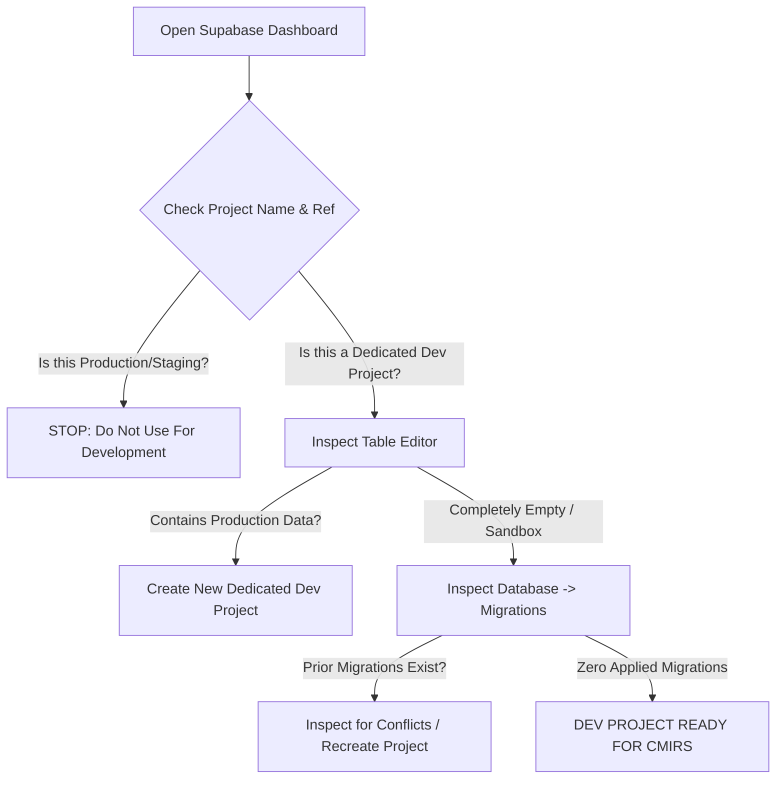
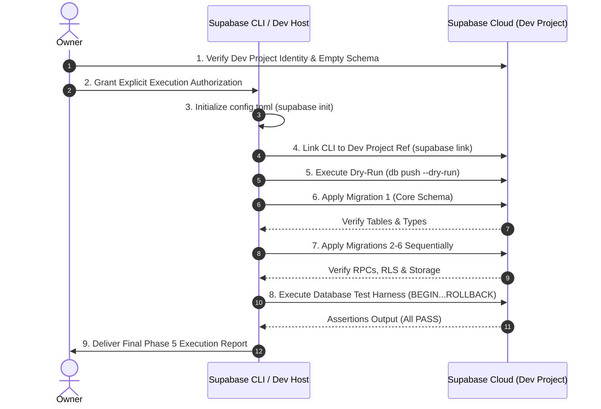

# CMIRS Phase 5D — Supabase Cloud Development Readiness & Execution Runbook

> **Document:** `docs/database-design/PHASE_5D_SUPABASE_CLOUD_READINESS.md`  
> **Date:** 2026-10-18  
> **Project:** Campus Maintenance & Incident Reporting System (CMIRS)  
> **Phase:** 5D — Supabase Cloud Development Transition & Readiness Assessment  
> **Role:** Lead PostgreSQL/Supabase Infrastructure Architect & Security Engineer  
> **Status:** AUDIT & PLANNING DELIVERABLE (READ-ONLY INSPECTION)  
> **Execution Status:** **NO DATABASE EXECUTION — ZERO REMOTE CONNECTIONS MADE**  
> **Readiness Verdict:** **CONDITIONAL** (Pending Owner Dashboard Verification & Execution Authorization)  

---

## 1. Executive Summary & Context

### 1.1 Transition Context: Moving Beyond Docker
During Phase 5B and Phase 5C, local Docker container execution was evaluated on the development host. Docker Desktop is installed, but its engine is currently failing to start on this Windows environment. Rather than spending additional development hours troubleshooting container daemon virtualization issues, the project is evaluating transitioning database development and integration verification to a **dedicated, cloud-hosted Supabase development instance**.

### 1.2 Purpose of Phase 5D
This assessment establishes a safe, Docker-free Supabase Cloud development workflow. It evaluates local tooling readiness, audits the six SQL migration files for cloud-specific prerequisites, outlines safe manual inspection procedures for the project owner, and establishes a sequential, fail-fast execution runbook for future authorized execution.

> [!CAUTION]
> **STRICT SAFETY COMPLIANCE & BOUNDARY ENFORCEMENT**  
> In strict accordance with owner safety mandates:
> 1. **Zero Remote Connections:** No network connections were initiated to remote Supabase endpoints (`*.supabase.co`, `*.pooler.supabase.com`).
> 2. **No Authentication or Linkage:** `supabase login` and `supabase link` were **not** executed. No credentials, personal access tokens, or project references were bound.
> 3. **No Database Modification:** No SQL statements, migrations, or database tests were executed. No databases were created, linked, or altered.
> 4. **No Secret Exposure:** No passwords, access tokens, API keys, or `.env` secrets were printed or exposed in logs.
> 5. **No Code or Migration Modification:** The six migration SQL files and application source code remain 100% unaltered.
> 6. **No Git Mutations:** No Git commits or branch pushes were executed.
> 7. **Static Boundary:** Static audit findings are explicitly distinguished from runtime behavior; no static review is claimed as runtime proof.

---

## 2. Verified Local Environment Findings

An exhaustive read-only inspection of the local workspace (`D:\CMIRS-System\my-app`) was performed. All inspected components and their statuses are documented below:

### 2.1 Workspace & Runtime Inventory

| Component / File | Inspected State | Evaluation & Impact |
|---|---|---|
| **Host Environment** | Windows (PowerShell Core / 7+) | Standard development workstation. |
| **Project Location** | `D:\CMIRS-System\my-app` | Monorepo application directory. |
| **Framework & Engine** | Next.js 16.4.2, React 19.3.0, TypeScript 5, Tailwind CSS 4 | Application foundation ready for full-stack integration. |
| **Supabase SDKs** | `@supabase/ssr` `^0.12.7`, `@supabase/supabase-js` `^2.118.0` | Official server-side rendering and browser client packages installed. |
| **Docker Engine** | Installed, but daemon/engine fails to start | Confirmed non-viable for local containerized development; validates Cloud Transition. |
| **Supabase CLI** | Version `2.121.0` (invocable via `npx supabase`) | Supported modern CLI capable of remote linking, migration tracking, and dry-run pushing. |
| **CLI Configuration** | `supabase/config.toml` is **ABSENT** | Project has not been initialized with `supabase init`. Required before CLI remote linking. |
| **CLI Linkage State** | `.supabase/` directory is **ABSENT** | Project is currently completely unlinked from any remote Supabase project. |
| **Client Code** | `utils/supabase/client.ts`, `utils/supabase/server.ts`, `proxy.ts` | Complete SSR and browser clients configured with standard environment variable guards. |
| **Environment Configuration** | `.env.example` verified; `.env.local` present | `.env.local` contains public URL and anon key format; does **not** contain `SUPABASE_SERVICE_ROLE_KEY` or `DATABASE_URL`. |

### 2.2 Cryptographic Migration Baseline Verification

All six migration files in `supabase/migrations/` and the database test harness in `supabase/tests/` were verified against their audited cryptographic SHA-256 checksums:

| Seq | Migration File | SHA-256 Checksum (Full) | Lines | Hash Verification Status |
|:---:|---|---|:---:|:---:|
| **1** | `20261018000001_core_schema.sql` | `3CA8111D309334AD842D1BA65E4D642F23D42EFF02863D528196A80855B63BCF` | 270 | **CONFIRMED 100% MATCH** |
| **2** | `20261018000002_performance_indexes.sql` | `1184B97E1FDC7B42487C8EA4D8B4E767506A1EF9ABA0032AE625ACA1767D01FC` | 54 | **CONFIRMED 100% MATCH** |
| **3** | `20261018000003_triggers.sql` | `858CF347752152A517D6EF68E726EA5401ACEDB57672CD34E43D79C9285B2254` | 181 | **CONFIRMED 100% MATCH** |
| **4** | `20261018000004_security_functions_and_rpc.sql` | `FFD5A221A489AC2BA5C877C78D3887B93A72B7BDD1DEE1EA211BDBB3B8DF7900` | 178 | **CONFIRMED 100% MATCH** |
| **5** | `20261018000005_table_rls_policies.sql` | `76E42398817FF61385B884C2548BDCECFF6FEBED125F115BB024BFBE98B9C42C` | 457 | **CONFIRMED 100% MATCH** |
| **6** | `20261018000006_storage_setup.sql` | `38610E66A59620FFCF11414F533C1B19552514E27209EE01EF1035D0684B20AF` | 160 | **CONFIRMED 100% MATCH** |
| **Test**| `database_test_suite.sql` | `C3911D47EE60B52CE05EB086A5A2D3ABD2F29B130D819E7CB188A6576D595C2E` | 220 | **CONFIRMED 100% MATCH** |

*Verification Result:* Zero discrepancies found. The local migration files are identical to the Phase 4D/5A/5B audited baseline.

---

## 3. Supabase CLI & Workflow Readiness Assessment

### 3.1 Migration File Naming & Lexicographical Ordering
Supabase CLI organizes and executes migrations based on their lexicographical file name prefix (`<timestamp>_<name>.sql`).
- The CMIRS migration suite uses standard 14-digit ISO timestamps:
  1. `20261018000001_core_schema.sql`
  2. `20261018000002_performance_indexes.sql`
  3. `20261018000003_triggers.sql`
  4. `20261018000004_security_functions_and_rpc.sql`
  5. `20261018000005_table_rls_policies.sql`
  6. `20261018000006_storage_setup.sql`
- **Assessment:** The naming convention is 100% compatible with Supabase CLI version `2.121.0`. The lexicographical sort order matches the architectural dependency graph perfectly:
  ```text
  01 (Tables/Enums/Sequences) 
       ↓
  02 (Indexes referencing 01)
       ↓
  03 (Triggers referencing 01)
       ↓
  04 (RPCs & Functions referencing 01)
       ↓
  05 (RLS Policies referencing 01 & 04)
       ↓
  06 (Storage Bucket & Policies referencing 01, 04, storage)
  ```

### 3.2 CLI Project Configuration Prerequisites
- Running commands such as `npx supabase link` or `npx supabase db push` requires a `supabase/config.toml` file in the project.
- Because `supabase init` has not yet been run, invoking `supabase link` immediately will yield an error:
  `supabase/config.toml not found. Run 'supabase init' first.`
- Running `npx supabase init` generates this configuration file with default port bindings, studio settings, and auth configuration.
- **Prerequisite:** When authorized by the owner, `npx supabase init` must be run prior to project linking.

### 3.3 Remote Development Capability Evaluation
The Supabase CLI supports three primary execution workflows against remote instances:
1. **`supabase db push`**:
   - Compares local migrations against the remote table `supabase_migrations.schema_migrations`.
   - Supports `--dry-run` to inspect pending files without applying.
   - Pushes pending migrations sequentially to the linked project.
2. **`supabase migration up --linked` / `db push --linked`**:
   - Applies pending migrations using the CLI's management API connection.
3. **Direct SQL Execution via Dashboard / Connection String**:
   - Executes individual migration files via the Supabase Dashboard SQL Editor or direct `psql` connection.

*Limitations to Note:*
- `supabase db push` does **not** execute all migration files in a single monolithic transaction across multiple files. If Migration 5 fails, Migrations 1–4 remain committed.
- There is no automated down-migration or rollback command for remote projects (`supabase migration down` is for local instances only).

---

## 4. Safe Remote Project Assessment Instructions for the Owner

To protect live data and ensure environmental isolation without automated agents contacting remote infrastructure, the project owner should perform the following manual checks via the [Supabase Management Dashboard](https://supabase.com/dashboard):



### 4.1 Step-by-Step Owner Verification Checklist

1. **Verify Project Identity & Purpose:**
   - Log in to the [Supabase Dashboard](https://supabase.com/dashboard).
   - Select the project referenced in `.env.local`.
   - **Crucial Question:** Is this project intended strictly as a disposable development/sandbox environment?
   - If this project contains existing production, staging, or client data, **STOP**. A new, separate project (e.g. `cmirs-dev`) should be created.
2. **Inspect Existing Tables (Table Editor):**
   - Navigate to the **Table Editor** (`schema: public`).
   - Check if any tables currently exist (e.g., `profiles`, `reports`, `categories`, etc.).
   - If tables already exist from previous manual prototyping, note them. Running CMIRS migrations against a pre-populated database may cause `relation already exists` conflicts.
3. **Inspect Custom Types & Enums:**
   - Navigate to **Database** -> **Enumerated Types**.
   - Verify whether custom types (`user_role`, `report_status`, `priority_level`, `assignment_status`, `notification_type`) exist.
   - If they exist, verify whether their labels match the CMIRS Data Dictionary.
4. **Inspect Migration History:**
   - Navigate to **Database** -> **Migrations** (or query `supabase_migrations.schema_migrations` in the SQL Editor).
   - Verify if any migrations are recorded.
5. **Inspect Supabase Storage:**
   - Navigate to **Storage**.
   - Check if the bucket `report-attachments` already exists.
   - If it exists, check its privacy setting (`public: false`) and whether any files are stored within it.
6. **Evaluate Backups & Point-in-Time Recovery:**
   - Navigate to **Project Settings** -> **Database** -> **Backups**.
   - Verify available backup options. On Supabase Free tier, daily automatic backups are retained for 7 days; Pro tier provides Point-in-Time Recovery (PITR).

---

## 5. Migration Audit: Cloud Suitability & Security Review

The six migration files were evaluated specifically for cloud deployment compatibility, security role boundaries, trigger behaviors, and Supabase service integrations:

### 5.1 Service Dependencies & Preconditions

| Migration File | Supabase Cloud Dependency | Precondition & Behavioral Verification |
|---|---|---|
| `01_core_schema.sql` | `auth.users`, `pgcrypto` | `profiles.id` foreign key references `auth.users(id) ON DELETE CASCADE`. Requires Supabase GoTrue Auth service to be active. `pgcrypto` extension is pre-installed in Supabase. |
| `02_performance_indexes.sql` | None (Standard PostgreSQL) | 24 B-tree indexes created with `IF NOT EXISTS`. Safe for cloud execution. |
| `03_triggers.sql` | `auth.users`, `auth.uid()` | Trigger T4 (`trg_on_auth_user_created`) attaches to `auth.users` on `AFTER INSERT`. Supabase CLI and cloud instances grant `postgres` permission to bind triggers to `auth.users`. |
| `04_security_functions_and_rpc.sql` | `auth.uid()`, `search_path` | All four functions (`get_user_role`, `can_view_report`, `soft_delete_attachment`, `decline_assignment`) pin `SET search_path = public, auth, pg_temp;`. Default public privileges are revoked; execution granted only to `authenticated`. |
| `05_table_rls_policies.sql` | `auth.uid()`, `authenticated` role | Enables RLS on all 12 tables. Scopes all policies to role `authenticated`. Disallows `anon` access. Restricts column UPDATE on `notifications` to `is_read`. |
| `06_storage_setup.sql` | `storage.buckets`, `storage.objects`, `storage.foldername()` | Configures private bucket `report-attachments` (10MB, JPEG/PNG/WebP). Applies RLS to `storage.objects` with canonical UUID regex validation and `CASE` short-circuit protection against casting errors. |

### 5.2 Classified Security & Migration Findings

The audit confirmed that the migrations contain **zero Critical or High severity flaws**. The findings below represent application-layer enforcement contracts, concurrency behaviors, and recovery considerations:

| Finding ID | Severity | Target Object | Scenario & Architectural Analysis | Application / Operational Contract |
|---|:---:|---|---|---|
| **FIND-01** | **MEDIUM** | `05_table_rls_policies.sql`<br>`profiles_update_own` | Policy prevents updating `role` and `is_active`, but does not restrict `email`. An authenticated user issuing `UPDATE profiles SET email = 'attacker@mail.com'` would cause profile email to diverge from `auth.users.email`. | **Application Contract:** Next.js Server Actions must only allow updates to `{ full_name, phone }`. Never expose `email` in profile update payloads. |
| **FIND-02** | **MEDIUM** | `05_table_rls_policies.sql`<br>`reports_update_reporter_cancel` | Policy verifies `reporter_id = auth.uid()` and transitions to `cancelled`, but does not explicitly check that `title` or `description` remain unchanged during cancellation. | **Application Contract:** The report cancellation Server Action must strictly issue an UPDATE payload containing only `{ status: 'cancelled' }`. |
| **FIND-03** | **LOW** | `03_triggers.sql`<br>Trigger T3 (`record_status_history`) | Trigger T3 automatically inserts a row into `report_status_history` on `AFTER UPDATE OF status` with `reason = NULL`. If the application explicitly inserts a history row with a reason and then updates `reports.status`, two rows will be generated. | **Application Contract:** Status transitions must be managed via an authoritative transition service/RPC rather than arbitrary multi-table client mutations. |
| **FIND-04** | **LOW** | `01_core_schema.sql`<br>`chk_decline_reason` | Constraint `CHECK (status != 'declined' OR ...)` permits `decline_reason` to be non-empty when status is not `declined`. RLS policy R3 restricts this for active technician work, but the database constraint itself is permissive for other statuses. | **Operational Note:** Enforced via RLS in Migration 5. Post-MVP enhancement can tighten constraint. |
| **FIND-05** | **LOW** | Migration Rollback & Partial Application | Supabase CLI `db push` does not roll back prior migration files if a subsequent file fails midway. Destructive reset commands (`DROP SCHEMA public CASCADE;` or deleting storage buckets) can destroy Supabase internal system roles, extensions, or project configuration. | **Operational Rule:** **Never** use `DROP ... CASCADE` or delete storage buckets on a hosted Supabase project. If a migration fails, inspect the specific error and apply an targeted forward fix. |
| **FIND-06** | **INFORMATIONAL** | Storage Upload vs. Metadata Concurrency | Storage binary upload precedes database row insertion. If a user spawns 10 concurrent upload streams, all 10 may upload binaries, but Trigger T5 locks the parent report row and rejects metadata insertions beyond 5. | **Design Guarantee:** Unlinked orphan binaries cannot be accessed or downloaded by any user due to `storage_attachments_select` requiring a matching active database row. Files are purged by background cleanup. |

---

## 6. Distinguishing Static Proof from Runtime Verification

To ensure transparent quality boundaries, the system's security and functional properties are classified by whether they are statically proven or require live database execution:

```mermaid
graph LR
    subgraph Statically Proven (Phase 4A - 5D)
        S1[SQL Syntax & Parsing Validity]
        S2[Table Schemas, Constraints & FKs]
        S3[Lexicographical Migration Ordering]
        S4[Search Path Pinning on RPCs]
        S5[RLS Policy Scoping to authenticated]
        S6[Canonical UUID Regex in Storage RLS]
        S7[Trigger T2 Report Number Sequence]
    end

    subgraph Requires Live Cloud Verification
        R1[Live GoTrue Signup Trigger T4 Execution]
        R2[Multi-Role JWT RLS Row Filtering]
        R3[Trigger T5 Parent Row Lock Concurrency]
        R4[Storage API & storage.foldername Integration]
        R5[Supavisor Connection Pooler Freshness]
        R6[Full 45-Test Integration Suite Pass]
    end
```

### 6.1 What Has Been Statically Proven
- SQL files parse cleanly without syntax errors.
- Foreign keys correctly enforce referential integrity (`RESTRICT` on audit profiles, `CASCADE` on report children).
- Custom enums are idempotent with sentinel compatibility checks.
- All 12 tables explicitly enable Row-Level Security.
- Functions explicitly pin `SET search_path = public, auth, pg_temp;`.
- Storage policies use canonical 8-4-4-4-12 UUID regex validation wrapped in `CASE` short-circuit logic.

### 6.2 What Strictly Requires Live Runtime Verification
1. **Supabase GoTrue Trigger T4:** Confirming that registering a user in `auth.users` fires `handle_new_user()` and creates a matching row in `public.profiles`.
2. **PostgREST RLS Multi-Role Evaluation:** Verifying that queries executed with mock or real JWT claims for each role (`student_personnel`, `coordinator`, `technician`, `administrator`, `management`, `anon`) receive exact authorized row sets.
3. **Trigger T5 Row-Locking Concurrency:** Firing concurrent HTTP upload streams to benchmark that row locking on `public.reports` strictly rejects the 6th active attachment.
4. **Storage API & Helper Execution:** Confirming that `storage.objects` upload and download operations interact correctly with `storage.foldername()`.
5. **Supavisor Transaction Pooler Behavior:** Confirming that `get_user_role()` behaves properly without stale role caching across pooled connections.

---

## 7. Recommended Cloud-Development Approach

To develop rapidly without Docker and without risking production infrastructure, CMIRS should adopt the following **Dedicated Cloud Development Architecture**:

```text
┌────────────────────────────────────────────────────────────────────────┐
│               DOCKER-FREE CLOUD DEVELOPMENT ARCHITECTURE               │
├────────────────────────────────────────────────────────────────────────┤
│  [Local Workstation: Windows]                                         │
│    ├── Next.js 16 App Router (npm run dev)                             │
│    ├── Supabase CLI (v2.121.0) for migration management & dry-run      │
│    └── Local .env.local configured with DEV project reference only     │
│                                │                                       │
│                                ▼ (Secure HTTPS / WSS API)              │
│  [Dedicated Supabase Cloud Development Project (e.g. cmirs-dev)]       │
│    ├── GoTrue Auth (Isolated development test accounts)                │
│    ├── PostgreSQL 15/16 Engine (Applied migrations 1-6)                │
│    ├── Supabase Storage (Private report-attachments bucket)            │
│    └── PostgREST & Supavisor Pooler                                    │
│                                                                        │
│  [Strict Isolation from Production / Staging]                          │
│    └── Zero shared keys, zero shared databases, zero shared data      │
└────────────────────────────────────────────────────────────────────────┘
```

### 7.1 Key Strategy Recommendations
1. **Dedicated Development Project:**
   - Do **not** share a project between development and production.
   - Use a separate, dedicated project (e.g. `cmirs-dev`) created under the owner's Supabase account.
   - Free tier permits up to 2 active projects per account, making a dedicated dev project cost-free.
2. **Standardized Migration Workflow:**
   - Use Supabase CLI with `config.toml` initialized to track migrations in `supabase_migrations.schema_migrations`.
   - Before applying any migration, run `supabase db push --dry-run` to preview pending scripts.
3. **Manual Stepping Fallback:**
   - For initial rollout verification, the owner may opt to execute migrations one-by-one via the Supabase Dashboard SQL Editor. This allows instant visual feedback and step-by-step verification before committing to full automation.

---

## 8. Safe Future Execution Runbook (Step-by-Step)

> [!IMPORTANT]
> **PRE-CONDITION FOR THIS RUNBOOK**  
> This runbook is a sequential procedure for a future phase. It must **not** be executed during Phase 5D. Execution is strictly contingent on owner review and explicit authorization.



### Step 1: Pre-Flight Verification & Explicit Authorization
1. Verify the project reference in `.env.local`:
   - Confirm it matches the dedicated development project.
2. Ensure the owner has signed off on Phase 5D readiness and granted explicit authorization to proceed to execution.

### Step 2: Project Linking & Configuration Initialization
Run in `D:\CMIRS-System\my-app`:
```powershell
# 1. Initialize Supabase configuration (if config.toml is absent)
npx supabase init

# 2. Log in securely to Supabase CLI (prompts in browser, never print token)
npx supabase login

# 3. Link project using the explicit development project reference
npx supabase link --project-ref <DEV_PROJECT_REF>
```

### Step 3: Migration Dry-Run Inspection
Execute a dry run to verify migration recognition without applying changes:
```powershell
npx supabase db push --dry-run
```
*Expected Output:* The CLI lists the six migrations in exact order:
1. `20261018000001_core_schema.sql`
2. `20261018000002_performance_indexes.sql`
3. `20261018000003_triggers.sql`
4. `20261018000004_security_functions_and_rpc.sql`
5. `20261018000005_table_rls_policies.sql`
6. `20261018000006_storage_setup.sql`

### Step 4: Controlled Migration Application
Apply the migrations using one of the two authorized methods:

#### Method A: Supabase CLI Application (Automated Tracking)
```powershell
# Push migrations to the linked development database
npx supabase db push
```

#### Method B: Supabase Dashboard SQL Editor (Controlled Single-File Stepping)
If the owner prefers manual stepping:
1. Open the **SQL Editor** in the Supabase Dashboard.
2. Open `supabase/migrations/20261018000001_core_schema.sql`. Paste and run. Confirm: `Success. No rows returned.`
3. Open `supabase/migrations/20261018000002_performance_indexes.sql`. Paste and run. Confirm: `Success.`
4. Open `supabase/migrations/20261018000003_triggers.sql`. Paste and run. Confirm: `Success.`
5. Open `supabase/migrations/20261018000004_security_functions_and_rpc.sql`. Paste and run. Confirm: `Success.`
6. Open `supabase/migrations/20261018000005_table_rls_policies.sql`. Paste and run. Confirm: `Success.`
7. Open `supabase/migrations/20261018000006_storage_setup.sql`. Paste and run. Confirm: `Success.`

> [!CAUTION]
> **FAIL-FAST STOP RULE**  
> If any migration script produces an error, **STOP IMMEDIATELY**.
> - Do not run subsequent migration files.
> - Do not execute `DROP SCHEMA public CASCADE;`.
> - Do not delete storage buckets.
> - Record the exact PostgreSQL error code and message for targeted remediation.

### Step 5: Post-Migration Schema Verification
Run a verification query in the Dashboard SQL Editor to confirm catalog completeness:
```sql
-- Catalog verification query
SELECT 
  (SELECT COUNT(*) FROM information_schema.tables WHERE table_schema = 'public' AND table_name IN (
    'profiles', 'role_change_audit', 'categories', 'locations', 'reports', 'assignments',
    'report_attachments', 'report_status_history', 'report_comments', 'work_logs', 'verifications', 'notifications'
  )) AS table_count,
  (SELECT COUNT(*) FROM pg_type t JOIN pg_namespace n ON n.oid = t.typnamespace 
   WHERE n.nspname = 'public' AND t.typname IN ('user_role', 'report_status', 'priority_level', 'assignment_status', 'notification_type')) AS enum_count,
  (SELECT COUNT(*) FROM pg_indexes WHERE schemaname = 'public') AS index_count,
  (SELECT COUNT(*) FROM storage.buckets WHERE id = 'report-attachments') AS bucket_count;
```
*Expected Result:* `table_count = 12`, `enum_count = 5`, `index_count >= 24`, `bucket_count = 1`.

### Step 6: Test Suite Execution (Isolated Rollback Mode)
Run the prepared test harness `supabase/tests/database_test_suite.sql` via the Dashboard SQL Editor:
- The script executes inside `BEGIN ... ROLLBACK;`, verifying:
  1. All 12 tables and 5 enums.
  2. Report number generation and immutability (Triggers T2 & `trg_reports_immutable_cols`).
  3. Decline reason constraints (`chk_decline_reason`).
  4. Active attachment limits and soft-deletion (Trigger T5).
  5. Status history automated audit trail (Trigger T3).
- **Zero Persistent Data Mutation:** The transaction automatically rolls back at completion, leaving the development database clean.

### Step 7: Multi-Role Integration Verification (45-Test Suite)
Execute the comprehensive 45-test suite documented in `PHASE_5A_TEST_PLAN.md` using test scripts or the Next.js API client, validating:
- GoTrue user signup and profile creation.
- Multi-role RLS policy boundaries.
- Storage upload and download restrictions.

---

## 9. Unresolved Decisions & Environmental Prerequisites

Before the owner authorizes execution of Phase 5E, the following prerequisites must be resolved:

| Item ID | Category | Description & Question for Owner | Status |
|---|---|---|:---:|
| **PREREQ-1** | Target Project Ref | Does the project reference in `.env.local` represent a dedicated, disposable development project, or should a fresh project be created? | **Pending Owner Confirmation** |
| **PREREQ-2** | Dashboard Inspection | Has the owner verified that the target development project is clean and free of conflicting tables, types, or data? | **Pending Owner Inspection** |
| **PREREQ-3** | Execution Preference | Does the owner prefer CLI automated execution (`supabase db push`) or Dashboard SQL Editor manual single-file stepping? | **Pending Owner Preference** |
| **PREREQ-4** | Application Guard FIND-01 | Confirmation that Next.js Server Actions will strictly whitelist `{ full_name, phone }` during profile updates to protect email alignment. | **Approved Architecture Contract** |
| **PREREQ-5** | Application Guard FIND-02 | Confirmation that the report cancellation Server Action will strictly submit `{ status: 'cancelled' }` without modifying text fields. | **Approved Architecture Contract** |
| **PREREQ-6** | Execution Authorization | Explicit owner sign-off authorizing Phase 5E (Cloud Migration Execution & Test Suite Run). | **Gated / Not Authorized** |

---

## 10. Readiness Assessment Verdict

Based on the read-only inspection, CLI readiness evaluation, cryptographic verification, and migration audit:

| Assessment Area | Status | Remarks |
|---|:---:|---|
| **Local Migration Integrity** | **PASSED** | All 6 files cryptographically match the Phase 4D/5A baseline. |
| **Dependency & Ordering** | **PASSED** | Correct 14-digit timestamps; strict lexicographical dependency order. |
| **SQL & Security Hardening** | **PASSED** | RLS on all 12 tables; search paths pinned; canonical UUID regex in Storage. |
| **CLI Availability** | **PASSED** | Supabase CLI `2.121.0` installed and operational on host. |
| **Cloud Configuration** | **PREREQUISITE** | `supabase init` required to create `config.toml` before linking. |
| **Remote Project Verification** | **PENDING** | Owner must confirm target project identity and schema state via Dashboard. |
| **Database Execution** | **HOLD** | Zero migrations executed. All tests remain `NOT RUN`. |

### Final Verdict: CONDITIONAL

> **Verdict Definition:**  
> The CMIRS codebase, migration suite, and Supabase CLI configuration are **technically prepared** for remote cloud execution. However, execution is **CONDITIONED** upon:
> 1. Owner verification of the remote project state via the Supabase Dashboard.
> 2. Owner confirmation of the target project reference.
> 3. Owner selection of the execution method (CLI vs. Dashboard SQL Editor).
> 4. Explicit owner authorization to proceed to Phase 5E execution.

---
*Report completed in read-only inspection mode. Awaiting owner review and further instructions.*
