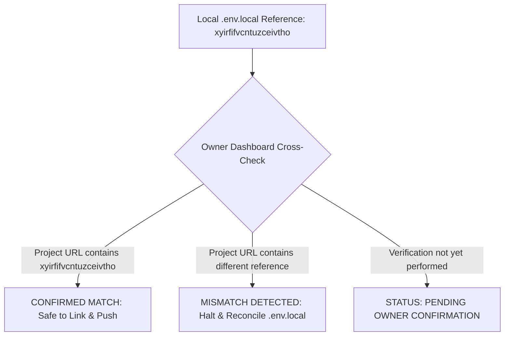
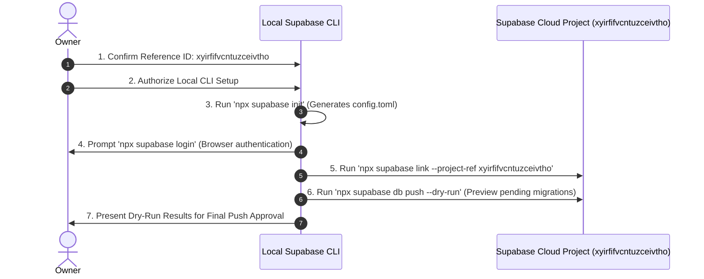

# CMIRS Phase 5E — Local Supabase CLI Preparation and Target Verification

> **Document:** `docs/database-design/PHASE_5E_LOCAL_CLI_PREPARATION.md`  
> **Date:** 2026-10-18  
> **Project:** Campus Maintenance & Incident Reporting System (CMIRS)  
> **Phase:** 5E — Local Supabase CLI Preparation & Remote Target Verification  
> **Role:** Lead PostgreSQL/Supabase Infrastructure Architect & Security Engineer  
> **Status:** AUDIT & TARGET VERIFICATION DELIVERABLE (READ-ONLY INSPECTION)  
> **Execution Status:** **NO DATABASE EXECUTION — ZERO REMOTE CONNECTIONS MADE**  
> **Readiness Verdict:** **READY FOR OWNER CONFIRMATION**  

---

## 1. Executive Summary & Objective

### 1.1 Context
CMIRS is transitioning database development and verification to Supabase Cloud, bypassing local Docker container virtualization. The project repository contains six approved, cryptographically verified SQL migrations (`supabase/migrations/`) and a database test suite (`supabase/tests/`).

The project owner previously inspected a Supabase project via the management dashboard and confirmed that its database appears empty. However, the owner has **not yet confirmed** whether the inspected project is the exact same project referenced by the local application environment configuration.

### 1.2 Objective of Phase 5E
Phase 5E performs read-only local preparation and verification:
1. Safely extract the locally configured Supabase project reference from `.env.local` without exposing secrets or credentials.
2. Cross-evaluate the project reference status against the owner's dashboard findings.
3. Assess the Supabase CLI version and local workspace configuration readiness.
4. Document the exact purpose and file impact of `supabase init`.
5. Establish a safe, sequential plan for CLI linking, migration preview, and execution.

> [!CAUTION]
> **STRICT SAFETY COMPLIANCE & ZERO-TOUCH BOUNDARIES**  
> In strict accordance with Phase 5E rules:
> - **Zero Remote Calls:** `supabase login`, `supabase link`, `supabase db push`, and `supabase migration up` were **not** executed.
> - **Zero Database Mutations:** No SQL commands, migrations, or database tests were run.
> - **Zero Secret Exposure:** No API keys, service-role keys, passwords, or credentials were printed, logged, or copied.
> - **Zero File Modifications:** Application code, migration files, and `.env.local` remain completely unaltered.
> - **No `supabase init` Executed:** Local initialization is analyzed and documented, but not executed ahead of owner sign-off.
> - **Clean Git History:** No commits, branches, or Git pushes were initiated.

---

## 2. Target Project Reference Extraction & Verification Status

### 2.1 Locally Configured Target Reference

A read-only local extraction of `NEXT_PUBLIC_SUPABASE_URL` from `.env.local` was performed. **No keys or secrets were accessed, printed, or exposed.**

| Configuration Property | Extracted Value | Security & Formatting Notes |
|---|---|---|
| **Config Source File** | `.env.local` | Local development environment file (excluded by `.gitignore`). |
| **Configured Hostname** | `xyirfifvcntuzceivtho.supabase.co` | Standard Supabase Cloud API endpoint hostname. |
| **Extracted Project Reference** | `xyirfifvcntuzceivtho` | 20-character alphanumeric project identifier. |
| **Credentials / Secrets** | `[NOT PRINTED / PROTECTED]` | Publishable key and service keys remained completely unprinted. |

### 2.2 Target Verification Cross-Check



- **Owner Observation:** The owner inspected a Supabase project and confirmed its database appears empty.
- **Reference Comparison:** The owner has not yet confirmed the reference ID of the inspected project.
- **Verification Status:** **PENDING OWNER CONFIRMATION**.
- **Action Required by Owner:** Check whether the dashboard project has the reference ID `xyirfifvcntuzceivtho` using the instructions in Section 3.

---

## 3. Owner Verification Guide (Supabase Dashboard)

Before authorizing any CLI linkage or migration push, the owner should confirm that the empty project inspected in the dashboard matches `xyirfifvcntuzceivtho`.

### How to Check the Project Reference ID in 30 Seconds:

1. Log in to the [Supabase Dashboard](https://supabase.com/dashboard).
2. Select the development project previously inspected.
3. Check the **Browser URL**:
   - The URL follows the pattern: `https://supabase.com/dashboard/project/<PROJECT_REF>`
   - Confirm whether `<PROJECT_REF>` matches:
     ```text
     xyirfifvcntuzceivtho
     ```
4. **Alternative Check via Settings:**
   - Click the **Project Settings** (gear icon) at the bottom of the left sidebar.
   - Under **General** → **Project Settings**, locate the field **Reference ID**.
   - Compare the Reference ID to `xyirfifvcntuzceivtho`.

### Verification Outcomes:
- **Case A — Matches (`xyirfifvcntuzceivtho`):**  
  The empty project inspected in the dashboard is confirmed to be the exact target configured locally. Proceed to CLI initialization and linkage.
- **Case B — Different Reference ID (Mismatch):**  
  The inspected project is not the one configured in `.env.local`. **Do not link or push.** The owner must decide whether to update `.env.local` to point to the inspected project or navigate to `xyirfifvcntuzceivtho` in the dashboard to inspect its schema.

---

## 4. Local CLI & Configuration Readiness

### 4.1 Supabase CLI Version Status
- **Execution Command:** `npx supabase --version`
- **Detected Version:** **`2.121.0`**
- **Assessment:** Modern, supported CLI version featuring full support for remote linking, management API authentication, migration tracking via `supabase_migrations.schema_migrations`, and non-destructive dry-run previews (`supabase db push --dry-run`).

### 4.2 Configuration File (`supabase/config.toml`) Status
- **File Existence:** `supabase/config.toml` is currently **ABSENT** (`Test-Path: False`).
- **Current Directory Layout:**
  ```text
  supabase/
  ├── .temp/
  │   └── cli-latest
  ├── migrations/
  │   ├── 20261018000001_core_schema.sql
  │   ├── 20261018000002_performance_indexes.sql
  │   ├── 20261018000003_triggers.sql
  │   ├── 20261018000004_security_functions_and_rpc.sql
  │   ├── 20261018000005_table_rls_policies.sql
  │   └── 20261018000006_storage_setup.sql
  └── tests/
      └── database_test_suite.sql
  ```

### 4.3 Analysis of `supabase init` (Local Setup Impact)

In compliance with Phase 5E boundaries, `npx supabase init` was **not executed**. The analysis below details what running `supabase init` will do when authorized:

1. **Why `supabase init` is Needed:**
   The Supabase CLI requires `supabase/config.toml` to identify the repository root as a Supabase project. Invocations such as `npx supabase link --project-ref <REF>` or `npx supabase db push` immediately exit with an error if `supabase/config.toml` does not exist:
   ```text
   supabase/config.toml not found. Run 'supabase init' first.
   ```
2. **What Files `supabase init` Creates:**
   - **`supabase/config.toml`**: Defines project parameters, local port bindings, studio settings, auth configurations, and storage limits.
   - **`supabase/seed.sql`**: Created if absent as an empty SQL file for optional database seed fixtures.
3. **Safety of Existing Migrations:**
   - `supabase init` **does not overwrite or alter** existing migration files in `supabase/migrations/`.
   - The six CMIRS migration files and the test harness in `supabase/tests/` will remain completely unaffected.

---

## 5. Local Git Working-Tree Status

A read-only Git status check was performed:

```text
On branch main
Your branch is ahead of 'origin/main' by 10 commits.
  (use "git push" to publish your local commits)

nothing to commit, working tree clean
```

- **Branch:** `main`
- **Working Tree:** Clean (all files tracked, zero uncommitted modifications, zero staged changes).
- **Integrity:** Phase 5D readiness documentation is committed locally; zero Git changes or pushes were executed during Phase 5E.

---

## 6. Prerequisites Checklist for Remote Transition

Before executing any remote command, the following prerequisites must be confirmed:

| Prerequisite ID | Description | Current Status | Required Action |
|---|---|:---:|---|
| **PREREQ-1** | Project Reference Confirmation | **PENDING** | Owner verifies whether dashboard project Reference ID is `xyirfifvcntuzceivtho`. |
| **PREREQ-2** | Empty Database Confirmation | **CONFIRMED** | Owner confirmed inspected project contains no active tables or conflicting data. |
| **PREREQ-3** | CLI Configuration Initialization | **PENDING AUTHORIZATION** | Run `npx supabase init` to generate `supabase/config.toml`. |
| **PREREQ-4** | CLI Authentication | **PENDING AUTHORIZATION** | Run `npx supabase login` to authenticate CLI with Supabase personal access token. |
| **PREREQ-5** | Execution Authorization | **PENDING AUTHORIZATION** | Explicit owner sign-off authorizing Phase 5F (Remote Link & Dry-Run Preview). |

---

## 7. Safe, Ordered Next-Step Plan (Phase 5F Preview)

When the owner completes the reference verification and grants explicit authorization, the transition will follow this sequential protocol:



### Protocol Steps:

1. **Step 1 — Project Initialization:**
   ```powershell
   npx supabase init
   ```
   *Action:* Creates `supabase/config.toml`. Validates workspace without altering existing migrations.
2. **Step 2 — Secure CLI Authentication:**
   ```powershell
   npx supabase login
   ```
   *Action:* Opens browser for secure Supabase account authorization. No access tokens or secrets are stored in code or repository files.
3. **Step 3 — Link to Confirmed Project:**
   ```powershell
   npx supabase link --project-ref xyirfifvcntuzceivtho
   ```
   *Action:* Links the local repository to the confirmed remote development project. Creates `.supabase/project-ref`.
4. **Step 4 — Non-Destructive Dry-Run Preview:**
   ```powershell
   npx supabase db push --dry-run
   ```
   *Action:* Queries remote `supabase_migrations.schema_migrations` and previews the exact sequence of the six migrations to be pushed, without applying any changes.
5. **Step 5 — Migration Execution & Test Suite (Phase 5G):**
   Following dry-run sign-off, push migrations sequentially, verify catalog, and run the isolated rollback test suite.

---

## 8. Final Verdict

### **Verdict: READY FOR OWNER CONFIRMATION**

**Verdict Rationale:**
- **Local Environment:** 100% prepared. Supabase CLI `2.121.0` is operational, Git working tree is clean, and the six SQL migrations are cryptographically validated.
- **Target Identification:** The project reference `xyirfifvcntuzceivtho` has been safely extracted from `.env.local` without secret exposure.
- **Safety Boundary Preserved:** Zero remote connections, zero logins, zero file alterations, and zero database executions occurred.
- **Single Pending Action:** The only missing prerequisite is the owner's confirmation that `xyirfifvcntuzceivtho` matches the Reference ID of the empty development project in the Supabase Dashboard.

---
*Report completed. All actions were read-only. Awaiting owner confirmation of project reference `xyirfifvcntuzceivtho` and further instructions.*
