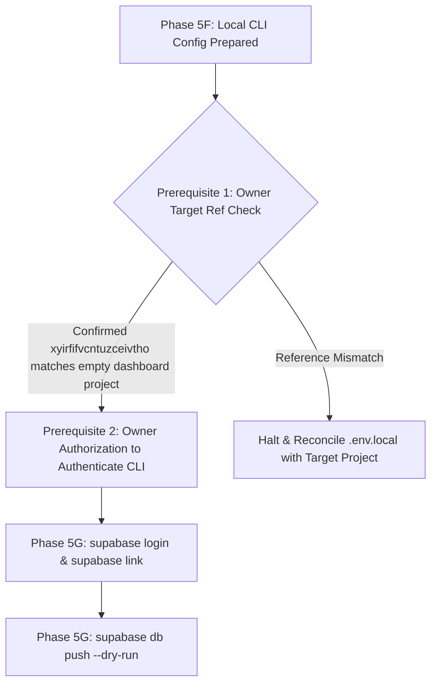

# CMIRS Phase 5F — Local Supabase CLI Configuration Setup Report

> **Document:** `docs/database-design/PHASE_5F_LOCAL_CLI_SETUP_REPORT.md`  
> **Date:** 2026-10-18  
> **Project:** Campus Maintenance & Incident Reporting System (CMIRS)  
> **Phase:** 5F — Local Supabase CLI Configuration Preparation  
> **Role:** Lead PostgreSQL/Supabase Infrastructure Architect & Security Engineer  
> **Status:** LOCAL SETUP COMPLETE (READ-ONLY WITH RESPECT TO CLOUD)  
> **Remote Status:** **ZERO REMOTE CONNECTIONS — ZERO DATABASE MUTATIONS**  
> **Final Phase Verdict:** **PASS — LOCAL CONFIGURATION PREPARED**  

---

## 1. Executive Summary & Authorization Boundary

### 1.1 Scope & Owner Authorization
In accordance with explicit project owner authorization for Phase 5F, local Supabase CLI workspace configuration was prepared. Prior to this phase, the repository contained the six audited SQL migration files and test harness under `supabase/`, but lacked `supabase/config.toml`. 

The initialization was performed strictly on the local workstation using the installed Supabase CLI version `2.121.0`.

### 1.2 Strict Non-Execution Compliance
In strict adherence to the project safety rules:
- **Zero Remote Connections:** No network calls were made to Supabase Cloud (`*.supabase.co` or `*.pooler.supabase.com`).
- **No Remote Commands:** `supabase login`, `supabase link`, `supabase db push`, and `supabase migration up` were **not** run.
- **Zero Database Operations:** No SQL statements, migrations, or test suites were executed.
- **Zero Credential Exposure:** `.env.local` was not modified, logged, printed, or exposed.
- **No Git Mutations:** No commits, branches, or Git pushes were initiated.

---

## 2. Initial Repository State (Pre-Initialization Inspection)

A static inspection was conducted immediately prior to executing any command to establish a verified baseline:

| Inspection Item | Inspected Baseline State | Evaluation |
|---|---|---|
| **Working Directory** | `D:\CMIRS-System\my-app` | Verified repository root. |
| **Git Branch** | `main` | Verified primary branch (ahead of origin/main by 10 commits). |
| **Git Working Tree** | Clean (1 untracked file: `PHASE_5E_LOCAL_CLI_PREPARATION.md`) | Verified clean state; zero modified tracked files. |
| **`supabase/config.toml`** | **ABSENT** (`Test-Path: False`) | Confirmed missing configuration file. |
| **`supabase/seed.sql`** | **ABSENT** (`Test-Path: False`) | Confirmed clean directory without seed fixtures. |
| **`.supabase/` Directory** | **ABSENT** (`Test-Path: False`) | Confirmed completely unlinked from any remote project. |
| **`supabase/migrations/`** | Exactly 6 SQL migration files present | Confirmed all 6 migration files present. |
| **`supabase/tests/`** | `database_test_suite.sql` present | Confirmed test runner script present. |
| **`.env.local` Timestamp** | `10/18/2026 2:20:03 PM` (Length: 150 bytes) | Baseline timestamp recorded. |

---

## 3. Initialization Execution & Results

### 3.1 Command Executed
The initialization was run locally from the repository root:
```powershell
# Executed in D:\CMIRS-System\my-app
npx supabase init
```

### 3.2 Command Output & Conflict Analysis
- **Exit Code:** `0` (Success)
- **Output:**
  ```text
  Finished supabase init.
  ```
- **Conflict Evaluation:**
  - Zero conflicts were reported by the CLI.
  - Zero prompts to overwrite existing files were encountered.
  - The CLI recognized the existing `supabase/` folder and populated only the missing configuration artifacts.

---

## 4. Verification of Local Artifacts & File Integrity

### 4.1 Created Files Inventory

| Created File Path | File Size | Description & Contents |
|---|---|---|
| [`supabase/config.toml`](file:///d:/CMIRS-System/my-app/supabase/config.toml) | 15,659 bytes (416 lines) | Primary Supabase CLI configuration file. Defines API, DB, Studio, Auth, and Storage parameters. Project ID defaults to `"my-app"`. |
| [`supabase/.gitignore`](file:///d:/CMIRS-System/my-app/supabase/.gitignore) | 72 bytes (9 lines) | Local ignore rules preventing local transient CLI artifacts (`.branches`, `.temp`, `.env.keys`, `.env.local`) from accidental Git staging. |

### 4.2 Cryptographic Verification of Existing Migration & Test Files

All six migration files and the test harness were re-hashed using SHA-256 and compared against the Phase 4D/5A/5B/5E cryptographic baseline:

| Sequence | File Name | SHA-256 Checksum (Post-Init) | Pre-Init Match | Status |
|:---:|---|---|:---:|:---:|
| **1** | `20261018000001_core_schema.sql` | `3CA8111D309334AD842D1BA65E4D642F23D42EFF02863D528196A80855B63BCF` | **EXACT MATCH** | **UNTOUCHED** |
| **2** | `20261018000002_performance_indexes.sql` | `1184B97E1FDC7B42487C8EA4D8B4E767506A1EF9ABA0032AE625ACA1767D01FC` | **EXACT MATCH** | **UNTOUCHED** |
| **3** | `20261018000003_triggers.sql` | `858CF347752152A517D6EF68E726EA5401ACEDB57672CD34E43D79C9285B2254` | **EXACT MATCH** | **UNTOUCHED** |
| **4** | `20261018000004_security_functions_and_rpc.sql` | `FFD5A221A489AC2BA5C877C78D3887B93A72B7BDD1DEE1EA211BDBB3B8DF7900` | **EXACT MATCH** | **UNTOUCHED** |
| **5** | `20261018000005_table_rls_policies.sql` | `76E42398817FF61385B884C2548BDCECFF6FEBED125F115BB024BFBE98B9C42C` | **EXACT MATCH** | **UNTOUCHED** |
| **6** | `20261018000006_storage_setup.sql` | `38610E66A59620FFCF11414F533C1B19552514E27209EE01EF1035D0684B20AF` | **EXACT MATCH** | **UNTOUCHED** |
| **Test** | `database_test_suite.sql` | `C3911D47EE60B52CE05EB086A5A2D3ABD2F29B130D819E7CB188A6576D595C2E` | **EXACT MATCH** | **UNTOUCHED** |

*Verification Result:* **100% Bit-for-Bit Integrity Confirmed.** Not a single byte in any SQL migration or test file was altered.

### 4.3 Environment File (`.env.local`) Protection Check
- **File Length:** 150 bytes (identical to baseline).
- **Last Modified:** `10/18/2026 2:20:03 PM` (identical to baseline).
- **Assessment:** `.env.local` was untouched. No credentials were accessed or exposed.

### 4.4 Linkage & Remote Boundary Check
- **`.supabase/` Directory:** Confirmed **ABSENT** (`Test-Path: False`).
- **Assessment:** The project remains completely detached from any remote cloud endpoint.

---

## 5. Post-Initialization Git Status

A read-only Git status and diff inspection confirmed that zero tracked files were modified:

```text
On branch main
Your branch is ahead of 'origin/main' by 10 commits.
  (use "git push" to publish your local commits)

Untracked files:
  (use "git add <file>..." to include in what will be committed)
	docs/database-design/PHASE_5E_LOCAL_CLI_PREPARATION.md
	supabase/.gitignore
	supabase/config.toml

nothing added to commit but untracked files present (use "git add" to track)
```

- **Git Diff:** `git diff` returned **zero changes**.
- **Untracked Artifacts:** Only the newly created [`supabase/config.toml`](file:///d:/CMIRS-System/my-app/supabase/config.toml), [`supabase/.gitignore`](file:///d:/CMIRS-System/my-app/supabase/.gitignore), and the previous Phase 5E report exist as untracked files.
- **Git State:** No commits or branch manipulations occurred.

---

## 6. Structural State of `supabase/` Directory

The resulting structure of the `supabase/` directory is clean, standard, and completely aligned with Supabase CLI conventions:

```text
D:\CMIRS-System\my-app\supabase\
├── .gitignore                                   # [NEW] Local ignore rules
├── config.toml                                  # [NEW] CLI configuration anchor
├── .temp\
│   └── cli-latest                               # CLI cache marker
├── migrations\
│   ├── 20261018000001_core_schema.sql           # [UNTOUCHED]
│   ├── 20261018000002_performance_indexes.sql   # [UNTOUCHED]
│   ├── 20261018000003_triggers.sql              # [UNTOUCHED]
│   ├── 20261018000004_security_functions_and_rpc.sql # [UNTOUCHED]
│   ├── 20261018000005_table_rls_policies.sql   # [UNTOUCHED]
│   └── 20261018000006_storage_setup.sql         # [UNTOUCHED]
└── tests\
    └── database_test_suite.sql                  # [UNTOUCHED]
```

---

## 7. Remaining Prerequisites for the Next Phase

Local CLI configuration preparation is complete. Before advancing to Phase 5G (Remote Linking and Dry-Run Preview), the following prerequisites remain:



| Prerequisite ID | Description | Current Status | Required Owner Action |
|---|---|:---:|---|
| **PREREQ-1** | Project Reference Confirmation | **PENDING OWNER CONFIRMATION** | Owner confirms that the empty project inspected in the dashboard has Reference ID `xyirfifvcntuzceivtho`. |
| **PREREQ-2** | CLI Authentication Authorization | **PENDING OWNER AUTHORIZATION** | Owner authorizes running `npx supabase login` (interactive browser login). |
| **PREREQ-3** | Remote Linkage Authorization | **PENDING OWNER AUTHORIZATION** | Owner authorizes running `npx supabase link --project-ref xyirfifvcntuzceivtho`. |
| **PREREQ-4** | Dry-Run Preview Authorization | **PENDING OWNER AUTHORIZATION** | Owner authorizes running `npx supabase db push --dry-run` to preview pending migrations. |

---

## 8. Final Verdict

### **Verdict: PASS — LOCAL CONFIGURATION PREPARED**

**Verdict Rationale:**
1. `supabase/config.toml` and `supabase/.gitignore` were initialized successfully without conflicts.
2. All six migration files and the database test harness remain 100% unaltered, verified via SHA-256 cryptographic hashes.
3. `.env.local` was untouched and zero credentials were exposed.
4. Zero remote calls, database operations, or Git commits were made.
5. The local workspace is now fully prepared to anchor Supabase CLI commands (`supabase link`, `supabase db push --dry-run`) upon explicit owner authorization.

---
*Report completed. The local environment is prepared and awaiting owner review, project reference confirmation, and next-phase authorization.*
