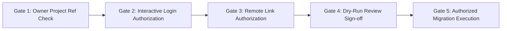
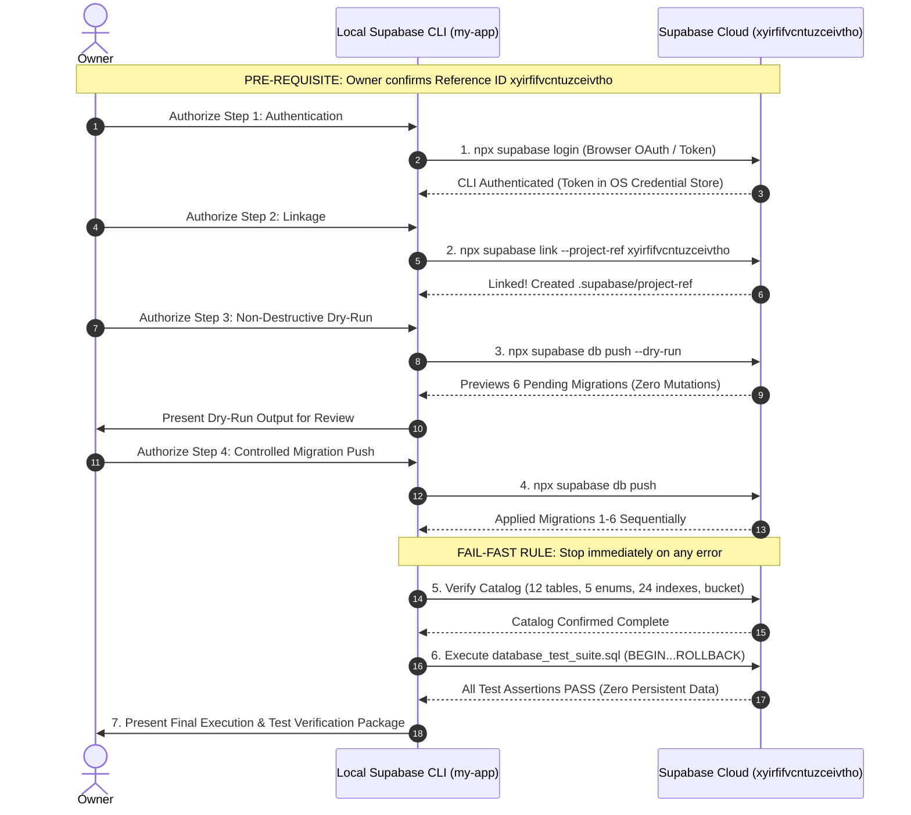

# CMIRS Phase 5G — Remote Target Safety Review & CLI Authentication Preparation

> **Document:** `docs/database-design/PHASE_5G_REMOTE_SAFETY_REVIEW.md`  
> **Date:** 2026-10-18  
> **Project:** Campus Maintenance & Incident Reporting System (CMIRS)  
> **Phase:** 5G — Remote Target Safety Review & CLI Authentication Preparation  
> **Role:** Lead PostgreSQL/Supabase Infrastructure Architect & Security Engineer  
> **Status:** AUDIT & PLANNING DELIVERABLE (READ-ONLY INSPECTION)  
> **Execution Status:** **NO DATABASE EXECUTION — ZERO REMOTE CONNECTIONS MADE**  
> **Final Phase Verdict:** **CONDITIONAL — READY FOR OWNER TARGET CONFIRMATION**  

---

## 1. Executive Summary & Review Objectives

### 1.1 Progression & Context
The CMIRS project has completed its local preparatory milestones:
- **Phase 5D ([PHASE_5D_SUPABASE_CLOUD_READINESS.md](file:///d:/CMIRS-System/my-app/docs/database-design/PHASE_5D_SUPABASE_CLOUD_READINESS.md)):** Established the Docker-free cloud development strategy, audited all six migration files, and created a sequential cloud execution runbook.
- **Phase 5E ([PHASE_5E_LOCAL_CLI_PREPARATION.md](file:///d:/CMIRS-System/my-app/docs/database-design/PHASE_5E_LOCAL_CLI_PREPARATION.md)):** Safely extracted the locally configured project reference (`xyirfifvcntuzceivtho`) from `.env.local` without secret exposure and defined the Dashboard verification criteria.
- **Phase 5F ([PHASE_5F_LOCAL_CLI_SETUP_REPORT.md](file:///d:/CMIRS-System/my-app/docs/database-design/PHASE_5F_LOCAL_CLI_SETUP_REPORT.md)):** Initialized local workspace configuration (`supabase/config.toml` and `supabase/.gitignore`) cleanly with zero conflicts, preserving all migration files with 100% cryptographic checksum verification.

### 1.2 Objective of Phase 5G
Phase 5G is the final safety checkpoint before any network connection to Supabase Cloud:
1. Conduct an exhaustive inspection of local configuration and Git state.
2. Formally separate **verified facts** from **unverified assumptions**.
3. Identify all remaining safety prerequisites.
4. Establish a strict, fail-safe protocol for future CLI authentication (`supabase login`), remote linkage (`supabase link`), dry-run preview (`supabase db push --dry-run`), and migration execution.

> [!CAUTION]
> **STRICT SAFETY BOUNDARIES PRESERVED**  
> In compliance with Phase 5G instructions:
> - **Zero Remote Calls:** `supabase login`, `supabase link`, `supabase db push`, and `supabase migration up` were **not** executed.
> - **Zero Database Operations:** No SQL statements, migrations, or test suites were run.
> - **Zero Secret Exposure:** No API keys, service-role keys, passwords, or credentials were read, printed, or exposed.
> - **Zero File Modifications:** Application code, migration files, and `.env.local` remain completely unaltered.
> - **Clean Git History:** No commits, branches, or Git pushes were initiated.

---

## 2. Distinction Between Verified Facts and Assumptions

To maintain absolute architectural integrity, all operational information is explicitly categorized into verified facts and working assumptions:

```mermaid
graph TD
    subgraph Verified Facts (Local Inspection)
        F1[CLI 2.121.0 Operational via npx]
        F2[supabase/config.toml Initialized & Readable]
        F3[All 6 Migration Files Cryptographically Verified]
        F4[Test Harness database_test_suite.sql Intact]
        F5[Local Target Ref: xyirfifvcntuzceivtho]
        F6[Zero Existing Linkage: .supabase/ Absent]
        F7[Git Working Tree Clean]
    end

    subgraph Assumptions (Pending Confirmation)
        A1[Inspected Dashboard Project Matches xyirfifvcntuzceivtho]
        A2[Target Remote Database Schema is Completely Empty]
        A3[Remote Postgres Major Version Matches config.toml]
        A4[Storage & GoTrue Schemas are Standard & Intact]
    end

    F5 -.-> A1
    A1 --> A2
```

### 2.1 Verified Facts (Proven Statically)

| Item | Verified Fact | Evidence / Verification Method |
|---|---|---|
| **Working Directory** | Repository root is `D:\CMIRS-System\my-app`. | Verified via `Get-Location`. |
| **CLI Availability** | Supabase CLI version `2.121.0` is operational. | Verified via `npx supabase --version`. |
| **Local Configuration** | [`supabase/config.toml`](file:///d:/CMIRS-System/my-app/supabase/config.toml) exists (15,659 bytes) and is valid TOML. | Verified via `Test-Path` and file inspection. |
| **Local Ignore Rules** | [`supabase/.gitignore`](file:///d:/CMIRS-System/my-app/supabase/.gitignore) exists (72 bytes), protecting local temp files. | Verified via file inspection. |
| **Local Project Reference** | `NEXT_PUBLIC_SUPABASE_URL` in `.env.local` points to `xyirfifvcntuzceivtho.supabase.co`. | Extracted safely in Phase 5E without secret exposure. |
| **Linkage State** | `.supabase/` is absent. Local CLI is completely unlinked. | Verified via `Test-Path .supabase`. |
| **Migration Integrity** | All six migration files match their Phase 4D/5A SHA-256 hashes exactly: <br>• `01_core_schema.sql` (`3CA8111D...`)<br>• `02_performance_indexes.sql` (`1184B97E...`)<br>• `03_triggers.sql` (`858CF347...`)<br>• `04_security_functions_and_rpc.sql` (`FFD5A221...`)<br>• `05_table_rls_policies.sql` (`76E42398...`)<br>• `06_storage_setup.sql` (`38610E66...`) | Verified via `Get-FileHash`. Zero discrepancies. |
| **Test Suite Integrity** | [`database_test_suite.sql`](file:///d:/CMIRS-System/my-app/supabase/tests/database_test_suite.sql) matches SHA-256 `C3911D47...`. | Verified via `Get-FileHash`. Zero discrepancies. |
| **Credential Safety** | `.env.local` timestamp and length remain untouched (`10/18/2026 2:20:03 PM`, 150 bytes). | Verified via `Get-Item`. |
| **Git Working Tree** | Clean tracked tree; only newly generated planning reports are present. | Verified via `git status` and `git diff`. |

### 2.2 Unverified Assumptions (Requiring Owner / Cloud Confirmation)

| Item | Assumption | Risk if Assumption is Invalid | Required Action |
|---|---|---|---|
| **Target Project Match** | The empty project inspected by the owner in the Dashboard has Reference ID `xyirfifvcntuzceivtho`. | If the inspected project has a different ID, connecting could target an unintended or populated database. | **Owner must verify** Reference ID in Dashboard URL. |
| **Target Database Purity** | The target database contains zero conflicting tables, enums, triggers, or policies. | If tables (`profiles`, `reports`) already exist, migration 1 will fail or require reconciliation. | Owner visual confirmation in Table Editor. |
| **PostgreSQL Version** | Remote database is compatible with `major_version = 17` specified in [`supabase/config.toml`](file:///d:/CMIRS-System/my-app/supabase/config.toml). | If the remote project is PostgreSQL 15, `supabase link` will detect the difference and prompt for version alignment. | `supabase link` auto-detects and aligns version. |
| **Storage Schema Health** | `storage.buckets` and `storage.objects` are present in their default clean state. | If bucket `report-attachments` already exists with conflicting settings, migration 6 could behave unexpectedly. | Owner visual check under Dashboard Storage. |
| **Auth Webhook Privileges** | GoTrue `auth.users` allows trigger `trg_on_auth_user_created` insertion. | In non-standard roles, trigger attachment might be restricted; standard Supabase projects grant full trigger rights to `postgres`. | Verified during Migration 3 execution. |

---

## 3. Local Supabase CLI Configuration Review

A comprehensive review of [`supabase/config.toml`](file:///d:/CMIRS-System/my-app/supabase/config.toml) was performed to ensure parameters align with CMIRS cloud development requirements:

### 3.1 Key Configuration Parameters Analysis

| Section & Parameter | Configured Value | Analysis & Cloud Compatibility |
|---|---|---|
| **`project_id`** | `"my-app"` | Local identifier used to namespace CLI operations. Remote linkage will bind via `.supabase/project-ref`. |
| **`[api] schemas`** | `["public", "graphql_public"]` | Correctly exposes the `public` schema for PostgREST API access. Matches CMIRS table definitions. |
| **`[api] extra_search_path`**| `["public", "extensions"]` | Ensures extensions like `pgcrypto` are discoverable. |
| **`[db] major_version`** | `17` | Defaults to PostgreSQL 17. Remote Supabase instances may run Postgres 15 or 17. `supabase link` synchronizes this cleanly. |
| **`[db.migrations] enabled`**| `true` | Required for `supabase db push` to recognize and apply files from `supabase/migrations/`. |
| **`[db.migrations] schema_paths`**| `[]` | Empty array defaults migration discovery to `supabase/migrations/*.sql` in standard timestamp order. |
| **`[storage] file_size_limit`**| `"50MiB"` | Local ceiling. Migration 6 explicitly enforces the CMIRS 10MB limit (`10485760` bytes) at both bucket and table levels. |
| **`[auth] enable_signup`** | `true` | Allows user registration in development testing, triggering `handle_new_user()` (Trigger T4). |
| **`[auth] jwt_expiry`** | `3600` (1 hour) | Matches standard production token lifecycle. Tested with session refresh proxy ([proxy.ts](file:///d:/CMIRS-System/my-app/proxy.ts)). |

---

## 4. Remaining Safety Prerequisites

Before any remote CLI command is executed, the following four gates must be cleared:



### Gate 1: Owner Project Reference Check (Mandatory)
The owner must confirm that the URL of the empty development project in the Supabase Dashboard matches:
```text
https://supabase.com/dashboard/project/xyirfifvcntuzceivtho
```
*(Or verify that **Project Settings → General → Reference ID** displays `xyirfifvcntuzceivtho`).*

### Gate 2: Interactive Authentication Authorization
The owner must authorize running `npx supabase login`. This command opens a secure browser window requesting a Supabase Personal Access Token. Zero secrets are written to the repository or exposed in application code.

### Gate 3: Database Password Availability
During `npx supabase link --project-ref xyirfifvcntuzceivtho`, the CLI may prompt for the database password set by the owner when creating the Supabase project. The owner must have this password ready.

### Gate 4: Zero Destructive Commands Policy
The owner and developer must mutually reaffirm the strict rule:
> **Under no circumstances will `DROP SCHEMA public CASCADE;` or storage bucket deletion be executed on the remote Supabase project.**  
> If an error occurs, the process halts immediately for targeted forward resolution.

---

## 5. Safe, Sequential Execution Protocol (Future Phase 5H)

When all gates are cleared, future execution must proceed strictly according to this eight-step sequential protocol:



### Protocol Execution Details:

1. **Step 1 — CLI Authentication (`npx supabase login`):**
   - Launches interactive browser session.
   - Generates and stores the management API access token in the operating system's secure credential store.
   - Zero credential files created in the project repository.
2. **Step 2 — Remote Project Linkage (`npx supabase link`):**
   - Command: `npx supabase link --project-ref xyirfifvcntuzceivtho`
   - Binds local workspace to the remote development project.
   - Populates `.supabase/project-ref`.
   - Synchronizes remote database version with `supabase/config.toml`.
3. **Step 3 — Non-Destructive Dry-Run Preview (`npx supabase db push --dry-run`):**
   - Command: `npx supabase db push --dry-run`
   - Compares local migration files against remote `supabase_migrations.schema_migrations`.
   - Confirms that all six migration files are recognized and pending:
     1. `20261018000001_core_schema.sql`
     2. `20261018000002_performance_indexes.sql`
     3. `20261018000003_triggers.sql`
     4. `20261018000004_security_functions_and_rpc.sql`
     5. `20261018000005_table_rls_policies.sql`
     6. `20261018000006_storage_setup.sql`
   - **Crucial Safety Property:** Zero SQL statements are executed; remote state is completely unchanged.
4. **Step 4 — Controlled Migration Application (`npx supabase db push`):**
   - Executed only after owner reviews the dry-run output.
   - Pushes the six migrations in strict dependency order.
   - **Fail-Fast Enforcement:** If any script fails, execution aborts immediately. No rollbacks or drops are attempted.
5. **Step 5 — Catalog Completeness Verification:**
   - Execute verification query confirming 12 tables, 5 enums, 1 sequence, 24 indexes, and the private `report-attachments` bucket.
6. **Step 6 — Isolated Test Suite Execution:**
   - Run [`supabase/tests/database_test_suite.sql`](file:///d:/CMIRS-System/my-app/supabase/tests/database_test_suite.sql).
   - Executed inside `BEGIN ... ROLLBACK;` to guarantee **zero persistent data contamination**.
   - Validates report numbering, immutability triggers, decline constraints, attachment limits, and audit history.
7. **Step 7 — Delivery of Phase 5H Execution Package:**
   - Compile final execution log, test suite output, and verification results for owner sign-off.

---

## 6. Final Phase Verdict

### **Verdict: CONDITIONAL — READY FOR OWNER TARGET CONFIRMATION**

**Verdict Rationale:**
1. **Local Foundation is 100% Prepared:** The Supabase CLI is operational, [`supabase/config.toml`](file:///d:/CMIRS-System/my-app/supabase/config.toml) is configured, the Git working tree is clean, and all six migration files are cryptographically verified.
2. **Safety Boundaries are Intact:** Zero remote connections have been made, no credentials have been exposed, and zero database mutations have occurred.
3. **Condition for Advancement:** Execution of Step 1 (`npx supabase login`) and Step 2 (`npx supabase link`) is **strictly conditioned** upon the owner verifying that the empty dashboard project Reference ID is `xyirfifvcntuzceivtho`.

---
*Report completed in read-only inspection mode. All migration files remain untouched. Awaiting owner target confirmation and explicit authorization before proceeding to Phase 5H.*
