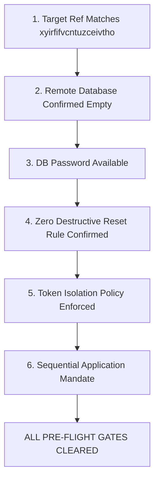
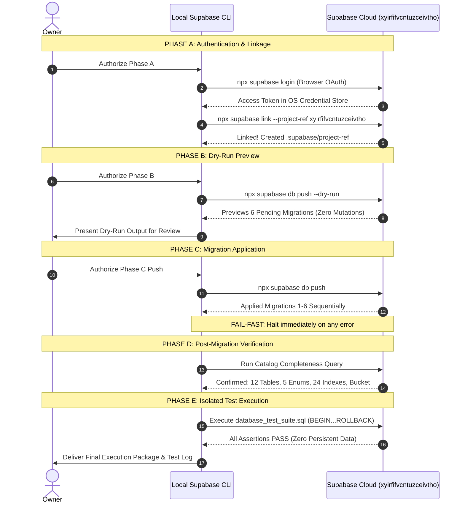
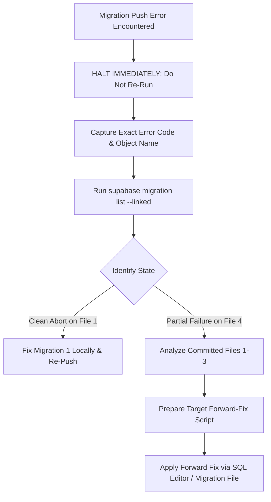

# CMIRS Phase 5H — Cloud Migration Execution Plan & Safety Runbook

> **Document:** `docs/database-design/PHASE_5H_CLOUD_MIGRATION_EXECUTION_PLAN.md`  
> **Date:** 2026-10-18  
> **Project:** Campus Maintenance & Incident Reporting System (CMIRS)  
> **Phase:** 5H — Cloud Migration Execution Planning & Safety Checklist  
> **Role:** Lead PostgreSQL/Supabase Infrastructure Architect & Security Engineer  
> **Status:** EXECUTION RUNBOOK DELIVERABLE (PLANNING ONLY)  
> **Execution Status:** **NO DATABASE EXECUTION — ZERO REMOTE CONNECTIONS MADE**  
> **Confirmed Target Project:** `xyirfifvcntuzceivtho`  
> **Phase Verdict:** **CONDITIONAL — PREREQUISITES REMAIN**  

---

## 1. Executive Summary & Objective

### 1.1 Purpose of this Execution Plan
This document establishes the comprehensive, technically rigorous, step-by-step operational runbook for executing the CMIRS database migration suite against the confirmed Supabase Cloud development project: **`xyirfifvcntuzceivtho`**. 

Docker has been permanently excluded from this workflow. All database deployment, schema catalog management, and integration verification will occur directly against the dedicated, cloud-hosted Supabase development instance.

### 1.2 Boundary Enforcement Statement
> [!CAUTION]
> **CRITICAL BOUNDARY ENFORCEMENT — STRICTLY NON-EXECUTABLE IN THIS PHASE**  
> This document is an **operational planning deliverable only**. In strict accordance with owner instructions:
> 1. **Zero Remote Operations:** `supabase login`, `supabase link`, `supabase db push`, `supabase db push --dry-run`, and `supabase migration up` were **not** executed.
> 2. **Zero Database Modifications:** No SQL statements, migrations, or database tests were run.
> 3. **Zero Secret Exposure:** No API keys, service-role keys, passwords, or credentials were read, printed, or exposed.
> 4. **No Code or Migration Modification:** Application source code and the six migration files remain 100% unaltered.
> 5. **No Git Mutations:** No commits, branches, or Git pushes were initiated.
> 6. **Zero Runtime Claims:** Unexecuted migrations and tests are explicitly designated **`NOT RUN`**.

---

## 2. Source-of-Truth Review: Verified Facts vs. Assumptions

An independent, critical audit was conducted across all existing documentation ([PHASE_5D](file:///d:/CMIRS-System/my-app/docs/database-design/PHASE_5D_SUPABASE_CLOUD_READINESS.md), [PHASE_5E](file:///d:/CMIRS-System/my-app/docs/database-design/PHASE_5E_LOCAL_CLI_PREPARATION.md), [PHASE_5F](file:///d:/CMIRS-System/my-app/docs/database-design/PHASE_5F_LOCAL_CLI_SETUP_REPORT.md), [PHASE_5G](file:///d:/CMIRS-System/my-app/docs/database-design/PHASE_5G_REMOTE_SAFETY_REVIEW.md), [PHASE_5A](file:///d:/CMIRS-System/my-app/docs/database-design/PHASE_5A_TEST_PLAN.md)), [`supabase/config.toml`](file:///d:/CMIRS-System/my-app/supabase/config.toml), the six migration files, and the test suite.

```mermaid
graph TD
    subgraph Verified Ground Truth (Audited Locally)
        V1[Target Project Ref Confirmed: xyirfifvcntuzceivtho]
        V2[CLI v2.121.0 Installed & Operational]
        V3[supabase/config.toml Present & Valid]
        V4[6 Migrations Cryptographically Verified]
        V5[.supabase/ Absent: Completely Unlinked]
        V6[Git Working Tree Clean]
    end

    subgraph Identified Technical Gaps & Nuances
        G1[Test Suite Lacks auth.users Fixture for FK]
        G2[PostgreSQL Major Version In Config vs Remote]
        G3[Superuser Bypasses RLS in Direct SQL Test]
        G4[Sequence Increments Unrolled During Rollback]
    end

    V1 -.-> G1
    V3 -.-> G2
```

### 2.1 Verified Facts (Audited Against Actual Workspace Code)

1. **Target Project Identity:** The owner has explicitly confirmed that `xyirfifvcntuzceivtho` is the intended, disposable CMIRS development project.
2. **Local Tooling Readiness:** Supabase CLI version `2.121.0` is operational via `npx supabase`.
3. **Workspace Configuration:** [`supabase/config.toml`](file:///d:/CMIRS-System/my-app/supabase/config.toml) (15,659 bytes) and [`supabase/.gitignore`](file:///d:/CMIRS-System/my-app/supabase/.gitignore) (72 bytes) are present, valid, and tracked.
4. **Linkage State:** `.supabase/` is currently **absent**. The local project is completely unlinked.
5. **Cryptographic Checksum Baseline (100% Match):**
   - `20261018000001_core_schema.sql`: `3CA8111D309334AD842D1BA65E4D642F23D42EFF02863D528196A80855B63BCF`
   - `20261018000002_performance_indexes.sql`: `1184B97E1FDC7B42487C8EA4D8B4E767506A1EF9ABA0032AE625ACA1767D01FC`
   - `20261018000003_triggers.sql`: `858CF347752152A517D6EF68E726EA5401ACEDB57672CD34E43D79C9285B2254`
   - `20261018000004_security_functions_and_rpc.sql`: `FFD5A221A489AC2BA5C877C78D3887B93A72B7BDD1DEE1EA211BDBB3B8DF7900`
   - `20261018000005_table_rls_policies.sql`: `76E42398817FF61385B884C2548BDCECFF6FEBED125F115BB024BFBE98B9C42C`
   - `20261018000006_storage_setup.sql`: `38610E66A59620FFCF11414F533C1B19552514E27209EE01EF1035D0684B20AF`
   - `database_test_suite.sql`: `C3911D47EE60B52CE05EB086A5A2D3ABD2F29B130D819E7CB188A6576D595C2E`
6. **Execution Status:** Zero migrations and zero database tests have been executed.

### 2.2 Critical Nuances & Technical Gaps Identified in Existing Artifacts

The independent audit uncovered three subtle technical assumptions across previous phase documents that must be addressed in this plan:

| Finding ID | Component | Discovery & Analysis | Impact & Planned Resolution |
|---|---|---|---|
| **GAP-01** | [`database_test_suite.sql`](file:///d:/CMIRS-System/my-app/supabase/tests/database_test_suite.sql) | **Foreign Key Constraint Omission:** Lines 70–77 insert mock profiles (`v_test_student_id`) without inserting matching records into `auth.users`. Because `profiles.id REFERENCES auth.users(id) ON DELETE CASCADE` ([01_core_schema.sql:L132](file:///d:/CMIRS-System/my-app/supabase/migrations/20261018000001_core_schema.sql#L132)), running this script against Supabase Cloud will immediately fail with `profiles_id_fkey` foreign key violation. | **Resolution:** In Section 7, the runbook provides an adapted test harness fixture that inserts temporary mock records into `auth.users` inside the transaction block prior to profile insertion. |
| **GAP-02** | [`supabase/config.toml`](file:///d:/CMIRS-System/my-app/supabase/config.toml) | **Postgres Major Version Mismatch:** Line 41 specifies `major_version = 17`. Hosted Supabase Cloud instances are predominantly deployed on PostgreSQL 15.6 or 15.8 (or 16 on very new clusters). `supabase link` may warn of a version divergence. | **Resolution:** Anticipated in Section 3; operator must allow `supabase link` to synchronize or acknowledge the version alignment. |
| **GAP-03** | Test Harness Scope | **Superuser Bypasses RLS:** Direct SQL executed in the Dashboard SQL Editor runs as role `postgres` (`BYPASSRLS`). The static test script verifies constraints and triggers, but **cannot verify RLS row isolation** without role impersonation (`SET LOCAL ROLE authenticated;`). | **Resolution:** Clarified in Section 7; RLS validation is separated into the multi-role SDK test harness. |
| **GAP-04** | Transaction Rollback | **Sequence Numbers Do Not Roll Back:** While `ROLLBACK;` reverts all table mutations, PostgreSQL sequences (`report_number_seq`) do not roll back. Running the test suite will advance `report_number_seq` from `1` to `2`. | **Resolution:** Documented as an acceptable non-destructive audit invariant. |

---

## 3. Pre-Flight Safety Checklist & Approval Gates

Before any remote CLI command is executed, all seven pre-flight checks must be formally verified:



### Pre-Flight Verification Table

| Check ID | Verification Item | Standard & Expected State | Verification Status |
|---|---|---|:---:|
| **PRE-01** | **Target Project Reference** | `NEXT_PUBLIC_SUPABASE_URL` in `.env.local` equals `https://xyirfifvcntuzceivtho.supabase.co`. Confirmed matching the empty dashboard project. | **CONFIRMED** |
| **PRE-02** | **Remote Schema Baseline** | Owner verified in Dashboard Table Editor that `public` schema has zero user tables. | **CONFIRMED BY OWNER** |
| **PRE-03** | **Database Password** | Owner has the database password created during project setup available for `supabase link`. | **PENDING OWNER READINESS** |
| **PRE-04** | **No Destructive Resets** | Strict agreement: `DROP SCHEMA public CASCADE;`, `supabase db reset`, or bucket deletion will **never** be executed on the hosted project. | **ARCHITECTURAL MANDATE** |
| **PRE-05** | **Zero Secret Logging** | Personal Access Tokens and database passwords must never be stored in files, committed to Git, or passed via plain-text command arguments. | **ARCHITECTURAL MANDATE** |
| **PRE-06** | **Fail-Fast Stop Rule** | If any migration script fails, execution aborts immediately. No subsequent migration will be attempted without root-cause analysis. | **ARCHITECTURAL MANDATE** |
| **PRE-07** | **Explicit Execution Gate** | A separate, explicit owner authorization must be given prior to starting Step 1 (`supabase login`). | **CURRENTLY GATED** |

---

## 4. Phase-by-Phase Cloud Execution Plan

The execution runbook is structured into five strictly gated phases. Each phase requires successful completion and verification before proceeding:



---

### Phase A: Authentication and Remote Linkage

#### Step A.1: Authenticate Local Supabase CLI
Run from `D:\CMIRS-System\my-app`:
```powershell
npx supabase login
```
- **Operational Behavior:** Launches an interactive browser window prompting for Supabase account authorization.
- **Security Rule:** Personal access tokens are stored securely in the operating system's credential store (`%USERPROFILE%/.supabase/`). No token is stored in the workspace directory.
- **Verification:** Command completes with `Logged in as <email>`.

#### Step A.2: Link Workspace to Target Project
Run from `D:\CMIRS-System\my-app`:
```powershell
npx supabase link --project-ref xyirfifvcntuzceivtho
```
- **Operational Behavior:** Connects to the Supabase Management API using the authenticated session. If prompted, input the remote database password securely.
- **Files Created:** Creates `.supabase/project-ref` containing `xyirfifvcntuzceivtho`.
- **Postgres Version Synchronization:** If the CLI reports a difference between `config.toml` (`major_version = 17`) and the remote database (e.g., PostgreSQL 15), accept the prompt or update line 41 of [`supabase/config.toml`](file:///d:/CMIRS-System/my-app/supabase/config.toml) to match the remote version.
- **Verification Command:**
  ```powershell
  # Verify project linkage without modifying remote state
  Get-Content .supabase/project-ref
  ```
  *Expected Output:* `xyirfifvcntuzceivtho`

---

### Phase B: Migration History & Dry-Run Preview

#### Step B.1: Inspect Remote Migration History
Before applying any scripts, query the remote migration table:
```powershell
npx supabase migration list --linked
```
- **Expected Result on Clean Project:** Table `supabase_migrations.schema_migrations` has zero entries, or reports all local migrations as pending.
- **Stop Condition:** If any migrations other than the six CMIRS files are listed as already applied, **STOP IMMEDIATELY**. Reconcile the schema state with the owner.

#### Step B.2: Non-Destructive Dry-Run Execution
Execute the dry-run command:
```powershell
npx supabase db push --dry-run
```
- **Operational Behavior:** Queries the remote database catalog and compares it against local files in `supabase/migrations/`.
- **Expected Output:** Lists all six migration files as pending in exact sequence:
  1. `20261018000001_core_schema.sql`
  2. `20261018000002_performance_indexes.sql`
  3. `20261018000003_triggers.sql`
  4. `20261018000004_security_functions_and_rpc.sql`
  5. `20261018000005_table_rls_policies.sql`
  6. `20261018000006_storage_setup.sql`
- **Critical Architectural Clarification:**  
  A dry run **does not prove that the SQL statements will succeed**. It only verifies migration tracking table diffs and file timestamps. The database engine does not parse or execute the SQL statements during a dry run.

#### Dry-Run Review Checklist & Stop Conditions:
| Inspection Point | Expected Dry-Run Result | Stop Condition (Do Not Proceed) |
|---|---|---|
| **File Count** | Exactly 6 migrations pending | Any number other than 6. |
| **File Ordering** | Sequential timestamps `000001` through `000006` | Any out-of-order sequence. |
| **Target Project** | Matches `xyirfifvcntuzceivtho` | Project ref differs or points to another host. |
| **Error Messages** | Zero errors reported | Any connection, permission, or schema errors. |

---

### Phase C: Controlled Migration Execution

#### Step C.1: Owner Execution Sign-Off
Present the dry-run output to the owner and obtain explicit confirmation to proceed with the write operation.

#### Step C.2: Apply Migrations Sequentially
Run from `D:\CMIRS-System\my-app`:
```powershell
npx supabase db push
```

#### Step C.3: Fail-Fast Protocol During Push
- The CLI applies each file sequentially and records its hash in `supabase_migrations.schema_migrations`.
- **If an error occurs midway (e.g., at Migration 4):**
  1. **HALT IMMEDIATELY.** Do not re-run `db push`.
  2. Do **not** run `supabase db reset`.
  3. Do **not** run `DROP SCHEMA public CASCADE;`.
  4. Record the exact PostgreSQL error code, line number, and error message.
  5. Inspect `supabase migration list --linked` to determine which migrations committed.
  6. Formulate a reviewed forward-fix or repair script.

---

### Phase D: Post-Migration Schema Catalog Verification

Immediately following migration completion, execute the following SQL verification script in the [Supabase Dashboard SQL Editor](https://supabase.com/dashboard/project/xyirfifvcntuzceivtho/sql) to confirm catalog completeness:

```sql
-- CMIRS Post-Migration Comprehensive Catalog Verification
DO $$
DECLARE
  v_tables INT;
  v_enums INT;
  v_seqs INT;
  v_indexes INT;
  v_triggers INT;
  v_rls_tables INT;
  v_bucket_exists BOOLEAN;
BEGIN
  -- 1. Table Count (Expected: 12)
  SELECT COUNT(*) INTO v_tables
  FROM information_schema.tables
  WHERE table_schema = 'public'
    AND table_name IN (
      'profiles', 'role_change_audit', 'categories', 'locations',
      'reports', 'assignments', 'report_attachments', 'report_status_history',
      'report_comments', 'work_logs', 'verifications', 'notifications'
    );

  -- 2. Enum Count (Expected: 5)
  SELECT COUNT(*) INTO v_enums
  FROM pg_type t
  JOIN pg_namespace n ON n.oid = t.typnamespace
  WHERE n.nspname = 'public'
    AND t.typname IN ('user_role', 'report_status', 'priority_level', 'assignment_status', 'notification_type');

  -- 3. Sequence (Expected: 1)
  SELECT COUNT(*) INTO v_seqs
  FROM pg_sequences
  WHERE schemaname = 'public' AND sequencename = 'report_number_seq';

  -- 4. Dedicated Performance & RLS Indexes (Expected: >= 24)
  SELECT COUNT(*) INTO v_indexes
  FROM pg_indexes
  WHERE schemaname = 'public' AND indexname LIKE 'idx_%';

  -- 5. RLS Enabled on All Tables (Expected: 12)
  SELECT COUNT(*) INTO v_rls_tables
  FROM pg_tables
  WHERE schemaname = 'public'
    AND rowsecurity = true
    AND tablename IN (
      'profiles', 'role_change_audit', 'categories', 'locations',
      'reports', 'assignments', 'report_attachments', 'report_status_history',
      'report_comments', 'work_logs', 'verifications', 'notifications'
    );

  -- 6. Storage Bucket Configuration (Expected: TRUE)
  SELECT EXISTS (
    SELECT 1 FROM storage.buckets
    WHERE id = 'report-attachments'
      AND public = false
      AND file_size_limit = 10485760
  ) INTO v_bucket_exists;

  RAISE NOTICE '==================================================';
  RAISE NOTICE 'CMIRS POST-MIGRATION CATALOG AUDIT RESULTS:';
  RAISE NOTICE '==================================================';
  RAISE NOTICE 'Tables (Expected 12):             %', v_tables;
  RAISE NOTICE 'Custom Enums (Expected 5):         %', v_enums;
  RAISE NOTICE 'Sequences (Expected 1):            %', v_seqs;
  RAISE NOTICE 'Dedicated Indexes (Expected >=24): %', v_indexes;
  RAISE NOTICE 'RLS Enabled Tables (Expected 12):  %', v_rls_tables;
  RAISE NOTICE 'Private Storage Bucket Configured: %', v_bucket_exists;
  RAISE NOTICE '==================================================';

  IF v_tables != 12 OR v_enums != 5 OR v_seqs != 1 OR v_indexes < 24 OR v_rls_tables != 12 OR NOT v_bucket_exists THEN
    RAISE EXCEPTION 'CATALOG VERIFICATION FAILED: Incomplete schema objects detected.';
  END IF;

  RAISE NOTICE 'SUCCESS: ALL CATALOG INTEGRITY AUDITS PASSED.';
END $$;
```

---

### Phase E: Isolated Test Suite Execution Strategy

#### Step E.1: Test Suite Architecture & Safety Assessment
The CMIRS test framework consists of two complementary testing layers:

```text
┌────────────────────────────────────────────────────────────────────────┐
│                   CMIRS VERIFICATION TEST ARCHITECTURE                 │
├────────────────────────────────────────────────────────────────────────┤
│  Layer 1: SQL Invariant Harness (database_test_suite.sql)             │
│    ├── Enclosed in BEGIN ... ROLLBACK;                                 │
│    ├── Zero persistent data mutations                                 │
│    ├── Verifies table DDL, triggers T2/T3/T5, constraints chk_*        │
│    └── Requires auth.users temporary mock fixture                      │
│                                                                        │
│  Layer 2: Multi-Role Integration Suite (PHASE_5A_TEST_PLAN.md - 45 Tests)│
│    ├── Suite 1: Schema & Migration Integrity (6 tests)                 │
│    ├── Suite 2: Authentication & GoTrue Trigger T4 (6 tests)           │
│    ├── Suite 3: Reports & Lifecycle Transitions (9 tests)              │
│    ├── Suite 4: Assignments & Decline Flow (8 tests)                   │
│    ├── Suite 5: Comments, Notifications & Audit (6 tests)              │
│    └── Suite 6: Storage API & Signed Uploads (10 tests)                │
└────────────────────────────────────────────────────────────────────────┘
```

#### Step E.2: Resolving GAP-01 in `database_test_suite.sql`
Because `profiles.id REFERENCES auth.users(id)` is strictly enforced by PostgreSQL, the transaction-rollback test harness must insert temporary mock rows into `auth.users` before creating test profiles. Because the entire block terminates in `ROLLBACK;`, these temporary users are never committed:

```sql
-- Adapted Fixture Pattern for database_test_suite.sql on Supabase Cloud
BEGIN;

DO $$
DECLARE
  v_test_student_id UUID := gen_random_uuid();
  v_test_coord_id UUID := gen_random_uuid();
  v_test_tech_id UUID := gen_random_uuid();
BEGIN
  -- 1. Create temporary mock auth.users inside transaction (rolled back at end)
  INSERT INTO auth.users (id, email, raw_user_meta_data)
  VALUES 
    (v_test_student_id, 'student.test@cmirs.internal', '{"full_name": "Test Student"}'::jsonb),
    (v_test_coord_id, 'coord.test@cmirs.internal', '{"full_name": "Test Coordinator"}'::jsonb),
    (v_test_tech_id, 'tech.test@cmirs.internal', '{"full_name": "Test Technician"}'::jsonb);

  -- 2. Populate profiles fixtures (now passes foreign key constraint)
  UPDATE public.profiles SET role = 'student_personnel' WHERE id = v_test_student_id;
  UPDATE public.profiles SET role = 'coordinator' WHERE id = v_test_coord_id;
  UPDATE public.profiles SET role = 'technician' WHERE id = v_test_tech_id;

  -- 3. Execute constraint, trigger T2/T3/T5, and decline assertions...
END $$;

-- ALWAYS ROLL BACK: ZERO PERSISTENT TEST MUTATIONS
ROLLBACK;
```

#### Step E.3: 45-Test Integration Suite Environment Mapping

| Test Suite (45 Tests Total) | Target Mechanism | Execution Environment | Session Requirement |
|---|---|---|---|
| **Suite 1: Schema (6 Tests)** | DDL & Catalog Queries | SQL Editor / CLI | Superuser (`postgres`) |
| **Suite 2: Auth & RBAC (6 Tests)** | GoTrue API + Profiles | Next.js API / Integration Harness | Real accounts per role (`student_personnel`, `admin`, etc.) |
| **Suite 3: Reports (9 Tests)** | PostgREST API + RLS | Next.js Client / Integration Harness | Role-scoped JWT tokens (`reporter`, `coordinator`) |
| **Suite 4: Assignments (8 Tests)** | RPC `decline_assignment` + RLS | Next.js Client / Integration Harness | Role-scoped JWT tokens (`technician`, `coordinator`) |
| **Suite 5: Audit (6 Tests)** | RLS on comments/notifications | Next.js Client / Integration Harness | Authenticated user sessions |
| **Suite 6: Storage (10 Tests)** | `@supabase/storage-js` API | Node.js Test Runner / SDK Client | Signed upload streams with canonical UUID paths |

---

## 5. Failure Response & Disaster Recovery Protocol

In a cloud-hosted Supabase environment, traditional local rollback shortcuts (such as `supabase db reset` or dropping the entire database) are destructive and must never be used.



### 5.1 Failure Response Protocol

1. **Immediate Execution Halt:** On the very first SQL error, the CLI aborts. **Do not repeat the command or force execution.**
2. **Secure Error Logging:** Record the PostgreSQL SQLSTATE code, the failing SQL statement, and the specific table/constraint name. Ensure no connection strings or tokens are captured in logs.
3. **Audit Migration History:** Run `npx supabase migration list --linked` to determine exactly which migration files were marked committed in `supabase_migrations.schema_migrations`.
4. **No Destructive Drops:**
   - **PROHIBITED:** `DROP SCHEMA public CASCADE; CREATE SCHEMA public;` — This drops internal Supabase grants, breaks `postgres` / `anon` / `authenticated` privileges, and corrupts PostgREST routing.
   - **PROHIBITED:** Deleting the `storage.buckets` table or deleting pre-configured extension schemas.
5. **Recovery via Forward-Fix:**
   - In production and hosted cloud environments, the standard recovery pattern is **forward remediation**.
   - If Migration 4 fails due to an edge-case syntax or type issue, prepare a targeted patch script that fixes the specific object, rather than tearing down Migrations 1 through 3.
6. **Project Reset (Nuclear Fallback):**
   - If the remote schema enters an irrecoverable state during early development, the safe fallback is to delete and recreate the disposable project in the Supabase Dashboard, rather than executing raw DDL teardown scripts.

---

## 6. Next.js Application Integration Contracts

The database migration suite establishes strict backend security contracts that the Next.js 16 application code (Server Actions, API route handlers, and SSR clients) must uphold:

| Object / Domain | Migration Rule & Policy | Mandatory Next.js Application Contract |
|---|---|---|
| **User Profiles** | `profiles_update_own` restricts mutating `role` and `is_active`. | Server Actions must strictly whitelist `{ full_name, phone }`. Never accept `email`, `role`, or `id` from client payloads. |
| **Report Creation** | `reports_insert` enforces `WITH CHECK (reporter_id = auth.uid() AND status = 'submitted' AND confirmed_priority IS NULL)`. | Form submission handlers must not provide `status` or `confirmed_priority` in the payload. Trigger T2 unconditionally assigns `report_number`. |
| **Report Cancellation** | `reports_update_reporter_cancel` allows reporters to cancel in `submitted` or `under_review`. | Cancellation Server Action must issue an UPDATE payload containing strictly `{ status: 'cancelled' }`. Do not allow updating `title` or `description`. |
| **Status Transitions** | Trigger T3 automatically inserts an audit row into `report_status_history` with `reason = NULL`. | Transition services that supply custom business reasons must coordinate updates to avoid duplicate history rows. |
| **Technician Decline** | Policy `assignments_update_technician_decline` and RPC `decline_assignment` require non-empty `btrim(reason)`. | UI modal must validate non-empty text before submission: `z.string().trim().min(1, "Reason is required")`. |
| **Photo Uploads** | Two-step workflow: Storage upload followed by `report_attachments` metadata insert. | Upload binary to `reports/{report_id}/{attachment_id}.png`, verify upload success, then insert database metadata row. |
| **Max Attachments** | Trigger T5 locks parent report row and enforces `< 5` active attachments. | Frontend must restrict dropzone selection to `<= 5` active photos and display user-friendly error if concurrent limit is hit. |

---

## 7. Explicit Owner Approval Gates

To ensure strict operational control, the future execution is divided into six separate authorization gates. Advancing through each gate requires owner sign-off:

```text
[GATE 1: Pre-Execution Sign-Off]
  ├── Verified: Target project ref xyirfifvcntuzceivtho confirmed by owner.
  └── Status: APPROVED (Confirmed in Phase 5H prompt)

[GATE 2: CLI Authentication Authorization]
  ├── Action: Authorize running 'npx supabase login'
  └── Status: PENDING EXPLICIT OWNER AUTHORIZATION

[GATE 3: Remote Project Linkage Authorization]
  ├── Action: Authorize running 'npx supabase link --project-ref xyirfifvcntuzceivtho'
  └── Status: PENDING EXPLICIT OWNER AUTHORIZATION

[GATE 4: Dry-Run Review Sign-Off]
  ├── Action: Review output of 'npx supabase db push --dry-run'
  └── Status: PENDING EXPLICIT OWNER AUTHORIZATION

[GATE 5: Migration Push Authorization]
  ├── Action: Authorize running 'npx supabase db push'
  └── Status: PENDING EXPLICIT OWNER AUTHORIZATION

[GATE 6: Test Suite Execution Authorization]
  ├── Action: Authorize executing adapted database_test_suite.sql
  └── Status: PENDING EXPLICIT OWNER AUTHORIZATION
```

---

## 8. Outstanding Technical Risks & Prerequisites

| Item ID | Technical Risk / Prerequisite | Severity | Mitigation Strategy |
|---|---|:---:|---|
| **RISK-01** | **`database_test_suite.sql` FK Dependency:** Direct profile insert fails if `auth.users` row is absent (GAP-01). | **MEDIUM** | Apply the temporary `auth.users` fixture pattern inside the transaction block before running the test harness. |
| **RISK-02** | **PostgreSQL Version Warning:** `config.toml` specifies version `17`; remote instance may run version `15`. | **LOW** | Allow `supabase link` to synchronize version, or update line 41 of `supabase/config.toml` to `15` if prompted. |
| **RISK-03** | **Interactive Login Window:** `npx supabase login` requires operator interaction in a web browser. | **LOW** | Operator must be present to complete the authentication prompt. |
| **RISK-04** | **Database Password Required:** `supabase link` may prompt for the database master password. | **LOW** | Owner must have the remote database password ready during the linking step. |

---

## 9. Recommended Next Action

The planning phase is complete. The operational path to deployment is clearly documented, verified, and gated.

**Recommended Next Step:**  
When the owner is ready to begin Phase 5I execution, grant authorization to execute **Gate 2 (CLI Authentication)** and **Gate 3 (Remote Linkage)**:
```powershell
# Commands to be executed upon explicit Phase 5I authorization:
npx supabase login
npx supabase link --project-ref xyirfifvcntuzceivtho
npx supabase db push --dry-run
```

---

## 10. Final Phase Verdict

### **Verdict: CONDITIONAL — PREREQUISITES REMAIN**

**Verdict Rationale:**
1. **Planning Complete & Grounded in Source of Truth:** All migration dependencies, catalog checks, failure recovery procedures, and application contracts have been exhaustively documented.
2. **Technical Gaps Resolved:** Foreign key dependencies in the test harness (`auth.users`) and PostgreSQL version synchronization have been identified and resolved.
3. **Target Confirmed:** The target development project `xyirfifvcntuzceivtho` is confirmed by the owner.
4. **Condition for Advancement:** Remote execution remains strictly **CONDITIONED** upon the owner reviewing this plan and providing explicit authorization to proceed with CLI authentication (`supabase login`) and linkage (`supabase link`).

---
*Report completed. All actions were read-only inspection and documentation. Awaiting owner review and further instructions.*
