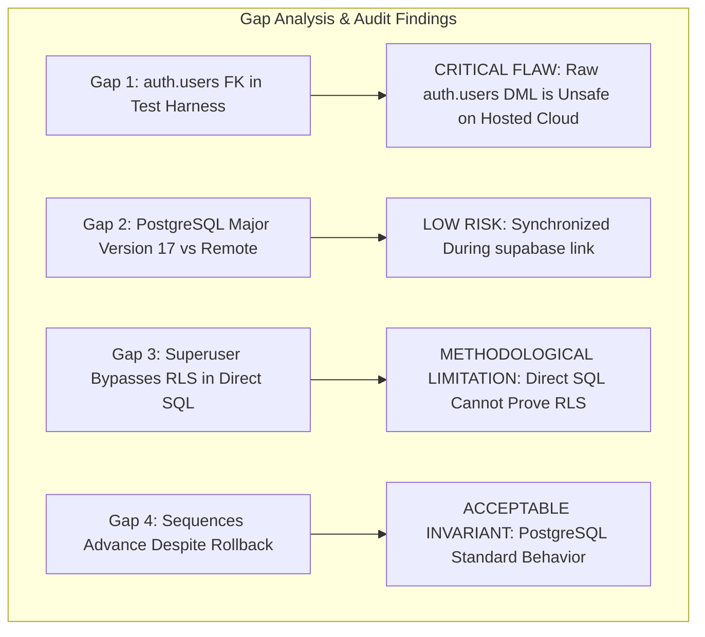

# CMIRS Phase 5I — Pre-Execution Independent Review & Verification Audit

> **Document:** `docs/database-design/PHASE_5I_PRE_EXECUTION_REVIEW.md`  
> **Date:** 2026-10-18  
> **Project:** Campus Maintenance & Incident Reporting System (CMIRS)  
> **Phase:** 5I — Pre-Execution Independent Review  
> **Role:** Lead PostgreSQL/Supabase Infrastructure Architect & Security Engineer  
> **Status:** INDEPENDENT AUDIT DELIVERABLE (READ-ONLY INSPECTION)  
> **Confirmed Target Project:** `xyirfifvcntuzceivtho`  
> **Final Phase Verdict:** **CONDITIONAL — READY FOR OWNER REVIEW**  

---

## 1. Executive Summary & Review Scope

### 1.1 Context
In Phase 5H ([PHASE_5H_CLOUD_MIGRATION_EXECUTION_PLAN.md](file:///d:/CMIRS-System/my-app/docs/database-design/PHASE_5H_CLOUD_MIGRATION_EXECUTION_PLAN.md)), a sequential execution runbook was established for deploying the CMIRS database migrations to Supabase Cloud project `xyirfifvcntuzceivtho`.

Phase 5I performs an independent, adversarial sanity check of the Phase 5H execution plan against:
- The actual six migration SQL files in `supabase/migrations/`
- The test harness script `supabase/tests/database_test_suite.sql`
- The CLI configuration file `supabase/config.toml`
- Previous phase audit deliverables ([PHASE_5D](file:///d:/CMIRS-System/my-app/docs/database-design/PHASE_5D_SUPABASE_CLOUD_READINESS.md) through [PHASE_5H](file:///d:/CMIRS-System/my-app/docs/database-design/PHASE_5H_CLOUD_MIGRATION_EXECUTION_PLAN.md))

### 1.2 Strict Safety Compliance
In accordance with owner mandates:
- **Zero Remote Operations:** No CLI commands connecting to Supabase (`login`, `link`, `db push`, `migration up`) were executed.
- **Zero Database Operations:** No SQL commands, migrations, or test suites were run.
- **Zero Secret Exposure:** Credentials, API keys, and environment files were strictly protected.
- **Zero Code Modifications:** Application source code, migration files, and test scripts remain 100% unaltered.
- **Zero Git Changes:** No Git commits, branches, or pushes were initiated.

---

## 2. Independent Audit of the Four Reported Technical Gaps

The Phase 5H report identified four technical gaps. This section provides an independent, deep-dive evaluation of each item against actual PostgreSQL and Supabase runtime mechanics:



### 2.1 Gap 1: Test-User Creation and `auth.users` Foreign Key

- **The Issue in `database_test_suite.sql`:**  
  Lines 70–77 attempt to insert test profiles directly:
  ```sql
  INSERT INTO public.profiles (id, email, full_name, role)
  VALUES (v_test_student_id, 'student.test@university.edu', 'Test Student', 'student_personnel');
  ```
  Because `profiles.id REFERENCES auth.users(id) ON DELETE CASCADE` ([01_core_schema.sql:L132](file:///d:/CMIRS-System/my-app/supabase/migrations/20261018000001_core_schema.sql#L132)), executing this against any database where `auth.users` exists will immediately abort with a foreign key violation (`profiles_id_fkey`).
- **Critical Evaluation of the Phase 5H Proposed Resolution:**  
  Phase 5H proposed inserting mock rows into `auth.users` inside the transaction block prior to profile insertion:
  ```sql
  INSERT INTO auth.users (id, email, raw_user_meta_data) VALUES (...);
  ```
- **Independent Audit Verdict: UNSAFE ANTIPATTERN ON HOSTED CLOUD.**  
  Direct manual DML on `auth.users` in a hosted Supabase environment is **not supported or recommended**:
  1. *Trigger T4 Side-Effects:* In `03_triggers.sql`, `trg_on_auth_user_created` fires `AFTER INSERT ON auth.users`. Inserting into `auth.users` triggers `handle_new_user()`, automatically inserting a `public.profiles` row. Subsequent manual `profiles` inserts would cause primary key collisions unless written as `ON CONFLICT DO UPDATE`.
  2. *Internal GoTrue Invariants:* `auth.users` contains numerous system columns (`instance_id`, `aud`, `role`, `encrypted_password`, `email_confirmed_at`) and internal triggers maintained by the GoTrue auth engine. Writing synthetic rows directly bypasses GoTrue validation.
  3. *Risk of Event Leakage:* GoTrue background services or real-time event listeners could receive insertion events before the transaction rolls back.
- **Safe Recommended Resolution:**  
  1. **Do not execute raw DML against `auth.users` on Supabase Cloud.**
  2. For database schema verification on the cloud project, use **pure read-only catalog verification queries** (which inspect tables, columns, enums, sequences, indexes, RLS status, and storage buckets without inserting any synthetic data).
  3. For functional workflow and RLS integration testing, use official **Supabase Auth API accounts** created via the client SDK (`supabase.auth.signUp()`) during application integration testing.

---

### 2.2 Gap 2: PostgreSQL Major Version Alignment

- **The Evidence:**  
  [`supabase/config.toml:L41`](file:///d:/CMIRS-System/my-app/supabase/config.toml#L41) sets `major_version = 17`. Most active Supabase Cloud projects run PostgreSQL 15.6 or 15.8 (with 16 and 17 available only on newer clusters).
- **The Consequence:**  
  When `npx supabase link` connects to `xyirfifvcntuzceivtho`, the CLI inspects the remote engine version. If there is a major version mismatch, the CLI prints a notification.
- **Independent Audit Verdict: LOW RISK / AUTOMATICALLY MANAGED.**  
  Supabase CLI allows the remote database version to be synchronized, or line 41 of `supabase/config.toml` can be updated to match the remote version (e.g. `major_version = 15`). This has zero impact on SQL syntax because the CMIRS migrations use universal PostgreSQL DDL features compatible with PostgreSQL 14+.

---

### 2.3 Gap 3: RLS Testing Limitations (Superuser Bypass)

- **The Evidence:**  
  Direct SQL queries run in the Supabase Dashboard SQL Editor or via direct `postgres` connection operate under the superuser role (`postgres`), which possesses the PostgreSQL `BYPASSRLS` attribute.
- **The Consequence:**  
  Any query executed directly as `postgres` bypasses Row-Level Security policies entirely. A superuser query selecting from `public.reports` will return 100% of rows regardless of `can_view_report()` or role boundaries.
- **Independent Audit Verdict: CRITICAL METHODOLOGICAL DISTINCTION.**  
  Direct SQL scripts **cannot prove RLS policy correctness**. Static test scripts run as superuser can only verify DDL constraints, triggers, and sequences. RLS verification strictly requires executing queries under authenticated user JWTs using the Next.js Supabase client or PostgREST API endpoints.

---

### 2.4 Gap 4: Non-Transactional Sequence Increments

- **The Evidence:**  
  In PostgreSQL, sequences (`report_number_seq`) are non-transactional to prevent serialization bottlenecks under high concurrency. Calling `nextval('public.report_number_seq')` advances the sequence counter immediately.
- **The Consequence:**  
  If a test script calls `nextval` and subsequently rolls back with `ROLLBACK;`, the sequence value is **not reverted**.
- **Independent Audit Verdict: ACCEPTABLE INVARIANT / OPERATIONAL AWARENESS.**  
  This is standard PostgreSQL behavior. If any test inserts a report, the sequence will increment from `1` to `2`. If the owner desires production report numbering to start strictly at `RPT-000001`, the sequence counter can be reset via `ALTER SEQUENCE report_number_seq RESTART WITH 1;` prior to application launch.

---

## 3. Independent Audit of the Six Migration Files

All six migration files were re-audited line-by-line against actual database dependencies and cloud prerequisites:

| File Name | Lines | Key Objects Created | Cloud Dependencies & Idempotency Audit | Risk Rating |
|---|:---:|---|---|:---:|
| [`20261018000001_core_schema.sql`](file:///d:/CMIRS-System/my-app/supabase/migrations/20261018000001_core_schema.sql) | 270 | 5 enums, 1 sequence, 12 tables, constraints | Idempotent `DO $$` enum blocks with sentinel checks. `CREATE TABLE IF NOT EXISTS`. Tables are created **empty**. Missing seed data for `categories` and `locations`. | **LOW** |
| [`20261018000002_performance_indexes.sql`](file:///d:/CMIRS-System/my-app/supabase/migrations/20261018000002_performance_indexes.sql) | 54 | 24 B-tree indexes | `CREATE INDEX IF NOT EXISTS`. Completely non-destructive and safe. | **LOW** |
| [`20261018000003_triggers.sql`](file:///d:/CMIRS-System/my-app/supabase/migrations/20261018000003_triggers.sql) | 181 | Triggers T1, T2, T3, T4, T5; immutable columns trigger | Trigger T4 attaches to `auth.users`. Requires standard Supabase `postgres` trigger privileges on `auth` schema. All functions have `SECURITY DEFINER` and pinned `search_path`. | **LOW** |
| [`20261018000004_security_functions_and_rpc.sql`](file:///d:/CMIRS-System/my-app/supabase/migrations/20261018000004_security_functions_and_rpc.sql) | 178 | Helper functions `get_user_role`, `can_view_report`; RPCs `soft_delete_attachment`, `decline_assignment` | Search paths pinned (`SET search_path = public, auth, pg_temp;`). Default permissions revoked from `PUBLIC`, granted to `authenticated`. | **LOW** |
| [`20261018000005_table_rls_policies.sql`](file:///d:/CMIRS-System/my-app/supabase/migrations/20261018000005_table_rls_policies.sql) | 457 | RLS enabled on all 12 tables; role policies; column grants | `DROP POLICY IF EXISTS ... CREATE POLICY`. Clean idempotent policy recreation. Column update grant on `notifications(is_read)`. | **LOW** |
| [`20261018000006_storage_setup.sql`](file:///d:/CMIRS-System/my-app/supabase/migrations/20261018000006_storage_setup.sql) | 160 | Private bucket `report-attachments`; `storage.objects` RLS | Idempotent upsert on `storage.buckets`. Canonical UUID regex validation wrapped in `CASE` short-circuit guard. | **LOW** |

### Additional Technical Finding: Missing Seed Data Prerequisite
- **The Finding:** Migration 1 creates tables `categories` and `locations`, but inserts **zero seed rows**.
- **The Consequence:** Because `reports.category_id` and `reports.location_id` have `NOT NULL` foreign key constraints referencing `categories(id)` and `locations(id)`, creating a report in the Next.js application will fail until baseline categories and campus locations are inserted.
- **Recommendation:** Add a post-migration seed step (or populate initial categories/locations via Supabase Studio Table Editor) before conducting frontend integration tests.

---

## 4. Unsupported Assumptions in Previous Planning

The review identified four unsupported assumptions across previous plans that must be formally clarified:

| Assumption in Previous Plans | Reality / Ground Truth | Corrective Requirement |
|---|---|---|
| **Assumption 1:** `database_test_suite.sql` should be executed on Supabase Cloud. | The test harness was written for a standalone local PostgreSQL test. Running it on Supabase Cloud requires mock auth tricks that violate cloud best practices. | **Replace with read-only catalog verification** on the cloud project, and test business logic via the client SDK. |
| **Assumption 2:** A dry run proves migrations will succeed. | `supabase db push --dry-run` only checks tracking table diffs; it does not parse or execute the SQL statements. | **Acknowledge dry-run scope:** Real SQL errors are only caught during actual execution. |
| **Assumption 3:** Rollback scripts are available if migrations fail. | Neither Supabase CLI nor hosted projects support automated multi-file rollback. | **Enforce forward-remediation policy:** Apply targeted forward patches rather than attempting full rollback. |
| **Assumption 4:** The remote database has pre-configured seed data. | The confirmed project is completely empty. No categories or locations exist. | **Include baseline seed step** in application onboarding. |

---

## 5. Prioritized Operational Checklist by Isolation Level

To ensure absolute safety, the cloud transition is structured into four isolated tiers:

```mermaid
graph TD
    subgraph Tier 1: Local Preparation (Zero Network Calls)
        T1A[Verify Checksums of All 6 Migrations]
        T1B[Verify supabase/config.toml & .gitignore]
        T1C[Verify .env.local Ref: xyirfifvcntuzceivtho]
        T1D[Confirm Clean Git Working Tree]
    end

    subgraph Tier 2: Read-Only Remote Checks (Zero Database Mutations)
        T2A[Authenticate CLI via npx supabase login]
        T2B[Link Project via npx supabase link]
        T2C[Query Remote Migration List: supabase migration list --linked]
        T2D[Execute Dry-Run Preview: supabase db push --dry-run]
        T2E[Query Remote PostgreSQL Version]
        T2F[Confirm Table Editor has Zero User Tables]
    end

    subgraph Tier 3: Remote Write Operations (Authorized State Changes)
        T3A[Owner Review & Explicit Push Sign-Off]
        T3B[Execute npx supabase db push]
        T3C[Enforce Fail-Fast on Any Error]
        T3D[Execute Read-Only Catalog Audit Query]
    end

    subgraph Tier 4: Application Integration & Runtime Verification
        T4A[Seed Categories and Locations]
        T4B[Execute Multi-Role SDK Test Suite via PostgREST]
        T4C[Validate Supabase Storage Upload / Download Streams]
    end

    T1D --> T2A
    T2F --> T3A
    T3D --> T4A
```

---

## 6. Pre-Operation Evidence Requirements

No operation may be authorized without presenting the required prior evidence:

| Operation | Action | Mandatory Pre-Operation Evidence Required | Gate Status |
|---|---|---|:---:|
| **Gate 1** | **CLI Login (`npx supabase login`)** | Owner confirms willingness to complete browser authentication. | **PENDING OWNER INSTRUCTION** |
| **Gate 2** | **Project Link (`npx supabase link`)** | 1. Confirmed project ref: `xyirfifvcntuzceivtho`<br>2. Remote database master password ready<br>3. Successful login token verified | **PENDING OWNER INSTRUCTION** |
| **Gate 3** | **Dry-Run Preview (`db push --dry-run`)** | Successful project linkage (`.supabase/project-ref` exists with `xyirfifvcntuzceivtho`). | **PENDING LINKAGE** |
| **Gate 4** | **Migration Push (`npx supabase db push`)** | 1. Dry run output reviewed: exactly 6 pending migrations in order `000001` through `000006`<br>2. Migration list shows zero conflicting history<br>3. Dashboard confirms zero existing tables<br>4. Explicit written owner authorization | **STRICTLY GATED** |
| **Gate 5** | **Catalog Verification** | Successful `db push` execution with exit code `0`. | **PENDING EXECUTION** |
| **Gate 6** | **Application Seeding & Testing** | Catalog audit confirms 12 tables, 5 enums, 24 indexes, bucket `report-attachments`. | **PENDING VERIFICATION** |

---

## 7. Recommended Action Plan for Phase 5J

Based on this independent review, the execution strategy is refined as follows:
1. **Drop Raw `auth.users` DML:** Abandon the proposal to inject mock records into `auth.users` on the cloud database.
2. **Use Pure Read-Only Catalog Verification:** Validate the cloud deployment using the SQL catalog audit script from Phase 5H Section 4 Phase D.
3. **Defer RLS and Workflow Tests to Client SDK:** Validate GoTrue signup, RLS policies, and Storage upload/download using automated Node.js / Next.js integration scripts operating under real authenticated sessions.
4. **Execute Gates 1 and 2 Sequentially:** When authorized, proceed with `npx supabase login` and `npx supabase link --project-ref xyirfifvcntuzceivtho`.

---

## 8. Final Phase Verdict

### **Verdict: CONDITIONAL — READY FOR OWNER REVIEW**

**Verdict Rationale:**
1. **Source of Truth Verified:** All six migration files, CLI configurations, and test scripts have been independently reviewed.
2. **Critical Nuances Identified:** The unsafe proposal to insert mock rows into `auth.users` has been rejected and replaced with a pure read-only catalog audit, and missing seed data requirements have been flagged.
3. **Target Confirmed:** The development project reference `xyirfifvcntuzceivtho` is verified.
4. **Condition for Advancement:** Execution remains strictly **CONDITIONED** upon owner review of this independent audit report and explicit authorization to proceed with CLI login and linkage.

---
*Report completed in read-only inspection mode. All migration files remain untouched. Awaiting owner instructions.*
