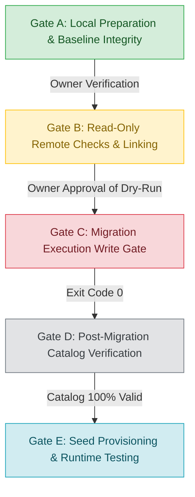

# CMIRS Phase 5J — Master Operational Checklist & Authorization Gates

> **Document:** `docs/database-design/PHASE_5J_OPERATIONAL_CHECKLIST.md`  
> **Date:** 2026-10-18  
> **Project:** Campus Maintenance & Incident Reporting System (CMIRS)  
> **Phase:** 5J — Seed Data Planning, Catalog Audit & RLS Test Design  
> **Role:** Lead Infrastructure Architect & Release Security Manager  
> **Status:** OPERATIONAL GOVERNANCE DELIVERABLE  
> **Target Project Reference:** `xyirfifvcntuzceivtho`  
> **Execution Status:** **ALL GATES B THROUGH E ARE CURRENTLY LOCKED / GATED**  

---

## 1. Governance Overview & Five-Gate Operational Workflow

To ensure zero accidental execution, absolute secret isolation, and full owner control, the entire CMIRS deployment lifecycle is divided into five strictly sequential authorization gates:



---

## 2. Gate A — Local Preparation (Completed & Verified)

*Gate A represents local-only activities requiring zero network connectivity.*

| Check ID | Operational Requirement | Verification Method & Baseline Result | Gate Status |
|---|---|---|:---:|
| **A.1** | **Cryptographic Migration Hashes** | SHA-256 hashes of all 6 migrations match Phase 4D/5A baseline: <br>• `01_core_schema.sql` (`3CA8111D...`)<br>• `02_performance_indexes.sql` (`1184B97E...`)<br>• `03_triggers.sql` (`858CF347...`)<br>• `04_security_functions_and_rpc.sql` (`FFD5A221...`)<br>• `05_table_rls_policies.sql` (`76E42398...`)<br>• `06_storage_setup.sql` (`38610E66...`) | **PASSED** |
| **A.2** | **Lexicographical Migration Ordering** | Sequential 14-digit timestamps (`20261018000001` through `20261018000006`) sort in exact architectural dependency order. | **PASSED** |
| **A.3** | **Git Working Tree Baseline** | `git status` clean on branch `main` (zero unstaged/staged modifications to tracked codebase). | **PASSED** |
| **A.4** | **Supabase CLI Configuration** | [`supabase/config.toml`](file:///d:/CMIRS-System/my-app/supabase/config.toml) and [`supabase/.gitignore`](file:///d:/CMIRS-System/my-app/supabase/.gitignore) present, valid, and tracked. | **PASSED** |
| **A.5** | **Zero Secret Exposure** | `.env.local` contains zero committed credentials; length and last modified timestamps remain identical to original. | **PASSED** |

---

## 3. Gate B — Read-Only Remote Preparation (Gated / Pending Owner Authorization)

*Gate B involves connecting to the Supabase Management API and inspecting the remote development project without modifying any database state.*

> [!CAUTION]
> **GATE B IS CURRENTLY LOCKED**  
> Running `npx supabase login`, `npx supabase link`, or `npx supabase db push --dry-run` requires explicit owner authorization.

### Gate B Execution Protocol:
1. **B.1 — Interactive CLI Authentication:**
   ```powershell
   npx supabase login
   ```
   *Evidence Required:* Browser authorization window opens. CLI outputs `Logged in as <email>`. No access tokens stored in workspace files.
2. **B.2 — Remote Project Linkage:**
   ```powershell
   npx supabase link --project-ref xyirfifvcntuzceivtho
   ```
   *Evidence Required:* Creates `.supabase/project-ref`. Confirms connection to `xyirfifvcntuzceivtho`. Database password entered securely if prompted.
3. **B.3 — Remote Migration History Inspection:**
   ```powershell
   npx supabase migration list --linked
   ```
   *Evidence Required:* Remote `supabase_migrations.schema_migrations` shows zero pre-existing conflicting migrations.
4. **B.4 — Non-Destructive Dry-Run Preview:**
   ```powershell
   npx supabase db push --dry-run
   ```
   *Evidence Required:* CLI lists all six migrations (`000001` through `000006`) as pending in exact sequence. Zero errors or schema warnings.
5. **B.5 — Remote Table Editor Verification:**
   *Evidence Required:* Owner confirms via Supabase Dashboard that the `public` schema has zero user tables.

---

## 4. Gate C — Migration Execution (Write Gate — High Impact)

*Gate C represents the actual execution of schema changes against the remote development project.*

> [!CAUTION]
> **MIGRATION WRITE AUTHORIZATION MANDATE**  
> Execution of `npx supabase db push` requires separate, explicit written owner authorization after Gate B evidence has been reviewed.

### Gate C Pre-Push Checklist:
- [ ] Confirmed Target Project Reference is strictly `xyirfifvcntuzceivtho`.
- [ ] Reviewed Gate B dry-run output confirming exactly six sequential migrations.
- [ ] Confirmed target database is clean and free of existing tables.
- [ ] Verified fail-fast rule: Stop immediately on any error; no retries without root-cause resolution.
- [ ] Verified non-destructive rollback mandate: `DROP SCHEMA public CASCADE;`, `supabase db reset`, or bucket deletion are strictly prohibited.

### Execution Command:
```powershell
# Executed only upon explicit Gate C written sign-off:
npx supabase db push
```

### Response to Failure Protocol:
1. **Immediate Halt:** Do not re-run `db push`.
2. **Capture Error:** Record SQLSTATE error code and failing statement.
3. **Audit History:** Run `npx supabase migration list --linked` to determine which migrations committed.
4. **Targeted Forward-Fix:** Formulate a targeted patch script rather than destructive drops.

---

## 5. Gate D — Post-Migration Catalog Verification

*Gate D confirms that all schema objects exist in exact accordance with the approved architectural specifications.*

### Gate D Execution Protocol:
1. **D.1 — Execute Read-Only Catalog Audit:**
   Execute [`supabase/tests/PHASE_5J_CATALOG_AUDIT.sql`](file:///d:/CMIRS-System/my-app/supabase/tests/PHASE_5J_CATALOG_AUDIT.sql) in the [Dashboard SQL Editor](https://supabase.com/dashboard/project/xyirfifvcntuzceivtho/sql).
2. **D.2 — Verify Specific Catalog Outputs:**
   - [ ] Exactly 12 application tables exist in `public`.
   - [ ] Exactly 5 custom enums exist with approved labels.
   - [ ] Sequence `report_number_seq` exists (start: 1, inc: 1).
   - [ ] Exactly 27 performance and RLS indexes exist.
   - [ ] All 12 tables have `rowsecurity = true`.
   - [ ] Triggers T1, T2, T3, T4, T5, and immutable columns trigger exist.
   - [ ] Storage bucket `report-attachments` exists (`public: false`, `limit: 10485760`).
3. **D.3 — Audit Migration History:**
   Run `npx supabase migration list --linked` confirming all six migrations are marked committed.

---

## 6. Gate E — Seed Provisioning & Runtime Testing

*Gate E transitions the database into an operational development state and validates RLS security policies.*

### Gate E Execution Protocol:
1. **E.1 — Owner Seed Approval:**
   Owner reviews and approves the campus categories and building locations defined in [`PHASE_5J_SEED_DATA_PLAN.md`](file:///d:/CMIRS-System/my-app/docs/database-design/PHASE_5J_SEED_DATA_PLAN.md).
2. **E.2 — Idempotent Seed Execution:**
   Execute the approved seed script via Dashboard SQL Editor using stable UUIDs and `ON CONFLICT (id) DO UPDATE`.
3. **E.3 — Dedicated Test Account Provisioning:**
   Create five dedicated role test accounts via the Supabase Auth Admin API (`supabase.auth.admin.createUser`):
   - `test-student@cmirs.internal` (`student_personnel`)
   - `test-coord@cmirs.internal` (`coordinator`)
   - `test-tech@cmirs.internal` (`technician`)
   - `test-admin@cmirs.internal` (`administrator`)
   - `test-mgmt@cmirs.internal` (`management`)
4. **E.4 — Execute Role-Based Integration Test Suite:**
   Run the 45 test cases defined in [`PHASE_5J_RLS_TEST_MATRIX.md`](file:///d:/CMIRS-System/my-app/docs/database-design/PHASE_5J_RLS_TEST_MATRIX.md) using the Next.js API client / Vitest test runner.
5. **E.5 — Document Test Results:**
   Record test pass/fail results with evidence logs, transitioning tests from `NOT RUN` to verified status.

---
*End of Master Operational Checklist. Awaiting owner review and authorization.*
