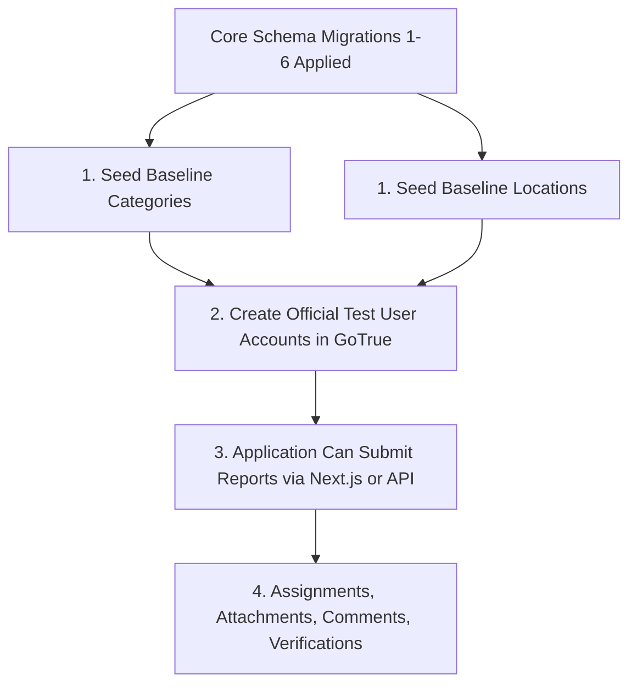

# CMIRS Phase 5J — Seed Data Architecture & Provisioning Plan

> **Document:** `docs/database-design/PHASE_5J_SEED_DATA_PLAN.md`  
> **Date:** 2026-10-18  
> **Project:** Campus Maintenance & Incident Reporting System (CMIRS)  
> **Phase:** 5J — Seed Data Planning, Catalog Audit & RLS Test Design  
> **Role:** Lead PostgreSQL/Supabase Infrastructure Architect & Security Engineer  
> **Status:** PLANNING DELIVERABLE (ZERO EXECUTION — PENDING OWNER APPROVAL)  
> **Target Project Reference:** `xyirfifvcntuzceivtho`  

---

## 1. Executive Summary & Objective

In CMIRS, the database schema enforces strict referential integrity. In particular, [`public.reports`](file:///d:/CMIRS-System/my-app/supabase/migrations/20261018000001_core_schema.sql#L173) contains non-nullable foreign keys referencing `categories(id)` and `locations(id)`. Migration 1 creates these tables empty. Consequently, **no maintenance report can be submitted by any user until baseline categories and campus locations exist in the database.**

This document establishes the seed data strategy, table constraints, dependency graphs, stable ID allocations, and idempotent SQL provisioning templates.

> [!IMPORTANT]
> **NO CAMPUS DATA INVENTED — PENDING OWNER APPROVAL**  
> In strict accordance with Phase 5J instructions, no actual campus building names, room numbers, maintenance categories, or organizational departments have been assumed. All proposed data values in this plan are explicitly marked **`PENDING OWNER APPROVAL`**. No SQL has been executed and no records have been inserted.

---

## 2. Table Definitions & Database Constraint Analysis

The schema definitions and integrity constraints for `categories` and `locations` in [`20261018000001_core_schema.sql`](file:///d:/CMIRS-System/my-app/supabase/migrations/20261018000001_core_schema.sql) were audited:

### 2.1 Table: `public.categories`

```sql
CREATE TABLE IF NOT EXISTS public.categories (
  id UUID PRIMARY KEY DEFAULT gen_random_uuid(),
  name TEXT NOT NULL UNIQUE,
  description TEXT,
  is_active BOOLEAN NOT NULL DEFAULT true
);
```

- **Primary Key:** `id UUID` (system default `gen_random_uuid()`).
- **Unique Constraint:** `name TEXT NOT NULL UNIQUE`. Duplicate category names are rejected at the database level.
- **Soft Deletion / Status:** `is_active BOOLEAN NOT NULL DEFAULT true`. Categories are never hard-deleted; inactive categories are hidden from report submission forms.
- **Referential Integrity on Reports:** `reports.category_id UUID NOT NULL REFERENCES public.categories(id) ON DELETE RESTRICT`. A category cannot be deleted from the database if any report references it.

### 2.2 Table: `public.locations`

```sql
CREATE TABLE IF NOT EXISTS public.locations (
  id UUID PRIMARY KEY DEFAULT gen_random_uuid(),
  building_name TEXT NOT NULL,
  floor TEXT,
  room TEXT,
  description TEXT,
  is_active BOOLEAN NOT NULL DEFAULT true
);
```

- **Primary Key:** `id UUID` (system default `gen_random_uuid()`).
- **Required Fields:** `building_name TEXT NOT NULL`.
- **Optional Specifics:** `floor TEXT`, `room TEXT`, `description TEXT`.
- **Soft Deletion / Status:** `is_active BOOLEAN NOT NULL DEFAULT true`.
- **No Database Unique Constraint:** Note that the schema does **not** have a composite unique constraint on `(building_name, floor, room)`. Therefore, naive reruns of an `INSERT INTO locations` script would create duplicate location records unless deterministic UUIDs and `ON CONFLICT (id)` are used.
- **Referential Integrity on Reports:** `reports.location_id UUID NOT NULL REFERENCES public.locations(id) ON DELETE RESTRICT`. A location cannot be deleted if any report references it.

---

## 3. Dependency Graph & Provisioning Sequence

The referential dependencies dictate the exact order of initialization:



1. **Step 1:** Seed `categories` and `locations`. (Independent of each other; must precede reports).
2. **Step 2:** Provision authenticated test user profiles in `auth.users` via Supabase Auth Admin API (Trigger T4 creates `public.profiles`).
3. **Step 3:** System is ready for report creation (`public.reports`), referencing valid `category_id`, `location_id`, and `reporter_id`.

---

## 4. Idempotency & Stable UUID Allocation Strategy

To ensure that seed provisioning can be run repeatedly in development and staging without creating duplicate rows or breaking foreign key references in existing test reports, **deterministic, well-known UUIDs** must be assigned to seed records:

- **Namespace for Categories:** `c0000000-0000-4000-a000-000000000001` through `c0000000-0000-4000-a000-000000000099`
- **Namespace for Locations:** `d0000000-0000-4000-b000-000000000001` through `d0000000-0000-4000-b000-000000000099`

### Idempotency Pattern:
- **`categories`:** Uses `ON CONFLICT (id) DO UPDATE SET name = EXCLUDED.name, description = EXCLUDED.description, is_active = EXCLUDED.is_active`.
- **`locations`:** Uses `ON CONFLICT (id) DO UPDATE SET building_name = EXCLUDED.building_name, floor = EXCLUDED.floor, room = EXCLUDED.room, description = EXCLUDED.description, is_active = EXCLUDED.is_active`.

---

## 5. Proposed Baseline Seed Templates (Pending Owner Approval)

The following tables represent a **template structure** for owner review. The owner must review, edit, and approve the actual campus names before this template is finalized for execution.

### 5.1 Proposed Categories Template

| Stable UUID | Category Name (`name`) | Description (`description`) | Status | Approval Status |
|---|---|---|:---:|:---:|
| `c0000000-0000-4000-a000-000000000001` | Electrical & Lighting | Power outlets, lighting fixtures, circuit breakers, and switches | Active | `[PENDING OWNER APPROVAL]` |
| `c0000000-0000-4000-a000-000000000002` | Plumbing & Water | Leaks, pipe blockages, faucets, toilets, and water supply issues | Active | `[PENDING OWNER APPROVAL]` |
| `c0000000-0000-4000-a000-000000000003` | HVAC & Ventilation | Air conditioning, heating, ventilation fans, and temperature control | Active | `[PENDING OWNER APPROVAL]` |
| `c0000000-0000-4000-a000-000000000004` | Structural & Carpentry | Doors, windows, locks, walls, ceiling tiles, and structural damage | Active | `[PENDING OWNER APPROVAL]` |
| `c0000000-0000-4000-a000-000000000005` | General Maintenance | Furniture, painting, groundskeeping, and miscellaneous facility repairs | Active | `[PENDING OWNER APPROVAL]` |

### 5.2 Proposed Locations Template

| Stable UUID | Building Name (`building_name`) | Floor (`floor`) | Room (`room`) | Description | Approval Status |
|---|---|---|---|---|:---:|
| `d0000000-0000-4000-b000-000000000001` | [Campus Building A] | 1 | 101 | Main Lecture Hall | `[PENDING OWNER APPROVAL]` |
| `d0000000-0000-4000-b000-000000000002` | [Campus Building A] | 2 | 204 | Computer Laboratory | `[PENDING OWNER APPROVAL]` |
| `d0000000-0000-4000-b000-000000000003` | [Campus Building B] | 1 | 110 | Administrative Office | `[PENDING OWNER APPROVAL]` |
| `d0000000-0000-4000-b000-000000000004` | [Campus Library] | 1 | Common Area | Main Reading Room | `[PENDING OWNER APPROVAL]` |
| `d0000000-0000-4000-b000-000000000005` | [Student Center] | Ground | Cafeteria | Dining and Kitchen Area | `[PENDING OWNER APPROVAL]` |

---

## 6. Access Control & Operational Governance

### 6.1 Who is Permitted to Manage Categories and Locations?
In [`20261018000005_table_rls_policies.sql:L75-L127`](file:///d:/CMIRS-System/my-app/supabase/migrations/20261018000005_table_rls_policies.sql#L75-L127), the RLS policies explicitly govern access:
- **Read Permissions (`categories_select`, `locations_select`):**
  - All authenticated users can read records where `is_active = true`.
  - Oversight roles (`coordinator`, `administrator`, `management`) can read all records (including inactive ones).
- **Write Permissions (`categories_insert`, `categories_update`, `locations_insert`, `locations_update`):**
  - Strictly limited to `coordinator` and `administrator` roles.
  - Technicians, students, and management have zero write privileges on categories and locations.
- **Delete Permissions:**
  - `DELETE` is default-denied for all roles (no DELETE policy exists). Categories and locations are soft-deleted by setting `is_active = false`.

### 6.2 Seed Provisioning Execution Method
Seed data for the development database can be applied via:
1. **Method A (SQL Editor / Direct Provisioning - Superuser):** Executed by the developer/owner via the Dashboard SQL Editor during project initialization.
2. **Method B (Application Management Portal):** Provisioned by an authenticated user with `role = 'administrator'` through the Next.js admin dashboard.
3. **Recommendation:** Method A for initial development baseline; Method B for ongoing operational management.

---

## 7. Draft Idempotent Seed Script (Ready for Future Execution)

> [!CAUTION]
> **DO NOT EXECUTE UNTIL OWNER APPROVES ACTUAL CAMPUS VALUES**  
> The script below is prepared for future execution after the owner approves or replaces the placeholder strings.

```sql
-- CMIRS Idempotent Baseline Seed Script
-- Requires: Migrations 1-6 applied.
-- Status: PENDING OWNER APPROVAL of campus strings.

BEGIN;

-- 1. Seed Categories (Idempotent upsert using stable UUIDs)
INSERT INTO public.categories (id, name, description, is_active)
VALUES
  ('c0000000-0000-4000-a000-000000000001', 'Electrical & Lighting', 'Power outlets, lighting fixtures, circuit breakers, and switches', true),
  ('c0000000-0000-4000-a000-000000000002', 'Plumbing & Water', 'Leaks, pipe blockages, faucets, toilets, and water supply issues', true),
  ('c0000000-0000-4000-a000-000000000003', 'HVAC & Ventilation', 'Air conditioning, heating, ventilation fans, and temperature control', true),
  ('c0000000-0000-4000-a000-000000000004', 'Structural & Carpentry', 'Doors, windows, locks, walls, ceiling tiles, and structural damage', true),
  ('c0000000-0000-4000-a000-000000000005', 'General Maintenance', 'Furniture, painting, groundskeeping, and miscellaneous facility repairs', true)
ON CONFLICT (id) DO UPDATE SET
  name = EXCLUDED.name,
  description = EXCLUDED.description,
  is_active = EXCLUDED.is_active;

-- 2. Seed Locations (Idempotent upsert using stable UUIDs)
INSERT INTO public.locations (id, building_name, floor, room, description, is_active)
VALUES
  ('d0000000-0000-4000-b000-000000000001', 'Main Academic Building', '1', '101', 'Main Lecture Hall', true),
  ('d0000000-0000-4000-b000-000000000002', 'Main Academic Building', '2', '204', 'Computer Laboratory', true),
  ('d0000000-0000-4000-b000-000000000003', 'Administration Wing', '1', '110', 'Administrative Office', true),
  ('d0000000-0000-4000-b000-000000000004', 'University Library', '1', 'Reading Area', 'Main Library Reading Room', true),
  ('d0000000-0000-4000-b000-000000000005', 'Student Union Building', 'Ground', 'Cafeteria', 'Dining and Kitchen Area', true)
ON CONFLICT (id) DO UPDATE SET
  building_name = EXCLUDED.building_name,
  floor = EXCLUDED.floor,
  room = EXCLUDED.room,
  description = EXCLUDED.description,
  is_active = EXCLUDED.is_active;

COMMIT;
```

---
*End of Seed Data Plan. No records have been created or modified.*
