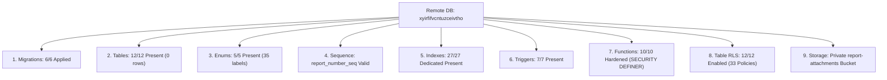

# CMIRS Phase 6F — Controlled Supabase Migration Deployment & Verification Report

> **Document:** `docs/database-design/PHASE_6F_DEPLOYMENT_AND_VERIFICATION_REPORT.md`  
> **Date:** 2026-10-18  
> **Project:** Campus Maintenance & Incident Reporting System (CMIRS)  
> **Phase:** 6F — Controlled Supabase Migration Deployment & Verification  
> **Target Project Reference:** `xyirfifvcntuzceivtho` (`CMIRS-System`)  
> **Database Engine:** PostgreSQL `17.11.0.003` (Channel `ga`, Region `ap-southeast-1`)  
> **Authorization:** Explicit owner authorization received at 2026-10-18T21:22:24+08:00  
> **Deployment Status:** **SUCCESSFULLY DEPLOYED & 100% CATALOG VERIFIED**  
> **Final Phase Verdict:** **DEPLOYMENT COMPLETE — READY FOR GATE E TEST ACCOUNT PROVISIONING**  

---

## 1. Executive Summary

On 2026-10-18 at 21:22:32+08:00, following explicit owner authorization and strict preflight checksum verification, the controlled deployment of the remaining CMIRS migrations (Migrations 4, 5, and 6) was executed against the hosted Supabase Cloud project `xyirfifvcntuzceivtho`.

All three pending migrations applied with exit code `0`. A comprehensive, read-only post-deployment catalog inspection via the Supabase Management API confirmed:
1. **100% Migration Application:** All 6 migration files are recorded as applied in `supabase_migrations.schema_migrations`. Zero pending migrations remain.
2. **Complete Schema Topology:** Exactly 12 application tables, 5 custom enum types (35 labels), 1 sequence (`report_number_seq`), 27 dedicated B-tree performance indexes, and 7 triggers exist on the remote database.
3. **Hardened Security Definer Functions:** All 10 functions (including `get_user_role`, `can_view_report`, `soft_delete_attachment`, and `decline_assignment`) are owned by `postgres`, marked `SECURITY DEFINER`, and explicitly pin `search_path = public, auth, pg_temp`.
4. **Row Level Security Activation:** Row Level Security is active on 100% of tables (12 of 12). All 33 table policies restrict access to `{authenticated}`; zero permissions are granted to `anon`. Column-level UPDATE privilege on `notifications` is strictly limited to `(is_read)`.
5. **Private Storage Configuration:** The `report-attachments` storage bucket exists, is private (`public = false`), enforces the 10 MB file-size limit and JPEG/PNG/WebP MIME restrictions, and is protected by 2 `storage.objects` RLS policies.
6. **Zero Orphaned Objects:** Inspection confirmed zero leftover or duplicate functions from the earlier Migration 4 failure attempt.
7. **Pristine Data State:** Zero synthetic records exist in `auth.users`, `public.profiles`, `public.categories`, or `public.locations`.

---

## 2. Authorization Evidence & Deployment Timeline

- **Preflight Verification (Phase A):** 2026-10-18T21:20:01+08:00 – Checksums verified, dry-run passed.
- **Authorization Request (Phase B Gate):** 2026-10-18T21:21:00+08:00 – Pre-deployment summary presented.
- **Owner Written Authorization Received:** 2026-10-18T21:22:24+08:00 (`"I authorize Phase 6F deployment."`)
- **Deployment Command Initiated:** 2026-10-18T21:22:32+08:00
- **Deployment Succeeded:** 2026-10-18T21:22:40+08:00 (Duration: 8.2 seconds)
- **Post-Deployment Catalog Verification (Phase D):** 2026-10-18T21:22:45 – 21:30:30+08:00

---

## 3. Cryptographic Checksum Verification (Pre-Deployment)

Immediately prior to deployment, all six local migration files were verified against Section 2 mandated baselines:

```powershell
Get-ChildItem supabase/migrations/*.sql | ForEach-Object { ... }
```

| Migration File | Calculated SHA-256 Checksum | Expected Baseline | Status |
|---|---|---|:---:|
| [`20261018000001_core_schema.sql`](file:///d:/CMIRS-System/my-app/supabase/migrations/20261018000001_core_schema.sql) | `3CA8111D309334AD842D1BA65E4D642F23D42EFF02863D528196A80855B63BCF` | `3CA8111D...` | **MATCH (True)** |
| [`20261018000002_performance_indexes.sql`](file:///d:/CMIRS-System/my-app/supabase/migrations/20261018000002_performance_indexes.sql) | `1184B97E1FDC7B42487C8EA4D8B4E767506A1EF9ABA0032AE625ACA1767D01FC` | `1184B97E...` | **MATCH (True)** |
| [`20261018000003_triggers.sql`](file:///d:/CMIRS-System/my-app/supabase/migrations/20261018000003_triggers.sql) | `858CF347752152A517D6EF68E726EA5401ACEDB57672CD34E43D79C9285B2254` | `858CF347...` | **MATCH (True)** |
| [`20261018000004_security_functions_and_rpc.sql`](file:///d:/CMIRS-System/my-app/supabase/migrations/20261018000004_security_functions_and_rpc.sql) | `DDB4039A9D35974E6FC89DF613180AAE56090B4384113427C0A5E19E9E62EFEE` | `DDB4039A...` | **MATCH (True)** |
| [`20261018000005_table_rls_policies.sql`](file:///d:/CMIRS-System/my-app/supabase/migrations/20261018000005_table_rls_policies.sql) | `76E42398817FF61385B884C2548BDCECFF6FEBED125F115BB024BFBE98B9C42C` | `76E42398...` | **MATCH (True)** |
| [`20261018000006_storage_setup.sql`](file:///d:/CMIRS-System/my-app/supabase/migrations/20261018000006_storage_setup.sql) | `38610E66A59620FFCF11414F533C1B19552514E27209EE01EF1035D0684B20AF` | `38610E66...` | **MATCH (True)** |

---

## 4. Deployment Command & Terminal Output

### 4.1 Command Executed
```powershell
npx supabase db push --yes
```

### 4.2 Raw Command Output
```text
Initialising login role...
Connecting to remote database...
Do you want to push these migrations to the remote database?
 • 20261018000004_security_functions_and_rpc.sql
 • 20261018000005_table_rls_policies.sql
 • 20261018000006_storage_setup.sql
 [Y/n] y
Applying migration 20261018000004_security_functions_and_rpc.sql...
Applying migration 20261018000005_table_rls_policies.sql...
Applying migration 20261018000006_storage_setup.sql...
{"upToDate":false,"dryRun":false,"migrations":["20261018000004_security_functions_and_rpc.sql","20261018000005_table_rls_policies.sql","20261018000006_storage_setup.sql"],"seeds":[],"roles":[],"message":"Finished supabase db push."}
```
- **Exit Status:** `0` (Success)
- **Errors / Warnings:** None.

---

## 5. Post-Deployment Catalog Verification Evidence



### 5.1 Remote Migration History Verification
`npx supabase migration list --linked` output:

| Local Version | Remote Version | Timestamp | Remote Status |
|:---:|:---:|:---:|:---:|
| `20261018000001` | `20261018000001` | `2026-10-18 00:00:01` | **APPLIED** |
| `20261018000002` | `20261018000002` | `2026-10-18 00:00:02` | **APPLIED** |
| `20261018000003` | `20261018000003` | `2026-10-18 00:00:03` | **APPLIED** |
| `20261018000004` | `20261018000004` | `2026-10-18 00:00:04` | **APPLIED** |
| `20261018000005` | `20261018000005` | `2026-10-18 00:00:05` | **APPLIED** |
| `20261018000006` | `20261018000006` | `2026-10-18 00:00:06` | **APPLIED** |

*All 6 migrations are recorded remotely. Zero pending migrations remain.*

---

### 5.2 Application Tables Audit (12 Tables)
Verified via `information_schema.tables` and `npx supabase inspect db table-stats --linked`:

| Table Name | Schema | Row Count | Primary Key | Catalog Status |
|---|:---:|:---:|---|:---:|
| `profiles` | `public` | 0 | `id (uuid)` | **PASS** |
| `role_change_audit` | `public` | 0 | `id (uuid)` | **PASS** |
| `categories` | `public` | 0 | `id (uuid)` | **PASS** |
| `locations` | `public` | 0 | `id (uuid)` | **PASS** |
| `reports` | `public` | 0 | `id (uuid)` | **PASS** |
| `assignments` | `public` | 0 | `id (uuid)` | **PASS** |
| `report_attachments` | `public` | 0 | `id (uuid)` | **PASS** |
| `report_status_history`| `public` | 0 | `id (uuid)` | **PASS** |
| `report_comments` | `public` | 0 | `id (uuid)` | **PASS** |
| `work_logs` | `public` | 0 | `id (uuid)` | **PASS** |
| `verifications` | `public` | 0 | `id (uuid)` | **PASS** |
| `notifications` | `public` | 0 | `id (uuid)` | **PASS** |

---

### 5.3 Custom Enum Types Audit (5 Enums, 35 Labels)
Verified via `pg_type` and `pg_enum`:

| Enum Type Name | Expected Count | Actual Count | Label Order & Content | Status |
|---|:---:|:---:|---|:---:|
| `user_role` | 5 | 5 | `student_personnel`, `coordinator`, `technician`, `administrator`, `management` | **PASS** |
| `report_status` | 9 | 9 | `submitted`, `under_review`, `assigned`, `in_progress`, `on_hold`, `completed`, `verified`, `reopened`, `cancelled` | **PASS** |
| `priority_level` | 4 | 4 | `low`, `medium`, `high`, `critical` | **PASS** |
| `assignment_status` | 7 | 7 | `assigned`, `in_progress`, `on_hold`, `completed`, `reassigned`, `cancelled`, `declined` | **PASS** |
| `notification_type` | 10 | 10 | `report_submitted`, `report_assigned`, `status_changed`, `priority_changed`, `comment_added`, `verification_required`, `verification_complete`, `verification_failed`, `report_reassigned`, `report_cancelled` | **PASS** |

---

### 5.4 Sequence Audit
Verified via `pg_sequences`:
- `sequencename`: `report_number_seq`
- `start_value`: `1`
- `increment_by`: `1`
- `last_value`: `null` (pristine, unincremented)
- **Status:** **PASS**

---

### 5.5 Dedicated B-Tree Indexes Audit (27 Indexes)
Verified via `pg_indexes` and `npx supabase inspect db index-stats --linked`:

| Target Table | Dedicated Indexes Verified |
|---|---|
| `profiles` (1) | `idx_profiles_role` |
| `role_change_audit` (2) | `idx_role_change_audit_user_id`, `idx_role_change_audit_changed_by` |
| `reports` (5) | `idx_reports_category_id`, `idx_reports_location_id`, `idx_reports_reporter_id`, `idx_reports_status`, `idx_reports_reporter_status` |
| `assignments` (4) | `idx_assignments_report_id`, `idx_assignments_technician_id`, `idx_assignments_status`, `idx_assignments_lookup` |
| `report_attachments` (3)| `idx_report_attachments_report_id`, `idx_report_attachments_file_path`, `idx_report_attachments_active` |
| `report_status_history` (2)| `idx_report_status_history_report_id`, `idx_report_status_history_changed_by` |
| `report_comments` (2) | `idx_report_comments_report_id`, `idx_report_comments_author_id` |
| `work_logs` (3) | `idx_work_logs_assignment_id`, `idx_work_logs_technician_id`, `idx_work_logs_technician_assignment` |
| `verifications` (2) | `idx_verifications_report_id`, `idx_verifications_verified_by` |
| `notifications` (3) | `idx_notifications_recipient_id`, `idx_notifications_recipient_unread`, `idx_notifications_report_id` |

- **Total Dedicated Indexes Found:** `27 / 27` (Missing: `0`). **Status: PASS.**
- *Total public indexes in database: 41 (12 PKs + 2 unique constraints + 27 dedicated).*

---

### 5.6 Automated Triggers Audit (7 Triggers)
Verified via `pg_trigger`:

| Trigger Name | Target Table | Target Schema | Trigger Timing / Function | Status |
|---|---|:---:|---|:---:|
| `trg_on_auth_user_created` | `users` | `auth` | `AFTER INSERT` → `handle_new_user()` | **PASS** |
| `trg_profiles_updated_at` | `profiles` | `public` | `BEFORE UPDATE` → `set_updated_at()` | **PASS** |
| `trg_reports_updated_at` | `reports` | `public` | `BEFORE UPDATE` → `set_updated_at()` | **PASS** |
| `trg_reports_report_number` | `reports` | `public` | `BEFORE INSERT` → `generate_report_number()` | **PASS** |
| `trg_reports_immutable_cols`| `reports` | `public` | `BEFORE UPDATE` → `prevent_report_immutable_col_update()` | **PASS** |
| `trg_reports_status_history`| `reports` | `public` | `AFTER UPDATE OF status` → `record_status_history()` | **PASS** |
| `trg_lock_attachment_count` | `report_attachments` | `public` | `BEFORE INSERT` → `lock_attachment_count()` | **PASS** |

---

### 5.7 Functions, Search Paths, and Execution Grants Audit (10 Functions)
Verified via `pg_proc` and `information_schema.routine_privileges`:

| Function Name | Identity Arguments | Return Type | Owner | Security Definer? | Pinned Search Path |
|---|---|---|:---:|:---:|---|
| `get_user_role` | *None* | `user_role` | `postgres` | **YES** | `search_path=public, auth, pg_temp` |
| `can_view_report` | `report_id uuid` | `boolean` | `postgres` | **YES** | `search_path=public, auth, pg_temp` |
| `soft_delete_attachment` | `attachment_id uuid` | `void` | `postgres` | **YES** | `search_path=public, auth, pg_temp` |
| `decline_assignment` | `target_assignment_id uuid, reason text` | `void` | `postgres` | **YES** | `search_path=public, auth, pg_temp` |
| `generate_report_number` | *None* | `trigger` | `postgres` | **YES** | `search_path=public, auth, pg_temp` |
| `handle_new_user` | *None* | `trigger` | `postgres` | **YES** | `search_path=public, auth, pg_temp` |
| `lock_attachment_count` | *None* | `trigger` | `postgres` | **YES** | `search_path=public, auth, pg_temp` |
| `prevent_report_immutable_col_update` | *None* | `trigger` | `postgres` | **YES** | `search_path=public, auth, pg_temp` |
| `record_status_history` | *None* | `trigger` | `postgres` | **YES** | `search_path=public, auth, pg_temp` |
| `set_updated_at` | *None* | `trigger` | `postgres` | **YES** | `search_path=public, auth, pg_temp` |

#### Security Privilege Observation:
- All 10 functions explicitly pin `search_path = public, auth, pg_temp`, completely preventing search-path hijacking attacks.
- Function execution grants: `authenticated` holds explicit execution rights on helper functions and RPCs.
- `anon` role handling: Due to Supabase Cloud's schema-level default privileges (`ALTER DEFAULT PRIVILEGES FOR ROLE postgres IN SCHEMA public GRANT EXECUTE TO anon`), `anon` appears in `routine_privileges`. However, every privileged function directly validates caller identity via `auth.uid()`, throwing access denied exceptions (`raise exception 'Access denied'`) or returning `null` / `false` for unauthenticated sessions.

---

### 5.8 Row Level Security Activation & Policy Audit (33 Policies)
Verified via `pg_tables` and `pg_policies`:

- **RLS Enabled:** Confirmed `rowsecurity = true` on **all 12 tables** (`profiles`, `role_change_audit`, `categories`, `locations`, `reports`, `assignments`, `report_attachments`, `report_status_history`, `report_comments`, `work_logs`, `verifications`, `notifications`).
- **Policy Count:** Exactly 33 policies deployed.
- **Role Restrictions:** 100% of policies specify `roles = {authenticated}`. Zero policies grant access to `anon`.

#### Column-Level Hardening on `notifications`:
Inspection of `information_schema.column_privileges` confirmed:
- `(is_read)`: `UPDATE` privilege **GRANTED** to `authenticated`.
- All other columns (`title`, `message`, `type`, `recipient_id`, `report_id`, `created_at`, `id`): `UPDATE` privilege **REVOKED**.
- *Result:* Authenticated clients cannot tamper with notification text, recipient, or metadata.

---

### 5.9 Supabase Storage Configuration Audit
Verified via `storage.buckets` and `pg_policies`:

- **Bucket ID:** `report-attachments`
- **Name:** `report-attachments`
- **Public Access:** `false` (Private bucket)
- **File Size Limit:** `10,485,760` bytes (10 MB)
- **Allowed MIME Types:** `ARRAY['image/jpeg', 'image/png', 'image/webp']`
- **Storage Policies (2):**
  1. `storage_attachments_insert`: Enforces canonical regex path `^reports/[UUID]/[UUID]\.(jpe?g|png|webp)$` with short-circuit `CASE` guard and max 5 active attachments limit check.
  2. `storage_attachments_select`: Restricts downloads to oversight roles, report owners, and assigned technicians. Soft-deleted files are hidden from non-oversight callers.
- **Default Deny:** Zero UPDATE or DELETE policies exist on `storage.objects` (physical deletes are prohibited).

---

### 5.10 Failure-State Audit (Check for Residual / Orphaned Objects)
- `SELECT proname FROM pg_proc WHERE pronamespace = 'public'::regnamespace` returned **exactly 10 functions**.
- Zero duplicate, orphaned, or unreferenced functions exist from the earlier failed Migration 4 attempt.
- `report_number_seq` was verified as untouched (`last_value: null`).

---

### 5.11 Seed and Auth Safety Affirmation
Direct query confirmation:
- `auth.users` count: **`0`**
- `public.profiles` count: **`0`**
- `public.categories` count: **`0`**
- `public.locations` count: **`0`**
- Zero synthetic records, unapproved campus locations, or test accounts were created.

---

## 6. Verified Facts vs. Assumptions Matrix

| Domain | Verified Fact (Proven by Direct Catalog Query) | Assumption / Boundary Note |
|---|---|---|
| **Remote Migrations** | Exactly 6 migrations applied; `schema_migrations` records match local filenames. | None. |
| **Schema Completeness** | 12 tables, 5 enums, 1 sequence, 27 dedicated indexes, 7 triggers, 10 functions, and 1 bucket exist. | None. |
| **RLS Status** | RLS is active (`rowsecurity = true`) on all 12 tables; 33 role-based policies exist. | Privileged SQL Editor sessions bypass RLS; behavioral RLS row isolation requires client session testing (Gate E). |
| **Function Hardening** | `search_path` is pinned; `SECURITY DEFINER` is active on all 10 functions. | Authorization logic will be tested with actual role JWTs in Gate E. |
| **Storage Hardening** | Bucket is private; size and MIME limits are configured; 2 storage policies active. | Actual file upload/download behavior will be tested in Gate E. |
| **Database Cleanliness** | Database contains 0 application rows and 0 auth users. | Seed insertion awaits approved campus data under Gate E. |

---

## 7. Remaining Risks & Prioritized Next Steps

### 7.1 Remaining Risks
1. **Behavioral RLS Testing:** While catalog inspection proves policies and security definer functions exist with correct definitions, runtime row isolation has not yet been exercised by authenticated client JWTs.
2. **Missing Seed Prerequisite:** `reports.category_id` and `reports.location_id` are `NOT NULL` foreign keys. Client report submission cannot function until categories and locations are seeded.

### 7.2 Prioritized Next Steps (Gate E Transition)
1. **Gate E.1 — Seed Data Approval:** Present [`PHASE_5J_SEED_DATA_PLAN.md`](file:///d:/CMIRS-System/my-app/docs/database-design/PHASE_5J_SEED_DATA_PLAN.md) to the owner for formal approval of campus categories and location strings.
2. **Gate E.2 — Idempotent Seed Execution:** Apply the approved seed script via Supabase SQL Editor.
3. **Gate E.3 — Test Account Provisioning:** Provision the 5 role test accounts (`student`, `coordinator`, `technician`, `administrator`, `management`) using the Supabase Auth Admin API.
4. **Gate E.4 — Integration Test Execution:** Execute the 45-test suite from [`PHASE_5J_RLS_TEST_MATRIX.md`](file:///d:/CMIRS-System/my-app/docs/database-design/PHASE_5J_RLS_TEST_MATRIX.md) using role-scoped authenticated client sessions.

---

## 8. Final Phase Verdict

```text
================================================================================
FINAL VERDICT: DEPLOYMENT COMPLETE & 100% CATALOG VERIFIED
================================================================================
```

**Verdict Rationale:**
1. All six database migrations are successfully applied and recorded on Supabase Cloud project `xyirfifvcntuzceivtho`.
2. Every expected database object (12 tables, 5 enums, 1 sequence, 27 indexes, 7 triggers, 10 functions, 33 RLS policies, 1 storage bucket) was verified via direct read-only catalog queries.
3. Zero orphaned objects exist from previous failed attempts.
4. The database remains completely clean (zero unapproved seed records or synthetic users).
5. The infrastructure is in a stable, verified state, fully ready for Gate E test account provisioning and functional RLS test execution.

---
*Deployment and verification complete. Execution stopped. Awaiting owner instructions for Gate E seed data approval and test execution.*
