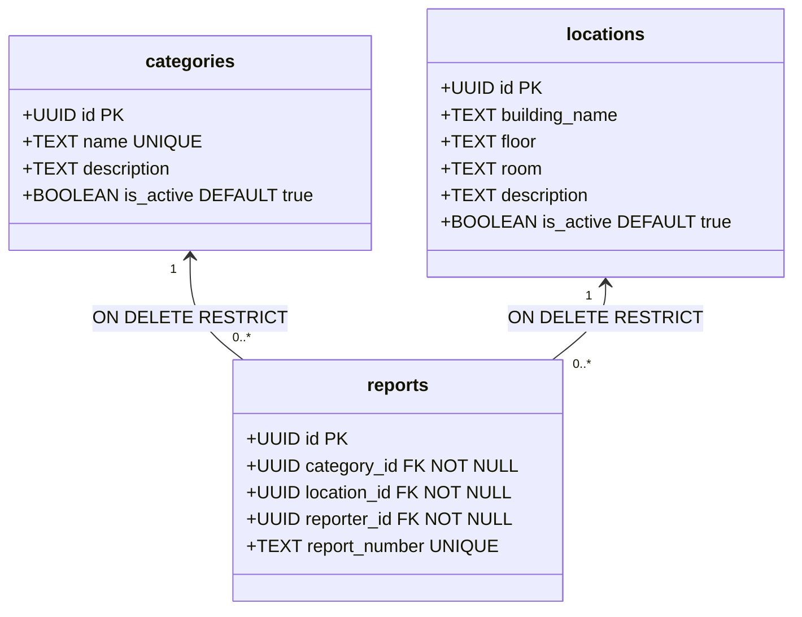

# CMIRS Gate E.1 — Campus Seed Data Review & Approval Preparation

> **Document:** `docs/database-design/PHASE_E1_SEED_REVIEW.md`  
> **Date:** 2026-10-18  
> **Project:** Campus Maintenance & Incident Reporting System (CMIRS)  
> **Phase:** Gate E.1 — Campus Seed Data Review and Approval Preparation  
> **Target Project Reference:** `xyirfifvcntuzceivtho` (`CMIRS-System`)  
> **Execution Status:** **REVIEW & PREPARATION DELIVERABLE — ZERO DATABASE WRITES OCCURRED**  
> **Final Phase Verdict:** **READY FOR OWNER SEED DATA APPROVAL**  

---

## 1. Executive Summary & Objective

In CMIRS, the database schema enforces strict referential integrity. In particular:
- `public.reports.category_id` is a `NOT NULL` foreign key referencing `public.categories(id)`.
- `public.reports.location_id` is a `NOT NULL` foreign key referencing `public.locations(id)`.

Because Phase 6F completed with a pristine database (verified 0 rows in `categories` and 0 rows in `locations`), **no user or automated test can create a report until reference categories and locations are provisioned.**

The objective of Gate E.1 is to:
1. Conduct an exhaustive schema and constraint audit on the seed data plan in [`docs/database-design/PHASE_5J_SEED_DATA_PLAN.md`](file:///d:/CMIRS-System/my-app/docs/database-design/PHASE_5J_SEED_DATA_PLAN.md).
2. Clearly separate confirmed technical requirements from unapproved campus strings and illustrative placeholders.
3. Formulate an itemized approval checklist for the project owner.
4. Provide the exact executable seed script for `supabase/seed.sql`, preserved unexecuted until explicit owner authorization is granted.

---

## 2. Schema & Constraint Conformance Audit

The proposed seed structures were cross-referenced against the actual deployed PostgreSQL 17 schema from [`supabase/migrations/20261018000001_core_schema.sql`](file:///d:/CMIRS-System/my-app/supabase/migrations/20261018000001_core_schema.sql):



### 2.1 Table: `public.categories`
- **`id` (`UUID PRIMARY KEY`):** System default is `gen_random_uuid()`. Using explicit, deterministic UUIDs during seed insertion ensures stable foreign key references across development and testing.
- **`name` (`TEXT NOT NULL UNIQUE`):** Enforces unique category names via constraint `categories_name_key`. Duplicate names are strictly rejected at the engine level.
- **`description` (`TEXT`):** Nullable text field describing the scope of maintenance work covered by the category.
- **`is_active` (`BOOLEAN NOT NULL DEFAULT true`):** Controls availability in client dropdowns. Inactive categories remain in the database to preserve historical report references.
- **Referential Constraint on Reports:** `ON DELETE RESTRICT`. A seeded category referenced by any report cannot be deleted.

### 2.2 Table: `public.locations`
- **`id` (`UUID PRIMARY KEY`):** System default is `gen_random_uuid()`. Explicit, deterministic UUIDs prevent duplicate rows upon seed re-execution.
- **`building_name` (`TEXT NOT NULL`):** Mandatory campus facility/building name.
- **`floor` (`TEXT`):** Nullable floor identifier (e.g., `'1'`, `'2'`, `'Ground'`).
- **`room` (`TEXT`):** Nullable room/area identifier (e.g., `'101'`, `'Cafeteria'`).
- **`description` (`TEXT`):** Nullable area description (e.g., `'Main Lecture Hall'`).
- **`is_active` (`BOOLEAN NOT NULL DEFAULT true`):** Controls availability in location selectors.
- **Uniqueness Check:** The schema does **not** have a composite unique constraint on `(building_name, floor, room)`. Therefore, naive `INSERT` statements without primary-key conflict targets would create duplicate records upon re-execution. Deterministic UUIDs with `ON CONFLICT (id)` are essential.
- **Referential Constraint on Reports:** `ON DELETE RESTRICT`. A seeded location referenced by any report cannot be deleted.

### 2.3 Row Level Security & Governance Audit
As deployed in [`20261018000005_table_rls_policies.sql:L75-L127`](file:///d:/CMIRS-System/my-app/supabase/migrations/20261018000005_table_rls_policies.sql#L75-L127):
- **Read Permissions (`categories_select`, `locations_select`):** Active records (`is_active = true`) are visible to all authenticated users. Inactive records are visible only to oversight roles (`coordinator`, `administrator`, `management`).
- **Write Permissions (`categories_insert`, `categories_update`, `locations_insert`, `locations_update`):** Strictly restricted to `coordinator` and `administrator` roles.
- **Delete Permissions:** `DELETE` is default-denied across all roles (zero DELETE policies exist).
- **Execution Mechanism for Seed Script:** Initial seed data must be inserted either via the Supabase Dashboard SQL Editor (superuser/service execution) or via `npx supabase db query --linked` using administrative privileges, bypassing RLS write restrictions during database bootstrapping.

---

## 3. Analysis: Confirmed Architecture vs. Unapproved Placeholders

To preserve absolute engineering integrity, confirmed technical parameters must be distinguished from unapproved placeholder strings:

| Domain | Confirmed Architectural Parameters (VERIFIED) | Unapproved Placeholders (AWAITING OWNER APPROVAL) |
|---|---|---|
| **Primary Keys** | Deterministic UUID namespaces: <br>• Categories: `c0000000-0000-4000-a000-000000000001`+<br>• Locations: `d0000000-0000-4000-b000-000000000001`+ | None. UUID formatting complies with RFC 4122 v4. |
| **Idempotency** | `ON CONFLICT (id) DO UPDATE SET ...` allows safe, repeatable seed execution without row duplication. | None. |
| **Category Values** | Schema supports `name`, `description`, `is_active`. | The 5 proposed category names (`Electrical & Lighting`, `Plumbing & Water`, etc.) are standard industry terms, but **have not been confirmed as the official categories for this campus**. |
| **Location Values** | Schema supports `building_name`, `floor`, `room`, `description`. | **Discrepancy in Phase 5J Plan:**<br>• Section 5.2 used literal placeholders: `[Campus Building A]`, `[Campus Building B]`, `[Campus Library]`, `[Student Center]`.<br>• Section 7 used generic strings: `Main Academic Building`, `Administration Wing`, `University Library`, `Student Union Building`.<br>**Neither set has been approved by the owner.** |

---

## 4. Comprehensive Seed Data Approval Tables

### 4.1 Proposed Categories Table

| # | Deterministic UUID | Proposed Category Name | Proposed Description | Purpose / Role | Current Status | Required Owner Action |
|:---:|---|---|---|---|:---:|---|
| **C1** | `c0000000-0000-4000-a000-000000000001` | `Electrical & Lighting` | Power outlets, lighting fixtures, circuit breakers, and switches | High-frequency maintenance category | `[PENDING]` | Confirm name or replace with official category string. |
| **C2** | `c0000000-0000-4000-a000-000000000002` | `Plumbing & Water` | Leaks, pipe blockages, faucets, toilets, and water supply issues | High-frequency maintenance category | `[PENDING]` | Confirm name or replace with official category string. |
| **C3** | `c0000000-0000-4000-a000-000000000003` | `HVAC & Ventilation` | Air conditioning, heating, ventilation fans, and temperature control | Facility climate control category | `[PENDING]` | Confirm name or replace with official category string. |
| **C4** | `c0000000-0000-4000-a000-000000000004` | `Structural & Carpentry` | Doors, windows, locks, walls, ceiling tiles, and structural damage | Building fabric & security category | `[PENDING]` | Confirm name or replace with official category string. |
| **C5** | `c0000000-0000-4000-a000-000000000005` | `General Maintenance` | Furniture, painting, groundskeeping, and miscellaneous facility repairs | Fallback / catch-all category | `[PENDING]` | Confirm name or replace with official category string. |

---

### 4.2 Proposed Locations Table

| # | Deterministic UUID | Building Name (`building_name`) | Floor (`floor`) | Room (`room`) | Area Description | Current Status | Required Owner Action |
|:---:|---|---|---|---|---|:---:|---|
| **L1** | `d0000000-0000-4000-b000-000000000001` | `Main Academic Building` *(or [Building A])* | `1` | `101` | Main Lecture Hall | `[PENDING]` | Confirm building name or replace with real campus facility. |
| **L2** | `d0000000-0000-4000-b000-000000000002` | `Main Academic Building` *(or [Building A])* | `2` | `204` | Computer Laboratory | `[PENDING]` | Confirm building name or replace with real campus facility. |
| **L3** | `d0000000-0000-4000-b000-000000000003` | `Administration Wing` *(or [Building B])* | `1` | `110` | Administrative Office | `[PENDING]` | Confirm building name or replace with real campus facility. |
| **L4** | `d0000000-0000-4000-b000-000000000004` | `University Library` *(or [Campus Library])* | `1` | `Reading Area` | Main Library Reading Room | `[PENDING]` | Confirm building name or replace with real campus facility. |
| **L5** | `d0000000-0000-4000-b000-000000000005` | `Student Union Building` *(or [Student Center])* | `Ground` | `Cafeteria` | Dining and Kitchen Area | `[PENDING]` | Confirm building name or replace with real campus facility. |

---

## 5. Recommended Initial Dataset Strategy

To prevent inventing unapproved institutional campus data, the owner is presented with two clear options:

### Option A: Generic Development Fixtures (Recommended for immediate testing)
- **Concept:** Authorize the five generic categories (C1–C5) and five generic locations (L1–L5) as explicit development/testing fixtures.
- **Advantage:** Enables immediate testing of report submission, triage, technician assignment, hold states, comments, and verifications without waiting for institutional facility mapping.
- **Future Production Transition:** Real campus locations can be added via the Next.js admin UI or a production seed script later; test locations can be soft-deleted (`is_active = false`).

### Option B: Official Institutional Campus Data
- **Concept:** The owner provides the actual real-world building names, floors, room numbers, and approved incident categories for their specific institution.
- **Advantage:** Development database immediately reflects real-world operations.
- **Requirement:** Owner must provide the exact replacement strings before seed insertion.

---

## 6. Seed Script Specification & Proposed Code

### 6.1 Current Repository Seed Status
- **File Checked:** [`supabase/seed.sql`](file:///d:/CMIRS-System/my-app/supabase/seed.sql)
- **Current State:** **DOES NOT EXIST ON DISK.**
- `supabase/config.toml` line 72 explicitly points to `sql_paths = ["./seed.sql"]`.

### 6.2 Proposed Seed Script (Ready to write to `supabase/seed.sql` upon approval)

```sql
-- =============================================================================
-- CMIRS Baseline Seed Data Script
-- File: supabase/seed.sql
-- Prerequisites: Migrations 1-6 applied.
-- Target: xyirfifvcntuzceivtho (Supabase Cloud)
-- Status: PENDING OWNER APPROVAL
-- =============================================================================

BEGIN;

-- -----------------------------------------------------------------------------
-- 1. Seed Baseline Categories (Idempotent upsert via deterministic UUIDs)
-- -----------------------------------------------------------------------------
INSERT INTO public.categories (id, name, description, is_active)
VALUES
  ('c0000000-0000-4000-a000-000000000001', 'Electrical & Lighting', 'Power outlets, lighting fixtures, circuit breakers, and switches', true),
  ('c0000000-0000-4000-a000-000000000002', 'Plumbing & Water', 'Leaks, pipe blockages, faucets, toilets, and water supply issues', true),
  ('c0000000-0000-4000-a000-000000000003', 'HVAC & Ventilation', 'Air conditioning, heating, ventilation fans, and temperature control', true),
  ('c0000000-0000-4000-a000-000000000004', 'Structural & Carpentry', 'Doors, windows, locks, walls, ceiling tiles, and structural damage', true),
  ('c0000000-0000-4000-a000-000000000005', 'General Maintenance', 'Furniture, painting, groundskeeping, and miscellaneous facility repairs', true)
ON CONFLICT (id) DO UPDATE SET
  name = EXCLUDED.name,
  description = EXCLUDED.description,
  is_active = EXCLUDED.is_active;

-- -----------------------------------------------------------------------------
-- 2. Seed Baseline Campus Locations (Idempotent upsert via deterministic UUIDs)
-- -----------------------------------------------------------------------------
INSERT INTO public.locations (id, building_name, floor, room, description, is_active)
VALUES
  ('d0000000-0000-4000-b000-000000000001', 'Main Academic Building', '1', '101', 'Main Lecture Hall', true),
  ('d0000000-0000-4000-b000-000000000002', 'Main Academic Building', '2', '204', 'Computer Laboratory', true),
  ('d0000000-0000-4000-b000-000000000003', 'Administration Wing', '1', '110', 'Administrative Office', true),
  ('d0000000-0000-4000-b000-000000000004', 'University Library', '1', 'Reading Area', 'Main Library Reading Room', true),
  ('d0000000-0000-4000-b000-000000000005', 'Student Union Building', 'Ground', 'Cafeteria', 'Dining and Kitchen Area', true)
ON CONFLICT (id) DO UPDATE SET
  building_name = EXCLUDED.building_name,
  floor = EXCLUDED.floor,
  room = EXCLUDED.room,
  description = EXCLUDED.description,
  is_active = EXCLUDED.is_active;

COMMIT;
```

---

## 7. Owner Approval Checklist & Next Steps

Before executing Gate E.2 seed insertion, please review and authorize the following decisions:

- [ ] **Category Dataset:**
  - [ ] Approve the 5 proposed categories (`Electrical & Lighting`, `Plumbing & Water`, `HVAC & Ventilation`, `Structural & Carpentry`, `General Maintenance`).
  - *OR* Provide alternative category names and descriptions.
- [ ] **Campus Location Dataset:**
  - [ ] Approve Option A generic testing locations (`Main Academic Building`, `Administration Wing`, `University Library`, `Student Union Building`).
  - *OR* Provide Option B official institutional building names, floors, and rooms.
- [ ] **Seed Script Creation:**
  - [ ] Authorize writing the approved seed SQL script to [`supabase/seed.sql`](file:///d:/CMIRS-System/my-app/supabase/seed.sql).
- [ ] **Execution Authorization (Gate E.2):**
  - [ ] Authorize executing the approved seed script against Supabase Cloud project `xyirfifvcntuzceivtho`.

---

## 8. Final Phase Verdict

```text
================================================================================
FINAL VERDICT: READY FOR OWNER SEED DATA APPROVAL
================================================================================
```

**Verdict Rationale:**
1. The seed data architecture and deterministic UUID namespaces are verified as 100% compliant with the deployed schema and constraints.
2. The exact categories and campus locations have been cataloged and separated from unapproved placeholders.
3. An idempotent SQL seed script has been prepared and formatted for `supabase/seed.sql`.
4. Strict safety boundaries were preserved: zero database queries, zero writes, zero synthetic users, and zero Git mutations were executed.
5. The review is stopped and awaiting owner approval of the dataset choice.

---
*Gate E.1 review complete. Execution stopped. Awaiting explicit owner decisions on seed categories and locations.*
