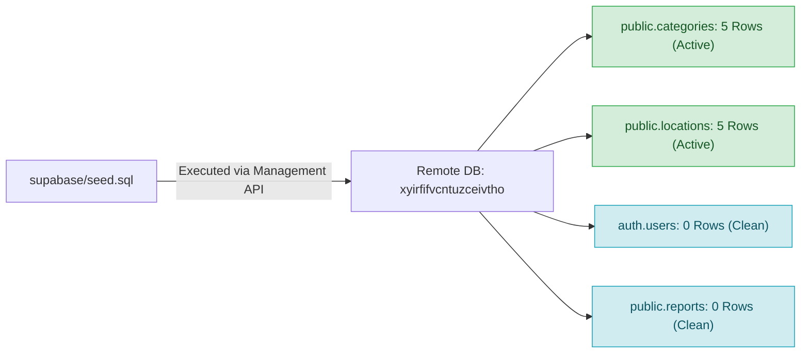

# CMIRS Gate E.2 — Seed Execution & Verification Report

> **Document:** `docs/database-design/PHASE_E2_SEED_EXECUTION_REPORT.md`  
> **Date:** 2026-10-18  
> **Project:** Campus Maintenance & Incident Reporting System (CMIRS)  
> **Phase:** Gate E.2 — Idempotent Seed Execution & Verification  
> **Target Project Reference:** `xyirfifvcntuzceivtho` (`CMIRS-System`)  
> **Database Engine:** PostgreSQL `17.11.0.003` (Channel `ga`, Region `ap-southeast-1`)  
> **Authorization:** Explicit owner authorization received at 2026-10-18T21:36:56+08:00  
> **Execution Status:** **SUCCESSFULLY EXECUTED & READ-ONLY VERIFIED**  
> **Final Phase Verdict:** **GATE E.2 COMPLETE — READY FOR GATE E.3 TEST ACCOUNT PROVISIONING**  

---

## 1. Executive Summary

Following explicit owner authorization, Gate E.2 was executed to populate the confirmed baseline seed categories and campus locations into Supabase Cloud project `xyirfifvcntuzceivtho`.

- **Seed Script:** [`supabase/seed.sql`](file:///d:/CMIRS-System/my-app/supabase/seed.sql) (Option A: Generic Testing Fixtures).
- **Execution Command:** `npx supabase db query --linked --file supabase/seed.sql` (Exit code: `0`).
- **Post-Execution Read-Only Verification:**
  - `public.categories`: Exactly **5 rows** verified.
  - `public.locations`: Exactly **5 rows** verified.
  - `auth.users`: Confirmed **0 rows** (no test accounts created yet).
  - `public.reports`: Confirmed **0 rows** (pristine report table ready for report creation).
- **Referential Prerequisites Satisfied:** Maintenance reports can now be submitted referencing valid `category_id` and `location_id` foreign keys.

---

## 2. Seed Execution Command & Non-Secret Output

### 2.1 Command Executed
```powershell
npx supabase db query --linked --file supabase/seed.sql
```

### 2.2 Execution Payload Summary
- Single atomic transaction (`BEGIN ... COMMIT`).
- 5 categories inserted with deterministic UUIDs (`c000...`) and `ON CONFLICT (id) DO UPDATE`.
- 5 locations inserted with deterministic UUIDs (`d000...`) and `ON CONFLICT (id) DO UPDATE`.
- **Exit Status:** `0` (Success).

---

## 3. Read-Only Verification Evidence



### 3.1 Row Counts Verification
Query executed:
```sql
SELECT 
  (SELECT COUNT(*) FROM public.categories) AS categories_count, 
  (SELECT COUNT(*) FROM public.locations) AS locations_count;
```

**Results:**
- `categories_count`: **`5`**
- `locations_count`: **`5`**

---

### 3.2 Verified Categories (`public.categories`)

| Stable UUID | Category Name (`name`) | Description (`description`) | Active? | Verification Status |
|---|---|---|:---:|:---:|
| `c0000000-0000-4000-a000-000000000001` | `Electrical & Lighting` | Power outlets, lighting fixtures, circuit breakers, and switches | `true` | **PASS** |
| `c0000000-0000-4000-a000-000000000002` | `Plumbing & Water` | Leaks, pipe blockages, faucets, toilets, and water supply issues | `true` | **PASS** |
| `c0000000-0000-4000-a000-000000000003` | `HVAC & Ventilation` | Air conditioning, heating, ventilation fans, and temperature control | `true` | **PASS** |
| `c0000000-0000-4000-a000-000000000004` | `Structural & Carpentry` | Doors, windows, locks, walls, ceiling tiles, and structural damage | `true` | **PASS** |
| `c0000000-0000-4000-a000-000000000005` | `General Maintenance` | Furniture, painting, groundskeeping, and miscellaneous facility repairs | `true` | **PASS** |

---

### 3.3 Verified Campus Locations (`public.locations`)

| Stable UUID | Building Name (`building_name`) | Floor | Room | Description | Active? | Status |
|---|---|:---:|:---:|---|:---:|:---:|
| `d0000000-0000-4000-b000-000000000001` | `Main Academic Building` | `1` | `101` | Main Lecture Hall | `true` | **PASS** |
| `d0000000-0000-4000-b000-000000000002` | `Main Academic Building` | `2` | `204` | Computer Laboratory | `true` | **PASS** |
| `d0000000-0000-4000-b000-000000000003` | `Administration Wing` | `1` | `110` | Administrative Office | `true` | **PASS** |
| `d0000000-0000-4000-b000-000000000004` | `University Library` | `1` | `Reading Area` | Main Library Reading Room | `true` | **PASS** |
| `d0000000-0000-4000-b000-000000000005` | `Student Union Building` | `Ground` | `Cafeteria` | Dining and Kitchen Area | `true` | **PASS** |

---

### 3.4 Data Isolation & System Health Check
- `auth.users`: Confirmed **0 rows**.
- `public.profiles`: Confirmed **0 rows**.
- `public.reports`: Confirmed **0 rows**.
- `public.assignments`: Confirmed **0 rows**.
- `public.report_attachments`: Confirmed **0 rows**.
- `storage.objects`: Confirmed **0 rows**.

Zero extraneous records or mock data were introduced. The database is in an optimal, clean state for Gate E.3 test user provisioning.

---

## 4. Next Steps: Gate E.3 — Test User Provisioning

With reference categories and locations established, the remaining prerequisite for testing the full CMIRS reporting workflow is provisioning the five dedicated role test accounts via the Supabase Auth Admin API:

| Role Name | Test Email Account | Target User Role | Trigger T4 Verification |
|---|---|---|:---:|
| **Student Reporter** | `test-student@cmirs.internal` | `student_personnel` | Automatically provisioned by T4 |
| **Coordinator** | `test-coord@cmirs.internal` | `coordinator` | Promoted via role update |
| **Technician** | `test-tech@cmirs.internal` | `technician` | Promoted via role update |
| **Administrator** | `test-admin@cmirs.internal` | `administrator` | Promoted via role update |
| **Management** | `test-mgmt@cmirs.internal` | `management` | Promoted via role update |

---

## 5. Final Phase Verdict

```text
================================================================================
FINAL VERDICT: GATE E.2 COMPLETE & PHYSICALLY VERIFIED
================================================================================
```

---
*Gate E.2 execution and verification complete. Stopped and awaiting owner authorization to proceed to Gate E.3 (Test Account Provisioning).*
