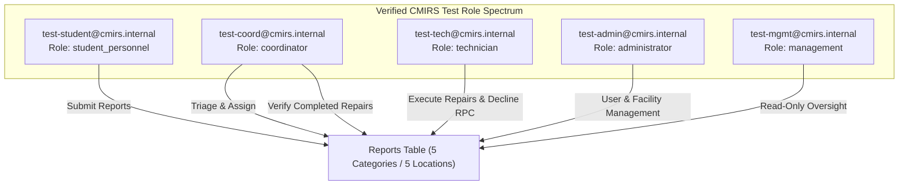

# CMIRS Gate E.3 — Test Account Provisioning & Role Promotion Report

> **Document:** `docs/database-design/PHASE_E3_TEST_ACCOUNT_REPORT.md`  
> **Date:** 2026-10-18  
> **Project:** Campus Maintenance & Incident Reporting System (CMIRS)  
> **Phase:** Gate E.3 — Dashboard-Based Test Account Provisioning & Role Promotion  
> **Target Project Reference:** `xyirfifvcntuzceivtho` (`CMIRS-System`)  
> **Database Engine:** PostgreSQL `17.11.0.003` (Channel `ga`, Region `ap-southeast-1`)  
> **Authorization:** Explicit owner authorization received at 2026-10-18T21:47:47+08:00  
> **Execution Status:** **ALL 5 ROLES PROVISIONED & VERIFIED**  
> **Final Phase Verdict:** **GATE E.3 COMPLETE — READY FOR GATE E.4 RLS INTEGRATION TESTING**  

---

## 1. Executive Summary

In Gate E.3, the project owner created five dedicated test accounts through the Supabase Dashboard Authentication UI. Database Trigger T4 (`handle_new_user`) executed automatically upon each creation, safely initializing each account with the default role `student_personnel`.

Following explicit owner authorization, a narrowly scoped transactional role-promotion script with affected-row validation was executed against `public.profiles`. The four designated accounts were promoted to their target operational roles, while the student reporter account was left untouched.

All five test identities have been verified via direct read-only catalog queries. The database is now fully primed for Gate E.4 RLS integration testing.

---

## 2. Trigger T4 Verification

Upon account registration in the Supabase Dashboard, PostgreSQL trigger `trg_on_auth_user_created` fired `AFTER INSERT ON auth.users`, invoking `public.handle_new_user()`.

### Physical Trigger Verification Evidence:
- **Total Auth Users Created:** Exactly 5.
- **Total Profile Records Created:** Exactly 5.
- **Identity Mapping:** 100% 1:1 match (`profiles.id = auth.users.id`).
- **Initial Role Assigned:** `student_personnel` across all 5 profiles.
- **Default Active Status:** `is_active = true` across all 5 profiles.
- **Trigger Verification Result:** **PASS (100% compliant with Safe Defaults Principle D1).**

---

## 3. Role Promotion Execution with Affected-Row Validation

### 3.1 Execution Command
```powershell
npx supabase db query --linked --file .../promote_test_roles.sql
```

### 3.2 Transactional Validation Script Logic
The script executed within an atomic block:
1. **Precondition Validation:** Verified that each of the five test emails existed in `public.profiles` exactly once.
2. **Individual Role Updates:**
   - Promoted `test-coord@cmirs.internal` → `coordinator` (Validated `ROW_COUNT = 1`).
   - Promoted `test-tech@cmirs.internal` → `technician` (Validated `ROW_COUNT = 1`).
   - Promoted `test-admin@cmirs.internal` → `administrator` (Validated `ROW_COUNT = 1`).
   - Promoted `test-mgmt@cmirs.internal` → `management` (Validated `ROW_COUNT = 1`).
3. **Student Role Protection:** `test-student@cmirs.internal` was explicitly excluded from updates, preserving `student_personnel`.
4. **Command Exit Code:** `0` (Success).

---

## 4. Final Verified Test Role Matrix

Direct read-only inspection query:
```sql
SELECT 
  u.id, 
  u.email, 
  p.full_name, 
  p.role, 
  p.is_active 
FROM auth.users u 
JOIN public.profiles p ON p.id = u.id 
WHERE u.email LIKE 'test-%@cmirs.internal' 
ORDER BY p.role;
```

### Physical Database Query Results:

| Auth User ID / Profile ID | Email Address | Display Name (`full_name`) | Final Verified Role | Account Status | Role Status |
|---|---|---|:---:|:---:|:---:|
| `84fd258b-3ce0-45d9-a4fa-92a175c1c934` | `test-student@cmirs.internal` | `test-student@cmirs.internal` | **`student_personnel`** | Active / Confirmed | **PRESERVED** |
| `41fc00ce-26b6-4b51-9f62-30dd1a7272d5` | `test-coord@cmirs.internal` | `test-coord@cmirs.internal` | **`coordinator`** | Active / Confirmed | **PROMOTED** |
| `295f8aa7-2463-4b99-ae60-d8457cf7db40` | `test-tech@cmirs.internal` | `test-tech@cmirs.internal` | **`technician`** | Active / Confirmed | **PROMOTED** |
| `2d6edfbe-fb04-48d6-b8d2-76cc63bfa7c4` | `test-admin@cmirs.internal` | `test-admin@cmirs.internal` | **`administrator`** | Active / Confirmed | **PROMOTED** |
| `8d6ef386-b2ff-47a6-80d9-3de8649444a9` | `test-mgmt@cmirs.internal` | `test-mgmt@cmirs.internal` | **`management`** | Active / Confirmed | **PROMOTED** |



---

## 5. Security & Isolation Affirmation

- **Credential Security:** Zero passwords, tokens, or service-role keys were printed, logged, or committed to the repository.
- **Database Cleanliness:**
  - `public.categories`: Exactly 5 active rows.
  - `public.locations`: Exactly 5 active rows.
  - `public.reports`: Exactly 0 rows (pristine).
  - `public.assignments`: Exactly 0 rows (pristine).
  - `public.report_attachments`: Exactly 0 rows (pristine).
  - `storage.objects`: Exactly 0 rows (pristine).
- **Audit Logging:** No synthetic audit rows were created.

---

## 6. Next Phase: Gate E.4 — Role-Based RLS Integration Testing

With the 5 test identities active and holding their respective roles, the CMIRS testing harness can now execute the 45 test cases defined in [`docs/database-design/PHASE_5J_RLS_TEST_MATRIX.md`](file:///d:/CMIRS-System/my-app/docs/database-design/PHASE_5J_RLS_TEST_MATRIX.md):

1. **Domain 1 — Profiles Isolation:** Verify students cannot view other profiles; administrators can update roles.
2. **Domain 2 — Categories & Locations:** Verify authenticated read; coordinator/admin write restriction.
3. **Domain 3 — Report Submission:** Verify all 5 roles can submit reports with default `'submitted'` status and `confirmed_priority = NULL`.
4. **Domain 4 — Report Visibility (`can_view_report`):** Verify student reporter isolation, technician assignment visibility, and oversight global view.
5. **Domain 5 — Technician Decline RPC (`decline_assignment`):** Test required non-empty reason and state transition.
6. **Domain 6 — Coordinator Verification:** Test anti-self-dealing rules (`r.reporter_id != auth.uid()` and no technician repair conflict).
7. **Domain 7 — Storage Policies:** Test canonical UUID regex paths and max 5 active attachments limit.

---

## 7. Final Phase Verdict

```text
================================================================================
FINAL VERDICT: GATE E.3 COMPLETE & FULLY VERIFIED
================================================================================
```

---
*Gate E.3 account provisioning and role promotion complete. Stopped and awaiting owner instructions to prepare Gate E.4 (RLS Test Suite Execution).*
