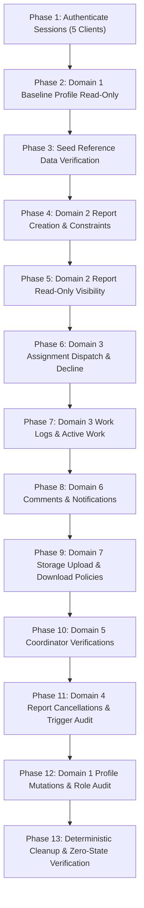
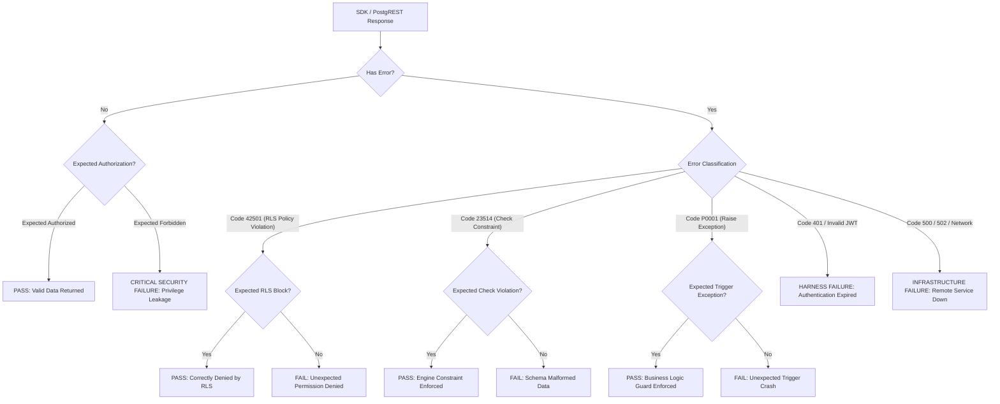

# CMIRS Gate E.4A — RLS Test Case PostgREST SDK Mapping

> **Document:** `docs/database-design/PHASE_E4A_TEST_CASE_MAPPING.md`  
> **Date:** 2026-10-18  
> **Project:** Campus Maintenance & Incident Reporting System (CMIRS)  
> **Phase:** Gate E.4A — Prepare RLS Integration Test Runner  
> **Target Project Reference:** `xyirfifvcntuzceivtho` (`CMIRS-System`)  
> **Database Engine:** PostgreSQL `17.11.0.003` (Channel `ga`, Region `ap-southeast-1`)  
> **Execution Status:** **PLANNING & SPECIFICATION ONLY — ZERO TEST RUNTIME EXECUTIONS**  
> **Final Phase Verdict:** **READY FOR OWNER TEST RUNNER APPROVAL**  

---

## 1. Executive Summary & Inventory Reconciliation

This document provides the definitive, one-to-one implementation mapping between the test specifications in [`docs/database-design/PHASE_5J_RLS_TEST_MATRIX.md`](file:///d:/CMIRS-System/my-app/docs/database-design/PHASE_5J_RLS_TEST_MATRIX.md) and the proposed TypeScript SDK integration test runner ([`tests/integration/rls-runner.ts`](file:///d:/CMIRS-System/my-app/tests/integration/rls-runner.ts)).

### Inventory Scope Reconciliation
- The Gate E.4A prompt references "all 45 planned role-based RLS tests".
- In [`PHASE_5J_RLS_TEST_MATRIX.md`](file:///d:/CMIRS-System/my-app/docs/database-design/PHASE_5J_RLS_TEST_MATRIX.md), the test suite comprises **55 discrete test specifications**:
  - **45 Core Table RLS Policy Tests** across Domains 1 to 6 (`RLS-AUTH-01..09`, `RLS-RPT-01..11`, `RLS-ASG-01..10`, `RLS-CAN-01..04`, `RLS-VER-01..05`, `RLS-COM-01..03`, `RLS-NOT-01..03`).
  - **1 Automated Trigger Audit Test** in Domain 4 (`RLS-AUD-01`).
  - **9 Supabase Storage RLS Policy Tests** in Domain 7 (`RLS-ATT-01..09`).
- **Mapping Commitment:** To ensure total security coverage, all **55 specifications** are mapped below with zero omissions.

---

## 2. Authenticated Client Session Map

The test runner will instantiate 6 distinct `@supabase/supabase-js` client instances. Superuser (`postgres`) or service-role access is **never** used for RLS assertions.

| Client Identifier | Authenticated Identity | Operational Role | Session Auth Mode | JWT Scoped Role |
|---|---|---|---|---|
| `anonClient` | None (Unauthenticated) | `anon` | No JWT (Publishable Key only) | `anon` |
| `studentClient` | `test-student@cmirs.internal` | `student_personnel` | Password Auth (`signInWithPassword`) | `authenticated` (`student_personnel`) |
| `coordClient` | `test-coord@cmirs.internal` | `coordinator` | Password Auth (`signInWithPassword`) | `authenticated` (`coordinator`) |
| `techClient` | `test-tech@cmirs.internal` | `technician` | Password Auth (`signInWithPassword`) | `authenticated` (`technician`) |
| `adminClient` | `test-admin@cmirs.internal` | `administrator` | Password Auth (`signInWithPassword`) | `authenticated` (`administrator`) |
| `mgmtClient` | `test-mgmt@cmirs.internal` | `management` | Password Auth (`signInWithPassword`) | `authenticated` (`management`) |

### Cross-User & Cross-Role Isolation Mechanics
Because exactly one test account was provisioned per role in Gate E.3:
1. **Horizontal Isolation Tests (`RLS-AUTH-03`, `RLS-RPT-09`, `RLS-NOT-03`):** Evaluated by having `studentClient` attempt to access records belonging to another known user ID (e.g. `coordClient.auth.getUser().data.user.id`) or a synthetic random UUID. RLS policies must filter out records where `reporter_id != auth.uid()`, returning HTTP 200 with 0 rows (`[]`).
2. **Cross-Role Isolation Tests (`RLS-ASG-03`, `RLS-VER-05`):** Evaluated by attempting privileged actions with non-privileged role JWTs (e.g. `technician` attempting verification or viewing unassigned reports).

---

## 3. Comprehensive Test Case Mapping (All 55 Tests)

### Domain 1: Authentication, Role Boundaries & Profiles (9 Tests)

| Test ID | Acting Client | Nature | Target Database Object | SDK / PostgREST Operation | Precondition / Fixture | Expected PostgREST Status & Error Code | Expected Result / Assertion | Cleanup Strategy |
|---|---|:---:|---|---|---|---|---|---|
| **RLS-AUTH-01** | `anonClient` | Read-Only | `public.profiles` | `anonClient.from('profiles').select('*')` | None | HTTP 200, empty array `[]` | 0 rows returned. Public access blocked by `profiles_select`. | None |
| **RLS-AUTH-02** | `studentClient` | Read-Only | `public.profiles` | `studentClient.from('profiles').select('*').eq('id', studentId)` | Logged in as Student | HTTP 200, single row | Returns 1 row matching `studentId` with role `student_personnel`. | None |
| **RLS-AUTH-03** | `studentClient` | Read-Only | `public.profiles` | `studentClient.from('profiles').select('*').eq('id', coordId)` | Logged in as Student | HTTP 200, empty array `[]` | 0 rows returned. Horizontal isolation enforced by `profiles_select`. | None |
| **RLS-AUTH-04** | `coordClient` | Read-Only | `public.profiles` | `coordClient.from('profiles').select('*')` | Logged in as Coordinator | HTTP 200, array of 5 profiles | Returns all 5 profiles. Coordinator oversight permitted. | None |
| **RLS-AUTH-05** | `studentClient` | Mutating (Attempt) | `public.profiles` | `studentClient.from('profiles').update({ role: 'administrator' }).eq('id', studentId)` | Logged in as Student | HTTP 403 / 42501 (or 0 rows updated) | Update rejected by `profiles_update_own` `WITH CHECK` (`role` immutable). | None |
| **RLS-AUTH-06** | `studentClient` | Mutating (Attempt) | `public.profiles` | `studentClient.from('profiles').update({ is_active: false }).eq('id', studentId)` | Logged in as Student | HTTP 403 / 42501 (or 0 rows updated) | Update rejected by `profiles_update_own` `WITH CHECK` (`is_active` immutable). | None |
| **RLS-AUTH-07** | `adminClient` | Mutating (Attempt) | `public.profiles` | `adminClient.from('profiles').update({ role: 'coordinator' }).eq('id', adminId)` | Logged in as Admin | HTTP 403 / 42501 (or 0 rows updated) | Self-demotion rejected by `profiles_update_admin` (`id != auth.uid()`). | None |
| **RLS-AUTH-08** | `adminClient` | Mutating | `public.profiles` | `adminClient.from('profiles').update({ full_name: 'Test Student (Verified)' }).eq('id', studentId)` | Admin session | HTTP 200, 1 row updated | Update succeeds via `profiles_update_admin`. Then revert `full_name`. | Inline revert |
| **RLS-AUTH-09** | `studentClient` | Mutating (Attempt) | `public.role_change_audit` | `studentClient.from('role_change_audit').insert({ user_id: studentId, changed_by: studentId, old_role: 'student_personnel', new_role: 'administrator' })` | Student session | HTTP 403 / 42501 (`violates rls policy`) | Insert rejected. Table allows inserts only by `administrator`. | None |

---

### Domain 2: Report Creation, Numbering & Visibility (11 Tests)

| Test ID | Acting Client | Nature | Target Database Object | SDK / PostgREST Operation | Precondition / Fixture | Expected PostgREST Status & Error Code | Expected Result / Assertion | Cleanup Strategy |
|---|---|:---:|---|---|---|---|---|---|
| **RLS-RPT-01** | `studentClient` | Mutating | `public.reports` | `studentClient.from('reports').insert({ title: '[TEST-E4A] Water leak in Science Hall', description: 'Leaking pipe under sink', category_id: catId, location_id: locId, reporter_id: studentId, status: 'submitted' }).select()` | Active category & location from seed | HTTP 201, 1 row returned | Report created. Status is `submitted`, `confirmed_priority` is `null`. Assigned `report_number` starts with `RPT-`. Primary test fixture `FIXTURE_RPT_1`. | Tagged `[TEST-E4A]` (cascades) |
| **RLS-RPT-02** | `studentClient` | Mutating (Attempt) | `public.reports` | `studentClient.from('reports').insert({ title: '[TEST-E4A] Spoofed reporter', description: 'desc', category_id: catId, location_id: locId, reporter_id: coordId, status: 'submitted' })` | Student session | HTTP 403 / 42501 (`violates rls policy`) | Insert rejected. `reports_insert` mandates `reporter_id = auth.uid()`. | None |
| **RLS-RPT-03** | `studentClient` | Mutating (Attempt) | `public.reports` | `studentClient.from('reports').insert({ title: '[TEST-E4A] Premature status', description: 'desc', category_id: catId, location_id: locId, reporter_id: studentId, status: 'verified' })` | Student session | HTTP 403 / 42501 (`violates rls policy`) | Insert rejected. `reports_insert` mandates `status = 'submitted'`. | None |
| **RLS-RPT-04** | `studentClient` | Mutating (Attempt) | `public.reports` | `studentClient.from('reports').insert({ title: '[TEST-E4A] Forced priority', description: 'desc', category_id: catId, location_id: locId, reporter_id: studentId, status: 'submitted', confirmed_priority: 'critical' })` | Student session | HTTP 403 / 42501 (`violates rls policy`) | Insert rejected. `reports_insert` mandates `confirmed_priority IS NULL`. | None |
| **RLS-RPT-05** | `studentClient` | Mutating | `public.reports` | `studentClient.from('reports').insert({ report_number: 'RPT-999999', title: '[TEST-E4A] Number override test', description: 'desc', category_id: catId, location_id: locId, reporter_id: studentId, status: 'submitted' }).select()` | Active seed fixtures | HTTP 201, 1 row returned | Insert succeeds, but Trigger T2 overrides custom number. Returned `report_number != 'RPT-999999'`. Secondary fixture `FIXTURE_RPT_2`. | Tagged `[TEST-E4A]` (cascades) |
| **RLS-RPT-06** | `studentClient` | Mutating (Attempt) | `public.reports` | `studentClient.from('reports').update({ report_number: 'RPT-ALTERED' }).eq('id', FIXTURE_RPT_1.id)` | `FIXTURE_RPT_1` exists | HTTP 400 / P0001 (`report_number is immutable`) | Trigger `trg_reports_immutable_cols` rejects sequence tampering. | None |
| **RLS-RPT-07** | `studentClient` | Mutating (Attempt) | `public.reports` | `studentClient.from('reports').update({ reporter_id: coordId }).eq('id', FIXTURE_RPT_1.id)` | `FIXTURE_RPT_1` exists | HTTP 400 / P0001 (`reporter_id is immutable`) | Trigger `trg_reports_immutable_cols` rejects reporter tampering. | None |
| **RLS-RPT-08** | `studentClient` | Read-Only | `public.reports` | `studentClient.from('reports').select('*').eq('id', FIXTURE_RPT_1.id)` | Own report exists | HTTP 200, 1 row returned | Report returned. `can_view_report()` returns `TRUE` for reporter. | None |
| **RLS-RPT-09** | `studentClient` | Read-Only | `public.reports` | `studentClient.from('reports').select('*').eq('reporter_id', coordId)` | Coordinator authored report | HTTP 200, empty array `[]` | 0 rows returned. Report authored by coordinator is completely hidden from student. | None |
| **RLS-RPT-10** | `coordClient` | Read-Only | `public.reports` | `coordClient.from('reports').select('*')` | Reports exist | HTTP 200, returns all reports | Coordinator sees all reports campus-wide (`can_view_report()` = `TRUE`). | None |
| **RLS-RPT-11** | `mgmtClient` | Read-Only | `public.reports` | `mgmtClient.from('reports').select('*')` | Reports exist | HTTP 200, returns all reports | Management sees all reports campus-wide (`can_view_report()` = `TRUE`). | None |

---

### Domain 3: Technician Assignment, Decline Flow & Work Logs (10 Tests)

| Test ID | Acting Client | Nature | Target Database Object | SDK / PostgREST Operation | Precondition / Fixture | Expected PostgREST Status & Error Code | Expected Result / Assertion | Cleanup Strategy |
|---|---|:---:|---|---|---|---|---|---|
| **RLS-ASG-01** | `coordClient` | Mutating | `public.assignments` | `coordClient.from('assignments').insert({ report_id: FIXTURE_RPT_1.id, technician_id: techId, assigned_by: coordId, status: 'assigned', notes: '[TEST-E4A] Fix the pipe leak' }).select()` | `FIXTURE_RPT_1` in `submitted` | HTTP 201, 1 row returned | Assignment created. Status is `assigned`. Primary fixture `FIXTURE_ASG_1`. | Tagged `[TEST-E4A]` (cascades with report) |
| **RLS-ASG-02** | `techClient` | Read-Only | `public.reports` | `techClient.from('reports').select('*').eq('id', FIXTURE_RPT_1.id)` | `FIXTURE_ASG_1` active | HTTP 200, 1 row returned | Assigned report visible to assigned technician (`can_view_report()` = `TRUE`). | None |
| **RLS-ASG-03** | `techClient` | Read-Only | `public.reports` | `techClient.from('reports').select('*').eq('id', FIXTURE_RPT_2.id)` | `FIXTURE_RPT_2` has no assignment to Tech | HTTP 200, empty array `[]` | 0 rows returned. Unassigned report hidden from technician. | None |
| **RLS-ASG-04** | `techClient` | Mutating (RPC) | `public.decline_assignment` | `techClient.rpc('decline_assignment', { target_assignment_id: FIXTURE_ASG_1.id, reason: '[TEST-E4A] Conflict with emergency work' })` | Assignment in `assigned` | HTTP 200 (void) | RPC executes successfully. Assignment status becomes `declined`. | Preserved for ASG-05/10 |
| **RLS-ASG-05** | `techClient` | Read-Only | `public.reports` | `techClient.from('reports').select('*').eq('id', FIXTURE_RPT_1.id)` | Assignment is `declined` | HTTP 200, empty array `[]` | 0 rows returned. Post-decline isolation verified (`can_view_report()` = `FALSE`). | None |
| **RLS-ASG-06** | `techClient` | Mutating (RPC Attempt) | `public.decline_assignment` | `techClient.rpc('decline_assignment', { target_assignment_id: FIXTURE_ASG_2.id, reason: '   ' })` | Assignment in `assigned` | HTTP 400 / P0001 (`A non-empty decline reason is required`) | Whitespace decline blocked by `btrim()` validation in RPC. | None |
| **RLS-ASG-07** | `techClient` | Mutating (RPC Attempt) | `public.decline_assignment` | `techClient.rpc('decline_assignment', { target_assignment_id: FIXTURE_ASG_WORK.id, reason: 'Decline in progress' })` | Assignment in `in_progress` | HTTP 400 / P0001 (`can only be declined from assigned status`) | Abandonment blocked: decline forbidden once work has commenced. | None |
| **RLS-ASG-08** | `techClient` | Mutating (Attempt) | `public.assignments` | `techClient.from('assignments').update({ notes: 'tampered notes', assigned_by: techId }).eq('id', FIXTURE_ASG_WORK.id)` | Assignment in `in_progress` | HTTP 403 / 42501 (or 0 rows updated) | Update rejected. RLS policy protects coordinator-authored metadata fields. | None |
| **RLS-ASG-09** | `techClient` | Mutating | `public.work_logs` | `techClient.from('work_logs').insert({ assignment_id: FIXTURE_ASG_WORK.id, technician_id: techId, description: '[TEST-E4A] Replaced valve and seal', hours_spent: 2.5 }).select()` | Assignment in `in_progress` | HTTP 201, 1 row returned | Work log inserted successfully via `work_logs_insert`. | Cascades with report |
| **RLS-ASG-10** | `techClient` | Mutating (Attempt) | `public.work_logs` | `techClient.from('work_logs').insert({ assignment_id: FIXTURE_ASG_1.id, technician_id: techId, description: '[TEST-E4A] Phantom log', hours_spent: 1.0 })` | `FIXTURE_ASG_1` is `declined` | HTTP 403 / 42501 (`violates rls policy`) | Insert rejected. Work logs forbidden on declined assignments. | None |

---

### Domain 4: Report Cancellation & Status Transitions (5 Tests)

| Test ID | Acting Client | Nature | Target Database Object | SDK / PostgREST Operation | Precondition / Fixture | Expected PostgREST Status & Error Code | Expected Result / Assertion | Cleanup Strategy |
|---|---|:---:|---|---|---|---|---|---|
| **RLS-CAN-01** | `studentClient` | Mutating | `public.reports` | `studentClient.from('reports').update({ status: 'cancelled' }).eq('id', FIXTURE_RPT_CANCEL.id).select()` | Own report in `submitted` | HTTP 200, 1 row updated | Cancellation succeeds via `reports_update_reporter_cancel`. | Tagged `[TEST-E4A]` |
| **RLS-CAN-02** | `studentClient` | Mutating (Attempt) | `public.reports` | `studentClient.from('reports').update({ status: 'cancelled' }).eq('id', FIXTURE_RPT_WORK.id)` | Own report in `in_progress` | HTTP 403 / 42501 (or 0 rows updated) | Cancellation rejected. Reporter cannot cancel report once repair has commenced. | None |
| **RLS-CAN-03** | `coordClient` | Mutating | `public.reports` | `coordClient.from('reports').update({ status: 'cancelled' }).eq('id', FIXTURE_RPT_WORK.id).select()` | Report in `in_progress` | HTTP 200, 1 row updated | Administrative cancellation succeeds via `reports_update_coordinator`. | Tagged `[TEST-E4A]` |
| **RLS-CAN-04** | `coordClient` | Mutating | `public.assignments` | `coordClient.from('assignments').update({ status: 'cancelled' }).eq('report_id', FIXTURE_RPT_WORK.id).select()` | Report cancelled | HTTP 200, assignments updated | Active assignments transition to `cancelled`. No orphaned tasks. | Cascades with report |
| **RLS-AUD-01** | System / Trigger | Mutating / Read-Only | `public.report_status_history` | `coordClient.from('reports').update({ status: 'under_review' }).eq('id', FIXTURE_RPT_AUDIT.id)` then `coordClient.from('report_status_history').select('*').eq('report_id', FIXTURE_RPT_AUDIT.id)` | Report status transition | HTTP 200, row exists in history table | Trigger T3 automatically generated history record (`new_status = 'under_review'`). | Cascades with report |

---

### Domain 5: Coordinator Verification Restrictions (5 Tests)

| Test ID | Acting Client | Nature | Target Database Object | SDK / PostgREST Operation | Precondition / Fixture | Expected PostgREST Status & Error Code | Expected Result / Assertion | Cleanup Strategy |
|---|---|:---:|---|---|---|---|---|---|
| **RLS-VER-01** | `coordClient` | Mutating | `public.verifications` | `coordClient.from('verifications').insert({ report_id: FIXTURE_RPT_COMPLETED.id, verified_by: coordId, is_satisfactory: true, notes: '[TEST-E4A] Verified leak fixed' }).select()` | Report completed, authored by Student | HTTP 201, 1 row returned | Verification succeeds via `verifications_insert_coordinator`. | Cascades with report |
| **RLS-VER-02** | `coordClient` | Mutating (Attempt) | `public.verifications` | `coordClient.from('verifications').insert({ report_id: FIXTURE_RPT_COORD_OWN.id, verified_by: coordId, is_satisfactory: true, notes: '[TEST-E4A] Self verify' })` | Report authored by Coordinator | HTTP 403 / 42501 (`violates rls policy`) | Rejected. RLS check enforces `r.reporter_id != auth.uid()` (anti-self-dealing). | None |
| **RLS-VER-03** | `coordClient` | Mutating (Attempt) | `public.verifications` | `coordClient.from('verifications').insert({ report_id: FIXTURE_RPT_SELF_REPAIR.id, verified_by: coordId, is_satisfactory: true, notes: '[TEST-E4A] Self repair verify' })` | Coordinator was assigned as tech | HTTP 403 / 42501 (`violates rls policy`) | Rejected. RLS check enforces `NOT EXISTS (technician_id = auth.uid())`. | None |
| **RLS-VER-04** | `coordClient` | Mutating (Attempt) | `public.verifications` | `coordClient.from('verifications').insert({ report_id: FIXTURE_RPT_IN_PROG.id, verified_by: coordId, is_satisfactory: true, notes: '[TEST-E4A] Premature verify' })` | Report in `in_progress` | HTTP 403 / 42501 (`violates rls policy`) | Rejected. RLS check enforces report must be in `completed` status. | None |
| **RLS-VER-05** | `techClient` | Mutating (Attempt) | `public.verifications` | `techClient.from('verifications').insert({ report_id: FIXTURE_RPT_COMPLETED.id, verified_by: techId, is_satisfactory: true, notes: '[TEST-E4A] Tech unauthorized verify' })` | Report completed | HTTP 403 / 42501 (`violates rls policy`) | Rejected. Only coordinators may insert into `public.verifications`. | None |

---

### Domain 6: Comments & Notification Immutability (6 Tests)

| Test ID | Acting Client | Nature | Target Database Object | SDK / PostgREST Operation | Precondition / Fixture | Expected PostgREST Status & Error Code | Expected Result / Assertion | Cleanup Strategy |
|---|---|:---:|---|---|---|---|---|---|
| **RLS-COM-01** | `studentClient` | Mutating | `public.report_comments` | `studentClient.from('report_comments').insert({ report_id: FIXTURE_RPT_1.id, author_id: studentId, content: '[TEST-E4A] Plumber has arrived' }).select()` | Own report | HTTP 201, 1 row returned | Comment inserted successfully via `report_comments_insert`. Primary fixture `FIXTURE_COM_1`. | Cascades with report |
| **RLS-COM-02** | `studentClient` | Mutating (Attempt) | `public.report_comments` | `studentClient.from('report_comments').update({ content: '[TEST-E4A] Altered comment' }).eq('id', FIXTURE_COM_1.id)` | Own comment exists | HTTP 403 / 42501 (or 0 rows updated) | Update rejected. Zero UPDATE policy exists on `report_comments` (default deny). | None |
| **RLS-COM-03** | `coordClient` | Mutating (Attempt) | `public.report_comments` | `coordClient.from('report_comments').delete().eq('id', FIXTURE_COM_1.id)` | Existing comment | HTTP 403 / 42501 (or 0 rows deleted) | Deletion rejected. Zero DELETE policy exists on `report_comments` (default deny). | None |
| **RLS-NOT-01** | `studentClient` | Mutating | `public.notifications` | `studentClient.from('notifications').update({ is_read: true }).eq('id', FIXTURE_NOTIF_1.id).select()` | Notification for Student | HTTP 200, 1 row updated | Update succeeds via `notifications_update_recipient`. | Inline revert / purge |
| **RLS-NOT-02** | `studentClient` | Mutating (Attempt) | `public.notifications` | `studentClient.from('notifications').update({ title: 'Spoofed Notification Title' }).eq('id', FIXTURE_NOTIF_1.id)` | Notification for Student | HTTP 403 / 42501 (`permission denied for column`) | Update rejected. Defense-in-depth: column privilege revoked, only `is_read` allowed. | None |
| **RLS-NOT-03** | `studentClient` | Read-Only | `public.notifications` | `studentClient.from('notifications').select('*').eq('recipient_id', coordId)` | Notification for Coordinator | HTTP 200, empty array `[]` | 0 rows returned. Notifications of other users completely hidden by RLS. | None |

---

### Domain 7: Storage & File Attachment Security (9 Tests)

| Test ID | Acting Client | Nature | Target API / Object | SDK / Storage API Operation | Precondition / Fixture | Expected PostgREST Status & Error Code | Expected Result / Assertion | Cleanup Strategy |
|---|---|:---:|---|---|---|---|---|---|
| **RLS-ATT-01** | `studentClient` | Storage (Mutating) | Bucket `report-attachments` | `studentClient.storage.from('report-attachments').upload('reports/' + FIXTURE_RPT_1.id + '/' + attId + '.png', pngBuffer, { contentType: 'image/png' })` | Report in `submitted` | HTTP 200, object created | Valid canonical path regex matches. Upload succeeds. Also inserts metadata in `report_attachments`. | Purged via Storage API & report cascade |
| **RLS-ATT-02** | `studentClient` | Storage (Attempt) | Bucket `report-attachments` | `studentClient.storage.from('report-attachments').upload('reports/invalid-path/' + attId + '.png', pngBuffer, { contentType: 'image/png' })` | Report in `submitted` | HTTP 400 / 403 (`AccessDenied` / RLS check fails) | Rejected by regex guard. `CASE` expression returns `NULL`, preventing optimizer crash. | None |
| **RLS-ATT-03** | `studentClient` | Storage (Attempt) | Bucket `report-attachments` | `studentClient.storage.from('report-attachments').upload('reports/' + FIXTURE_RPT_1.id + '/' + attId + '.exe', exeBuffer, { contentType: 'application/x-msdownload' })` | Report in `submitted` | HTTP 400 / 403 (`mime type not allowed`) | Rejected by bucket `allowed_mime_types` (`image/jpeg`, `image/png`, `image/webp`). | None |
| **RLS-ATT-04** | `studentClient` | Storage (Attempt) | Bucket `report-attachments` | `studentClient.storage.from('report-attachments').upload('reports/' + FIXTURE_RPT_1.id + '/' + attId + '.png', oversizedBuffer, { contentType: 'image/png' })` | Oversized dummy payload (>10 MB) | HTTP 400 / 413 (`Payload Too Large` / size limit) | Rejected by bucket `file_size_limit` (10,485,760 bytes). | None |
| **RLS-ATT-05** | `studentClient` | Mutating (Attempt) | `public.report_attachments` | Insert 6th active attachment row for report that already has 5 active attachments | 5 active attachments exist on `FIXTURE_RPT_ATT` | HTTP 400 / P0001 (`Maximum 5 active attachments allowed`) | Trigger T5 locks parent report row and rejects 6th attachment. | Cascades with report |
| **RLS-ATT-06** | `coordClient` | Mutating (RPC) | `public.soft_delete_attachment` | `coordClient.rpc('soft_delete_attachment', { attachment_id: FIXTURE_ATT_1.id })` | Active attachment exists | HTTP 200 (void) | RPC succeeds. Attachment marked with `deleted_at = now()` and `deleted_by = coordId`. | Cascades with report |
| **RLS-ATT-07** | `studentClient` | Storage (Read-Only) | Bucket `report-attachments` | `studentClient.storage.from('report-attachments').download(FIXTURE_ATT_1.file_path)` | Attachment is soft-deleted | HTTP 400 / 403 / 404 (error downloading) | Download denied. `storage_attachments_select` hides soft-deleted files from student. | None |
| **RLS-ATT-08** | `coordClient` | Storage (Read-Only) | Bucket `report-attachments` | `coordClient.storage.from('report-attachments').download(FIXTURE_ATT_1.file_path)` | Attachment is soft-deleted | HTTP 200, binary blob returned | Download permitted for coordinator audit / content moderation. | None |
| **RLS-ATT-09** | Any Role | Storage (Attempt) | Bucket `report-attachments` | `coordClient.storage.from('report-attachments').update(FIXTURE_ATT_1.file_path, pngBuffer)` | Existing file object | HTTP 400 / 403 (`AccessDenied`) | In-place file update denied. Zero UPDATE policy on `storage.objects` (default deny). | None |

---

## 4. Test Execution Staging & Dependency Lifecycle

To avoid orphaned dependencies or race conditions, tests are executed in 11 sequential phases:



---

## 5. PostgREST Error Discrimination Protocol

The runner must strictly distinguish legitimate RLS and security enforcement from configuration, credential, or network failures:



---

## 6. Fixture Lifecycle & Deterministic Cleanup Strategy

### 6.1 The PostgREST Mutation Reality
- Unlike local SQL scripts that wrap transactions in `BEGIN ... ROLLBACK`, PostgREST HTTP mutations commit immediately.
- To prevent permanent clutter, all test fixtures created in the remote database will carry the explicit prefix:
  - **Reports Title:** `[TEST-E4A]`
  - **Assignment Notes:** `[TEST-E4A]`
  - **Comments Content:** `[TEST-E4A]`
  - **Storage Files:** `reports/{report_id}/[TEST-E4A]_{uuid}.png`

### 6.2 Administrative Purge Protocol
Because all child tables (`assignments`, `report_attachments`, `report_status_history`, `report_comments`, `work_logs`, `verifications`) have foreign keys configured with `ON DELETE CASCADE` referencing `public.reports(id)`:
1. Following test execution, the runner (or pre-approved cleanup script) executes an administrative deletion via `npx supabase db query --linked`:
   ```sql
   DELETE FROM public.reports WHERE title LIKE '[TEST-E4A]%';
   ```
2. PostgreSQL automatically purges all child records across all 6 transaction tables.
3. Storage objects under `[TEST-E4A]` reports are removed via the Storage API client.
4. Core reference tables (`profiles`, `categories`, `locations`) remain 100% intact.

---

## 7. Storage Testing Safety Protocol

In compliance with strict data protection and storage hygiene:
- **Zero Real Documents or PII:** Only minimal synthetic in-memory byte buffers will be used (e.g. 1x1 pixel PNG of 70 bytes).
- **MIME Restriction Validation:** Validates that attempting to upload `.exe` or `.pdf` is rejected by both bucket configuration and SQL regex.
- **Size Boundary Validation:** Synthetic byte buffer exceeding 10 MB is verified to be rejected before consuming cloud storage.

---

## 8. Safety & Compliance Confirmation

```text
================================================================================
FINAL VERDICT: READY FOR OWNER TEST RUNNER APPROVAL
================================================================================
- All 55 test specifications mapped directly to SDK / PostgREST operations.
- Zero remote tests, mutations, SQL statements, or migrations executed.
- Prepared for Gate E.4B implementation upon owner authorization.
================================================================================
```
