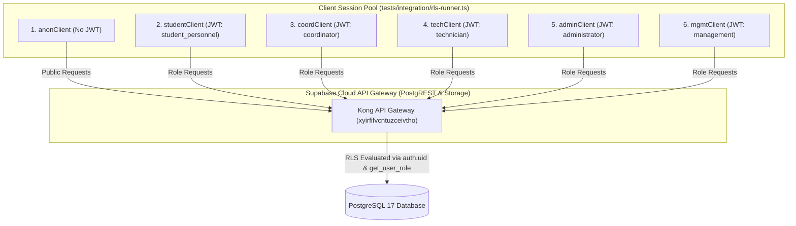
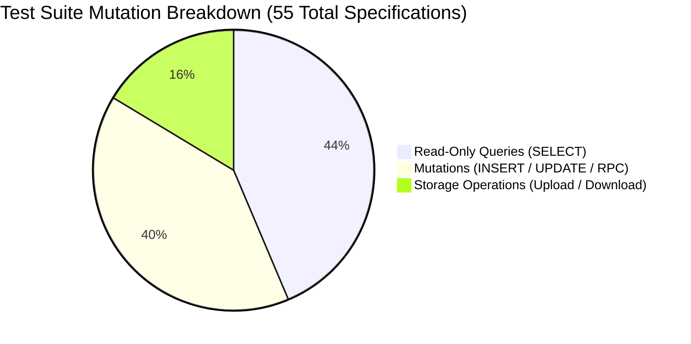

# CMIRS Gate E.4A — RLS Integration Test Runner Architecture & Execution Plan

> **Document:** `docs/database-design/PHASE_E4A_TEST_RUNNER_PLAN.md`  
> **Date:** 2026-10-18  
> **Project:** Campus Maintenance & Incident Reporting System (CMIRS)  
> **Phase:** Gate E.4A — Prepare RLS Integration Test Runner  
> **Target Project Reference:** `xyirfifvcntuzceivtho` (`CMIRS-System`)  
> **Database Engine:** PostgreSQL `17.11.0.003` (Channel `ga`, Region `ap-southeast-1`)  
> **Execution Status:** **PLANNING & DESIGN DELIVERABLE ONLY — ZERO TEST MUTATIONS EXECUTED**  
> **Final Phase Verdict:** **READY FOR OWNER TEST RUNNER APPROVAL**  

---

## 1. Executive Summary & Objective

In Gate E.3, five dedicated test accounts were successfully created and promoted to their target operational roles. The remote database also contains the 5 seed categories and 5 campus locations provisioned in Gate E.2.

The objective of Gate E.4A is to design a safe, deterministic, and repeatable automated test runner that evaluates all role-based Row Level Security (RLS) policies and Storage policies defined in [`docs/database-design/PHASE_5J_RLS_TEST_MATRIX.md`](file:///d:/CMIRS-System/my-app/docs/database-design/PHASE_5J_RLS_TEST_MATRIX.md).

> [!IMPORTANT]
> **PREPARATION & REVIEW ONLY — ZERO REMOTE MUTATIONS EXECUTED**  
> In strict accordance with Gate E.4A safety rules, no test runner has been executed, no remote SQL was executed, no test mutations were sent to Supabase Cloud, and no production or reference records were modified.

---

## 2. Technology Stack & Client Architecture

### 2.1 Reusing the Existing Stack
Inspection of [`package.json`](file:///d:/CMIRS-System/my-app/package.json) confirms that `@supabase/supabase-js` (`^2.118.0`) is already installed.
- **Runtime Environment:** Node.js v24.22.0 (native ESM and TypeScript execution support).
- **Execution Harness:** Proposed runner script at [`tests/integration/rls-runner.ts`](file:///d:/CMIRS-System/my-app/tests/integration/rls-runner.ts) executed via `npx tsx tests/integration/rls-runner.ts`.
- **Zero Additional Dependencies:** No third-party test framework (such as Jest or Vitest) is required; native TypeScript assertions and structured JSON/console reporting provide maximum transparency with zero package installation risk.

### 2.2 Client Session Architecture

To test RLS row-isolation genuinely, the runner must execute queries as standard PostgREST authenticated clients using role-scoped JWTs. Superuser (`postgres`) access must never be used for policy assertions, as superusers possess `BYPASSRLS`.



Each client is instantiated using:
```typescript
createClient(process.env.NEXT_PUBLIC_SUPABASE_URL!, process.env.NEXT_PUBLIC_SUPABASE_PUBLISHABLE_KEY!, {
  auth: {
    persistSession: false,
    autoRefreshToken: false,
  },
});
```
At runner initialization, the script logs into each of the five test accounts using `client.auth.signInWithPassword()`, caching the five distinct authenticated client instances for the duration of the test suite.

---

## 3. Secure Credential Handling Protocol

In compliance with strict security requirements:
1. **Environment Variables by Name Only:**
   - `NEXT_PUBLIC_SUPABASE_URL`: Supabase project endpoint (from `.env.local`).
   - `NEXT_PUBLIC_SUPABASE_PUBLISHABLE_KEY`: Public anon key (from `.env.local`).
   - `CMIRS_TEST_PASSWORD`: Uniform test password for the five `.internal` accounts, read from environment variable or `.env.test.local` (strictly added to `.gitignore`).
2. **Zero Secret Printing:** Passwords, JWT access tokens, refresh tokens, and service-role keys are never printed, logged, or recorded in report deliverables.
3. **No Service-Role Key in Runner:** The test runner operates 100% via the public publishable key with authenticated user JWTs.

---

## 4. Test Classification: Read-Only vs. Mutating Tests

The 55 total test specifications from [`PHASE_5J_RLS_TEST_MATRIX.md`](file:///d:/CMIRS-System/my-app/docs/database-design/PHASE_5J_RLS_TEST_MATRIX.md) were analyzed for data mutation impact:



| Domain | Total Tests | Read-Only Tests | Mutating Tests | Storage Operations |
|---|:---:|:---:|:---:|:---:|
| **Domain 1: Profiles & Auth** | 9 | 4 (`AUTH-01..04`) | 5 (`AUTH-05..09`) | 0 |
| **Domain 2: Reports & Visibility** | 11 | 4 (`RPT-08..11`) | 7 (`RPT-01..07`) | 0 |
| **Domain 3: Assignments & Work Logs** | 10 | 2 (`ASG-02,03,05`) | 8 (`ASG-01,04,06..10`) | 0 |
| **Domain 4: Cancellations & Audit** | 5 | 0 | 5 (`CAN-01..04, AUD-01`) | 0 |
| **Domain 5: Coordinator Verifications**| 5 | 0 | 5 (`VER-01..05`) | 0 |
| **Domain 6: Comments & Notifications** | 6 | 0 | 6 (`COM-01..03, NOT-01..03`)| 0 |
| **Domain 7: Storage & Attachments** | 9 | 0 | 0 | 9 (`ATT-01..09`) |
| **Total** | **55** | **10** | **36** | **9** |

---

## 5. Fixture Lifecycle & Deterministic Cleanup Strategy

### 5.1 The PostgREST Non-Transactional Mutation Problem
In local superuser testing (`database_test_suite.sql`), test suites wrap queries in `BEGIN ... ROLLBACK`.
However, **HTTP PostgREST calls commit immediately upon execution**. Every `INSERT` and `UPDATE` sent via `@supabase/supabase-js` becomes permanent in the remote database.

Furthermore, **RLS policies prohibit client `DELETE` on `public.reports`**. Neither students, technicians, nor coordinators can delete reports via the client API.

### 5.2 Deterministic Fixture Tagging
To prevent orphaned data and guarantee complete traceability, every test mutation will tag its records:
- **Report Titles:** Prefixed with `[TEST-E4A]` (e.g. `'[TEST-E4A] Water leak in Science Hall'`).
- **File Attachments:** Prefixed in object name: `reports/{report_id}/[TEST-E4A]_{uuid}.png`.
- **Comments & Notes:** Prefixed with `[TEST-E4A]`.

### 5.3 Administrative Post-Test Cleanup Protocol
Because child tables (`assignments`, `report_attachments`, `report_status_history`, `report_comments`, `work_logs`, `verifications`) have `ON DELETE CASCADE` referencing `public.reports(id)`:
1. All client-side test assertions execute.
2. At the conclusion of the test run, a single administrative SQL statement is executed via `npx supabase db query --linked` (or SQL Editor):
   ```sql
   DELETE FROM public.reports WHERE title LIKE '[TEST-E4A]%';
   ```
3. PostgreSQL cascades the deletion to all child transaction tables.
4. Storage test files prefixed with `[TEST-E4A]` in bucket `report-attachments` are purged.
5. `profiles`, `categories`, and `locations` remain untouched.
6. The database returns to its clean post-seed state (0 reports, 5 categories, 5 locations).

---

## 6. Assertion Logic & Error Discrimination Matrix

A common flaw in automated security testing is treating any error as a "pass" when testing an unauthorized action. The runner must strictly differentiate:

| Observed Response | Scenario A: Action Was Authorized | Scenario B: Action Was Prohibited (Negative Test) |
|---|:---:|:---:|
| **HTTP 200 + Expected Data Returned** | **PASS** | **CRITICAL SECURITY FAILURE** (Privilege Leakage) |
| **HTTP 200 + Empty Array (`[]`)** | **FAIL** (Data Missing) | **PASS** (Row Successfully Isolated by RLS) |
| **HTTP 403 / 42501 (`violates rls policy`)** | **FAIL** (Unexpected Rejection) | **PASS** (Mutation Blocked by RLS `WITH CHECK`) |
| **HTTP 400 / 23514 (`check_violation`)** | **FAIL** (Invalid Fixture) | **PASS** (Engine Constraint Enforced) |
| **HTTP 400 / P0001 (`raise_exception`)** | **FAIL** (Trigger Error) | **PASS** (Immutable Column / Trigger Guard Enforced)|
| **HTTP 401 (`invalid_grant` / expired JWT)**| **HARNESS FAILURE** | **HARNESS FAILURE** (Session Expired / Auth Error) |
| **HTTP 500 / 502 / Network Timeout** | **INFRASTRUCTURE FAILURE** | **INFRASTRUCTURE FAILURE** (Connection Aborted) |

---

## 7. Storage Test Strategy (Domain 7)

- **Test Fixtures:** Minimal, non-sensitive in-memory byte buffers (e.g. 1x1 pixel PNG buffer of 70 bytes). Zero real documents, photos, or personal data.
- **Path Compliance:**
  - Valid: `reports/{valid_report_id}/{valid_attachment_id}.png` (matches canonical regex).
  - Malicious / Invalid: `reports/invalid-path/image.png` (tests regex short-circuit `CASE` guard).
- **MIME Restriction Test:** Attempt upload with MIME `application/pdf` or `application/x-msdownload` (tests bucket whitelist rejection).
- **Size Boundary Test:** Test file size check against bucket limit (10,485,760 bytes).
- **Soft-Delete Download Isolation:** Verify `test-coord` calls `soft_delete_attachment(id)`, then verify `test-student` receives HTTP 404/403 while `test-coord` can still download.

---

## 8. Coverage & Scope Reconciliation

- **Original Planning Document Reference:** Mentioned "45 tests" representing the 45 core table RLS policy tests across Domains 1 to 6.
- **Full Inventory in Matrix:** [`PHASE_5J_RLS_TEST_MATRIX.md`](file:///d:/CMIRS-System/my-app/docs/database-design/PHASE_5J_RLS_TEST_MATRIX.md) contains exactly **55 test specifications** (45 table RLS tests + 9 storage tests + 1 trigger audit test).
- **Scope Commitment:** The runner will implement and report on **all 55 test specifications** without omitting Storage or Trigger tests.

---

## 9. Next Steps & Proposed Runner Location

- **Proposed Runner File:** [`tests/integration/rls-runner.ts`](file:///d:/CMIRS-System/my-app/tests/integration/rls-runner.ts)
- **Proposed Command:** `npx tsx tests/integration/rls-runner.ts`
- **Gating Protocol:** This plan and the accompanying case mapping ([`PHASE_E4A_TEST_CASE_MAPPING.md`](file:///d:/CMIRS-System/my-app/docs/database-design/PHASE_E4A_TEST_CASE_MAPPING.md)) must be approved by the owner before any runner script is written or executed.

---

## 10. Final Phase Verdict

```text
================================================================================
FINAL VERDICT: READY FOR OWNER TEST RUNNER APPROVAL
================================================================================
```

---
*Test runner architecture plan complete. Execution stopped. Awaiting owner review and authorization to implement the runner script.*
