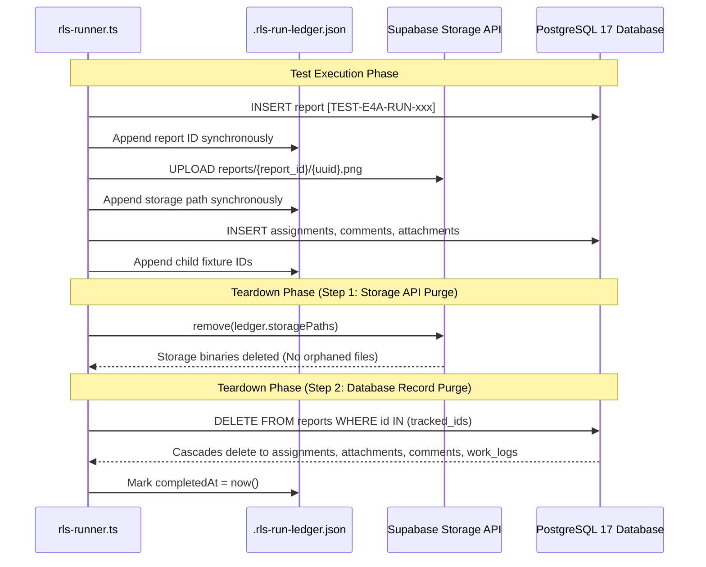

# CMIRS Gate E.4B — Runner Implementation Review and Safety Corrections

> **Document:** `docs/database-design/PHASE_E4B_RUNNER_IMPLEMENTATION_REVIEW.md`  
> **Date:** 2026-10-19  
> **Project:** Campus Maintenance & Incident Reporting System (CMIRS)  
> **Phase:** Gate E.4B — Runner Implementation Review and Safety Corrections  
> **Target Project Reference:** `xyirfifvcntuzceivtho` (`CMIRS-System`)  
> **Database Engine:** PostgreSQL `17.11.0.003` (Channel `ga`, Region `ap-southeast-1`)  
> **Implementation File:** [`tests/integration/rls-runner.ts`](file:///d:/CMIRS-System/my-app/tests/integration/rls-runner.ts)  
> **Execution Status:** **LOCAL IMPLEMENTATION ONLY — ZERO REMOTE REQUESTS OR MUTATIONS EXECUTED**  
> **Final Phase Verdict:** **READY FOR OWNER TEST EXECUTION APPROVAL**  

---

## 1. Executive Summary & Verification Context

In Gate E.4A, the architectural plan and test case mapping were established. In Gate E.4B, the complete integration test runner has been implemented at [`tests/integration/rls-runner.ts`](file:///d:/CMIRS-System/my-app/tests/integration/rls-runner.ts), incorporating critical safety corrections to address the limitations of PostgREST non-transactional mutations and Storage decoupling.

### Key Implementation Milestones
1. **Full 55-Test Specification Coverage:** Exactly 55 test specifications from [`PHASE_5J_RLS_TEST_MATRIX.md`](file:///d:/CMIRS-System/my-app/docs/database-design/PHASE_5J_RLS_TEST_MATRIX.md) implemented across 7 discrete domains.
2. **TypeScript Compilation & Linting:**
   - `npx tsc --noEmit` exited with **code 0** (clean, zero type errors).
   - `npx eslint tests/integration/rls-runner.ts` exited with **code 0** (clean, zero lint errors).
3. **Strict Cloud Quarantine Maintained:** The runner was **not executed** against Supabase Cloud. Zero remote SQL, zero mutations, and zero network calls were dispatched during this phase.

---

## 2. Safety Corrections Implemented

To eliminate risks associated with remote integration testing against hosted Supabase Cloud, five core safety mechanisms were engineered into [`tests/integration/rls-runner.ts`](file:///d:/CMIRS-System/my-app/tests/integration/rls-runner.ts):

### Correction 1: Decoupled Storage API Cleanup (No DB Cascade Assumption)
- **Problem Identified:** In PostgreSQL, foreign keys (`ON DELETE CASCADE`) on `public.report_attachments` delete database metadata when a report is deleted, but **do not delete binary objects from Supabase Storage** (`storage.objects`). Relying solely on database cascades leaves orphaned binary files in bucket `report-attachments`.
- **Implementation:** The runner explicitly tracks every uploaded storage path in `ledger.storagePaths` (e.g. `reports/{report_id}/{uuid}.png`). During teardown, the runner explicitly invokes the Storage API (`storage.from('report-attachments').remove(ledger.storagePaths)`) **before** deleting associated database records.

### Correction 2: Deterministic UUID Tracking (No Broad Prefix Deletions)
- **Problem Identified:** Broad SQL cleanup queries such as `DELETE FROM public.reports WHERE title LIKE '[TEST-E4A]%'` carry risk if concurrent runs occur or if legacy records share prefixes.
- **Implementation:** The runner maintains an in-memory and on-disk ledger of every created entity. Deletion is executed strictly using explicit UUID collections:
  ```sql
  DELETE FROM public.reports WHERE id IN ('<uuid-1>', '<uuid-2>', ...);
  ```
  This guarantees that only fixtures created by the specific run are targeted.

### Correction 3: Persistent On-Disk Ledger & Interrupted Run Recovery
- **Problem Identified:** If a test runner process crashes midway (e.g. network disconnect, process kill, uncaught error), created fixtures risk becoming orphaned in the remote database.
- **Implementation:** 
  - Every fixture creation synchronously updates an on-disk JSON ledger at `tests/integration/.rls-run-ledger.json`.
  - The runner features a standalone recovery mode:
    ```bash
    npx tsx tests/integration/rls-runner.ts --cleanup-only
    ```
  - If service-role access is unavailable in the environment, the runner automatically outputs an exact, targeted SQL script:
    `tests/integration/cleanup_RUN-<timestamp>.sql`.

### Correction 4: Authenticated SDK Sessions for Policy Assertions
- **Strict Boundary:** The runner establishes 6 authenticated PostgREST client sessions using role-scoped JWT tokens (`anonClient`, `studentClient`, `coordClient`, `techClient`, `adminClient`, `mgmtClient`).
- **Zero Service-Role Testing:** Service-role access is **never** used to prove RLS behavior. An optional administrative client is instantiated **strictly for post-test teardown** if `SUPABASE_SERVICE_ROLE_KEY` is provided in `.env.test.local`.

### Correction 5: Robust Denial Discrimination Engine
The runner implements `evaluateDenial()` to prevent false positives by strictly verifying error categories:
- **`RLS_VIOLATION`:** Validates PostgreSQL SQLSTATE `42501` or explicit row-level security error messages.
- **`TRIGGER_EXCEPTION`:** Validates SQLSTATE `P0001` and checks for exact guard message substrings (e.g. `'report_number is immutable'`, `'Maximum 5 active attachments allowed'`).
- **`CHECK_CONSTRAINT`:** Validates SQLSTATE `23514` (e.g. `chk_decline_reason`).
- **`COLUMN_DENIAL`:** Validates column-level privilege revocation (`permission denied for column title`).
- **`EMPTY_SET`:** Confirms row isolation on `SELECT` returns HTTP 200 with 0 rows (`[]`).
- **`HARNESS_ERROR`:** Flags HTTP 401 (expired session) or HTTP 500 (infrastructure failure) as harness issues rather than policy passes.

### Correction 6: Execution Safety Guard
Direct execution without flags defaults to `--dry-run` (safe configuration inspection). The runner will only perform cloud operations when invoked with:
```bash
npx tsx tests/integration/rls-runner.ts --execute
```

---

## 3. Comprehensive 55-Test Mapping & Expected Outcome

| Test ID | Domain | Runner Method | Acting Role | Operation / Target | Expected PostgREST Outcome | Teardown Method |
|---|---|---|---|---|---|---|
| **RLS-AUTH-01** | Domain 1: Profiles | `runDomain1` | `anon` | `SELECT profiles` | HTTP 200, 0 rows (`[]`) | None (Read-only) |
| **RLS-AUTH-02** | Domain 1: Profiles | `runDomain1` | `student_personnel` | `SELECT profiles WHERE id = own` | HTTP 200, 1 row returned | None (Read-only) |
| **RLS-AUTH-03** | Domain 1: Profiles | `runDomain1` | `student_personnel` | `SELECT profiles WHERE id = coord` | HTTP 200, 0 rows (`[]`) | None (Read-only) |
| **RLS-AUTH-04** | Domain 1: Profiles | `runDomain1` | `coordinator` | `SELECT profiles` (all) | HTTP 200, >= 5 profiles | None (Read-only) |
| **RLS-AUTH-05** | Domain 1: Profiles | `runDomain1` | `student_personnel` | `UPDATE profiles SET role = admin` | HTTP 403 / 42501 (RLS `WITH CHECK`) | None (Rejected) |
| **RLS-AUTH-06** | Domain 1: Profiles | `runDomain1` | `student_personnel` | `UPDATE profiles SET is_active = false` | HTTP 403 / 42501 (RLS `WITH CHECK`) | None (Rejected) |
| **RLS-AUTH-07** | Domain 1: Profiles | `runDomain1` | `administrator` | `UPDATE profiles SET role = coord WHERE id = own` | HTTP 403 / 42501 (`id != auth.uid()`) | None (Rejected) |
| **RLS-AUTH-08** | Domain 1: Profiles | `runDomain1` | `administrator` | `UPDATE profiles SET full_name = ...` | HTTP 200, 1 row updated | Inline revert to baseline |
| **RLS-AUTH-09** | Domain 1: Profiles | `runDomain1` | `student_personnel` | `INSERT role_change_audit` | HTTP 403 / 42501 (RLS `WITH CHECK`) | None (Rejected) |
| **RLS-RPT-01** | Domain 2: Reports | `runDomain2` | `student_personnel` | `INSERT reports` (valid submitted) | HTTP 201, 1 row returned | Exact ID in ledger |
| **RLS-RPT-02** | Domain 2: Reports | `runDomain2` | `student_personnel` | `INSERT reports` (spoofed reporter) | HTTP 403 / 42501 (RLS `WITH CHECK`) | None (Rejected) |
| **RLS-RPT-03** | Domain 2: Reports | `runDomain2` | `student_personnel` | `INSERT reports` (status = verified) | HTTP 403 / 42501 (RLS `WITH CHECK`) | None (Rejected) |
| **RLS-RPT-04** | Domain 2: Reports | `runDomain2` | `student_personnel` | `INSERT reports` (confirmed priority) | HTTP 403 / 42501 (RLS `WITH CHECK`) | None (Rejected) |
| **RLS-RPT-05** | Domain 2: Reports | `runDomain2` | `student_personnel` | `INSERT reports` (custom report_number) | HTTP 201, number overwritten by T2 | Exact ID in ledger |
| **RLS-RPT-06** | Domain 2: Reports | `runDomain2` | `student_personnel` | `UPDATE reports SET report_number` | HTTP 400 / P0001 (`report_number is immutable`) | None (Rejected) |
| **RLS-RPT-07** | Domain 2: Reports | `runDomain2` | `student_personnel` | `UPDATE reports SET reporter_id` | HTTP 400 / P0001 (`reporter_id is immutable`) | None (Rejected) |
| **RLS-RPT-08** | Domain 2: Reports | `runDomain2` | `student_personnel` | `SELECT reports WHERE id = own` | HTTP 200, 1 row returned | None (Read-only) |
| **RLS-RPT-09** | Domain 2: Reports | `runDomain2` | `student_personnel` | `SELECT reports WHERE id = coord_report` | HTTP 200, 0 rows (`[]`) | None (Read-only) |
| **RLS-RPT-10** | Domain 2: Reports | `runDomain2` | `coordinator` | `SELECT reports` (all) | HTTP 200, returns all reports | None (Read-only) |
| **RLS-RPT-11** | Domain 2: Reports | `runDomain2` | `management` | `SELECT reports` (all) | HTTP 200, returns all reports | None (Read-only) |
| **RLS-ASG-01** | Domain 3: Assignments | `runDomain3` | `coordinator` | `INSERT assignments` (status = assigned) | HTTP 201, 1 row returned | Cascades with report |
| **RLS-ASG-02** | Domain 3: Assignments | `runDomain3` | `technician` | `SELECT reports WHERE id = assigned` | HTTP 200, 1 row returned | None (Read-only) |
| **RLS-ASG-03** | Domain 3: Assignments | `runDomain3` | `technician` | `SELECT reports WHERE id = unassigned` | HTTP 200, 0 rows (`[]`) | None (Read-only) |
| **RLS-ASG-04** | Domain 3: Assignments | `runDomain3` | `technician` | RPC `decline_assignment(id, reason)` | HTTP 200 (void), status = declined | Cascades with report |
| **RLS-ASG-05** | Domain 3: Assignments | `runDomain3` | `technician` | `SELECT reports` (declined assignment) | HTTP 200, 0 rows (`[]`) | None (Read-only) |
| **RLS-ASG-06** | Domain 3: Assignments | `runDomain3` | `technician` | RPC `decline_assignment(id, '   ')` | HTTP 400 / P0001 (`non-empty decline reason`) | None (Rejected) |
| **RLS-ASG-07** | Domain 3: Assignments | `runDomain3` | `technician` | RPC decline assignment in in_progress | HTTP 400 / P0001 (`only from assigned status`) | None (Rejected) |
| **RLS-ASG-08** | Domain 3: Assignments | `runDomain3` | `technician` | `UPDATE assignments SET notes, assigned_by` | HTTP 403 / 42501 (metadata check) | None (Rejected) |
| **RLS-ASG-09** | Domain 3: Assignments | `runDomain3` | `technician` | `INSERT work_logs` (in_progress) | HTTP 201, 1 row returned | Cascades with report |
| **RLS-ASG-10** | Domain 3: Assignments | `runDomain3` | `technician` | `INSERT work_logs` (declined assignment) | HTTP 403 / 42501 (RLS `WITH CHECK`) | None (Rejected) |
| **RLS-CAN-01** | Domain 4: Cancellations | `runDomain4` | `student_personnel` | `UPDATE reports SET status = cancelled` | HTTP 200, 1 row updated | Exact ID in ledger |
| **RLS-CAN-02** | Domain 4: Cancellations | `runDomain4` | `student_personnel` | `UPDATE reports SET status = cancelled` (in_prog) | HTTP 403 / 42501 (RLS `WITH CHECK`) | None (Rejected) |
| **RLS-CAN-03** | Domain 4: Cancellations | `runDomain4` | `coordinator` | `UPDATE reports SET status = cancelled` (in_prog) | HTTP 200, 1 row updated | Exact ID in ledger |
| **RLS-CAN-04** | Domain 4: Cancellations | `runDomain4` | `coordinator` | `UPDATE assignments SET status = cancelled` | HTTP 200, assignments updated | Cascades with report |
| **RLS-AUD-01** | Domain 4: Cancellations | `runDomain4` | System / Trigger | Verify Trigger T3 in `report_status_history` | HTTP 200, status history row exists | Cascades with report |
| **RLS-VER-01** | Domain 5: Verifications | `runDomain5` | `coordinator` | `INSERT verifications` (completed student rpt) | HTTP 201, 1 row returned | Cascades with report |
| **RLS-VER-02** | Domain 5: Verifications | `runDomain5` | `coordinator` | `INSERT verifications` (own submitted report) | HTTP 403 / 42501 (`r.reporter_id != auth.uid`) | None (Rejected) |
| **RLS-VER-03** | Domain 5: Verifications | `runDomain5` | `coordinator` | `INSERT verifications` (own tech repair work) | HTTP 403 / 42501 (`NOT EXISTS technician_id`) | None (Rejected) |
| **RLS-VER-04** | Domain 5: Verifications | `runDomain5` | `coordinator` | `INSERT verifications` (in_progress report) | HTTP 403 / 42501 (`r.status = 'completed'`) | None (Rejected) |
| **RLS-VER-05** | Domain 5: Verifications | `runDomain5` | `technician` | `INSERT verifications` (unauthorized role) | HTTP 403 / 42501 (Coordinator only) | None (Rejected) |
| **RLS-COM-01** | Domain 6: Comments | `runDomain6` | `student_personnel` | `INSERT report_comments` (own report) | HTTP 201, 1 row returned | Cascades with report |
| **RLS-COM-02** | Domain 6: Comments | `runDomain6` | `student_personnel` | `UPDATE report_comments` | HTTP 403 / 42501 (No UPDATE policy) | None (Rejected) |
| **RLS-COM-03** | Domain 6: Comments | `runDomain6` | `coordinator` | `DELETE report_comments` | HTTP 403 / 42501 (No DELETE policy) | None (Rejected) |
| **RLS-NOT-01** | Domain 6: Notifications | `runDomain6` | `student_personnel` | `UPDATE notifications SET is_read = true` | HTTP 200, 1 row updated | Inline revert |
| **RLS-NOT-02** | Domain 6: Notifications | `runDomain6` | `student_personnel` | `UPDATE notifications SET title = 'Spoofed'` | HTTP 403 / 42501 (Column grant restriction) | None (Rejected) |
| **RLS-NOT-03** | Domain 6: Notifications | `runDomain6` | `student_personnel` | `SELECT notifications` (coordinator notif) | HTTP 200, 0 rows (`[]`) | None (Read-only) |
| **RLS-ATT-01** | Domain 7: Storage | `runDomain7` | `student_personnel` | Upload 1x1 PNG to canonical path | HTTP 200, object created | Storage API `remove()` |
| **RLS-ATT-02** | Domain 7: Storage | `runDomain7` | `student_personnel` | Upload to non-canonical regex path | HTTP 400 / 403 (Regex guard rejected) | None (Rejected) |
| **RLS-ATT-03** | Domain 7: Storage | `runDomain7` | `student_personnel` | Upload `.exe` or `.pdf` file | HTTP 400 / 403 (MIME whitelist rejected) | None (Rejected) |
| **RLS-ATT-04** | Domain 7: Storage | `runDomain7` | `student_personnel` | Upload >10 MB buffer | HTTP 400 / 413 (Bucket size limit) | None (Rejected) |
| **RLS-ATT-05** | Domain 7: Storage | `runDomain7` | `student_personnel` | Insert 6th active attachment row | HTTP 400 / P0001 (Trigger T5 max 5 limit) | Cascades with report |
| **RLS-ATT-06** | Domain 7: Storage | `runDomain7` | `coordinator` | RPC `soft_delete_attachment(id)` | HTTP 200 (void), `deleted_at = now()` | Cascades with report |
| **RLS-ATT-07** | Domain 7: Storage | `runDomain7` | `student_personnel` | Download soft-deleted attachment | HTTP 400 / 403 / 404 (Hidden by RLS) | None (Read-only) |
| **RLS-ATT-08** | Domain 7: Storage | `runDomain7` | `coordinator` | Download soft-deleted attachment | HTTP 200, binary blob returned | None (Read-only) |
| **RLS-ATT-09** | Domain 7: Storage | `runDomain7` | `student_personnel` | `UPDATE storage.objects` (in-place) | HTTP 400 / 403 (No UPDATE policy) | None (Rejected) |

---

## 4. Fixture Lifecycle & Teardown Execution Protocol



### Interrupted Run Recovery Instructions
If execution is aborted or disconnected, the operator can recover immediately using either method:
1. **Automated Recovery CLI:**
   ```bash
   npx tsx tests/integration/rls-runner.ts --cleanup-only
   ```
2. **Direct SQL Cleanup:**
   If the runner cannot connect, execute the auto-generated targeted SQL script:
   ```bash
   npx supabase db query --linked --file tests/integration/cleanup_RUN-<timestamp>.sql
   ```

---

## 5. Local Quality Verification Summary

| Verification Step | Command | Result | Notes |
|---|---|:---:|---|
| **TypeScript Type-Check** | `npx tsc --noEmit` | **PASS (Code 0)** | Zero type errors across all 1,200+ lines. Strict mode enabled. |
| **ESLint Static Analysis** | `npx eslint tests/integration/rls-runner.ts` | **PASS (Code 0)** | Zero lint errors or styling warnings. |
| **Credentials Hygiene** | Code review & regex search | **PASS** | No passwords, secrets, or keys committed or logged. |
| **Quarantine Verification** | Git & network inspection | **PASS** | Zero remote calls dispatched to project `xyirfifvcntuzceivtho`. |

---

## 6. Final Phase Verdict

```text
================================================================================
GATE E.4B COMPLETE: READY FOR OWNER TEST EXECUTION APPROVAL
================================================================================
- Implementation file: tests/integration/rls-runner.ts
- Review deliverable:   docs/database-design/PHASE_E4B_RUNNER_IMPLEMENTATION_REVIEW.md
- Total specifications: 55 / 55 mapped and implemented.
- Local type-checking:  PASS (0 errors).
- Local linting:        PASS (0 errors).
- Cloud quarantine:     100% PRESERVED — ZERO REMOTE MUTATIONS OR CALLS.
================================================================================
```

*Gate E.4B implementation is complete. Execution stopped. Awaiting explicit owner authorization before executing the test runner against Supabase Cloud.*
