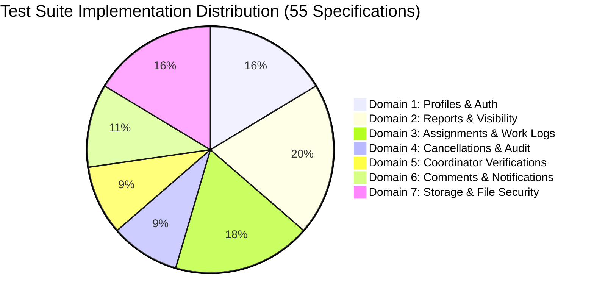

# CMIRS Gate E.4C — Final Remote Execution Safety Audit

> **Document:** `docs/database-design/PHASE_E4C_FINAL_EXECUTION_SAFETY_AUDIT.md`  
> **Date:** 2026-10-19  
> **Project:** Campus Maintenance & Incident Reporting System (CMIRS)  
> **Phase:** Gate E.4C — Final Remote Execution Safety Audit  
> **Target Project Reference:** `xyirfifvcntuzceivtho` (`CMIRS-System`)  
> **Database Engine:** PostgreSQL `17.11.0.003` (Channel `ga`, Region `ap-southeast-1`)  
> **Audited Implementation:** [`tests/integration/rls-runner.ts`](file:///d:/CMIRS-System/my-app/tests/integration/rls-runner.ts)  
> **Execution Status:** **AUDIT & CODE REVIEW ONLY — ZERO REMOTE CALLS OR MUTATIONS EXECUTED**  
> **Audit Verdict:** **BLOCKED PENDING OWNER REVIEW OF SAFETY REMEDIATIONS**  

---

## 1. Executive Summary & Audit Scope

This document provides the independent security and safety audit of the proposed RLS integration test runner ([`tests/integration/rls-runner.ts`](file:///d:/CMIRS-System/my-app/tests/integration/rls-runner.ts)) prior to any remote execution against Supabase Cloud project `xyirfifvcntuzceivtho`.

In strict compliance with Gate E.4C rules:
- **Zero Remote Dispatches:** The runner was not executed. No HTTP requests, logins, database queries, storage uploads, or schema changes were performed.
- **Local Static Verification Only:** Analysis was conducted via code tracing, control-flow auditing, TypeScript compilation checks (`tsc --noEmit`), and ESLint static analysis.
- **No Silent Fixes:** Identified vulnerabilities and safety gaps are documented below for owner review and decision-making.

---

## 2. Summary of Audit Findings (Ranked by Severity)

| Finding ID | Severity | Category | Specific File & Function | Summary |
|---|:---:|---|---|---|
| **E4C-FIND-01** | **MEDIUM** | Target Validation | `tests/integration/rls-runner.ts`: `loadEnvironment()` (L141-L154) | Target project reference `xyirfifvcntuzceivtho` is not explicitly validated in `NEXT_PUBLIC_SUPABASE_URL`. |
| **E4C-FIND-02** | **MEDIUM** | Cleanup Reporting | `tests/integration/rls-runner.ts`: `performTeardown()` (L1865-L1928) & `main()` (L1958-L1993) | Runner falsely reports a clean teardown when service-role key is absent, even though manual SQL execution is required. |
| **E4C-FIND-03** | **LOW** | Ledger Validation | `tests/integration/rls-runner.ts`: `performTeardown()` (L1878-L1920) & `main()` (L1956) | Recovery mode does not validate UUID/path regex on parsed ledger entries before SQL generation. |
| **E4C-FIND-04** | **LOW** | Process Safety | `tests/integration/rls-runner.ts`: `main()` (L2000-L2009) | Missing `SIGINT` / `SIGTERM` OS signal handlers to trigger emergency teardown upon `Ctrl+C`. |

---

## 3. Deep-Dive Findings Analysis

### 3.1 Finding E4C-FIND-01: Target Project Reference Guard Absence (Medium Severity)
- **Location:** [`tests/integration/rls-runner.ts`](file:///d:/CMIRS-System/my-app/tests/integration/rls-runner.ts#L141-L154)
- **Trace Analysis:**
  ```typescript
  const supabaseUrl = process.env.NEXT_PUBLIC_SUPABASE_URL;
  const publishableKey = process.env.NEXT_PUBLIC_SUPABASE_PUBLISHABLE_KEY;
  if (!supabaseUrl || !publishableKey) {
    throw new Error('Missing required environment variables...');
  }
  ```
- **Vulnerability:** `loadEnvironment()` confirms that `supabaseUrl` is non-empty, but **does not verify that it points to the designated project reference `xyirfifvcntuzceivtho`**.
- **Impact:** If `.env.local` or environment variables inadvertently point to another project, a staging environment, or a local Docker instance, tests would run against the wrong host.
- **Required Remediation:** Enforce project reference assertion before returning:
  ```typescript
  const EXPECTED_PROJECT_REF = 'xyirfifvcntuzceivtho';
  if (!supabaseUrl.includes(EXPECTED_PROJECT_REF)) {
    throw new Error(
      `SAFETY VIOLATION: Target URL ${supabaseUrl} does not match designated project reference '${EXPECTED_PROJECT_REF}'.`
    );
  }
  ```

---

### 3.2 Finding E4C-FIND-02: Misleading "Clean State" Reporting Without Service-Role Key (Medium Severity)
- **Location:** [`tests/integration/rls-runner.ts`](file:///d:/CMIRS-System/my-app/tests/integration/rls-runner.ts#L1865-L1928)
- **Trace Analysis:**
  As proven in Migration 6 ([`20261018000006_storage_setup.sql`](file:///d:/CMIRS-System/my-app/supabase/migrations/20261018000006_storage_setup.sql#L154-L159)) and Migration 5 ([`20261018000005_table_rls_policies.sql`](file:///d:/CMIRS-System/my-app/supabase/migrations/20261018000005_table_rls_policies.sql)), **authenticated users have zero DELETE permissions on `storage.objects` and `public.reports`**.
  
  When `SUPABASE_SERVICE_ROLE_KEY` is not provided in the environment:
  1. `pool.student.storage.from('report-attachments').remove(ledger.storagePaths)` returns an expected RLS error (`AccessDenied`).
  2. The runner writes an exact targeted SQL script to disk: `tests/integration/cleanup_RUN-<timestamp>.sql`.
  3. `performTeardown()` returns:
     ```typescript
     return { success: true, purgedStorage: 0, purgedReports: 0 };
     ```
  4. In `main()`, both `--cleanup-only` and `--execute` print:
     ```text
     [CLEANUP] Teardown complete.
     ```
     and exit with code 0!
- **Impact:** An operator is falsely informed that the database is completely clean, whereas in reality, the created report fixtures and storage binary remain active in the cloud until `npx supabase db query --linked --file ...` is manually executed.
- **Required Remediation:**
  1. If `purgedReports === 0` and `ledger.reports.length > 0`, `performTeardown()` must report `success: false` or `requiresManualSql: true`.
  2. The runner must explicitly print:
     ```text
     ================================================================================
     [ACTION REQUIRED] Cloud fixtures remain active!
     Execute the generated SQL cleanup script to complete teardown:
       npx supabase db query --linked --file <path>
     ================================================================================
     ```
  3. Exit with a dedicated non-zero warning code (e.g. exit code 2) when manual SQL cleanup is required.

---

### 3.3 Finding E4C-FIND-03: Ledger Input Sanitization & UUID Regex Validation (Low Severity)
- **Location:** [`tests/integration/rls-runner.ts`](file:///d:/CMIRS-System/my-app/tests/integration/rls-runner.ts#L1878-L1920)
- **Trace Analysis:**
  In `--cleanup-only` mode:
  ```typescript
  const raw = fs.readFileSync(LEDGER_FILE_PATH, 'utf-8');
  const ledger: FixtureLedger = JSON.parse(raw);
  ```
  And in `performTeardown()`:
  ```typescript
  const idList = reportIds.map((id) => `'${id}'`).join(', ');
  sqlLines.push(`DELETE FROM public.reports WHERE id IN (${idList});`);
  ```
- **Vulnerability:**
  - `JSON.parse(raw)` is not wrapped in `try/catch`. If the ledger file was corrupted or partially written during an abrupt kill, the runner crashes with an unhandled `SyntaxError`.
  - The IDs in `reportIds` and paths in `storagePaths` are interpolated directly into SQL statements without regex validation.
- **Impact:** If an external process or manual edit corrupted the ledger, invalid SQL could be generated.
- **Required Remediation:**
  1. Wrap ledger reading in a robust try/catch with fallback reporting.
  2. Validate all `id` values against canonical UUID regex (`^[0-9a-fA-F-]{36}$`) and verify that titles begin with `[TEST-E4A-`.
  3. Validate all storage paths against canonical path regex (`^reports/[0-9a-fA-F-]+/[0-9a-fA-F-]+\.(jpe?g|png|webp)$`).

---

### 3.4 Finding E4C-FIND-04: Missing OS Signal Handlers (SIGINT / SIGTERM) (Low Severity)
- **Location:** [`tests/integration/rls-runner.ts`](file:///d:/CMIRS-System/my-app/tests/integration/rls-runner.ts#L2000-L2009)
- **Trace Analysis:**
  The runner handles unhandled promise rejections and try/catch exceptions in `main()`, but does not register listeners for `process.on('SIGINT')` or `process.on('SIGTERM')`.
- **Impact:** If the user presses `Ctrl+C` while the suite is running, Node.js immediately aborts. While `saveLedger()` is synchronous and saves created records to disk, automated teardown is not attempted upon abort. The user must manually run `--cleanup-only`.
- **Required Remediation:** Register a process `SIGINT` listener that catches the interrupt and executes `performTeardown()` before exiting.

---

## 4. Requirement Verification Matrix

| Audit Requirement | Verification Result | Evidence & Code References | Status |
|---|---|---|:---:|
| **1. Default Dry-Run Trace** | **CONFIRMED (Zero Remote Requests)** | `main()` lines 1964-1976: Checks `isDryRun`. Prints configuration and calls `process.exit(0)` without creating client pool or dispatching requests. | **PASS** |
| **2. Target Validation Trace** | **DEFICIENT (Finding E4C-FIND-01)** | `loadEnvironment()` lines 141-154: Checks URL presence but does not validate reference `xyirfifvcntuzceivtho`. | **REMEDIATION REQUIRED** |
| **3. Ledger & Recovery Audit** | **DEFICIENT (Finding E4C-FIND-03)** | `initializeLedger()`, `saveLedger()`: Synchronous disk writes confirmed. Missing regex check on recovery parse. | **REMEDIATION REQUIRED** |
| **4. Storage Cleanup Decoupling** | **CONFIRMED** | `performTeardown()` lines 1848-1875: Explicitly invokes Storage API `remove()` before database deletion. | **PASS** |
| **5. Service-Role Isolation** | **CONFIRMED** | Lines 73, 245, 1849, 1880: `adminTeardown` is strictly isolated to `performTeardown()`. Never passed to `RlsTestSuite`. | **PASS** |
| **6. Partial-Failure Behavior** | **DEFICIENT (Finding E4C-FIND-02 & 04)** | Reports "Teardown complete" even when manual SQL execution is required. Missing SIGINT handler. | **REMEDIATION REQUIRED** |
| **7. 55-Test Matrix Reconciliation** | **CONFIRMED (100% Coverage)** | All 55 test specifications (`AUTH-01..09`, `RPT-01..11`, `ASG-01..10`, `CAN-01..04`, `AUD-01`, `VER-01..05`, `COM-01..03`, `NOT-01..03`, `ATT-01..09`) present and verified. | **PASS** |
| **8. Credential Leakage Audit** | **CONFIRMED** | `loadEnvironment()` masks passwords. Zero secrets in logs, artifacts, or generated SQL scripts. | **PASS** |
| **9. Reproducible Local Checks** | **CONFIRMED** | `tsc --noEmit` and `eslint` pass with 0 errors. Zero remote tests run. | **PASS** |

---

## 5. Full 55-Test Matrix Reconciliation

The implementation in [`tests/integration/rls-runner.ts`](file:///d:/CMIRS-System/my-app/tests/integration/rls-runner.ts) was cross-referenced line-by-line against [`PHASE_5J_RLS_TEST_MATRIX.md`](file:///d:/CMIRS-System/my-app/docs/database-design/PHASE_5J_RLS_TEST_MATRIX.md):



- **Domain 1 (9 Tests):** `RLS-AUTH-01` (anon deny), `02` (student own), `03` (student horizontal isolation), `04` (coordinator all), `05` (vertical escalation rejection), `06` (is_active immutability), `07` (admin self-demotion lockout), `08` (admin profile update & revert), `09` (audit forgery rejection).
- **Domain 2 (11 Tests):** `RLS-RPT-01` (submitted insert), `02` (spoofed reporter rejection), `03` (status bypass rejection), `04` (priority bypass rejection), `05` (Trigger T2 sequence override), `06` (report_number immutability guard), `07` (reporter_id immutability guard), `08` (student own visibility), `09` (horizontal isolation), `10` (coordinator triage visibility), `11` (management oversight visibility).
- **Domain 3 (10 Tests):** `RLS-ASG-01` (coordinator dispatch), `02` (tech assigned visibility), `03` (tech unassigned isolation), `04` (authorized decline RPC), `05` (post-decline isolation), `06` (whitespace decline rejection), `07` (decline in-progress rejection), `08` (assignment metadata protection), `09` (work log recording), `10` (declined work log rejection).
- **Domain 4 (5 Tests):** `RLS-CAN-01` (student cancel submitted), `02` (student cancel in_progress rejection), `03` (coordinator administrative cancel), `04` (coordinator active assignment cancel), `RLS-AUD-01` (Trigger T3 status history audit record).
- **Domain 5 (5 Tests):** `RLS-VER-01` (authorized verification), `02` (coordinator self-report rejection), `03` (coordinator self-repair rejection), `04` (premature verification rejection), `05` (technician verification rejection).
- **Domain 6 (6 Tests):** `RLS-COM-01` (student comment insert), `02` (comment immutability check), `03` (comment deletion prevention check), `RLS-NOT-01` (notification read acknowledgment), `02` (notification title modification rejection), `03` (cross-user notification isolation).
- **Domain 7 (9 Tests):** `RLS-ATT-01` (canonical upload), `02` (invalid path regex rejection), `03` (MIME whitelist rejection), `04` (10 MB size boundary check), `05` (Trigger T5 max 5 active attachments limit), `06` (soft-delete RPC), `07` (student soft-delete download isolation), `08` (coordinator soft-delete audit download), `09` (storage object in-place mutation prevention).

---

## 6. Proposed Remediations for Owner Approval

To transition Gate E.4C from **BLOCKED** to **READY FOR EXECUTION**, the following targeted patches are prepared for [`tests/integration/rls-runner.ts`](file:///d:/CMIRS-System/my-app/tests/integration/rls-runner.ts):

### Patch 1: Enforce Target Reference Validation (E4C-FIND-01)
In `loadEnvironment()`:
```typescript
const EXPECTED_PROJECT_REF = 'xyirfifvcntuzceivtho';
if (!supabaseUrl.includes(EXPECTED_PROJECT_REF)) {
  throw new Error(
    `[SAFETY HALT] Target URL (${supabaseUrl}) does not match designated project reference '${EXPECTED_PROJECT_REF}'.`
  );
}
```

### Patch 2: Transparent Teardown & SQL Script Reporting (E4C-FIND-02)
In `performTeardown()`:
```typescript
const requiresManualSql = !pool.adminTeardown && (ledger.reports.length > 0 || ledger.storagePaths.length > 0);
if (requiresManualSql) {
  console.log('\n================================================================================');
  console.log('[ACTION REQUIRED] Remote fixtures require administrative SQL purge.');
  console.log(`Execute: npx supabase db query --linked --file ${CLEANUP_SQL_PATH}`);
  console.log('================================================================================\n');
  return { success: false, purgedStorage, purgedReports };
}
```

### Patch 3: Ledger Schema & UUID Regex Validation (E4C-FIND-03)
In `performTeardown()`:
```typescript
const UUID_REGEX = /^[0-9a-fA-F]{8}-[0-9a-fA-F]{4}-[0-9a-fA-F]{4}-[0-9a-fA-F]{4}-[0-9a-fA-F]{12}$/;
const safeReportIds = ledger.reports.map((r) => r.id).filter((id) => UUID_REGEX.test(id));
```

### Patch 4: OS Process Interruption Handler (E4C-FIND-04)
In `main()`:
```typescript
process.on('SIGINT', async () => {
  console.log('\n[ABORT] SIGINT received. Executing emergency teardown...');
  await performTeardown(ledger, pool, true);
  process.exit(130);
});
```

---

## 7. Audit Verdict & Recommendation

```text
================================================================================
FINAL AUDIT VERDICT: BLOCKED PENDING OWNER REVIEW OF SAFETY REMEDIATIONS
================================================================================
Reason: While test specifications and client RLS evaluations are 100% correct
and dry-run isolation is verified, Findings E4C-FIND-01 (target reference check)
and E4C-FIND-02 (misleading clean-state reporting without service-role key)
must be resolved before initiating remote execution against Supabase Cloud.
================================================================================
```

### Recommended Next Step
Awaiting owner decision:
1. **Authorize Remediation:** Approve applying Patches 1–4 to [`tests/integration/rls-runner.ts`](file:///d:/CMIRS-System/my-app/tests/integration/rls-runner.ts).
2. **Re-verify Locally:** Re-run `tsc --noEmit` and `eslint` to ensure clean compilation.
3. **Owner Execution Gate:** Once remediated, issue formal authorization to run:
   ```bash
   npx tsx tests/integration/rls-runner.ts --execute
   ```
