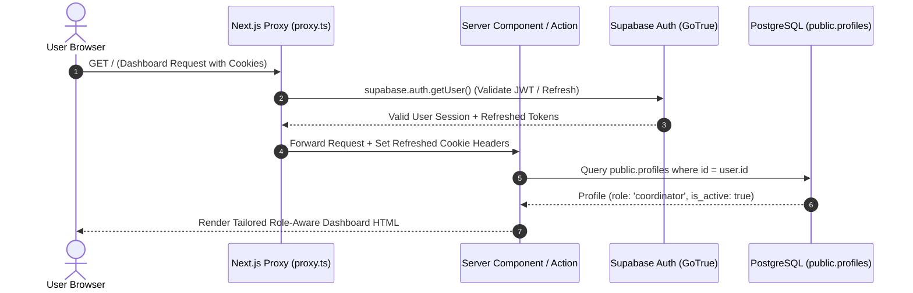
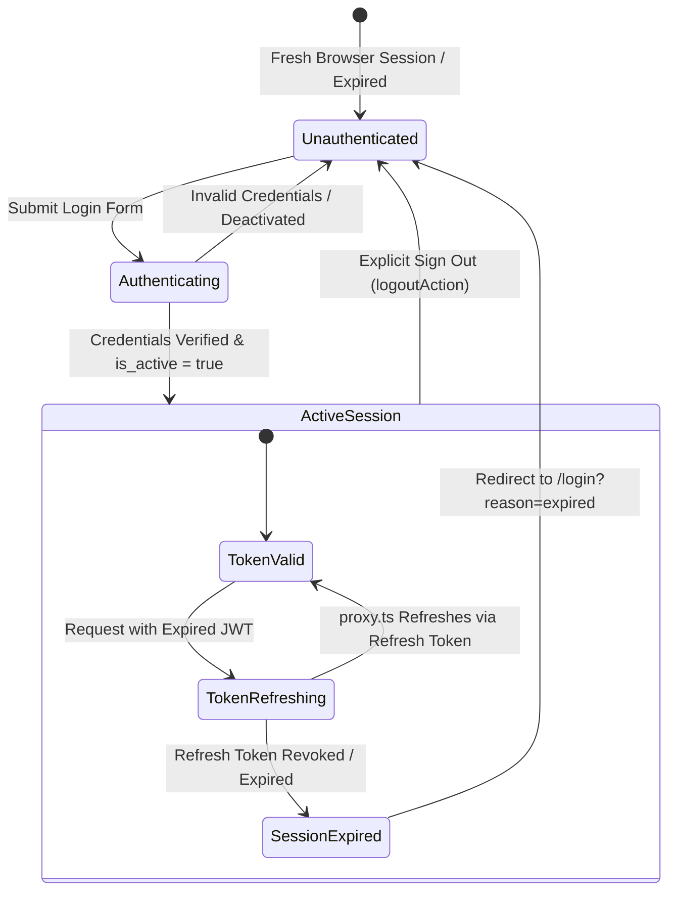
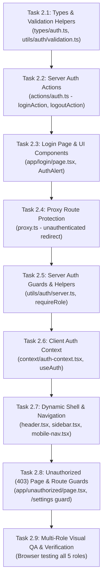

# CMIRS — Frontend Phase 2: Authentication & Role-Based Access Control (RBAC) Architecture Plan

> **Document Type:** Technical Architecture, Security Specification & Implementation Plan  
> **Author:** Senior Full-Stack Engineer, Security Architect & Technical Lead  
> **System:** Campus Maintenance & Incident Reporting System (CMIRS)  
> **Target Application Root:** `D:\CMIRS-System\my-app`  
> **Status:** **PROPOSED — PENDING ARCHITECTURAL REVIEW & OWNER APPROVAL**  
> **Execution Boundary:** **STRICTLY PLANNING ONLY — NO APPLICATION CODE OR BACKEND MODIFIED**  
> **Date:** October 19, 2026  

---

## 1. Executive Summary

### 1.1 Purpose and Objectives
Phase 1 established the user interface foundation, responsive application shell, reusable UI components, operations dashboard, and realistic campus mock datasets.

The objective of **Phase 2** is to transition CMIRS from a static UI preview into a secure, authenticated, role-aware campus operations platform. This phase designs the complete integration of **Supabase Auth** with the **Next.js 16.4.2 App Router**, implementing robust session management and enforcing **Role-Based Access Control (RBAC)** across the system's five designated operational roles:

1. **Student / School Personnel** (`student_personnel`)
2. **Maintenance Coordinator** (`coordinator`)
3. **Maintenance Technician** (`technician`)
4. **School Administrator** (`administrator`)
5. **School Management** (`management`)

### 1.2 Core Security Philosophy: Defense-in-Depth
In strict adherence to the project's established security principles ([`SECURITY.md`](file:///d:/CMIRS-System/my-app/docs/SECURITY.md)):
- **Hiding UI elements is not authorization.** Conditional rendering and navigation route protection exist solely to provide an intuitive, frictionless user experience.
- **Server-Side Enforcement is Mandatory.** Every Server Action, Route Handler, and Server Component data fetch independently verifies the caller's identity and permissions.
- **Database-Level Row Level Security (RLS) is the Authoritative Boundary.** PostgreSQL RLS policies in Supabase act as the final, immutable defense line. Even if frontend guards were entirely bypassed or direct HTTP requests crafted, database policies prevent unauthorized access.

### 1.3 Scope and Boundary Guarantees
During the compilation of this plan:
- **Zero remote Supabase operations** were performed.
- **Zero database migrations, SQL executions, triggers, or policies** were modified.
- **Gate E.4D** (Authorized Remote RLS Integration Testing) remains strictly **PENDING AND UNAUTHORIZED**.
- **Zero dependencies** were installed, removed, or updated.
- **Zero secrets, API keys, or passwords** have been exposed.
- **No application code** in `my-app/` has been altered.

---

## 2. Current-State Repository Findings

A comprehensive inspection of the actual repository at `D:\CMIRS-System\my-app` was conducted. The verified facts and file paths are documented below:

### 2.1 Framework & Core Dependencies (`package.json`)
- **Next.js:** `16.4.2` (App Router, Turbopack enabled)
- **React:** `19.3.0` & **React DOM:** `19.3.0`
- **TypeScript:** `^5` (Strict type checking enabled in `tsconfig.json`)
- **Styling:** Tailwind CSS `^4` (with `@tailwindcss/turbopack`)
- **Supabase SSR:** `@supabase/ssr` `^0.12.7`
- **Supabase JS:** `@supabase/supabase-js` `^2.118.0`

### 2.2 Next.js App Router Structure & Proxy Convention
- **Proxy Middleware:** [`proxy.ts`](file:///d:/CMIRS-System/my-app/proxy.ts)
  - Next.js 16 deprecated `middleware.ts` in favor of `proxy.ts` exporting `async function proxy(request: NextRequest)`.
  - Currently implements session token refresh via `@supabase/ssr` `createServerClient`. It calls `await supabase.auth.getUser()` and copies refreshed cookies to both `request` and `response`.
  - Intentionally passes through without route protection or redirects in Phase 1.
- **Layout & Application Shell:**
  - [`app/layout.tsx`](file:///d:/CMIRS-System/my-app/app/layout.tsx): Root layout with light-mode background (`bg-slate-50`), font configuration, and page metadata.
  - [`components/layout/app-shell.tsx`](file:///d:/CMIRS-System/my-app/components/layout/app-shell.tsx): Orchestrates desktop sidebar, mobile drawer, sticky header, and main layout container.
  - [`components/layout/header.tsx`](file:///d:/CMIRS-System/my-app/components/layout/header.tsx): Sticky top bar displaying user initials (`JM`), display name (`Jordan Miller`), and role badge (`Coordinator`) as hardcoded Phase 1 mock placeholders.
  - [`components/layout/sidebar.tsx`](file:///d:/CMIRS-System/my-app/components/layout/sidebar.tsx): Collapsible navigation sidebar (256px expanded / 80px collapsed) with Phase 1 route items and hardcoded persona footer.
  - [`components/layout/mobile-nav.tsx`](file:///d:/CMIRS-System/my-app/components/layout/mobile-nav.tsx): Mobile bottom navigation bar and slide-out navigation drawer with body scroll lock and Escape dismissal.
- **Route Placeholders:**
  - [`app/page.tsx`](file:///d:/CMIRS-System/my-app/app/page.tsx): Working operations dashboard displaying mock KPI stats and mock report table.
  - [`app/reports/page.tsx`](file:///d:/CMIRS-System/my-app/app/reports/page.tsx): Reports Queue module placeholder.
  - [`app/reports/new/page.tsx`](file:///d:/CMIRS-System/my-app/app/reports/new/page.tsx): Submit Report module placeholder.
  - [`app/locations/page.tsx`](file:///d:/CMIRS-System/my-app/app/locations/page.tsx): Campus Locations directory placeholder.
  - [`app/analytics/page.tsx`](file:///d:/CMIRS-System/my-app/app/analytics/page.tsx): Operations Analytics placeholder.
  - [`app/settings/page.tsx`](file:///d:/CMIRS-System/my-app/app/settings/page.tsx): System Settings placeholder.

### 2.3 Existing Supabase Integration Utilities
- **Browser Client:** [`utils/supabase/client.ts`](file:///d:/CMIRS-System/my-app/utils/supabase/client.ts)
  - Uses `createBrowserClient(url, anonKey)` from `@supabase/ssr`.
  - Expects `NEXT_PUBLIC_SUPABASE_URL` and `NEXT_PUBLIC_SUPABASE_PUBLISHABLE_KEY`.
- **Server Client:** [`utils/supabase/server.ts`](file:///d:/CMIRS-System/my-app/utils/supabase/server.ts)
  - Uses `createServerClient` from `@supabase/ssr`.
  - Correctly awaits `cookies()` (as required by Next.js 16).
  - Implements `getAll()` and `setAll()` with Server Component `try/catch` guard.
- **Environment Variables Template:** [`.env.example`](file:///d:/CMIRS-System/my-app/.env.example)
  - Documents `NEXT_PUBLIC_SUPABASE_URL`, `NEXT_PUBLIC_SUPABASE_PUBLISHABLE_KEY`, and optional `SUPABASE_SERVICE_ROLE_KEY`.

### 2.4 Verified Database Architecture & Role Schema
Inspection of [`supabase/migrations/`](file:///d:/CMIRS-System/my-app/supabase/migrations/) and [`docs/database-design/`](file:///d:/CMIRS-System/my-app/docs/database-design/) revealed:
- **Canonical PostgreSQL Enum:** Defined in `20261018000001_core_schema.sql` line 12:
  ```sql
  CREATE TYPE user_role AS ENUM (
    'student_personnel',
    'coordinator',
    'technician',
    'administrator',
    'management'
  );
  ```
  *(Note: English prose in documentation sometimes refers to "Maintenance Coordinator" or "School Administrator", but the physical database enum and all RLS policies strictly use `coordinator`, `technician`, `administrator`, `management`, and `student_personnel`.)*
- **Database Profiles Table:** `public.profiles` (`id` references `auth.users(id) ON DELETE CASCADE`, `email`, `full_name`, `role`, `is_active`, `created_at`, `updated_at`).
- **Security Functions Deployed (`20261018000004_security_functions_and_rpc.sql`):**
  - `public.get_user_role()`: Stable `SECURITY DEFINER` function returning caller's `user_role`.
  - `public.can_view_report(report_id UUID)`: Centralized visibility predicate enforcing report access per role.
  - `public.soft_delete_attachment(attachment_id UUID)`: Coordinator-only attachment removal.
  - `public.decline_assignment(target_assignment_id UUID, reason TEXT)`: Technician-only assignment decline with required reason.
- **Row Level Security (RLS) Status:**
  - RLS enabled on all 12 tables (`profiles`, `role_change_audit`, `categories`, `locations`, `reports`, `assignments`, `report_attachments`, `report_status_history`, `report_comments`, `work_logs`, `verifications`, `notifications`).
  - Strict policies prevent unauthorized reading, vertical role elevation, self-verification, and modification of append-only audit tables.
- **Pre-provisioned Test Accounts:** Documented in [`docs/database-design/PHASE_E3_TEST_ACCOUNT_REPORT.md`](file:///d:/CMIRS-System/my-app/docs/database-design/PHASE_E3_TEST_ACCOUNT_REPORT.md):
  - `test-student@cmirs.internal` &rarr; `student_personnel`
  - `test-coord@cmirs.internal` &rarr; `coordinator`
  - `test-tech@cmirs.internal` &rarr; `technician`
  - `test-admin@cmirs.internal` &rarr; `administrator`
  - `test-mgmt@cmirs.internal` &rarr; `management`

---

## 3. Proposed Authentication Architecture

### 3.1 Next.js 16 + `@supabase/ssr` Architectural Model
The authentication architecture utilizes `@supabase/ssr` (v0.12.7) with cookie-based session persistence. Tokens are managed exclusively via HTTP-only, secure cookies, preventing script-based access and mitigating XSS token theft.



### 3.2 Login Architecture
- **Route:** Dedicated unauthenticated route at `/login`.
- **Submission Pattern:** Built with React 19 Server Actions (`loginAction`).
- **Flow:**
  1. User submits email and password.
  2. Client component performs pre-flight validation (non-empty fields, valid email format) for instant visual feedback.
  3. Form triggers `loginAction(formData)`.
  4. Server Action initializes `createClient()` from `@supabase/ssr`.
  5. Action calls `supabase.auth.signInWithPassword({ email, password })`.
  6. Upon successful credentials verification:
     - The user session is established and cookie headers (`sb-*-auth-token`) are attached to the response.
     - The user's profile is queried from `public.profiles`.
     - If `is_active === false`, the session is terminated immediately via `supabase.auth.signOut()` and an error is returned: *"Account is deactivated. Please contact campus administration."*
     - If active, user is redirected to the requested destination (`next` parameter) or default `/`.
  7. Upon failure, a safe, generic error message is returned: *"Invalid email or password."* Specific account existence is never leaked.

### 3.3 Session Management & Token Refresh
- **Token Storage:** Encrypted session cookies managed by `@supabase/ssr`. No tokens in `localStorage` or `sessionStorage`.
- **Refresh Mechanism:**
  - Next.js 16 App Router executes `proxy.ts` on every page and data request.
  - `proxy.ts` initializes `createServerClient` and calls `await supabase.auth.getUser()`.
  - When the access token (default TTL: 3600 seconds) nears or exceeds expiry, `@supabase/ssr` automatically uses the refresh token to negotiate a new JWT from Supabase Auth and updates the `Set-Cookie` headers on the HTTP response.
- **Server Component Cookie Isolation:**
  - Next.js 16 enforces read-only cookie access during Server Component rendering.
  - Because `proxy.ts` executes *prior* to Server Component rendering and updates the cookie headers on the request and response, Server Components always receive fresh session claims without triggering runtime cookie-mutation exceptions.

### 3.4 Logout Architecture
- **Action:** `logoutAction` Server Action in `actions/auth.ts`.
- **Flow:**
  1. User clicks "Sign Out" in Header or Navigation Drawer.
  2. Form submits to `logoutAction()`.
  3. Server client calls `await supabase.auth.signOut()`.
  4. Auth cookies are invalidated and cleared.
  5. User is redirected to `/login?reason=logged_out`.

### 3.5 Password Recovery & Registration Architectural Decisions
- **Registration Policy:**
  - Per project decision D1 ([`ROLES.md`](file:///d:/CMIRS-System/my-app/docs/ROLES.md)), self-registration assigns the default role `student_personnel`. Elevated roles must be assigned by an Administrator.
  - In Phase 2, public self-registration will remain disabled or restricted; authentication will focus on the five verified operational test roles to validate RBAC boundaries.
- **Password Reset:**
  - Supported natively by Supabase Auth via `resetPasswordForEmail()`. For internal campus staging and Phase 2 testing, admin-managed resets or direct test passwords will be utilized.

---

## 4. Authentication and Session Lifecycle

### 4.1 State Machine Diagram


### 4.2 Lifecycle Event Specifications

| Lifecycle Event | Trigger | Processing Location | Action / Result | Redirect Target |
|---|---|---|---|---|
| **Unauthenticated Request** | User visits `/` or `/reports` without cookies | `proxy.ts` | Detects `user === null` | Redirect to `/login?next={path}` |
| **Login Attempt** | User submits email & password | Server Action (`loginAction`) | Validates credentials via Supabase Auth; queries `profiles` | On success: Redirect to `next` or `/`<br>On fail: Return inline error |
| **Account Deactivated** | User authenticates but `profiles.is_active = false` | Server Action (`loginAction`) | Terminates session immediately (`signOut()`) | Return error: *"Account deactivated"* |
| **Token Refresh** | User navigates with expired access token (< 1h) | `proxy.ts` | Calls `supabase.auth.getUser()`, updates cookies | Transparent pass-through to requested route |
| **Session Expired / Revoked** | Refresh token expired (> 30 days) or revoked | `proxy.ts` | Catches auth failure; clears stale cookies | Redirect to `/login?reason=expired` |
| **Explicit Logout** | User clicks "Sign Out" | Server Action (`logoutAction`) | Calls `supabase.auth.signOut()`, deletes cookies | Redirect to `/login?reason=logged_out` |
| **Cross-Tab Sync** | User logs out in Tab A | Client Context (`AuthProvider`) | `onAuthStateChange` fires `SIGNED_OUT` in Tab B | Automatically reloads or redirects Tab B to `/login` |

---

## 5. Protected Route Strategy

### 5.1 Defense-in-Depth Layered Protection

```
┌─────────────────────────────────────────────────────────────┐
│ Layer 1: Next.js Edge Proxy (proxy.ts)                      │
│ - Perimeter guard for unauthenticated users                 │
│ - Automatic JWT session refresh via @supabase/ssr           │
│ - Fast redirect to /login before rendering pipeline         │
└──────────────────────────────┬──────────────────────────────┘
                               │
                               ▼
┌─────────────────────────────────────────────────────────────┐
│ Layer 2: Server Component Route Guards                      │
│ - Validate user profile and active status in DB             │
│ - Enforce specific role requirements (e.g. Admin/Coord)     │
│ - Prevent UI rendering of unauthorized views (403 state)     │
└──────────────────────────────┬──────────────────────────────┘
                               │
                               ▼
┌─────────────────────────────────────────────────────────────┐
│ Layer 3: Server Actions & Route Handlers                     │
│ - Validate caller's auth.uid() and role on every mutation   │
│ - Input validation & business rule verification             │
└──────────────────────────────┬──────────────────────────────┘
                               │
                               ▼
┌─────────────────────────────────────────────────────────────┐
│ Layer 4: PostgreSQL Row Level Security (RLS)                │
│ - Authoritative, unbypassable database policy enforcement    │
│ - Direct query filtering via get_user_role() & can_view... │
└─────────────────────────────────────────────────────────────┘
```

### 5.2 Route Access Control Specification

| Route Path | Access Level | Permitted Roles | Unauthenticated Behavior | Unauthorized Role Behavior |
|---|---|---|---|---|
| `/login` | Public Only | Anyone (Unauthenticated) | Renders Login Form | Redirects to `/` (if already logged in) |
| `/` (Dashboard) | Authenticated | All 5 Roles | Redirect to `/login?next=/` | Renders role-specific tailored dashboard view |
| `/reports` (Queue) | Authenticated | All 5 Roles | Redirect to `/login?next=/reports` | Renders role-scoped report list (see Matrix) |
| `/reports/new` | Authenticated | All 5 Roles *(Approved PD-R6)* | Redirect to `/login?next=/reports/new` | All roles may submit initial report |
| `/locations` | Authenticated | All 5 Roles (Read);<br>Admin/Coord (Edit) | Redirect to `/login?next=/locations` | Read-only directory for non-admin/coord |
| `/analytics` | Authenticated (Oversight) | `coordinator`, `management`, `administrator` | Redirect to `/login?next=/analytics` | Renders `/unauthorized` (403) for Student & Tech |
| `/settings` | Authenticated (Admin) | `administrator` only | Redirect to `/login?next=/settings` | Renders `/unauthorized` (403) for non-administrators |
| `/unauthorized` | Authenticated | All Roles | Redirect to `/login` | Displays friendly 403 Forbidden screen |

---

## 6. Five-Role Permission Matrix

The matrix below reflects all approved architectural decisions, physical database constraints, and RLS policies across the 11 functional domains:

| # | Functional Domain / Action | Student / Personnel (`student_personnel`) | Maintenance Coordinator (`coordinator`) | Maintenance Technician (`technician`) | School Administrator (`administrator`) | School Management (`management`) | Enforcement Mechanism |
|---|---|:---:|:---:|:---:|:---:|:---:|---|
| **1** | **Dashboard Access** | ✅ (Student View: Own Submissions) | ✅ (Coordinator View: Full Triage Queue) | ✅ (Technician View: Assigned Work Queue) | ✅ (Admin View: User & System Stats) | ✅ (Management View: SLA & Facility Trends) | Server Component layout + UI widgets |
| **2** | **Report List Visibility** | Own submitted reports only | All reports campus-wide | Reports assigned to them *(status != 'declined')* | All reports campus-wide | All reports campus-wide (Read-Only) | Database RLS `reports_select` via `can_view_report()` |
| **3** | **Report Submission** | ✅ | ✅ | ✅ | ✅ *(Approved PD-R6)* | ✅ *(Approved PD-R6)* | Database RLS `reports_insert` (`status='submitted'`, `priority=NULL`) |
| **4** | **Urgent Hazard Flagging** | ✅ (At submission) | ✅ (At submission) | ✅ (At submission) | ✅ (At submission) | ✅ (At submission) | DB Column `is_urgent_hazard = true` |
| **5** | **Priority Triage & Confirmation** | — | ✅ (`low`, `medium`, `high`, `critical`) | — | — | — | Database RLS `reports_update_coordinator` |
| **6** | **Technician Assignment & Reassignment** | — | ✅ | — | — | — | Database RLS `assignments_insert_coordinator`, `assignments_update_coordinator` |
| **7** | **Technician Work & Decline** | — | — | ✅ (Update status to `in_progress`, `on_hold`, `completed`; or `decline_assignment` RPC) | — | — | Database RLS `assignments_update_technician_work`, `decline_assignment()` RPC |
| **8** | **Work Hold Transition** | — | ✅ | ✅ *(On assigned work, Approved PD-W1)* | — | — | Database RLS `reports_update_technician_hold`, `reports_update_coordinator` |
| **9** | **Reporter Self-Cancellation** | ✅ *(In submitted / under_review only, PD-W2)* | ✅ *(Cancel report)* | — | — | — | Database RLS `reports_update_reporter_cancel` |
| **10** | **Repair Verification** | — | ✅ *(Designated Verifier D2; cannot verify own work or report PD-R4)* | — | — | — | Database RLS `verifications_insert_coordinator` |
| **11** | **Comments & Clarifications** | Own reports only | Any report | Assigned reports only *(status != 'declined')* | — | — | Database RLS `report_comments_insert` (Immutable) |
| **12** | **Photo Attachments Upload** | Own reports *(in submitted/under_review)* | Any report | Assigned reports *(in assigned/progress/hold)* | — | — | Database RLS `report_attachments_insert` |
| **13** | **Photo Soft Deletion** | — | ✅ (`soft_delete_attachment` RPC) | — | — | — | Database RPC `soft_delete_attachment()` |
| **14** | **Campus Locations Directory** | View active locations | View & Manage locations | View active locations | View & Manage locations | View active locations | Database RLS `locations_select`, `locations_insert/update` |
| **15** | **Operations Analytics** | — | ✅ | — | ✅ | ✅ | Route Guard on `/analytics` + DB RLS |
| **16** | **User Management & Role Change** | — | — | — | ✅ (Cannot change own role) | — | Database RLS `profiles_update_admin`, `role_change_audit` |

---

## 7. Frontend and Backend Authorization Responsibilities

To guarantee defense-in-depth, responsibilities are partitioned strictly across tiers:

```
┌────────────────────────────────────────────────────────────────────────┐
│ 1. Frontend Client Tier (Browser / React Components)                  │
│ Responsibilities:                                                      │
│ - Render role-appropriate navigation links and action buttons.         │
│ - Provide instant visual feedback and form field validation.           │
│ - Display descriptive error banners for rejected operations.          │
│ - NEVER rely on disabled buttons or hidden tabs for access control.    │
├────────────────────────────────────────────────────────────────────────┤
│ 2. Next.js Server Tier (proxy.ts, Server Components, Server Actions)   │
│ Responsibilities:                                                      │
│ - Intercept unauthenticated users before rendering protected routes.   │
│ - Refresh expired JWT tokens transparently.                            │
│ - Authenticate caller identity via supabase.auth.getUser().            │
│ - Query public.profiles to verify is_active === true and extract role. │
│ - Abort mutations and data fetching with explicit 401/403 responses.   │
│ - Sanitize input data before passing to database client.               │
├────────────────────────────────────────────────────────────────────────┤
│ 3. Database Tier (Supabase PostgreSQL + RLS + Functions)              │
│ Responsibilities:                                                      │
│ - Cryptographically verify JWT claims (auth.uid()).                    │
│ - Execute get_user_role() and can_view_report() security predicates.   │
│ - Filter query results at the database engine level (Row Level Sec).   │
│ - Reject forbidden INSERT, UPDATE, DELETE queries with SQL violations. │
│ - Ensure audit integrity on immutable tables (history, audit logs).    │
└────────────────────────────────────────────────────────────────────────┘
```

---

## 8. Proposed File and Route Changes

### 8.1 Files to Create

1. **`types/auth.ts`**
   - TypeScript definitions for user profiles, auth sessions, role types (`UserRole`), and login form schemas:
     ```ts
     export type UserRole =
       | 'student_personnel'
       | 'coordinator'
       | 'technician'
       | 'administrator'
       | 'management';

     export interface UserProfile {
       id: string;
       email: string;
       full_name: string;
       role: UserRole;
       is_active: boolean;
       created_at: string;
       updated_at: string;
     }
     ```

2. **`actions/auth.ts`**
   - Next.js Server Actions:
     - `loginAction(prevState, formData)`: Authenticates user, checks profile status, handles errors, sets redirect.
     - `logoutAction()`: Signs out user, clears cookies, redirects to `/login`.

3. **`utils/auth/server.ts`**
   - Server-side auth utility helpers wrapped in React `cache()`:
     - `getCurrentUserAndProfile()`: Retrieves Supabase user and joined profile in a single memoized request.
     - `requireAuth()`: Asserts valid session; redirects to `/login` if unauthenticated.
     - `requireRole(allowedRoles: UserRole[])`: Asserts user has one of the allowed roles; redirects to `/unauthorized` if forbidden.

4. **`context/auth-context.tsx`**
   - Client-side `AuthProvider` and `useAuth()` hook.
   - Provides user and profile context to interactive Client Components (e.g., Header avatar, dynamic navigation).
   - Listens to `supabase.auth.onAuthStateChange` for cross-tab session syncing.

5. **`app/login/page.tsx`**
   - Accessible, mobile-responsive login interface using existing CMIRS design tokens (`bg-slate-50`, `Card`, `Button`, `CmirsLogo`, form inputs).
   - Handles URL reason parameters (`?reason=expired`, `?reason=logged_out`).
   - Displays clear, accessible inline error messages without revealing whether an email exists.

6. **`app/unauthorized/page.tsx`**
   - Accessible 403 Forbidden page explaining why the user cannot view the requested resource, showing their current assigned role, and providing CTAs to return to their dashboard.

### 8.2 Existing Files to Update (Preserving Phase 1 Aesthetics)

1. **`proxy.ts`**
   - Extend existing proxy logic to inspect the user session returned by `supabase.auth.getUser()`.
   - Add route protection rules:
     - Public routes: `/login`, `/auth/callback`, static assets.
     - Protected routes: All other routes. Unauthenticated requests are redirected to `/login?next=${pathname}`.
     - Authenticated users visiting `/login` are redirected to `/`.

2. **`components/layout/header.tsx`**
   - Replace hardcoded "Jordan Miller" (`Coordinator`) with dynamic session user:
     - Displays actual initials, user's full name, and role badge.
     - Includes a user profile dropdown menu with a functional "Sign Out" button triggering `logoutAction`.

3. **`components/layout/sidebar.tsx`** & **`components/layout/mobile-nav.tsx`**
   - Update navigation arrays to filter items based on current user role:
     - All roles: *Dashboard*, *Reports*, *Submit Report*, *Locations*.
     - Oversight roles (`coordinator`, `administrator`, `management`): *Analytics*.
     - Admin only: *Settings*.
   - Replace hardcoded footer profile with dynamic user details and a sign-out trigger.

4. **`app/page.tsx` (Dashboard)**
   - Convert or wrap dashboard to inspect `getCurrentUserAndProfile()`.
   - Render tailored role-aware greetings and statistics:
     - Student sees "My Submitted Reports" and personal ticket tracking.
     - Coordinator sees "Triage Queue", "Urgent Hazards", and "Unassigned Reports".
     - Technician sees "My Assigned Repairs" and "Work Orders".
     - Administrator sees "System Overview" and "User Accounts".
     - Management sees "Facility Health" and "Resolution SLA Trends".

5. **Route Placeholders (`app/settings/page.tsx`, `app/analytics/page.tsx`)**
   - Add server-side `requireRole()` checks to prevent unauthorized rendering.

---

## 9. Security Risks & Mitigations

| # | Security Risk | Severity | Potential Impact | Architecture Mitigation |
|---|---|:---:|---|---|
| **1** | **Token Theft via XSS** | Critical | Attacker steals JWT and impersonates user session | `@supabase/ssr` stores auth tokens exclusively in HTTP-only, secure, `SameSite=Lax` cookies. Client JavaScript cannot read auth tokens. |
| **2** | **Role Spoofing / Vertical Elevation** | Critical | User modifies request payload to assert `role = 'administrator'` | User role is NEVER accepted from client input or client-side storage. Role is derived server-side from `public.profiles` using authenticated `auth.uid()`. Database RLS triggers strictly block profile role updates by non-admins. |
| **3** | **Open Redirect Vulnerability** | High | Attacker crafts `/login?next=https://evil.com` to phish users after login | Redirect URLs are strictly validated: must start with a single `/` and cannot start with `//` or contain protocol schemes. Non-relative targets default safely to `/`. |
| **4** | **Stale or Revoked Session Retention** | High | Deactivated employee continues accessing system via existing JWT | `loginAction` and Server Component guards query `is_active` in `public.profiles`. If `is_active = false`, session is immediately terminated. `proxy.ts` re-validates JWT with Supabase on every page load. |
| **5** | **Self-Verification & Separation of Duties** | High | Technician verifies their own repair work, bypassing quality control | Database RLS policy `verifications_insert_coordinator` strictly rejects verifications if `verified_by` performed repair work on the report or submitted the report. |
| **6** | **Credential Exposure in Code / Bundles** | Critical | Service role key or database passwords leaked to browser | Client bundle only receives `NEXT_PUBLIC_SUPABASE_URL` and `NEXT_PUBLIC_SUPABASE_PUBLISHABLE_KEY`. `SUPABASE_SERVICE_ROLE_KEY` is never prefixed with `NEXT_PUBLIC_` and never imported into Client Components. |
| **7** | **Brute-Force Login Attacks** | Medium | Automated credential stuffing attacks against student accounts | Supabase Auth provides built-in rate limiting on `/auth/v1/token`. Server Action returns generic "Invalid email or password" error without distinguishing account existence. |

---

## 10. Testing Strategy

### 10.1 Unit Testing
- Test auth validation helper functions (`utils/auth/validation.ts`):
  - Email format validation.
  - Redirect URL sanitization (rejecting external URLs, protocol-relative `//evil.com`, and malformed URIs).
  - Role-matching predicate functions (`hasRequiredRole(userRole, allowedRoles)`).

### 10.2 Integration Testing (Mock Session Environment)
- Test Next.js 16 Server Actions with mocked `@supabase/ssr` cookies:
  - `loginAction` returns errors for invalid credentials.
  - `loginAction` rejects deactivated accounts (`is_active = false`).
  - `logoutAction` clears auth cookies and redirects to `/login`.
  - Server Component route guards redirect unauthenticated users to `/login?next=...`.
  - Server Component role guards render 403 / `/unauthorized` for unauthorized roles.

### 10.3 Manual Browser Verification Checklist (5 Role Personas)
Once authorized for Phase 2 implementation, test execution will proceed using the five provisioned test accounts:

1. **Student Account (`test-student@cmirs.internal`):**
   - [ ] Log in successfully from `/login`.
   - [ ] Confirm redirect to `/`.
   - [ ] Verify Dashboard only displays student's submitted reports.
   - [ ] Verify Sidebar does NOT show *Settings* or *Analytics*.
   - [ ] Attempt direct navigation to `/settings` &rarr; Verify redirect to `/unauthorized`.
   - [ ] Attempt direct navigation to `/analytics` &rarr; Verify redirect to `/unauthorized`.
   - [ ] Verify ability to access `/reports/new`.

2. **Coordinator Account (`test-coord@cmirs.internal`):**
   - [ ] Log in successfully.
   - [ ] Verify Dashboard shows coordinator triage KPI cards (Pending Triage, Urgent Hazards).
   - [ ] Verify access to `/analytics`.
   - [ ] Attempt direct navigation to `/settings` &rarr; Verify redirect to `/unauthorized`.

3. **Technician Account (`test-tech@cmirs.internal`):**
   - [ ] Log in successfully.
   - [ ] Verify Dashboard shows assigned repairs.
   - [ ] Verify Sidebar does NOT show *Settings* or *Analytics*.
   - [ ] Attempt direct navigation to `/analytics` &rarr; Verify redirect to `/unauthorized`.

4. **Administrator Account (`test-admin@cmirs.internal`):**
   - [ ] Log in successfully.
   - [ ] Verify Sidebar shows *Settings* and *Analytics*.
   - [ ] Access `/settings` successfully.

5. **Management Account (`test-mgmt@cmirs.internal`):**
   - [ ] Log in successfully.
   - [ ] Verify Sidebar shows *Analytics*.
   - [ ] Verify read-only presentation across reports.

6. **General Auth & Session Tests:**
   - [ ] Invalid password displays clean, accessible error alert.
   - [ ] Click "Sign Out" &rarr; verifies cookies removed and redirected to `/login?reason=logged_out`.
   - [ ] Mobile responsive layout verified on 390px viewport (drawer sign out, login form responsiveness).

---

## 11. Implementation Sequence

The implementation is broken down into small, reviewable, non-breaking tasks:



- **Task 2.1 — Types & Validation Helpers:** Create `types/auth.ts` and pure utility functions for email and redirect validation.
- **Task 2.2 — Server Auth Actions:** Implement `loginAction` and `logoutAction` in `actions/auth.ts` using `@supabase/ssr`.
- **Task 2.3 — Login Page UI:** Create `app/login/page.tsx` adhering to Phase 1 design tokens, complete with accessible form inputs, loading spinner states, and error alerts.
- **Task 2.4 — Proxy Route Protection:** Update `proxy.ts` to enforce authentication perimeter and redirect unauthenticated users to `/login`.
- **Task 2.5 — Server Auth Guards:** Implement `getCurrentUserAndProfile()`, `requireAuth()`, and `requireRole()` with React `cache()`.
- **Task 2.6 — Client Auth Context:** Create `AuthProvider` and `useAuth()` to distribute session state to interactive UI components.
- **Task 2.7 — Role-Aware Navigation & Header:** Update `Header`, `Sidebar`, and `MobileNav` to render dynamic user initials, full names, role pills, and role-filtered navigation items.
- **Task 2.8 — Unauthorized Route Guard & Page:** Create `app/unauthorized/page.tsx` and attach role guards to `/settings` and `/analytics`.
- **Task 2.9 — Multi-Role Verification & QA:** Execute the manual browser testing checklist across all five role personas on both desktop and mobile viewports.

---

## 12. Dependencies, Unresolved Questions & Approval Requests

The following items require explicit architectural confirmation before implementation commences:

### Decision Item 1: Role Naming Harmonization
- **Repository Fact:** The PostgreSQL database enum (`user_role`) and all database migrations define the roles as:
  1. `student_personnel`
  2. `coordinator`
  3. `technician`
  4. `administrator`
  5. `management`
- **Documentation Fact:** Some documentation sections use descriptive names like "Maintenance Coordinator" or "School Administrator".
- **Recommendation:** Standardize the TypeScript types and application codebase strictly on the database enum values (`student_personnel`, `coordinator`, `technician`, `administrator`, `management`), and map them to human-readable labels in the UI (`"Student / Personnel"`, `"Maintenance Coordinator"`, etc.).
- **Decision Required:** Confirm approval of this enum-standardized mapping.

### Decision Item 2: Staging Password Policy for 5 Test Accounts
- **Repository Fact:** Gate E.3 provisioned five test accounts (`test-student@cmirs.internal`, `test-coord@cmirs.internal`, etc.) in Supabase Cloud.
- **Implementation Requirement:** For Phase 2 manual testing, a shared staging password is required in local environment `.env.local` to log into these accounts.
- **Decision Required:** Confirm whether the staging password already established in Gate E.4 testing scripts will be used for Phase 2 browser verification.

### Decision Item 3: Public Self-Registration in Phase 2
- **Recommendation:** Keep public user registration disabled or hidden on `/login` during Phase 2. Focus Phase 2 exclusively on authenticating the five provisioned test accounts and verifying RBAC boundaries. Public self-registration can be introduced alongside report submission workflows in Phase 3.
- **Decision Required:** Confirm whether public self-registration should be deferred to Phase 3.

### Decision Item 4: Password Recovery Scope
- **Recommendation:** Defer self-service email password recovery ("Forgot Password") to a later phase when email SMTP services are fully configured, relying on administrative account resets in the interim.
- **Decision Required:** Confirm deferral of self-service password recovery.

---

## 13. Explicit Confirmation of Infrastructure Protection

As senior technical lead and security architect, I provide explicit confirmation that during the execution of this planning phase:

1. **NO remote Supabase requests** were initiated or executed.
2. **NO Supabase CLI commands** were run.
3. **NO SQL statements, migrations, or database queries** were executed.
4. **NO Row Level Security policies, database functions, triggers, or tables** were modified.
5. **NO environment files** (`.env`, `.env.local`) were modified or read into outputs.
6. **NO npm packages** were installed, removed, or upgraded.
7. **NO application code** in `my-app` was changed.
8. **Gate E.4D** (Remote RLS Integration Testing) remains strictly **PENDING AND UNAUTHORIZED**.
9. **NO credentials, passwords, tokens, or service-role keys** were exposed.

---

*This concludes the Phase 2 Authentication & Role-Based Access Control Architecture Plan. Awaiting explicit owner review and authorization before proceeding to implementation.*
