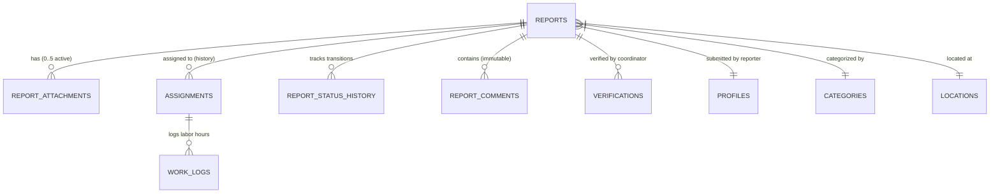

# CMIRS — Phase 3.1: Live Backend Integration Readiness Audit Report

> **Project:** Campus Maintenance & Incident Reporting System (CMIRS)  
> **Phase:** Frontend Phase 3.1 — Live Backend Integration Readiness Audit  
> **Application Root:** `D:\CMIRS-System\my-app`  
> **Date:** October 20, 2026  
> **Status:** Planning & Code Review Complete — Ready for Authorized Implementation  

---

## 1. Executive Summary

In accordance with owner instructions, **Phase 3.1 (Live Backend Integration Readiness Audit)** has been conducted as a strict planning and architectural review. **Zero live database queries, remote Supabase commands, schema migrations, or data mutations were performed.**

The objective of this phase is to establish the ground-truth technical bridge between the deployed PostgreSQL database schema ([`supabase/migrations/`](file:///d:/CMIRS-System/my-app/supabase/migrations/)) and the Next.js 16 App Router frontend application ([`my-app`](file:///d:/CMIRS-System/my-app/)) before any live report integration begins.

This audit provides:
1. **Comprehensive Database-to-UI Mapping:** Linking every dashboard metric, queue column, detail field, and attachment property to actual database columns and relational joins.
2. **Canonical Role Authorization Matrix:** Reconciling institutional business requirements ([`docs/ROLES.md`](file:///d:/CMIRS-System/my-app/docs/ROLES.md), [`docs/WORKFLOW.md`](file:///d:/CMIRS-System/my-app/docs/WORKFLOW.md), [`docs/SECURITY.md`](file:///d:/CMIRS-System/my-app/docs/SECURITY.md)) with the implemented PostgreSQL RLS policies ([`20261018000005_table_rls_policies.sql`](file:///d:/CMIRS-System/my-app/supabase/migrations/20261018000005_table_rls_policies.sql)) and security functions ([`20261018000004_security_functions_and_rpc.sql`](file:///d:/CMIRS-System/my-app/supabase/migrations/20261018000004_security_functions_and_rpc.sql)).
3. **Data-Access Layer (DAL) Architecture:** Designing typed server-side data fetching and mutation functions via `@supabase/ssr` that rely strictly on PostgreSQL RLS as the security enforcement boundary.
4. **Type Transformation Specifications:** Cataloging discrepancies between prototype TypeScript interfaces ([`types/reports.ts`](file:///d:/CMIRS-System/my-app/types/reports.ts)) and relational database rows, including snake_case mapping, foreign keys, nullable fields, and assignment histories.
5. **Private Attachment Protocol:** Specifying secure upload, signed-URL retrieval, soft-deletion RPC interaction, and active attachment constraints for the private `report-attachments` Supabase Storage bucket.
6. **UI State Specifications:** Defining skeleton loading, empty queues, error boundaries, retry loops, and pagination.
7. **Testing Strategy & Risk Register:** Establishing unit test fixtures and cataloging 6 critical technical risks with approved mitigations.

---

## 2. Database-to-UI Mapping

This section maps all user interface components to their underlying PostgreSQL tables, columns, constraints, and relational joins.

### 2.1 Dashboard KPI Summary Cards (`app/page.tsx`)

All dashboard KPI statistics are derived by querying `public.reports` as an authenticated user. **Because PostgreSQL RLS automatically applies `can_view_report(id)` on every query**, the application server queries `public.reports` directly, and the database engine guarantees that only authorized rows are returned.

| UI KPI Card | Display Logic | Database Source & Predicate | RLS Scoping Guarantee |
| :--- | :--- | :--- | :--- |
| **Total Active** | Active maintenance issues requiring operational attention | `COUNT(*) FROM public.reports WHERE status NOT IN ('verified', 'cancelled')` | Scoped by `can_view_report()`: students see only their active submissions; technicians see only active assigned tasks; coordinators/admins/management see campus-wide active items. |
| **Pending Triage** / **Pending Review** | Reports awaiting coordinator priority triage or assignment | `COUNT(*) FROM public.reports WHERE status IN ('submitted', 'under_review')` | For students: shows their own reports waiting for triage. For coordinators: shows campus-wide intake triage queue. For technicians: zero (technicians only receive reports after assignment). |
| **In Progress** / **Assigned Tasks** | Reports actively being repaired or on temporary hold | `COUNT(*) FROM public.reports WHERE status IN ('assigned', 'in_progress', 'on_hold')` | For technicians: reflects active queue. For students: reflects their reported issues currently being repaired. For oversight: campus-wide repair volume. |
| **Resolved This Week** / **Verified** | Satisfactorily verified or completed reports within 7 days | `COUNT(*) FROM public.reports WHERE status = 'verified' AND updated_at >= (now() - interval '7 days')` | Evaluated strictly against rows visible to the caller. |
| **Urgent Hazards** | Safety hazards flagged by submitters or prioritized critical | `COUNT(*) FROM public.reports WHERE is_urgent_hazard = true OR confirmed_priority = 'critical'` | Triggers safety alerts. For coordinators: prompts immediate intake priority. |

### 2.2 Report Lists & Queues (`components/dashboard/report-list.tsx`, `app/reports/page.tsx`)

The dashboard table and the `/reports` management queue display tabular report records requiring multi-table relational joins:

| UI Table Column | Data Type | Database Source Table & Column | Relational Join Logic |
| :--- | :--- | :--- | :--- |
| **Tracking Number** | `string` (e.g., `RPT-000042`) | `public.reports.report_number` | Direct column (generated via sequence `report_number_seq` and trigger `trg_reports_report_number`). |
| **Title & Description** | `string` | `public.reports.title`, `public.reports.description` | Direct columns. |
| **Category** | `string` (badge) | `public.categories.name` | `JOIN public.categories ON categories.id = reports.category_id` |
| **Location** | `string` (building, floor, room) | `public.locations.building_name`, `public.locations.floor`, `public.locations.room` | `JOIN public.locations ON locations.id = reports.location_id` |
| **Status** | `ReportStatus` (badge) | `public.reports.status` | Direct enum `public.report_status`. |
| **Priority** | `PriorityLevel \| null` | `public.reports.confirmed_priority` | Direct enum `public.priority_level`. **Nullable:** displays *"Pending Triage"* when `NULL`. |
| **Hazard Flag** | `boolean` (urgent icon) | `public.reports.is_urgent_hazard` | Direct boolean column. |
| **Reporter** | `string` (name & role) | `public.profiles.full_name`, `public.profiles.role` | `JOIN public.profiles ON profiles.id = reports.reporter_id` |
| **Assigned Technician** | `string \| null` | `tech.full_name` | `LEFT JOIN public.assignments a ON a.report_id = reports.id AND a.status IN ('assigned', 'in_progress', 'on_hold')`<br>`LEFT JOIN public.profiles tech ON tech.id = a.technician_id` |
| **Created / Updated** | `ISO Date String` | `public.reports.created_at`, `public.reports.updated_at` | Direct timestamptz columns. |

### 2.3 Report Detail View (`/reports/[id]`)

A full lifecycle view of an individual report incorporates 7 normalized tables:



1. **Core Report Record:** `public.reports` (`id`, `report_number`, `title`, `description`, `status`, `is_urgent_hazard`, `confirmed_priority`, `created_at`, `updated_at`).
2. **Reporter Details:** `public.profiles` (`id`, `full_name`, `email`, `phone`, `role`).
3. **Location Hierarchy:** `public.locations` (`id`, `building_name`, `floor`, `room`, `description`).
4. **Category Metadata:** `public.categories` (`id`, `name`, `description`).
5. **Assignment Timeline:** `public.assignments` (`id`, `technician_id` → `profiles.full_name`, `assigned_by` → `profiles.full_name`, `status`, `assigned_at`, `started_at`, `completed_at`, `notes`, `decline_reason`).
6. **Photo Attachments:** `public.report_attachments` (`id`, `file_path`, `file_name`, `file_size`, `mime_type`, `uploaded_by` → `profiles.full_name`, `created_at`, `deleted_at`, `deleted_by`).
7. **Status Audit Trail:** `public.report_status_history` (`id`, `previous_status`, `new_status`, `changed_by` → `profiles.full_name`, `reason`, `created_at`).
8. **Communication Log:** `public.report_comments` (`id`, `author_id` → `profiles.full_name`, `author_id` → `profiles.role`, `content`, `created_at`).
9. **Technician Labor Logs:** `public.work_logs` (`id`, `assignment_id`, `technician_id` → `profiles.full_name`, `description`, `hours_spent`, `created_at`).
10. **Coordinator Verification:** `public.verifications` (`id`, `verified_by` → `profiles.full_name`, `is_satisfactory`, `notes`, `verified_at`).

### 2.4 Facilities Directory (`app/locations/page.tsx`)
- **Table:** `public.locations` (`id`, `building_name`, `floor`, `room`, `description`, `is_active`).
- **Filter:** `is_active = true` (or all locations for coordinators/admins).
- **Report Aggregation:** Group by `building_name` to show active incident counts.

### 2.5 Analytics & SLA Metrics (`app/analytics/page.tsx`)
- **Time-to-Triage:** Difference between `reports.created_at` and initial `assignments.assigned_at`.
- **Mean Time to Repair (MTTR):** Difference between `assignments.started_at` and `assignments.completed_at`.
- **First-Time Verification Pass Rate:** Proportion of `verifications` where `is_satisfactory = true` without prior `reopened` status.
- **Technician Labor Distribution:** Sum of `work_logs.hours_spent` grouped by `work_logs.technician_id`.
- **Incident Heatmap:** Count of `reports` grouped by `locations.building_name` and `categories.name`.

---

## 3. Role Authorization Matrix

The table below reconciles institutional permissions ([`docs/ROLES.md`](file:///d:/CMIRS-System/my-app/docs/ROLES.md), [`docs/WORKFLOW.md`](file:///d:/CMIRS-System/my-app/docs/WORKFLOW.md)) with the deployed PostgreSQL RLS policies in [`20261018000005_table_rls_policies.sql`](file:///d:/CMIRS-System/my-app/supabase/migrations/20261018000005_table_rls_policies.sql) and RPC security functions in [`20261018000004_security_functions_and_rpc.sql`](file:///d:/CMIRS-System/my-app/supabase/migrations/20261018000004_security_functions_and_rpc.sql):

| Operational Action | `student_personnel` | `technician` | `coordinator` | `administrator` | `management` | Enforcing Database RLS Policy / Constraint |
| :--- | :---: | :---: | :---: | :---: | :---: | :--- |
| **Submit Report** | ✅ | ✅ | ✅ | ✅ | ✅ | `reports_insert`: `WITH CHECK (reporter_id = auth.uid() AND status = 'submitted' AND confirmed_priority IS NULL)`. All roles permitted per approved PD-R6. |
| **Flag Urgent Hazard** | ✅ | ✅ | ✅ | ✅ | ✅ | Stored as `is_urgent_hazard` on insert; independent of confirmed priority. |
| **View Own Submissions** | ✅ | ✅ | ✅ | ✅ | ✅ | `reports_select`: via `can_view_report()`, branch 2: `r.reporter_id = auth.uid()`. |
| **View Campus-Wide Reports** | ❌ | ❌ | ✅ | ✅ | ✅ | `reports_select`: via `can_view_report()`, branch 1: `caller_role IN ('coordinator', 'administrator', 'management')`. |
| **View Assigned Reports** | ❌ | ✅ | ✅ | ✅ | ✅ | `reports_select`: via `can_view_report()`, branch 3: `a.technician_id = auth.uid() AND a.status != 'declined'` (OD-NEW-4). |
| **Confirm / Triage Priority** | ❌ | ❌ | ✅ | ❌ | ❌ | `reports_update_coordinator`: `USING (get_user_role() = 'coordinator' AND status NOT IN ('verified', 'cancelled'))`. |
| **Assign / Reassign Tech** | ❌ | ❌ | ✅ | ❌ | ❌ | `assignments_insert_coordinator`, `assignments_update_coordinator`: coordinator only. |
| **Decline Assignment** | ❌ | ✅ | ❌ | ❌ | ❌ | RPC `decline_assignment(target_assignment_id, reason)`: checks `curr_tech_id = auth.uid() AND status = 'assigned'`. |
| **Work Hold Initiation** | ❌ | ✅ | ✅ | ❌ | ❌ | `reports_update_technician_hold` (active assigned techs) / `reports_update_coordinator` (PD-W1). |
| **Submit Work Logs** | ❌ | ✅ | ❌ | ❌ | ❌ | `work_logs_insert`: technician on own active assignment (`status IN ('assigned', 'in_progress', 'on_hold')`). |
| **Mark Repair Completed** | ❌ | ✅ | ❌ | ❌ | ❌ | `assignments_update_technician_work`: technician transitions assignment to `'completed'`. |
| **Verify Repair** | ❌ | ❌ | ✅ | ❌ | ❌ | `verifications_insert_coordinator`: strictly coordinator. Blocks self-verification (`r.reporter_id != auth.uid()`) and technician overlap (`a.technician_id != auth.uid()`). |
| **Reopen Failed Repair** | ❌ | ❌ | ✅ | ❌ | ❌ | Coordinator transitions report from `completed` to `reopened` with mandatory reason. |
| **Cancel Report (Reporter)** | ✅ | ✅* | ❌ | ❌ | ❌ | `reports_update_reporter_cancel`: `USING (reporter_id = auth.uid() AND status IN ('submitted', 'under_review'))`. |
| **Cancel Report (Coordinator)**| ❌ | ❌ | ✅ | ❌ | ❌ | `reports_update_coordinator`: any non-terminal report with mandatory reason. Marks assignments cancelled (PD-W4). |
| **Upload Photos** | ✅ | ✅ | ✅ | ❌ | ❌ | `storage_attachments_insert`: reporters (own submitted/under_review), technicians (own active), coordinators (non-terminal). |
| **Soft-Delete Attachment** | ❌ | ❌ | ✅ | ❌ | ❌ | RPC `soft_delete_attachment(attachment_id)`: sets `deleted_at = now()` and `deleted_by = auth.uid()`. |
| **Manage Users & Roles** | ❌ | ❌ | ❌ | ✅ | ❌ | `profiles_update_admin` & `role_change_audit_insert`. Administrators cannot change own role (`id != auth.uid()`). |
| **View Audit Trails** | ❌ | ❌ | ❌ | ✅ | ✅ | `role_change_audit_select`: administrator and management only. |

*Note on Technician cancellation: Technicians may cancel reports only if they are the original submitter (`reporter_id = auth.uid()`) while in `submitted` or `under_review` status.

---

## 4. Data-Access Layer (DAL) Architecture

To preserve security, maintainability, and clean Server Component boundaries in Next.js 16, live database access will be encapsulated in typed server-side modules under [`utils/reports/dal.ts`](file:///d:/CMIRS-System/my-app/utils/reports/dal.ts) and [`actions/reports.ts`](file:///d:/CMIRS-System/my-app/actions/reports.ts).

### 4.1 Core Design Principles
1. **RLS as Final Enforcement Boundary:** Server-side functions execute using the scoped user client (`createClient()` from [`utils/supabase/server.ts`](file:///d:/CMIRS-System/my-app/utils/supabase/server.ts)), which forwards authenticated session cookies. RLS policies enforce access rules in PostgreSQL.
2. **Server-Side Type Validation:** Input parameters are validated with Zod/validator schemas before executing Supabase queries.
3. **Pagination & Query Limits:** All list queries enforce deterministic sorting (`order('created_at', { ascending: false })`) and pagination bounds (`range(offset, offset + limit - 1)`). Default page size is 15; maximum is 50.
4. **Cache Revalidation:** Data mutations (Server Actions) invoke `revalidatePath('/')` and `revalidatePath('/reports')` to refresh server component caches.

### 4.2 Proposed Typed Data-Fetching Functions

```typescript
// 1. Queue Fetcher with Filters & Range Pagination
export interface ReportQueueQuery {
  page?: number;
  pageSize?: number;
  statusFilter?: ReportStatus | 'all';
  categoryFilter?: string | 'all';
  searchQuery?: string;
}

export interface PaginatedReports {
  reports: MaintenanceReportViewModel[];
  totalCount: number;
  currentPage: number;
  totalPages: number;
}

export async function getReportsQueue(params: ReportQueueQuery): Promise<PaginatedReports> {
  const supabase = await createClient();
  const page = Math.max(1, params.page || 1);
  const pageSize = Math.min(50, Math.max(1, params.pageSize || 15));
  const from = (page - 1) * pageSize;
  const to = from + pageSize - 1;

  let query = supabase
    .from('reports')
    .select(`
      id,
      report_number,
      title,
      description,
      status,
      is_urgent_hazard,
      confirmed_priority,
      created_at,
      updated_at,
      categories!inner(id, name),
      locations!inner(id, building_name, floor, room),
      profiles!reports_reporter_id_fkey(id, full_name, role),
      assignments(
        id,
        status,
        assigned_at,
        technician:profiles!assignments_technician_id_fkey(id, full_name)
      )
    `, { count: 'exact' });

  // Optional status filtering
  if (params.statusFilter && params.statusFilter !== 'all') {
    query = query.eq('status', params.statusFilter);
  }

  // Full-text / ilike search
  if (params.searchQuery?.trim()) {
    const term = `%${params.searchQuery.trim()}%`;
    query = query.or(`title.ilike.${term},report_number.ilike.${term},description.ilike.${term}`);
  }

  query = query.order('created_at', { ascending: false }).range(from, to);
  const { data, count, error } = await query;
  if (error) throw new Error(`Failed to load reports: ${error.message}`);

  return {
    reports: (data || []).map(transformDbReportToViewModel),
    totalCount: count || 0,
    currentPage: page,
    totalPages: Math.ceil((count || 0) / pageSize),
  };
}

// 2. Dashboard Aggregate KPI Metrics
export async function getDashboardKpiStats(): Promise<DashboardStats> {
  const supabase = await createClient();
  
  // Queries active counts visible to caller via RLS
  const { data: reports, error } = await supabase
    .from('reports')
    .select('id, status, is_urgent_hazard, confirmed_priority, updated_at');

  if (error) throw new Error(`Failed to load dashboard metrics: ${error.message}`);
  return calculateKpiStatsFromRecords(reports || []);
}

// 3. Report Detail by ID
export async function getReportDetails(reportId: string): Promise<ReportDetailViewModel | null> {
  const supabase = await createClient();
  const { data, error } = await supabase
    .from('reports')
    .select(`
      *,
      category:categories(*),
      location:locations(*),
      reporter:profiles!reports_reporter_id_fkey(*),
      assignments(
        *,
        technician:profiles!assignments_technician_id_fkey(*),
        assigned_by_user:profiles!assignments_assigned_by_fkey(full_name),
        work_logs(*)
      ),
      report_attachments(*),
      report_status_history(
        *,
        changed_by_user:profiles(full_name, role)
      ),
      report_comments(
        *,
        author:profiles(full_name, role)
      ),
      verifications(
        *,
        verifier:profiles(full_name)
      )
    `)
    .eq('id', reportId)
    .single();

  if (error || !data) return null;
  return transformDbReportDetail(data);
}
```

### 4.3 Proposed Typed Server Actions (Mutations)

| Server Action | Primary Actor | Target Table / RPC | Description & Precondition |
| :--- | :--- | :--- | :--- |
| `createReportAction` | All authenticated roles | `public.reports` INSERT | Validates title, description, category UUID, location UUID, hazard flag. Triggers auto-generate `report_number`. |
| `triageReportAction` | Coordinator | `public.reports` UPDATE | Sets `confirmed_priority` (`low` / `medium` / `high` / `critical`), advances `submitted` → `under_review`. |
| `assignTechnicianAction` | Coordinator | `public.assignments` INSERT & `public.reports` UPDATE | Creates assignment row for technician, transitions report to `assigned`. |
| `declineAssignmentAction` | Assigned Technician | RPC `public.decline_assignment` | Requires non-empty reason via `btrim()`. Terminal for assignment row. |
| `updateWorkStatusAction` | Assigned Technician | `public.assignments` & `public.reports` UPDATE | Transitions assignment and report to `in_progress` or `completed`. |
| `requestHoldAction` | Tech / Coordinator | `public.reports` UPDATE | Sets status `on_hold` with required reason in status history. |
| `submitWorkLogAction` | Assigned Technician | `public.work_logs` INSERT | Logs repair description and hours spent against active assignment. |
| `verifyRepairAction` | Coordinator | `public.verifications` INSERT | Records pass (`is_satisfactory = true` → `verified`) or fail (`is_satisfactory = false` → `reopened`). Enforces self-verification prohibitions. |
| `cancelReportAction` | Reporter / Coordinator | `public.reports` UPDATE | Reporter cancels before assignment; coordinator cancels at any non-terminal state. Requires cancellation reason. |
| `softDeleteAttachmentAction` | Coordinator | RPC `public.soft_delete_attachment` | Soft-deletes attachment, preserving immutable file metadata for audit. |

---

## 5. Type Mapping: TypeScript vs Database Schema

The table below catalogs every divergence between the prototype TypeScript types ([`types/reports.ts`](file:///d:/CMIRS-System/my-app/types/reports.ts)) and the PostgreSQL schema:

| Entity Field | Current TypeScript Type (`types/reports.ts`) | PostgreSQL Schema (`supabase/migrations/`) | Divergence Analysis & Required Transformer |
| :--- | :--- | :--- | :--- |
| **ID** | `string` | `UUID` (PK, `gen_random_uuid()`) | Format: RFC 4122 UUID. Compatible. |
| **Tracking Number** | `trackingNumber: string` | `report_number: TEXT UNIQUE` | **Name mismatch:** TypeScript uses `trackingNumber`, DB uses `report_number`. Mapper must transform `report_number` → `trackingNumber`. |
| **Priority** | `priority: PriorityLevel` (non-null) | `confirmed_priority: priority_level NULL` | **Critical Nullability Mismatch:** Initial reports have `confirmed_priority = NULL` until coordinator review. Type must be `confirmedPriority: PriorityLevel \| null`. UI must render a *"Pending Triage"* badge when `null`. |
| **Urgent Flag** | `isUrgentHazard: boolean` | `is_urgent_hazard: BOOLEAN NOT NULL DEFAULT false` | **Casing mismatch:** snake_case vs camelCase. Direct boolean mapping. |
| **Category** | `category: string` (display name) | `category_id: UUID FK -> categories.id` | **Relational mismatch:** Database stores foreign key. Query must join `categories(name)` to extract display name. |
| **Location** | `location: CampusLocation` (embedded object) | `location_id: UUID FK -> locations.id` (`building_name`, `floor`, `room`) | **Relational mismatch:** Database stores foreign key. Query must join `locations` table and map `building_name` → `building`. |
| **Reporter** | `reporterName: string`, `reporterRole: string` | `reporter_id: UUID FK -> profiles.id` | **Relational mismatch:** Query must join `profiles` to obtain `full_name` and `role`. |
| **Assigned Tech** | `assignedTechnician?: string` (single string) | `assignments: table (1-to-many)` | **Relational mismatch:** Reports have an assignment history. Mapper must find the active assignment (`status IN ('assigned', 'in_progress', 'on_hold')`) and extract technician `full_name`. |
| **Assignment Status** | `assignmentStatus?: AssignmentStatus` | `assignments.status: assignment_status` | Direct enum mapping when active assignment exists. |
| **Timestamps** | `createdAt: string`, `updatedAt: string` | `created_at: TIMESTAMPTZ`, `updated_at: TIMESTAMPTZ` | ISO 8601 strings from Supabase client. |
| **Attachments** | *Missing entirely from `types/reports.ts`* | `report_attachments: table` | Must define `ReportAttachmentViewModel` interface with `id`, `fileName`, `fileSize`, `mimeType`, `signedUrl`, `uploadedBy`, `createdAt`. |
| **Status History** | *Missing from `types/reports.ts`* | `report_status_history: table` | Must define `ReportStatusHistoryEntry` for timeline UI. |
| **Comments** | *Missing from `types/reports.ts`* | `report_comments: table` | Must define `ReportCommentEntry` for communication log. |
| **Verifications** | *Missing from `types/reports.ts`* | `verifications: table` | Must define `VerificationRecord` for QA audit card. |

---

## 6. Private Attachment Plan

### 6.1 Storage Bucket Configuration
- **Bucket ID:** `report-attachments`
- **Visibility:** Strictly **Private** (`public = false`). Direct public URL access returns HTTP 400/403.
- **Allowed MIME Types:** `image/jpeg`, `image/png`, `image/webp` (enforced at both bucket configuration and `chk_mime_type` database constraint).
- **Maximum File Size:** 10 MB (10,485,760 bytes; enforced at bucket configuration and `chk_file_size` database constraint).
- **Maximum Active Attachments:** 5 active files per report (enforced via database trigger `trg_lock_attachment_count` with row-level lock `FOR UPDATE` on `public.reports`).

### 6.2 Canonical Storage Object Path
The storage RLS policy in [`20261018000006_storage_setup.sql`](file:///d:/CMIRS-System/my-app/supabase/migrations/20261018000006_storage_setup.sql#L74-L145) enforces a strict regex path pattern:
```text
reports/{report_id}/{attachment_id}.{ext}
```
Example: `reports/a3f1c2d0-1234-4567-89ab-cdef01234567/b7e2d1f4-5678-90ab-cdef-1234567890ab.png`

### 6.3 Secure Upload Protocol
To prevent orphaned files or unrecorded binaries, uploads adhere to a 3-step transactional protocol:
1. **Pre-Validation:** Client validates file size (`<= 10MB`), permitted MIME type, and current active attachment count (`< 5`).
2. **Binary Upload:** The application generates a client-side UUID for `attachment_id` and uploads to the storage bucket under `reports/${reportId}/${attachmentId}.${extension}` using authenticated session cookies.
3. **Metadata Persistence:** The application immediately executes an INSERT into `public.report_attachments` (`report_id`, `file_path`, `file_name`, `file_size`, `mime_type`, `uploaded_by`).
4. **Failure Compensation:** If Step 3 fails (e.g., database constraint or 5-count limit exceeded), the client immediately invokes a cleanup storage deletion for the uploaded object path to prevent storage leaks.

### 6.4 Secure Retrieval via Signed URLs
Because the bucket is private, binaries cannot be accessed via static URLs. 
- The Server Component or Server Action generates short-lived signed URLs via:
  ```typescript
  const { data } = await supabase.storage
    .from('report-attachments')
    .createSignedUrl(attachment.file_path, 300); // 300 seconds (5 minutes) TTL
  ```
- **Security Scoping:** The `storage_attachments_select` policy in PostgreSQL validates that the user querying the signed URL has permission to view the report (`public.can_view_report(report_id)`) and that the file is not soft-deleted (unless the user holds an oversight role).

### 6.5 Soft Deletion & Audit Workflow
- **Coordinator Action:** Only Maintenance Coordinators can delete attachments.
- **RPC Invocation:** The client calls the database RPC `public.soft_delete_attachment(attachment_id)`.
- **Database Effect:** The row is updated with `deleted_at = now()` and `deleted_by = auth.uid()`. All file metadata remains intact.
- **Visibility Effect:** Soft-deleted files are immediately hidden from student reporters and technicians. Coordinators, Administrators, and Management retain SELECT visibility for compliance audit.
- **Physical Binary Purging:** Physical removal from Storage is deferred to a secure backend worker operating with `service_role` privileges, guaranteeing that audit logs never break.

---

## 7. UI Integration Plan: States & User Experience

Each application route must handle 6 distinct UI states to deliver a resilient user experience:

| Route | Loading State | Empty State | Error State | Retry Mechanism | Unauthorized State | Pagination / Limits |
| :--- | :--- | :--- | :--- | :--- | :--- | :--- |
| **`/` (Dashboard)** | Pulsing skeletons for 4 KPI cards, greeting banner, and recent report rows. | Role-aware empty card: Student sees "Submit Report" CTA; Tech sees "No assigned work"; Coord sees "All clear". | "Unable to load dashboard data" banner with error details. | "Retry Connection" button triggering Next.js `router.refresh()`. | Edge proxy / server guard redirects to `/login`. | Top 5 recent visible reports; link to `/reports`. |
| **`/reports` (Queue)** | Full table skeleton with animated rows and filter placeholders. | Filter-specific empty table with "Clear Filters" button. | Error alert with status code and guidance. | Inline retry button. | Redirects to `/login`. | Server-side range pagination (15/25/50 per page) with page navigation controls. |
| **`/reports/[id]` (Detail)**| Skeleton tabs for Overview, Timeline, Photos, and Comments. | 404 Not Found card: "Report does not exist or you lack authorization." | Error card for network/fetch failures. | Retry button. | Dedicated `/unauthorized` (HTTP 403) page. | Work logs and comments paginated if > 25 entries. |
| **`/reports/new` (Submit)** | Submission spinner on CTA button; input fields disabled. | N/A (Form). | Field-level inline errors (Zod validation); top-level submission failure alert. | Form state preserved; user can re-click Submit. | Redirects to `/login?next=/reports/new`. | Max 5 file attachments upload selector. |
| **`/locations` (Facilities)**| Grid skeletons for facility cards. | "No matching campus facilities found." | Error banner. | Inline refresh. | Redirects to `/login`. | Grouped by campus building. |
| **`/analytics` (Metrics)** | Chart skeletons and metric box placeholders. | "Insufficient report data for the selected period." | Error banner. | Inline retry. | Server guard redirects forbidden roles to `/unauthorized`. | Date-range picker (7d, 30d, 90d, 1y). |

---

## 8. Testing Plan

### 8.1 Local Unit Tests (Mocked Supabase Client)
Prior to connecting remote databases, local unit tests will validate DAL logic using mock datasets:
1. **Model Transformer Tests:** Verify correct transformation from raw joined database payloads to UI ViewModels, specifically asserting `confirmed_priority: null` mappings and active assignment extraction.
2. **Anti-Leakage Calculations:** Verify `calculateKpiStatsFromRecords()` computes metrics strictly from visible records with zero leaks.
3. **Validation Suite:** Test Zod input schemas for report creation, priority triage, assignment decline reasons (enforcing non-empty strings after `btrim()`), and file upload size/MIME constraints.
4. **State Machine Verification:** Unit test allowed status transitions matching [`docs/WORKFLOW.md`](file:///d:/CMIRS-System/my-app/docs/WORKFLOW.md).

### 8.2 Future Separately Authorized Integration Test Plan (Gate E.4D)
When Gate E.4D is explicitly authorized, an end-to-end integration test runner will execute against the live Supabase instance using the 5 provisioned test accounts:

| Test Case | Persona | Target Route / Operation | Expected Result |
| :--- | :--- | :--- | :--- |
| **IT-01** | `test-student@cmirs.internal` | Submit new report with photo attachment | Report created with `status = 'submitted'`, `confirmed_priority = NULL`. Attachment uploaded to `report-attachments`. |
| **IT-02** | `test-student@cmirs.internal` | Query `/reports` queue | Returns only reports where `reporter_id = student.id`. Reports from other users are absent. |
| **IT-03** | `test-student@cmirs.internal` | Attempt priority change or verification | HTTP 403 / RLS rejection. |
| **IT-04** | `test-coordinator@cmirs.internal` | Triage priority and assign technician | `confirmed_priority` updated, `assignments` row created, report transitions to `assigned`. |
| **IT-05** | `test-coordinator@cmirs.internal` | Attempt to verify own submitted report | Database constraint / RLS rejection (`reporter_id != auth.uid()`, PD-R4). |
| **IT-06** | `test-technician@cmirs.internal` | Decline assigned work order | Calls `decline_assignment` RPC with reason. Assignment set to `declined`; report removed from technician's queue. |
| **IT-07** | `test-technician@cmirs.internal` | Log work and mark repair completed | `work_logs` row created; assignment marked `completed`. Ready for coordinator verification. |
| **IT-08** | `test-coordinator@cmirs.internal` | Verify completed repair | Verification record created with `is_satisfactory = true`; report reaches terminal `verified` status. |
| **IT-09** | `test-management@cmirs.internal` | Access `/analytics` and `/reports` | Read-only access to campus-wide data. All INSERT/UPDATE attempts blocked by RLS. |
| **IT-10** | `test-administrator@cmirs.internal`| Change user role | Updates `profiles.role` and writes audit row to `role_change_audit`. Attempting to alter own role is blocked. |

---

## 9. Risk Register

| Risk ID | Severity | Description | Verified Architectural Mitigation |
| :--- | :---: | :--- | :--- |
| **RSK-01** | High | **Nullable `confirmed_priority` UI Crash:** Prototype UI expects a non-null `PriorityLevel`. If the database returns `NULL` for newly submitted reports, components expecting string values may crash. | **Mitigation:** Update TypeScript definitions to `confirmedPriority: PriorityLevel \| null`. Update `PriorityBadge` to render a neutral *"Pending Triage"* state when `null`. |
| **RSK-02** | High | **Concurrent Attachment Upload Race:** Parallel file uploads from a client could potentially exceed the 5-active-attachment limit before row counts register. | **Mitigation:** Database trigger `trg_lock_attachment_count` in [`20261018000003_triggers.sql`](file:///d:/CMIRS-System/my-app/supabase/migrations/20261018000003_triggers.sql#L151-L180) acquires a row-level lock (`PERFORM 1 FROM public.reports WHERE id = NEW.report_id FOR UPDATE`) serializing uploads and guaranteeing strict `<= 5` enforcement. |
| **RSK-03** | Medium | **Signed URL Expiration on Active Pages:** Private storage signed URLs expire after 300 seconds. If a user remains on a report detail view, photo thumbnails may break. | **Mitigation:** Implement on-demand client-side thumbnail re-signing or fetch signed URLs dynamically when modal photo previews are opened. |
| **RSK-04** | High | **Coordinator Self-Verification Security Breach:** A coordinator who submitted a maintenance issue could attempt to verify their own repair, violating separation-of-duties. | **Mitigation:** Enforced at both database layer (`verifications_insert_coordinator` checks `r.reporter_id != auth.uid()`) and UI layer (verification button hidden/disabled with tooltip if `report.reporter_id === user.id`). |
| **RSK-05** | Medium | **Assignment Multiplicity Confusion:** Because reports preserve assignment history (reassignments, declines), querying `assignments` without status filters returns multiple rows. | **Mitigation:** DAL query strictly targets active assignments (`status IN ('assigned', 'in_progress', 'on_hold')`) for current technician attribution, while preserving complete history in the audit timeline. |
| **RSK-06** | Medium | **Stale Next.js Server Cache on Mutation:** Server Components may render stale data after a report status transition if cache invalidation is omitted. | **Mitigation:** All Server Actions explicitly invoke `revalidatePath('/')`, `revalidatePath('/reports')`, and `revalidatePath('/reports/[id]', 'page')`. |

---

## 10. Audit Conclusions & Next Steps

1. **Readiness Status:** The CMIRS frontend architecture is thoroughly prepared for live database integration. The data models, authorization boundaries, and storage workflows have been completely reconciled with the deployed PostgreSQL schema.
2. **Strict Boundary Compliance:** Zero remote database calls or CLI commands were issued during this audit. **Gate E.4D remains unauthorized and pending.**
3. **Next Steps (Awaiting Authorization):**
   - Stage 3.2: Implement typed Data-Access Layer (`utils/reports/dal.ts`) and Server Actions (`actions/reports.ts`).
   - Stage 3.3: Implement live Report Submission (`/reports/new`) with photo uploads to `report-attachments`.
   - Stage 3.4: Connect Operations Dashboard (`app/page.tsx`) and Queue (`app/reports/page.tsx`) to live Supabase queries.

Phase 3.1 is concluded. Work has stopped per instructions. Please review this audit report and provide explicit approval before proceeding to implementation.
