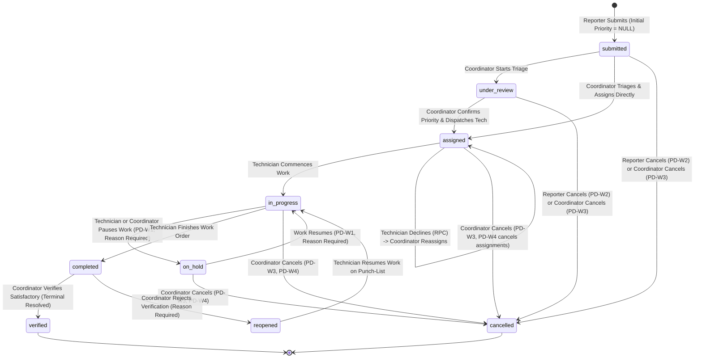

# Phase 3.3 — Report Submission and Mutation Integration Plan

**Project:** Campus Maintenance & Incident Reporting System (CMIRS)  
**Workspace:** `D:\CMIRS-System\my-app`  
**Document Target:** Phase 3.3 Mutation Architecture, Report Submission, and Lifecycle Transitions  
**Author:** Senior Full-Stack Engineer, Next.js App Router Specialist, Supabase/PostgreSQL Reviewer & Application Security Auditor  
**Date:** October 20, 2026  
**Status:** **PLANNING ONLY (No Mutations Implemented)**

---

## 1. Executive Summary

This document establishes the implementation-ready architectural plan for **Phase 3.3: Report Submission and Mutation Integration** for the Campus Maintenance & Incident Reporting System (CMIRS).

Phase 3.2 established a verified, read-only Data Access Layer (DAL) operating under authenticated Supabase server sessions, deterministic pagination, sanitized database notices, and Philippine Standard Time calendar-week KPI metrics. Phase 3.3 builds upon this foundation by introducing **write operations** (report creation, technician dispatch, assignment decline, work progress tracking, work logs, coordinator verification, resolution, and photo attachment handling).

### Guiding Architectural Principles
1. **Zero Privileged Bypass:** All mutations must execute under the authenticated user's session client (`createClient()`), actively bound to PostgreSQL Row Level Security (RLS). No service-role key or admin bypass is permitted in user-facing workflows.
2. **Cryptographic Identity Authority:** The acting user ID (`auth.uid()`) and verified institutional role (`profiles.role`) are established exclusively by the server via `supabase.auth.getUser()`. Client-supplied IDs and roles are strictly rejected.
3. **Database-Level Constraint Integrity:** Application logic acts as a first-line validation layer, while PostgreSQL check constraints, foreign keys, immutability triggers, and RLS policies serve as the final, immutable defense-in-depth boundary.
4. **Resilient Attachment Orchestration:** File uploads to the private `report-attachments` Storage bucket are synchronized with `public.report_attachments` metadata rows, respecting the 5-active-attachment limit enforced by PostgreSQL row-locking concurrency triggers.
5. **Deterministic State Machine:** Report statuses follow the approved 9-status lifecycle, strictly preventing invalid transitions or unauthorized state manipulation.

---

## 2. Phase 3.2 Handoff Verification

Before planning Phase 3.3, all deliverables and remediated behaviors from Phase 3.2 were statically verified across current source code and local test suites:

| Handoff Verification Item | Source File / Artifact | Observed Implementation | Verification Status |
| :--- | :--- | :--- | :--- |
| **Category Filter Correctness** | `utils/reports/dal.ts:77-81, 308-319` | Specifies `categories!inner` in PostgREST column selection. Dual-mode filtering supports direct UUID matching (`category_id`) and name matching (`categories.name`). Non-matching parent reports are eliminated. | **VERIFIED (Static & Test)** |
| **Deterministic Pagination** | `utils/reports/dal.ts:327-331` | Applies `.order('created_at', { ascending: false }).order('id', { ascending: false })` before `.range(from, to)`. Prevents row drift across timestamp collisions. | **VERIFIED (Static & Test)** |
| **Pagination Filter Preservation** | `app/reports/page.tsx:42-53` | `buildReportsQueueUrl()` preserves `status`, `category`, and `search` query parameters with URL encoding across Previous and Next page transitions. | **VERIFIED (Static & Test)** |
| **KPI Truncation Guard** | `utils/reports/dal.ts:413-431` | Queries with `{ count: 'exact' }` and calls `isDatasetTruncated(count, fetchedRows.length)`. Rejects incomplete metrics when database records exceed single-request query limits. | **VERIFIED (Static & Test)** |
| **Philippine Calendar Week** | `utils/reports/transform.ts:57-82` | `getPhilippineWeekBounds()` calculates Monday 12:00:00 AM to following Monday 12:00:00 AM exclusive in PST (UTC+8). `resolvedThisWeek` strictly inspects `updated_at` without substituting `created_at`. | **VERIFIED (Static & Test)** |
| **`completed` Status as Active** | `utils/reports/transform.ts:180-227` | Reports in `completed` status increment `totalActive`. Only `verified` reports increment resolved metrics. | **VERIFIED (Static & Test)** |
| **Database Error Sanitization** | `utils/reports/dal.ts:333-344, 403-412` | PostgREST errors are logged to server console without leaking to client. User receives safe, sanitized notices. UI displays degraded connection banner. | **VERIFIED (Static & Test)** |
| **Authenticated Session Client** | `utils/supabase/server.ts:21-53` | Uses `@supabase/ssr` `createServerClient` bound to Next.js cookie store. Zero references to service-role keys. | **VERIFIED (Static & Test)** |
| **Test Production Direct Import** | `tests/unit/dal-read-queries.test.mjs:8-17` | Imports pure helpers directly from `utils/reports/transform.ts`. Zero code duplication. All 58 unit tests pass. | **VERIFIED (Static & Test)** |
| **Remote PostgreSQL RLS Execution** | `tests/integration/rls-runner.ts` | Remote test suite Gate E.4D against live Supabase Cloud database remains unauthorized per safety rules. | **DEFERRED (Requires Authorization)** |

---

## 3. Existing Architecture and Schema Evidence

The database schema, triggers, and security functions defined in Phase 4A migrations provide the foundation for Phase 3.3 mutations:

```
┌─────────────────────────────────────────────────────────────────────────────┐
│                            PostgreSQL Database                              │
├─────────────────────────────────────────────────────────────────────────────┤
│  public.reports (Table 5)                                                   │
│   ├── id (UUID PK, default gen_random_uuid())                               │
│   ├── report_number (TEXT UNIQUE, generated by Trigger T2: RPT-000001)      │
│   ├── title (TEXT NOT NULL), description (TEXT NOT NULL)                    │
│   ├── category_id (UUID FK -> categories.id, ON DELETE RESTRICT)            │
│   ├── location_id (UUID FK -> locations.id, ON DELETE RESTRICT)            │
│   ├── reporter_id (UUID FK -> profiles.id, ON DELETE RESTRICT, IMMUTABLE)   │
│   ├── status (report_status ENUM, default 'submitted')                      │
│   ├── is_urgent_hazard (BOOLEAN NOT NULL, default false)                    │
│   ├── confirmed_priority (priority_level ENUM, NULL until triage)           │
│   └── created_at, updated_at (TIMESTAMPTZ, auto-updated by Trigger T1)      │
│                                                                             │
│  public.assignments (Table 6)                                               │
│   ├── id (UUID PK), report_id (UUID FK -> reports.id ON DELETE CASCADE)     │
│   ├── technician_id (UUID FK -> profiles.id), assigned_by (UUID FK)         │
│   ├── status (assignment_status ENUM: assigned, in_progress, on_hold, etc.) │
│   ├── decline_reason (TEXT, CHECK: non-empty if status = 'declined')        │
│   └── assigned_at, started_at, completed_at, notes                          │
│                                                                             │
│  public.report_attachments (Table 7)                                        │
│   ├── id (UUID PK), report_id (UUID FK), file_path, file_name, file_size    │
│   ├── mime_type (CHECK: image/jpeg, image/png, image/webp), uploaded_by      │
│   ├── deleted_at, deleted_by (Soft-deletion via RPC soft_delete_attachment) │
│   └── Trigger T5: Row-level lock on reports FOR UPDATE; max 5 active        │
│                                                                             │
│  public.work_logs (Table 10)                                                │
│   ├── id (UUID PK), assignment_id (UUID FK), technician_id (UUID FK)        │
│   └── description (TEXT NOT NULL), hours_spent (DECIMAL(5,2)), created_at   │
│                                                                             │
│  public.verifications (Table 11)                                            │
│   ├── id (UUID PK), report_id (UUID FK), verified_by (UUID FK)              │
│   └── is_satisfactory (BOOLEAN NOT NULL), notes (TEXT), verified_at         │
│                                                                             │
│  public.report_status_history (Table 8)                                     │
│   └── Append-only audit trail; Trigger T3 automatic status logging          │
└─────────────────────────────────────────────────────────────────────────────┘
```

### Critical Existing Database Enforcement Rules
1. **Unconditional Report Numbering (`Trigger T2`, `20261018000003_triggers.sql:37-55`):**  
   Every insert on `public.reports` executes `generate_report_number()`, which unconditionally pulls the next sequence value from `report_number_seq` and formats it as `RPT-000001`. Client input for `report_number` is ignored.
2. **Immutability of Key Columns (`Trigger trg_reports_immutable_cols`, `triggers.sql:56-78`):**  
   `report_number` and `reporter_id` cannot be altered on `UPDATE`. Attempting to modify them throws an unhandled database exception.
3. **Initial Submission Constraints (`reports_insert` RLS Policy, `20261018000005_table_rls_policies.sql:140-147`):**  
   `WITH CHECK (reporter_id = auth.uid() AND status = 'submitted' AND confirmed_priority IS NULL)`. Any attempt to set initial priority, initial assigned status, or author a report under another user's ID is rejected by PostgreSQL.
4. **Concurrency-Safe Attachment Limit (`Trigger T5`, `triggers.sql:151-180`):**  
   `lock_attachment_count()` acquires an exclusive row lock (`PERFORM 1 FROM public.reports WHERE id = NEW.report_id FOR UPDATE`) before checking that active attachments do not exceed 5.
5. **Strict Separation of Duties for Verification (`verifications_insert_coordinator`, `rls_policies.sql:407-427`):**  
   Coordinators cannot verify their own submitted reports (`r.reporter_id != auth.uid()`), nor can they verify reports where they served as the assigned technician.

---

## 4. Role-Operation Authorization Matrix

The table below delineates the authorized roles, server-side validation, database enforcement, and expected behavior for every Phase 3.3 mutation.

| Mutation Operation | Authorized Roles | Affected Tables & Columns | Server Authorization Guard | Database RLS / Function Constraint | Behavior on Unauthorized Attempt |
| :--- | :--- | :--- | :--- | :--- | :--- |
| **Submit Report** | `student_personnel`, `coordinator`, `technician`, `administrator`, `management` (All roles per PD-R6) | `reports` (`title`, `description`, `category_id`, `location_id`, `is_urgent_hazard`, `reporter_id`) | `requireAuth()`, validates `category_id` & `location_id` are active | `reports_insert` policy: `reporter_id = auth.uid() AND status = 'submitted' AND confirmed_priority IS NULL` | Rejected with 403 Forbidden / PostgREST RLS violation. |
| **Confirm Priority & Triage** | `coordinator` | `reports` (`confirmed_priority`, `status`) | `requireRole(['coordinator'])` | `reports_update_coordinator`: `status NOT IN ('verified', 'cancelled')` | Rejected with 403 Forbidden. Priority unchanged. |
| **Assign Technician** | `coordinator` | `assignments` (INSERT: `report_id`, `technician_id`, `assigned_by`, `notes`), `reports` (`status = 'assigned'`) | `requireRole(['coordinator'])`, validates technician profile is active and has role `technician` | `assignments_insert_coordinator`: `assigned_by = auth.uid()`, `reports_update_coordinator` | Rejected with 403 Forbidden. Assignment rejected. |
| **Decline Assignment** | `technician` | `assignments` (`status = 'declined'`, `decline_reason = text`) | `requireRole(['technician'])`, validates non-empty reason | RPC `public.decline_assignment(target_id, reason)`: verifies `technician_id = auth.uid()` and status is `assigned` | RPC throws exception: 'Access denied' or 'Non-empty reason required'. |
| **Start Work (`in_progress`)** | `technician` | `assignments` (`status = 'in_progress'`, `started_at`), `reports` (`status = 'in_progress'`) | `requireRole(['technician'])`, verifies technician assignment | `assignments_update_technician_work`: `technician_id = auth.uid() AND status IN ('assigned', 'in_progress', 'on_hold')` | Rejected with 403 Forbidden. Status unchanged. |
| **Place Work On Hold** | `technician`, `coordinator` (Approved PD-W1) | `assignments` (`status = 'on_hold'`), `reports` (`status = 'on_hold'`), `report_status_history` (`reason`) | `requireRole(['technician', 'coordinator'])`, requires non-empty reason | `reports_update_technician_hold` / `reports_update_coordinator` | Rejected with 403 Forbidden. Reason required. |
| **Resume Work** | `technician`, `coordinator` (Approved PD-W1) | `assignments` (`status = 'in_progress'`), `reports` (`status = 'in_progress'`) | `requireRole(['technician', 'coordinator'])` | `reports_update_technician_hold` / `reports_update_coordinator` | Rejected with 403 Forbidden. |
| **Log Work Session** | `technician` | `work_logs` (INSERT: `assignment_id`, `technician_id`, `description`, `hours_spent`) | `requireRole(['technician'])`, validates hours > 0 and <= 24 | `work_logs_insert`: `technician_id = auth.uid()` on active assignment | Rejected with 403 Forbidden. Work log discarded. |
| **Complete Repair** | `technician` | `assignments` (`status = 'completed'`, `completed_at`), `reports` (`status = 'completed'`) | `requireRole(['technician'])` | `assignments_update_technician_work`: `status = 'completed'` | Rejected with 403 Forbidden. Report remains active. |
| **Verify & Resolve** | `coordinator` (Designated Verifier) | `verifications` (INSERT: `is_satisfactory = true`, `notes`), `reports` (`status = 'verified'`) | `requireRole(['coordinator'])`, checks self-verification restriction | `verifications_insert_coordinator`: verifies `r.status = 'completed'`, `r.reporter_id != auth.uid()`, and verifier is not technician | Database RLS policy violation. Terminal closure blocked. |
| **Reopen Report** | `coordinator` | `verifications` (INSERT: `is_satisfactory = false`, `notes`), `reports` (`status = 'reopened'`) | `requireRole(['coordinator'])`, requires rejection reason | `verifications_insert_coordinator`: verifies `r.status = 'completed'` | Reopening rejected with 403 Forbidden. |
| **Cancel Report (Reporter)** | `student_personnel` (and any report author) | `reports` (`status = 'cancelled'`), `report_status_history` (`reason`) | Validates caller is report author; status is `submitted` or `under_review` (Approved PD-W2) | `reports_update_reporter_cancel`: `reporter_id = auth.uid() AND status IN ('submitted', 'under_review')` | Rejected with 403 Forbidden if assigned or in progress. |
| **Cancel Report (Coordinator)** | `coordinator` | `reports` (`status = 'cancelled'`), `assignments` (`status = 'cancelled'`) | `requireRole(['coordinator'])`, requires non-empty cancellation reason (Approved PD-W3, PD-W4) | `reports_update_coordinator`: `status NOT IN ('verified', 'cancelled')` | Cancellation rejected. Terminal states cannot be cancelled. |
| **Upload Photo Attachment** | `student_personnel` (own report submitted/under_review), `technician` (active assignment), `coordinator` (non-terminal) | `storage.objects` (binary), `report_attachments` (metadata row) | File MIME validation (JPEG, PNG, WebP), file size limit <= 10MB | `storage_attachments_insert` & `report_attachments_insert`, Trigger T5 row-locking limit (<= 5) | Storage upload rejected with 403; database insert rejected if >5 attachments. |
| **Soft-Delete Attachment** | `coordinator` Only (Approved PD-D2) | `report_attachments` (`deleted_at = now()`, `deleted_by = auth.uid()`) | `requireRole(['coordinator'])` | RPC `public.soft_delete_attachment(attachment_id)` | Access denied. Non-coordinators cannot delete files. |

---

## 5. Report Lifecycle and Transition Matrix

Every report follows the approved state machine. Transitions outside this matrix are blocked at both application and database layers:



### Transition Validation Rules Table
| Current Status | Target Status | Permitted Actor | Mandatory Inputs & Preconditions |
| :--- | :--- | :--- | :--- |
| `submitted` | `under_review` | `coordinator` | None. Indicates active coordinator assessment. |
| `submitted` | `assigned` | `coordinator` | `confirmed_priority` must be set; `technician_id` must be provided. |
| `submitted` | `cancelled` | Reporter or `coordinator` | Non-empty cancellation reason required. |
| `under_review` | `assigned` | `coordinator` | `confirmed_priority` must be set; `technician_id` must be provided. |
| `under_review` | `cancelled` | Reporter or `coordinator` | Non-empty cancellation reason required. |
| `assigned` | `in_progress` | Assigned `technician` | Technician must own active assignment on report. |
| `assigned` | `assigned` (Reassign) | `coordinator` | Previous assignment marked `reassigned`; new assignment row created. |
| `assigned` | `declined` (Assignment) | Assigned `technician` | Via `decline_assignment` RPC; non-empty reason required; report status remains `assigned`. |
| `assigned` | `cancelled` | `coordinator` | Reason required; all active assignments set to `cancelled` (PD-W4). |
| `in_progress` | `on_hold` | `technician` or `coordinator` | Non-empty hold reason required (PD-W1). |
| `on_hold` | `in_progress` | `technician` or `coordinator` | Resume note recorded in status history (PD-W1). |
| `in_progress` | `completed` | Assigned `technician` | Recommended work log recorded. Report enters verification stage. |
| `completed` | `verified` | `coordinator` | Verifier != Reporter (PD-R4); Verifier != Technician (D2). Terminal closure. |
| `completed` | `reopened` | `coordinator` | Unsatisfactory reason required in verification record. |
| `reopened` | `in_progress` | Assigned `technician` | Technician acknowledges punch-list feedback. |
| `verified` | *Any* | **PROHIBITED** | Terminal state. No transitions allowed. |
| `cancelled` | *Any* | **PROHIBITED** | Terminal state. No transitions allowed. |

---

## 6. Recommended Mutation Architecture

### Pattern Comparison: Next.js Server Actions vs. Route Handlers vs. RPCs

| Evaluation Criteria | Next.js Server Actions (Recommended) | Dedicated Route Handlers (`/api/*`) | Direct Client Supabase Calls |
| :--- | :--- | :--- | :--- |
| **Security & JWT Handling** | **Superior:** Automatically scoped to server-side cookies via `@supabase/ssr`. Zero token exposure to client JS. | **Good:** Secure, but requires manual boilerplate JSON serialization and CSRF verification. | **Poor:** Directly exposes database query endpoints; lacks server-side validation checkpoint. |
| **Form Integration** | **Native:** Seamless integration with React 19 `useActionState`, progressive enhancement, and Server Components. | **Complex:** Requires `fetch()`, manual payload serialization, and state synchronization. | **Manual:** Requires ad-hoc state handlers. |
| **Cache Revalidation** | **Native:** Built-in `revalidatePath('/reports')` and `revalidateTag()`. | **Manual:** Requires manual triggering of Next.js tag invalidation. | **None:** Client cache must be managed manually. |
| **Defense-in-Depth** | **Maximum:** Server Action validates role, input schema, and ownership before passing query to PostgreSQL RLS. | **Good:** Can perform server-side checks. | **Minimal:** Relies solely on database RLS. |

### Architectural Decision
We recommend implementing Phase 3.3 mutations using **Next.js Server Actions** located in `actions/reports.ts`, backed by dedicated, pure database service functions in `utils/reports/mutations.ts`. 

Where specific security-critical operations already have approved PostgreSQL RPCs (specifically `public.decline_assignment` and `public.soft_delete_attachment`), the Server Actions will invoke those RPCs directly through the authenticated server Supabase client.

```
┌────────────────────────────────────────────────────────────────────────┐
│                        Next.js Server Component / UI                   │
│   (app/reports/new/page.tsx, components/reports/report-form.tsx)       │
└────────────────────────────────────┬───────────────────────────────────┘
                                     │ React 19 FormAction (FormData / Typed Payload)
                                     ▼
┌────────────────────────────────────────────────────────────────────────┐
│                        actions/reports.ts                              │
│   1. requireAuth() / requireRole() — Cryptographic identity check      │
│   2. validateReportSubmissionInput() — Strict schema & length check    │
│   3. CSRF & duplicate submission guard                                 │
└────────────────────────────────────┬───────────────────────────────────┘
                                     │ Validated Domain Parameters
                                     ▼
┌────────────────────────────────────────────────────────────────────────┐
│                        utils/reports/mutations.ts                      │
│   1. createClient() — Request-scoped Supabase server client            │
│   2. Executes PostgREST INSERT / UPDATE / RPC under user's session JWT │
│   3. Enforces single-table & multi-table transaction orchestration     │
└────────────────────────────────────┬───────────────────────────────────┘
                                     │ SQL over TLS with Bearer Token
                                     ▼
┌────────────────────────────────────────────────────────────────────────┐
│                        PostgreSQL Engine + RLS                         │
│   1. evaluates can_view_report(), reports_insert, assignments_update   │
│   2. fires triggers: T2 (report_number), T1 (updated_at), T3 (audit)   │
│   3. locks parent row on attachments (T5)                              │
└────────────────────────────────────────────────────────────────────────┘
```

---

## 7. Proposed File-by-File Implementation Sequence

To ensure maintainability, isolated testing, and clean git history during Phase 3.3, implementation should proceed in four sequential milestones:

```
Milestone 1: Schemas, Types & Pure Validation
  ├── types/mutations.ts (Payload interfaces, Action State types)
  └── utils/reports/validation.ts (Input validators, string sanitizers)

Milestone 2: Data Access Layer (DAL) Mutations
  └── utils/reports/mutations.ts (Core database write functions & RPC calls)

Milestone 3: Server Actions & Cache Revalidation
  └── actions/reports.ts (Server Actions for submission, triage, assignments, status)

Milestone 4: UI Components & Route Integration
  ├── components/reports/report-form.tsx (Client form with photo dropzone)
  ├── app/reports/new/page.tsx (Submission page connecting categories/locations)
  ├── app/reports/[id]/page.tsx (Report details view with tracking timeline)
  └── components/reports/report-action-panel.tsx (Role-based operational buttons)
```

### Detailed File Specifications

#### File 1: `types/mutations.ts`
Defines TypeScript contracts for all write operations:
- `ReportSubmissionInput`: `{ title, description, categoryId, locationId, isUrgentHazard }`
- `ReportTriageInput`: `{ reportId, confirmedPriority, status }`
- `TechnicianAssignmentInput`: `{ reportId, technicianId, notes? }`
- `AssignmentDeclineInput`: `{ assignmentId, reason }`
- `StatusTransitionInput`: `{ reportId, targetStatus, reason?, assignmentId? }`
- `WorkLogInput`: `{ assignmentId, description, hoursSpent }`
- `VerificationInput`: `{ reportId, isSatisfactory, notes? }`
- `MutationResult<T>`: Standardized return shape `{ success: boolean, data?: T, error?: string, fieldErrors?: Record<string, string> }`

#### File 2: `utils/reports/validation.ts`
Pure validation helpers that execute synchronously without network dependencies:
- `validateReportSubmission(input: unknown)`: Validates title length (5–120 chars), description length (10–2000 chars), UUID format for `categoryId` and `locationId`, and boolean flag for `isUrgentHazard`.
- `validateDeclineReason(reason: string)`: Enforces `btrim(reason).length >= 5` to meet database constraint `chk_decline_reason`.
- `validateWorkLog(input: unknown)`: Validates hours spent (0.1 to 24.0) and description.
- `validateVerification(input: unknown)`: Enforces non-empty reason when `isSatisfactory === false`.

#### File 3: `utils/reports/mutations.ts`
Pure database mutation helpers executing under authenticated server Supabase client:
- `createReportRecord(input: ReportSubmissionInput)`: Executes `.from('reports').insert(...)`. Returns created report including generated `report_number`.
- `triageReportRecord(input: ReportTriageInput)`: Updates `confirmed_priority` and `status`.
- `assignTechnicianToReport(input: TechnicianAssignmentInput)`: Inserts row into `public.assignments` and updates report `status = 'assigned'`.
- `declineAssignmentViaRpc(input: AssignmentDeclineInput)`: Calls RPC `public.decline_assignment()`.
- `updateWorkStatus(input: StatusTransitionInput)`: Updates assignment and report statuses.
- `createWorkLogRecord(input: WorkLogInput)`: Inserts row into `public.work_logs`.
- `verifyReportRecord(input: VerificationInput)`: Inserts into `public.verifications` and updates report to `verified` or `reopened`.
- `cancelReportRecord(reportId: string, reason: string)`: Orchestrates cancellation.

#### File 4: `actions/reports.ts`
Next.js Server Actions with `'use server'` directive:
- `submitReportAction(prevState, formData)`: Authenticates user, extracts fields, validates inputs, creates report record, processes photo attachments, calls `revalidatePath('/reports')`, and redirects to report details.
- `triageReportAction(input)`: Validates coordinator role, updates priority, revalidates paths.
- `assignTechnicianAction(input)`: Validates coordinator role, inserts assignment, revalidates paths.
- `declineAssignmentAction(input)`: Validates technician role, executes decline RPC.
- `transitionReportStatusAction(input)`: Validates authorized actor, records status change and reason.
- `submitWorkLogAction(input)`: Validates technician role, records log.
- `verifyReportAction(input)`: Validates coordinator role, ensures caller != reporter and caller != technician, records verification result.

---

## 8. Attachment Handling Plan

### Storage Architecture & Constraints
- **Bucket:** `report-attachments` (Private; `public = false`).
- **File Limit:** Maximum **10 MB** (10,485,760 bytes) per file (CHECK constraint `chk_file_size` and bucket config).
- **MIME Types:** Strictly `image/jpeg`, `image/png`, `image/webp`. Rejected on upload if MIME does not match.
- **Active Limit:** Maximum **5 active attachments** per report (enforced by `Trigger T5` row-locking concurrency guard).

### Canonical Path Design
In accordance with `20261018000006_storage_setup.sql:80`, every file must adhere to the canonical regex path:
```
reports/{report_id}/{attachment_id}.{extension}
```
Where:
- `{report_id}` is a valid UUID corresponding to an existing row in `public.reports`.
- `{attachment_id}` is a freshly generated client UUID (`crypto.randomUUID()`).
- `{extension}` is `jpg`, `jpeg`, `png`, or `webp`.

### The "Report First, Storage Second" Orchestration Rule
The storage INSERT policy (`storage_attachments_insert`) contains a critical foreign-key constraint:
```sql
EXISTS (
  SELECT 1 FROM public.reports r
  WHERE r.id = (storage.foldername(name))[2]::uuid
)
```
**Consequence:** A file **cannot** be uploaded to Storage before its parent report row exists in `public.reports`.

### Recommended Upload Sequence
```
Step 1: Create Report Record
  │  Client submits form data.
  │  Server Action creates public.reports row (status = 'submitted').
  │  Report UUID is generated: e.g., '11111111-2222-3333-4444-555555555555'.
  ▼
Step 2: Upload Files to Storage
  │  For each file (up to 5):
  │  Generate attachment UUID: e.g., 'aaaaaaaa-bbbb-cccc-dddd-eeeeeeeeeeee'.
  │  Storage Path: 'reports/11111111-2222-3333-4444-555555555555/aaaaaaaa-bbbb-cccc-dddd-eeeeeeeeeeee.jpg'.
  │  Upload binary via supabase.storage.from('report-attachments').upload().
  ▼
Step 3: Insert Metadata Records
  │  For each uploaded file:
  │  Insert into public.report_attachments:
  │  { report_id, file_path, file_name, file_size, mime_type, uploaded_by: auth.uid() }.
  │  Trigger T5 validates active count < 5 under row lock.
  ▼
Step 4: Rollback / Orphan Cleanup Handling
  │  If file upload or metadata insertion fails:
  │  - Any uploaded storage binaries for this transaction are deleted via storage client.
  │  - If report creation succeeded but attachments failed, return success for report
  │    with a warning that photo upload failed, allowing user to retry from report details.
```

### Retrieval & Display (Signed URLs)
Because `report-attachments` is a private bucket, image tags cannot point to public URLs.
- The DAL helper `getReportAttachments(reportId)` will select active attachments (`deleted_at IS NULL`).
- For each attachment, generate a short-lived signed URL:
  ```typescript
  const { data } = await supabase.storage
    .from('report-attachments')
    .createSignedUrl(attachment.file_path, 3600); // 1 hour expiry
  ```
- Expired URLs are never stored in the database; signed URLs are ephemeral and computed dynamically at render time.

---

## 9. Validation, Security, and Error-Handling Requirements

### Validation Defense-in-Depth
1. **Client-Side Validation (UX Layer):**  
   React Hook Form / native HTML5 validation provides instant user feedback for required fields, character minimums, and image dimensions.
2. **Server Action Validation (Security Boundary Layer):**  
   `utils/reports/validation.ts` parses and sanitizes inputs before invoking database queries. Strips control characters and whitespace.
3. **Database Constraints (Integrity Enforcement Layer):**  
   PostgreSQL `CHECK` constraints (`chk_file_size`, `chk_mime_type`, `chk_decline_reason`) and foreign keys enforce schema validity.

### Protection Against Common Web Vulnerabilities
- **Injection & Path Traversal:** File paths in Storage are constructed strictly using validated UUIDs generated by the server/client, completely discarding client-provided file paths.
- **CSRF / Cross-Site Request Forgery:** Next.js Server Actions automatically validate request origins and action tokens, preventing cross-site invocation.
- **Double-Submission Prevention:** Client form buttons disable immediately on submit with a loading spinner; Server Actions verify idempotency by checking recent submissions by the same user within a short debounce window.
- **Error Sanitization:** Raw PostgreSQL constraint error codes (e.g., `23505`, `23503`) are caught in try-catch blocks and converted to user-friendly messages:
  - Unique collision -> *"A report with these details has already been registered."*
  - Lock timeout -> *"The system is currently busy. Please retry your request in a moment."*

---

## 10. Test Strategy and Release Gates

Testing Phase 3.3 requires strict division between offline local tests and authorized remote integration tests:

### Phase 3.3 Test Matrix

| Test Category | Target Scope | Execution Environment | Gating Requirement |
| :--- | :--- | :--- | :--- |
| **Local Unit: Input Validation** | `utils/reports/validation.ts`: title, description, UUIDs, file constraints | Local Node test runner (`tests/unit/validation.test.mjs`) | **MANDATORY GATE 1 (Local Only)** |
| **Local Unit: Transition Matrix** | `utils/reports/validation.ts`: state machine valid vs invalid transitions | Local Node test runner (`tests/unit/workflow-transitions.test.mjs`) | **MANDATORY GATE 1 (Local Only)** |
| **Local Unit: Error Sanitization** | `utils/reports/mutations.ts`: error message sanitization | Local Node test runner | **MANDATORY GATE 1 (Local Only)** |
| **Mocked Orchestration Tests** | Server Actions: mock Supabase client testing submission flow, rollback on error | Local Node test runner (`tests/unit/report-actions.test.mjs`) | **MANDATORY GATE 1 (Local Only)** |
| **Compilation & Linting** | TypeScript zero errors, ESLint zero warnings, Next.js build | Local CLI (`tsc`, `eslint`, `next build`) | **MANDATORY GATE 1 (Local Only)** |
| **Remote Integration: RLS Policies** | Verify `reports_insert`, `assignments_update_*`, `verifications_insert_*` across all 5 roles | Remote Supabase Cloud (`tests/integration/rls-runner.ts`) | **DEFERRED GATE 2 (Requires Separate Authorization)** |
| **Remote Integration: Storage Policies** | Verify `storage_attachments_insert`, canonical UUID path check, Trigger T5 concurrency lock | Remote Supabase Cloud | **DEFERRED GATE 2 (Requires Separate Authorization)** |
| **Manual UI Verification** | Responsive report submission form, photo preview, drag-and-drop, mobile layout | Local browser with dev server (`npm run dev`) | **MANDATORY GATE 3 (Local Manual)** |

---

## 11. Unresolved Requirements and Decisions

The following business rules must be confirmed by the project owner before implementing the corresponding Phase 3.3 workflows:

1. **Reassignment Work State (PD-W6 / Workflow Doc Section 10):**  
   When a coordinator reassigns a report that was already `in_progress`, should the report status revert to `assigned` for the new technician, or remain `in_progress`?  
   *Recommendation:* Revert report status to `assigned` to reflect that the newly assigned technician has not yet commenced work.
2. **Reopening Limit (PD-W5):**  
   Should there be a maximum number of verification failures / reopenings (e.g. 3 attempts) before an automatic notification/escalation is triggered to School Administration or Management?  
   *Recommendation:* Allow unlimited reopenings in Phase 3.3 MVP, but track the reopening count in `report_status_history` for administrative reporting.
3. **Coordinator Direct Assignment from Submitted (PD-W6):**  
   Is the `under_review` status mandatory before assigning a technician, or may a coordinator assign directly from `submitted`?  
   *Recommendation:* Permit both transitions (`submitted -> under_review -> assigned` and direct `submitted -> assigned`) as currently supported by the database migration.

---

## 12. Risks, Dependencies, and Acceptance Criteria

### Risks & Mitigations
- **Risk:** Multi-step upload failure leaves orphaned binaries in Supabase Storage.  
  *Mitigation:* Server Action catches metadata insertion failure and proactively calls `storage.from(...).remove([filePath])`. Storage RLS policy also guarantees unlinked binaries cannot be downloaded by any user.
- **Risk:** Slow mobile networks cause timeout during multi-image uploads.  
  *Mitigation:* Implement client-side image compression (client-side canvas resize before upload) and show clear per-file progress indicators.
- **Risk:** Concurrent assignments by multiple coordinators to the same report.  
  *Mitigation:* PostgreSQL foreign key and assignment checks ensure only active coordinators can assign, and UI revalidates state upon opening report details.

### Phase 3.3 Acceptance Criteria
1. Any authenticated user can submit a report with title, description, category, location, and hazard toggle.
2. Submitted report receives an automatic `RPT-000001` format number and initial `status = 'submitted'`, with `confirmed_priority = NULL`.
3. Photo attachments up to 5 images (max 10MB each) upload to private Storage and link to `public.report_attachments`.
4. Maintenance Coordinator can triage incoming reports, set confirmed priority, and assign an active technician.
5. Assigned technician can view assigned work order, decline with required reason, start work (`in_progress`), and mark `completed`.
6. Maintenance Coordinator can verify completed repairs, marking report `verified` or `reopened` with mandatory feedback.
7. Reporters cannot verify their own reports, nor can technicians verify their own repair work.
8. All unit tests pass cleanly; TypeScript and production build succeed with zero errors.

---

## 13. Explicit List of Operations Requiring Separate Authorization

In compliance with our safety boundaries, the following actions remain **unauthorized and deferred** until explicit owner instruction:
1. Executing any write queries, inserts, updates, or deletes against the live Supabase database.
2. Uploading or deleting files in the live `report-attachments` Supabase Storage bucket.
3. Executing Gate E.4D remote integration test runner (`tests/integration/rls-runner.ts`).
4. Creating or applying database migrations, schema alterations, or trigger modifications.
5. Modifying `.env.local` or configuring production authentication keys.
6. Performing Git commits or pushes.

*(Phase 3.3 planning complete. Awaiting authorization before commencing implementation.)*
